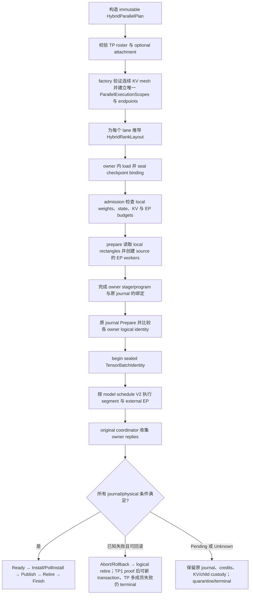

# Hybrid PP × TP 与外置 EP 组合边界

> 本页是当前源码结构的职责与验证地图，不是新的实现计划，也不把 CPU-reference
> 组合写成 production GPU 能力。文中“已接通”表示源码/测试入口存在；除非表格明确给出
> 已执行报告，否则不表示本次或当前工作树测试已经通过。

相关总览：[PARALLELISM.md](PARALLELISM.md)、[当前验收](CURRENT_ACCEPTANCE.md)、
[Qwen3.5 状态](QWEN35.md)、[dense process 边界](QWEN35_DENSE_PROCESS.md)、
[CUDA TP-rank provider 与 typed capability](../crates/ferrule-runtime/tests/support/hybrid_cuda_tensor.md#typed-capability-and-production-validation)、
[当前 composition 职责、catalog/profile 流程与 transport 支持表](../crates/ferrule-composition/src/model_factory/parallel/README.md)。

## 1. 一句话模型

`HybridParallelPlan` 是 immutable、payload-free 的 model-owned 组合描述：

- TP roster 是有序的 `tensor_members`；`rank_layout(lane)` 给出该 lane 的真实局部
  attention/GQA/GDN 几何、局部状态/KV schema、parameter partition 与 weight budget。
- routed EP 不是 mesh 维度，而是可选的 `HybridExpertAttachment`：明确
  `source_rank`、ordered expert members 与 placement。dense-only stage 可以使用 `None`；
  routed layer 必须提供完整 attachment，不再使用 empty placement sentinel。
- EP 可以是稀疏/外置 owner，但 parent 的 PP×TP KV mesh 必须先是 authenticated、
  连续且与 plan 完全相同的 roster；EP owner 不加入 KV participants。EP 的 sparse
  不能用来掩盖不连续或不匹配的 KV mesh。
- model 产生 `HYBRID_AGREEMENT_VERSION = 2` 的 immutable collective schedule。
  runtime 只翻译其 wire metadata，不重建 decoder loop、agreement packet 长度或
  synthetic dense operator。

本页展开的实际执行入口是 **CPU-reference**：真实 `HybridTensorCpuSegment`、
真实 parent pipeline、真实 state/KV journal 与 external expert executor。它不是
production GPU hybrid PP×EP/TP×EP，也不是 process TP 的新实现。该入口由
`cpu-reference` feature 显式开放，当前允许 F32、TP1/2/4、DP=SP=CP=1。
下文 child 指真实 external expert worker；此 factory 使用持久 thread owners，
不表示这里启动了 process TP。既有 strict dense 0.8B process PP2/TP1 GPU 路径及其历史
smoke 是独立能力，见 [dense process 文档](QWEN35_DENSE_PROCESS.md)。

## 2. 职责表与依赖方向

| 层 | 当前职责 | 明确不拥有/不允许越界 |
| --- | --- | --- |
| `ferrule-model::transformer::hybrid_parallel` | 验证 immutable plan；推导 global layer 到 lane-local geometry；导出 schedule V2；计算 rank-local partition、state/KV schema 与 weight budget | 不持有 runtime coordinator、KV publication、child process 或 GPU execution |
| `HybridRankLayout` / `parameter_partition` | 以实际 checkpoint rectangle 计算局部 shape；为 CPU local matrix、局部状态和预算提供同一几何来源 | 不把 global dense weight 当成每个 TP owner 的输入；不把 read limit 当成全进程 resident limit |
| `StateDictMaterializer::for_hybrid` / prepared local storage | 在 prepare 阶段读取已绑定的局部矩阵，解码为 `PreparedCpuLocalMatrix` F32 values；parameter/linear 通过 `Arc` 共享该 local allocation | 不在 execute 阶段切 weight、解码 checkpoint 或依靠 lazy weight I/O；不为局部 shard 旁边再保留完整 projection |
| `HybridCollectiveSchedule` | 以 model-owned recipe 固定 ordinal、global layer、semantic、kind、shape 与版本；TP1 的 logical sites 仍存在，但 `wire_sites()` 为空 | 不由 runtime 猜 site count、shape 或 agreement 编码；不把 TP1 空 wire 误认为没有协议边界 |
| `parallel::pipeline::hybrid_tensor` façade | 公开 CPU-reference factory、翻译 schedule、构造 endpoints/owners，将 EP attachment 注册到唯一 `ParallelExecutionScopes` | parent 不另存第二份 hybrid topology authority；不重写 forward/coordinator |
| `hybrid_tensor/admission.rs` | seal checkpoint binding；检查源快照；按实际 retained storage 做 owner/EP admission，提前拒绝 CPU numeric FP8 EP | 不让相同 model spec 代替 checkpoint 同源证明；不把 EP ticket/stats 充当 KV commit/cleanup 证据 |
| `HybridCpuTensorPipelineStageProgram` | 在现有 `PipelineStageWorker` 内调用 model segment，绑定 source owner 的 external expert，等待 expert dispatch quiescence，并把 execution 交给既有 journal | 不自建 Prepare/Execute/Ready/Install/Publish/Retire/Finish driver；不自建 dense fake journal |
| `PipelineParallelExecutor::new_hybrid_cpu_tensor` | actual factory：按 PP stage 构建 plan/layout、collective endpoint、owner stage、external EP scope 与 parent coordinator；PP2×TP2×EP2 使用同一入口 | 不启动 production GPU hybrid factory；不接受 process TP；不把 EP world size 乘入 KV mesh |
| `PipelineParallelExecutor` / original coordinator + journal | 唯一负责 transaction、KV owner cohort、Ready/Install/PollInstall、Publish、Abort/Rollback、Retire、Finish、Unknown custody | 不由 model/local test 证明 global publication；不因 child exit、stats、重复 shutdown 或 release 推断 physical cleanup |
| `TensorBatchIdentity` + sealed tensor scope | 将 `KvCommitBinding`、完整 logical execution identity、packed sequence cardinality 作为 sealed cohort identity；schedule registration 比较完整 metadata，begin/exchange preflight 使用同一 identity | 不用弱 commit projection、owner-local index、物理 KV slot 或 S=1 假设替代 identity |
| `ExpertSourceScope::ExternalTensorSource` | 将 external EP members 注册到父 scope；source 必须是该 replica/stage 的 authenticated TP lane | 不混用旧 `ExternalStage` 语义；process decoder 不因此自动获得 tensor-source scope |

依赖方向保持单向：

```text
model plan/layout/schedule
          │  immutable metadata
          ▼
runtime façade / actual factory
          ├─ admission: checkpoint seal + retained storage
          ├─ one ParallelExecutionScopes
          ├─ one parent coordinator + logical KvPageManager
          └─ original PipelineStageWorker journal per owner
                      │
                      ▼
          runtime program → model segment → external EP child owners
```

Model 依赖 common/model contracts；runtime 依赖 model 并注入 transport、resource
limits 与 ownership。Model 不依赖 runtime coordinator，runtime 也不能把 model schedule
改写成自己的 decoder loop。

## 3. Prepare、执行与提交顺序



更具体地说：

1. model 先验证 roster、lane、scope、attention 形状、EP placement 与每个 routed
   expert 的 owner 完整性；此时没有 payload 读取。
2. `rank_layout` 同时成为局部矩阵、局部 recurrent/KV state 和预算的几何来源。
   `weight_budget` 只表达 model owner 的 resident/parameter 账，不声称整个 process 的
   RSS、allocator、activation、collective buffer、workspace、metadata 或 child overhead
   已全部计入。
3. admission 先比较有序 parameter specs、role、canonical id、source mapping、slice /
   transform、weight/scale snapshot 与 freshness，再允许 model preparation 或 EP startup。
   失败必须在 spawn/dispatch 前拒绝或清理已启动 sibling。
4. runtime 将 `plan.collective_schedule(segment).wire_sites()` 原样翻译为 protocol
   sites；`TensorCollectiveOperator::Protocol` 对版本、semantic、kind、shape、ordinal、
   global layer 做 sealed equality。TP1 没有 wire call，但仍有 logical schedule 与
   journal lifetime。
5. 每个 owner 保留自己的原有 `PipelineStageWorker` physical/state journal；parent 仍只有
   一个 `DistributedTransaction` coordinator 与 logical `KvPageManager`。只有 attachment
   的 `source_rank` 创建 external expert executor；其它 TP lane 不重复创建 EP。
6. 进入 execution 前 seal `TensorBatchIdentity`。identity 的 sequence cardinality 来自
   packed batch；不能用 owner-local index 或弱 projection 缩短它。
7. parent 只在全体 KV owners 完成正式协议后推进 install/publish。EP worker ticket、
   expert stats、child shutdown ACK 与 endpoint drop 都不是 commit 或 physical release
   receipt。

局部数值顺序也属于 model 合同：attention output 与 dense/shared down partials 先
ReduceSum，再进入 residual；shared scalar gate 在 reduction 后应用。只有 explicit source
调用 routed EP，其它 TP lane 贡献零，再用 Sum 分发 weighted output。output head 使用
ragged gather/unpack。runtime 不通过编造 dense projection 来表达这些 semantic sites。

## 4. 失败、重试与 child custody

### 4.1 TP1 与 TP>1 是两种终态策略

- **TP1：**已知的 in-compute cancel/EP error 可以在原 journal 完成 rollback、logical
  retirement、credits 清理并证明 execution 已 quiescent 后重试。重试必须使用新的
  transaction/identity；不能 replay 原 work。没有 rollback proof 时，step admission
  仍保留。
- **TP>1：**任一 collective/peer/transport lifetime 失败会唤醒 peers，并使该 image /
  endpoint lifetime terminal/poisoned。Rollback 是 custody cleanup，不是 resurrect；不能
  把同一多-owner execution 重放成成功，也不能自动降级为 TP1。
- **两者共同：**已知失败、Pending、Unknown 不能写成成功；完成但被丢弃的 step 也必须
  checkout 新 transaction。`TensorBatchIdentity`、schedule 和 execution watermark 不
  因 shutdown/release 重置。

### 4.2 child Unknown 的托管

child completion 无法证明 physical quiescence（包括相关 loss、Unknown panic 或
超时路径）时，parent 保留 typed Unknown/quarantine：原 transaction、owner cohort、credits、new pages、frontier 与
必要的 child custody 都继续由原 journal/transport authority 持有。OS reap、child exit、
空 outstanding counter、重复 shutdown 或“看起来已经 drain”都不是 physical retirement
receipt。Unknown 不能 publish、retire、释放 custody 或被 replacement child 重放覆盖。

### 4.3 父 S=1 与可复用协议的 S/R 维度

**当前 parent/owner program 只接单条 packed sequence（S=1）**，不是多 sequence serving。
这里 S 表示 sequence 数，R 表示 token rows；不要把 S=1 与“单一 coordinator”混为一谈。
协议 shape 使用 checked `fixed + per_sequence * S + per_row * R`，其中 S/R 必须取自
sealed `TensorBatchIdentity`。可复用 decorator/collective 的 S=2 测试证明该公式和
preflight/exchange 一致，不等于 parent 已开放 S>1。即使 S=1 时元素总数相同，不同
shape coefficients 也不能通过 sealed metadata equality。

V2 agreement 去掉 owner-local execution generation，并显式携带版本；model 的 packet
内容比较补充 runtime 的 identity/schedule admission，不替代 authenticated cohort。
TP1 的空 wire schedule 也必须通过 owner identity validation，不能绕过 journal。

### 4.4 预算账本的明确范围

- `max_owner_resident_bytes` 对照实际 local weights（含 norm copies）、
  `state_bytes * (session_capacity + 1)` 与 physical KV slots；额外的一份状态用于 working
  checkout。复制 GQA heads 的每个 lane 都有自己的 physical KV pool，不能把 replicas
  错算为 global logical pages，也不能共享可并发写入的 physical page。
- external Native F32/BF16 expert linear 同时保留原 parameter bytes 与 Native 深拷贝，
  按 `2 * slice.bytes` 计费；不是统一按 F32 扩展，也不能只收一份原文件大小。
- TP-local dense/shared matrix 的 parameter/linear 共用 `Arc`，不能照搬 external Native
  的双存储收费；shared expert 算入 TP owner，不算 routed EP owner。
- CPU numeric FP8 EP 在 materialization/startup 前拒绝，不偷偷解码或 fallback。
- checkpoint mappings、temporary scalar workspace、RoPE、metadata/allocator、collective
  buffers 等不由这一 owner ledger 全部覆盖；这里只说明已计费项，**不声称全进程峰值
  内存或 aggregate admission 已闭合**。

## 5. 测试分层：local math 与 runtime global protocol

旧的 model-side manual publish/Ready/Install/Publish/Retire/Finish test driver、
`RankProgram`/worker boot，以及 fake dense journal binding 不再是组合证明入口；历史删除
说明保留在 [hybrid PP/EP contract](../crates/ferrule-model/tests/support/hybrid_pp_ep.md)
与 [model TP/EP contract](../crates/ferrule-model/tests/support/hybrid_tp_ep.md)。这不是删除
底层数学测试，而是把 global authority 移回 runtime 的 actual factory。

Model tests 中 `commit_local` 只为下一步数值比较建立本地状态，`rollback_local` 只处理
测试自己持有的 work；它们不拥有 participant roster、commit binding 或 global decision。
runtime probes 可以观察真实 programs/backends 和注入 child compute 故障，但不替换
factory construction、model loop、worker journal 或 parent forward。

以下命令从仓库根目录运行。`tests/unit/` 是通过 `#[path]` 挂载的 library unit tests，
不是名为 `unit` 的 integration-test target：

```sh
# model metadata/layout 与局部数值、准备期读取
cargo test --locked -p ferrule-model --features cpu-reference --test hybrid_parallel --test hybrid_pp_ep --test hybrid_tp_ep
# 独立的 unsplit Transformers fixture 数值参照
cargo test --locked -p ferrule-model --features cpu-reference --test hybrid_cpu
# actual factory 与原 coordinator/journal 全局协议
cargo test --locked -p ferrule-runtime --features cpu-reference --lib parallel::pipeline::hybrid_tensor::tests
# 底层 sealed identity / per-sequence shape / state-program protocol
cargo test --locked -p ferrule-runtime --features cpu-reference --lib parallel::pipeline::tensor_scope
# 默认 feature 下 CPU-reference execution API 关闭；metadata API 仍可用
cargo test --locked -p ferrule-model --doc
cargo test --locked -p ferrule-runtime --doc
```

表内为可用作 Cargo filter 的测试函数名，不伪造 module-qualified `--exact` 名称。
model source root 缩写 `M = crates/ferrule-model/tests`，runtime root 缩写
`R = crates/ferrule-runtime/tests/unit/parallel`。

| 层 / 定位 | 测试函数名 | 明确作用 |
| --- | --- | --- |
| Model oracle；`M/hybrid_cpu.rs` | `hybrid_full_prefill_matches_transformers_f32_logits_and_states` | unsplit Transformers fixture logits/state；不证明 global publish |
| Model partition；`M/hybrid_parallel/rank_image.rs` | `preparation_reads_exact_local_rectangles_and_binding_rejects_foreign_scope`；`dense_tp4_has_no_expert_attachment_or_dispatch` | actual local rectangles、foreign scope 拒绝、optional attachment；数值与每步读取断言由 local tests 负责 |
| Model pre-write；`M/hybrid_pp_ep.rs`、`M/hybrid_tp_ep.rs` | `transaction_and_sequence_mismatch_reject_before_mutation_or_dispatch`；`mismatched_tokens_reject_before_local_state_kv_or_expert_writes` | 本地 transaction/sequence 与输入不一致先拒绝；不作 cross-owner commit 结论 |
| Runtime schedule；`R/hybrid_tensor/schedule.rs` | `runtime_translates_only_model_wire_metadata_for_tp1_tp2_tp4_and_both_boundaries`；`sealed_protocol_compares_version_kind_semantic_shape_ordinal_and_global_layer` | V2 wire translation 与完整 sealed metadata equality，不复制 model packet recipe |
| Runtime admission；`R/hybrid_tensor/admission.rs` | `native_f32_and_bf16_charge_both_actual_storages_before_expert_startup`；`checkpoint_seal_compares_parameter_mapping_not_just_current_source_set`；`cpu_numeric_fp8_is_rejected_by_factory_before_any_expert_materialization` | Native 双存储、cross-owner binding seal、CPU numeric FP8 先拒绝 |
| Runtime global numerics；`R/hybrid_tensor/numerics.rs` | `actual_pp2_tp2_ep2_matches_unsplit_owner_logits_local_state_and_kv` | PP2×TP2×EP2 的 4 个 KV owners + 4 个 external EP owners、nonzero source、prefill/decode logits/state/KV 与 publish count；不是 GPU acceptance |
| Runtime protocol；`R/hybrid_tensor/protocol.rs` | `all_kv_owners_ready_before_install_and_ep_owners_never_vote`；`singleton_empty_wire_schedule_still_requires_sealed_owner_validation` | 唯一 KV voting cohort，TP1 空 wire 仍校验 owner identity |
| Runtime identity；`R/tensor_scope/sealed.rs`、`per_sequence.rs` | `sealed_cohort_rejects_strong_logical_identity_and_kv_binding_change`；`sealed_exchange_and_memory_preflight_use_full_identity_sequence_cardinality` | 完整 identity、S=2 preflight/exchange，不能外推 parent S>1 |
| Runtime retry；`R/hybrid_tensor/retry.rs` | `tp1_real_in_compute_cancel_and_ep_error_retry_after_journal_rollback_tp2_stays_poisoned`；`singleton_unknown_or_pending_rollback_never_releases_step_admission` | TP1 proof 后不同 token 的 fresh transaction；TP2 terminal；Pending/Unknown 不清 admission |
| Runtime custody；`R/hybrid_tensor/custody.rs` | `typed_unknown_retains_full_cohort_credits_new_page_and_frontier_across_cleanup_attempts` | 1 retained transaction、4 credits、完整 4-owner cohort、新页与旧 frontier；重复 cleanup 不洗掉证据 |
| Runtime child；`R/hybrid_tensor/child_lifecycle.rs` | `real_child_cancel_failure_and_unknown_propagate_through_parent_custody`；`child_shutdown_unknown_never_becomes_a_parent_shutdown_ack` | 真正 CPU child work 的失败传播，不把 shutdown unknown 当 parent ACK |
| Runtime startup/topology；`R/hybrid_tensor/startup.rs`、`topology.rs` | `partial_expert_startup_failure_cleans_successful_sibling_roots`；`dense_optional_groups_tp1_tp4_and_local_residency_admission`；`optional_attachment_nonzero_source_and_invalid_sparse_kv_scope_fail_closed` | optional EP、startup unwind、nonzero source 与 sparse KV 拒绝 |
| Runtime tracing；`R/hybrid_tensor/tracing.rs` | `real_factory_traces_success_failure_unknown_without_payload_or_error_text` | 真实 factory/transport 的 allowlisted boundary fields，不是手写 trace 替代 forward |

上表是**验证入口与作用的索引**。本页编写期间没有启动或等待任何最终 Cargo/GPU
测试；若另一个工作仍在运行，不能把它的未结束状态写成通过。应在对应 artifact/report
中记录命令、feature、test name、exit status、设备与失败范围后，才能将“入口存在”升级为
“该快照已执行”。

## 6. 当前关闭门禁与不应外推的能力

- production CUDA thread 路径已由共享 `parallel` plan/budget/assembly 组合：
  [TP1 PP2×EP2/4/8](QWEN35_PP_EP.md) 与
  [PP1/2 TP2/4 EP2](../crates/ferrule-runtime/tests/support/hybrid_cuda_tensor.md)
  分别使用 segment / tensor-rank provider leaves，不再各自控制完整 factory 流程。不能从本页
  CPU-reference 测试外推 GPU 验收。TP×EP F32 full-model strict evidence 仅覆盖 TP2 EP2、PP1/2；
  TP4 仅 factory support，W8A16 仍 quality-unaccepted。
- `model_factory::qwen35_composition::Qwen35CompositionAdapter::validate_production_execution(profile)` 使用显式 typed profile，
  不再无条件拒绝；CPU、CUDA process TP、稀疏/错位 KV owners、非 factory EP scope 与
  W8A16 production quality 仍拒绝。通用 model 的稀疏 EP/nonzero-source 支持不扩大此 gate。
- process TP：**关闭**。现有 process decoder 的 TP gate 不因
  `ExternalTensorSource` 改变；process PP/EP 的旧 scope/协议边界仍需单独遵守。
- vision/MTP、DP/SP/CP > 1、MoE TP×EP 的 production serving、跨机与 driver-fault
  recovery：不由本组合文档宣称。
- budget：只报告 owner-local model/state/KV/外置 expert ledger 的明确部分。不能把
  一个 `max_owner_resident_bytes`、checkpoint read bound 或 frame ceiling 解释为全进程
  RSS/峰值或资源预算已闭合。
- `ExternalTensorSource` 是 scope/ownership contract，不是 transport 实现，也不是
  authentication of an arbitrary executor trait object；实际 worker roster 仍由 runtime
  admission 建立并校验。

## 7. 源码与维护入口

- Model immutable metadata：[hybrid_parallel.rs](../crates/ferrule-model/src/transformer/hybrid_parallel.rs)、
  [layout.rs](../crates/ferrule-model/src/transformer/hybrid_parallel/layout.rs)、
  [schedule.rs](../crates/ferrule-model/src/transformer/hybrid_parallel/schedule.rs)。
- Prepare/local execution：[materialize.rs](../crates/ferrule-model/src/transformer/materialize.rs)、
  [tensor_reference.rs](../crates/ferrule-model/src/transformer/hybrid_parallel/tensor_reference.rs)。
- Runtime façade / 私有分工：[hybrid_tensor.rs](../crates/ferrule-runtime/src/parallel/pipeline/hybrid_tensor.rs)、
  [admission.rs](../crates/ferrule-runtime/src/parallel/pipeline/hybrid_tensor/admission.rs)、
  [program.rs](../crates/ferrule-runtime/src/parallel/pipeline/hybrid_tensor/program.rs)。
- Global authority：[pipeline.rs](../crates/ferrule-runtime/src/parallel/pipeline.rs)、
  [tensor_scope.rs](../crates/ferrule-runtime/src/parallel/pipeline/tensor_scope.rs)、
  [common topology](../crates/ferrule-common/src/topology.rs)。
- 细粒度合同：[model local](../crates/ferrule-model/tests/support/hybrid_tp_ep.md)、
  [runtime actual factory](../crates/ferrule-runtime/tests/unit/parallel/hybrid_tensor/CONTRACT.md)、
  [sealed protocol](../crates/ferrule-runtime/tests/unit/parallel/tensor_scope/CONTRACT.md)。

历史报告、旧测试总数、GPU smoke 和未完成的 final rerun 继续按各自快照保留；它们不能
覆盖上述关闭门禁，也不能替代当前 artifact 的明确命令与结果。
