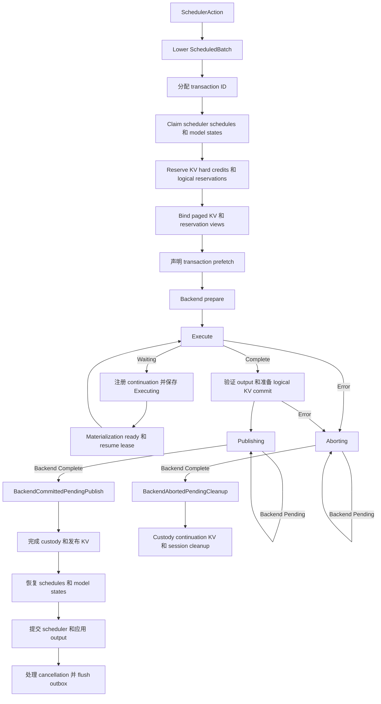
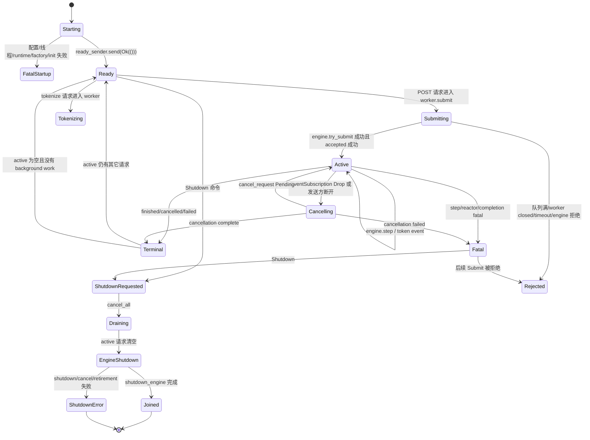

> **历史快照，路径不保证反映当前重构。** 本文保留当时的会话、路径、命令与验收语义，不代表当前源码布局或当前可执行的验证入口。

## User

来我们通篇读一下代码，来看看现在的设计上很多不够好，太冗杂，抽象度太低，或者太复杂的地方，看看设计上如何我们能改进的更干净，更优雅，更软件工程一些。

## Assistant

<thinking>
**Planning parallel agent delegation for repo inspection**

**Defining distinct agent scopes for repo review**
</thinking>

我先让几位子代理并行做“全局体检”，分别从架构分层、复杂度/重复、API 抽象、测试与工程化几个角度扫描仓库；我再把结果合并成一份按优先级排序的重构路线图，避免一上来凭局部代码做判断。

**Tool Call: 架构全景扫描**
Status: Completed

# Ferrule 全局架构审查报告

## 1. 审查范围与结论

| 项目 | 结果 |
|---|---|
| 审查对象 | `/root/Ferrule` 当前工作区，包含已有未提交修改及未跟踪源码，不仅是 `HEAD` |
| 基线 | `HEAD = b1d1109`；工作区存在大量进行中的改动 |
| 方法 | 使用终端 `rg --files`、`rg -n`、`sed`、`nl -ba`、`wc` 和 `cargo tree` 查看、交叉核对 |
| 覆盖范围 | 6 个 workspace crate、CLI/HTTP 入口、模型装配、执行协议、调度与物化、CPU/CUDA 原生边界、并行执行、CI 与架构测试 |
| 验证边界 | 已完成默认及 CUDA feature 的依赖树检查；未编译、运行测试或进行 GPU/负载验证，以避免生成文件 |
| 文件修改 | 本次未修改文件 |

**总体判断：这是一个以 Rust 所有权和显式事务协议为核心的 LLM 推理运行时，不是简单的模型加载器或 HTTP 包装层。** Crate 依赖总体单向，模型与原生算子之间已有语义协议；资源代际、物理完成、取消和回收的设计较完整。

主要风险不是 crate 循环依赖，而是：

1. **HTTP 队列有界，但 resident 引擎接收后的等待队列没有端到端容量上限。**
2. **单一所有者的正确设计，被实现为职责过多的中心对象。**
3. **“provider-neutral” 接口仍暴露具体 CUDA/CUTLASS 实现类型。**
4. **模型语义、存储传输和设备物化混居于 `ferrule-model`。**
5. **新增模型能力、服务策略、测试证据和文档之间存在同步成本与漂移。**

以下风险结论基于静态源码；不把潜在性能影响当成已测得的性能问题。

---

## 2. 技术栈与入口

### 2.1 技术栈

| 层面 | 当前实现 | 证据 |
|---|---|---|
| 主语言与构建 | Rust 2024、Cargo workspace，版本 `0.2.0`；固定 nightly | `Cargo.toml:1–22`；`rust-toolchain.toml:1–3` |
| HTTP 服务 | Axum 0.8、Tokio 1、JSON、SSE | `crates/ferrule-server/Cargo.toml:16–25` |
| CLI | Clap 4、Rustyline、Anyhow | `crates/ferrule-cli/Cargo.toml:12–32` |
| 模型与权重 | HF 配置/Safetensors 元数据与权重读取、GGUF 检查与量化工具、Tokenizers、memmap2、Rayon | `crates/ferrule-model/Cargo.toml:16–33`；`crates/ferrule-model/src/descriptor.rs:64–115` |
| CPU 算子 | Rust reference/dispatch + C++17 native provider | `crates/ferrule-backend/src/cpu/provider.rs:18–42`；`crates/ferrule-backend/build.rs:126–143` |
| GPU 算子 | CUDA Driver API 封装、NVCC、CUTLASS 4.6.1、链接 cuBLASLt | `crates/ferrule-backend/build.rs:64–123`；`crates/ferrule-backend/native/cuda/cutlass/abi_checks.cuh:34–35` |
| 专家流式读取 | Linux `io_uring`、对齐缓冲、CUDA pinned staging | `crates/ferrule-model/src/moe/io_uring_reader.rs:4–26,78–108` |
| 并行与隔离 | DP/TP/PP/EP 相关执行器、线程 owner、Unix 子进程、版本化 JSON IPC | `crates/ferrule-runtime/src/parallel/mod.rs:6–12`；`crates/ferrule-runtime/src/parallel/process.rs:1–17,47–50,120–140` |

**能力边界：**

- 默认 feature 不启用 CUDA，但 CPU 构建仍需要原生 C++ 编译器：`crates/ferrule-backend/build.rs:14–31`。
- 模型目录包含 DeepSeek-V4、Qwen3、Qwen3.5；实际可执行组合由 family、backend、checkpoint/profile 和并行方式共同限制，不能由目录存在推断完整支持。注册表见 `crates/ferrule-runtime/src/engine/model_factory/mod.rs:101–139`。
- 当前主线是推理；训练/RL 属于路线图，不应把相关配置或协议词汇当成完整训练实现：`docs/ROADMAP.md:42–47`。
- 生产并行传输并非 NCCL；外部 Python/NCCL 脚本是对比工具：`docs/PARALLELISM.md:3–7`。

### 2.2 入口

| 入口 | 关键符号与路径 | 职责 |
|---|---|---|
| 命令行 | `main()`，`crates/ferrule-cli/src/main.rs:18–72` | 分发 `info`、`cuda`、`serve`、`chat`、bench、rank worker、weightpack 检查 |
| 服务启动 | `cmd_serve()`，`crates/ferrule-cli/src/commands/serve.rs:22–109` | 构建计划、启动 HTTP runtime、启动模型 owner、安装退出流程 |
| HTTP 路由 | `router()`，`crates/ferrule-server/src/http.rs:49–58` | `/health`、模型列表、chat/completions、completions、tokenize |
| 模型 owner | `spawn_model_worker_with()`，`crates/ferrule-server/src/worker.rs:282–349` | 在专属线程内构建模型和执行引擎 |
| 库接口 | `InferenceEngine`、`SessionInferenceEngine`，`crates/ferrule-runtime/src/engine/mod.rs:23–27` | 面向服务和本地交互的引擎边界 |
| 子进程入口 | `rank_worker::serve()`，`crates/ferrule-cli/src/commands/rank_worker.rs:1–13` | Unix rank endpoint，不负责全局事务决策 |

---

## 3. 目录与模块职责

| 目录 | 实际职责 | 关键实现 |
|---|---|---|
| `crates/ferrule-common` | 共享身份、执行批次/KV 协议、物化协议、拓扑、错误与观测 | `src/lib.rs:3–28`；`src/materialization_io.rs:10–20,162–175` |
| `crates/ferrule-backend` | CPU/CUDA 内存、流、事件、算子、provider 选择与原生 ABI | `src/cuda/mod.rs:7–54`；`src/cuda/providers/catalog.rs:20–70` |
| `crates/ferrule-model` | 模型检测、配置与 recipe、checkpoint 绑定、通用 decoder/transformer、序列状态、专家流式物化 | `src/lib.rs:28–53`；`src/runner.rs:310–406` |
| `crates/ferrule-runtime` | 请求/会话调度、事务推进、KV 页与前缀缓存、全局物化注册表、资源配额、推测执行和并行协调 | `src/lib.rs:13–22`；`src/engine/driver.rs:563–622` |
| `crates/ferrule-server` | OpenAI 请求校验、HTTP/SSE、worker 命令和事件、断连取消 | `src/http.rs:92–170`；`src/worker.rs:352–519` |
| `crates/ferrule-cli` | 用户参数、应用装配、交互/基准、私有子进程入口 | `src/main.rs:18–72`；`src/commands/serve.rs:112–246` |
| `docs` | 架构协议、数值契约、吞吐标准、并行与具体模型验证记录 | `ARCHITECTURE.md`、`COMPUTATION.md`、`PARALLELISM.md`、`QWEN35.md` |
| `scripts` / `configs` | 构建辅助、下载、外部 reference/benchmark；部分 agent/train/rollout 配置不在当前主入口中 | `justfile:39–58,171–187`；`crates/ferrule-cli/src/main.rs:27–72` |
| `.github` / `tests` | CPU CI、Miri、依赖检查、架构约束及大量硬件/模型专项测试 | `.github/workflows/ci.yml:16–20,22–175` |

### 职责划分中值得保留的部分

- `DecoderRecipe` 只做配置到语义描述的转换，不读取 checkpoint 或执行模型：`crates/ferrule-model/src/transformer/recipe.rs:57–62`。
- 模型准备与实际构建分离，`ResidentModelBuildPlan` 可以跨线程，而 `build()` 在消费它的 owner 线程内创建状态：`crates/ferrule-runtime/src/engine/model_factory/mod.rs:369–378,449–459`。
- Native ABI 是同一 checkout 内的内部协议，已有尺寸、对齐和字段偏移断言；不要求跨版本二进制稳定性：`docs/ARCHITECTURE.md:271–274`；`crates/ferrule-backend/native/cuda/cutlass/abi_checks.cuh:34–86`。

---

## 4. 依赖方向

以下箭头表示 **Cargo 直接依赖**；省略各层指向 `common` 的重复边：

```text
ferrule-cli
 ├── ferrule-server
 │    ├── ferrule-runtime
 │    └── ferrule-model
 ├── ferrule-runtime
 │    ├── ferrule-model
 │    └── ferrule-backend  [cuda 可选]
 ├── ferrule-model
 │    └── ferrule-backend
 └── ferrule-backend      [cuda 可选]

ferrule-backend → ferrule-common
其余 crate 也直接依赖 ferrule-common
```

证据：各 crate 的 `Cargo.toml`，尤其：

- `crates/ferrule-cli/Cargo.toml:16–21`
- `crates/ferrule-server/Cargo.toml:16–19`
- `crates/ferrule-runtime/Cargo.toml:16–19`
- `crates/ferrule-model/Cargo.toml:16–18`
- `crates/ferrule-backend/Cargo.toml:21–23`

**判断：**

- workspace 直接依赖没有形成循环；backend 不反向依赖 model/runtime，是良好的基础。
- runtime 依赖 model 中的 runner 协议，model 不依赖 runtime。runtime 将 residency control、resolver 注入 runner，属于接口反转，而非 Cargo 循环：`crates/ferrule-model/src/runner.rs:327–406`；`crates/ferrule-runtime/src/engine/driver.rs:705–745`。
- **单向依赖不等于边界足够窄。** `model` 同时装载抽象协议和硬件/存储适配；`server` 因 chat/template 等类型直接依赖 model；`common` 又包含 HTTP/SSE 专用错误。实际变更传播范围大于图上看起来的层次。

---

## 5. 核心数据流

### 5.1 模型启动与装配

```text
CLI 参数 + 本地模型路径
  → AutoConfig / ModelDescriptor
  → family/backend 能力解析
  → ResidentModelBuildPlan
  → 专属 owner 线程内 build()
  → recipe + schema + name mapper
  → checkpoint 绑定 / 参数与设备资源准备
  → runner + KV 预算 + scheduler
  → InferenceEngine
```

关键证据：

- 轻量描述与格式检测：`crates/ferrule-model/src/descriptor.rs:16–39,64–115`
- registry 与 planner：`crates/ferrule-runtime/src/engine/model_factory/mod.rs:101–139,339–365`
- Qwen3.5 的语义 schema 和权重绑定：`crates/ferrule-model/src/models/qwen35/adapter.rs:45–60`
- 通用引擎组合：`build_resident_engine()`，`crates/ferrule-runtime/src/engine/composition.rs:169–188`
- owner 内调用 factory：`crates/ferrule-server/src/worker.rs:297–327`

### 5.2 HTTP 请求到 token

```text
请求解析 / greedy 参数与模型名校验
  → bounded worker command channel
  → owner 内 tokenize
  → engine.try_submit()
  → scheduler 等待 / prefill / decode
  → runner 执行与事务结束
  → token event channel
  → SSE 或非流式响应
```

- 请求入口与提交：`crates/ferrule-server/src/http.rs:92–125`
- bounded channel 与超时：`crates/ferrule-server/src/worker.rs:98–143`
- tokenize、引擎提交及 ACK：`crates/ferrule-server/src/worker.rs:570–632`
- driver 推进顺序：`crates/ferrule-runtime/src/engine/driver.rs:6414–6504`
- 慢消费者仅取消自身，不阻塞模型 owner：`crates/ferrule-server/src/worker.rs:425–440`

**重要语义：token 回调不等同于请求完成或 KV 保留屏障。** 接口明确允许 target-only 路径先发出已选择 token、稍后 append KV；调用方必须等待 terminal：`crates/ferrule-runtime/src/engine/inference.rs:452–455`。

### 5.3 资源缺失与异步物化

```text
模型 stage 声明精确资源依赖
  → PendingModelProgress / continuation
  → LoadRegistry 精确 key 去重与资源准入
  → provider reserve / read / upload / install
  → CQE 或 CUDA event 完成通知
  → generation / residency 校验与发布
  → 定向唤醒 continuation
  → 继续执行
```

- stage 挂起携带资源与 workspace：`crates/ferrule-model/src/runner.rs:204–223`
- 注册表持有资源 broker、operation、waiter、custody 和 publication 状态：`crates/ferrule-runtime/src/io/registry.rs:485–525`
- 物理 provider 协议：`crates/ferrule-runtime/src/io/provider.rs:134–200`
- registry 推进读写完成、发布、清理：`crates/ferrule-runtime/src/io/registry.rs:1681–1734`

### 5.4 取消、回收与并行

- 客户端断连通过 `EventSubscription::drop()` 设置取消标志，由 owner 调用引擎取消：`crates/ferrule-server/src/worker.rs:219–224,639–657`。
- `TransactionEndProgress::Pending` 保留资源，`Complete` 才表示 backend 不再访问资源：`crates/ferrule-model/src/runner.rs:280–297`。
- PP 中 parent 是逻辑 KV 和分布式事务协调者；rank 持有物理状态，回收需要 ACK：`crates/ferrule-runtime/src/parallel/pipeline.rs:1–16`。
- 分布式准备票与决策后 ACK 分离，发布要求通信已 drain 且参与者全部成功确认：`crates/ferrule-runtime/src/distributed.rs:84–104`。
- 子进程退出不被视为 GPU fence，未知设备状态需要隔离：`crates/ferrule-runtime/src/parallel/process.rs:1–17`。

---

## 6. 架构问题与改进建议——按影响排序

### 1. 高：建立端到端请求准入上限，而不只限制入口 channel

**证据**

- worker 每 tick 消费命令，成功提交后加入 `active`：`crates/ferrule-server/src/worker.rs:389–400,602–618`。
- `ResidentTopKDriver::try_submit()` 仅检查 shutdown，然后入队：`crates/ferrule-runtime/src/engine/driver.rs:2318–2332`。
- `ResidentScheduler::submit()` 无条件 `waiting.push_back()`；`max_active_sequences` 只约束从 waiting 转为执行态：`crates/ferrule-runtime/src/scheduling/resident.rs:244–257,621–632`。

**影响**

bounded command channel 只限制“尚未被 worker 消费”的请求。持续过载可转移为无界 waiting、tokenized prompt、事件通道和 worker 请求记录，违背整体资源有界目标。此结论针对 resident 路径；pipeline 的 `try_submit()` 有额外 session capacity 检查。

**建议**

引入统一 admission ticket，限制已接收请求数、等待 prompt token/字节数；从接收到 terminal/取消全程持有配额。返回现有 `RequestCapacity`，HTTP 已能映射为 429：`crates/ferrule-server/src/http.rs:817–819`。

**验收重点：** 持续超载时 retained 请求、prompt 内存和队列长度均稳定受限，取消后额度准确归还。

---

### 2. 高：把 worker 健康状态接入 readiness

**证据**

- `/health` 始终返回 `{"status":"ok"}`：`crates/ferrule-server/src/http.rs:76–78`。
- worker 发生 fatal execution/reactor 错误后记录 `fatal_error`，并拒绝后续提交：`crates/ferrule-server/src/worker.rs:445–492,553–558`。

**影响**

HTTP 存活但模型已经不能服务时，外部探针仍看到成功。若部署将 `/health` 用于 readiness，会继续导入无效流量。

**建议**

保留 liveness，增加读取 owner 状态快照的 readiness：启动、可接收、排空、失败/隔离。不要让探针直接锁住或执行模型。

**验收重点：** fatal worker、quarantine、shutdown 都使 readiness 返回不可用；临时满载与永久故障可区分。

---

### 3. 高：补齐 CUDA 全链路验证与架构边界覆盖

**证据**

- CI 全局 `FERRULE_NO_CUDA=1`，主要测试和 coverage 为 CPU：`.github/workflows/ci.yml:16–20,44–108`。
- 本地 `check-cuda-arch`、`test-cuda` 主要针对 backend：`justfile:51–55,100–104`。
- 架构测试虽然声称约束所有 family，实际扫描只列出 DeepSeek-V4 与 Qwen3，没有 Qwen3.5，也未覆盖整个 transformer 层：`crates/ferrule-model/tests/architecture_boundaries.rs:60–69,170–180`。

**影响**

model/runtime/server 的 feature-only 路径，以及通过 re-export 绕过的实现依赖，可能不被现有主 CI 捕获。

**建议**

分开建立：

1. CPU 协议与故障注入；
2. CUDA feature 的 workspace 编译；
3. 按设备能力分组的 GPU 数值/生命周期测试；
4. 显式模型 fixture 测试。

架构约束按全部 family 和层级自动发现，而非维护两个目录的白名单。

**验收重点：** 报告明确区分 passed、ignored、缺 fixture 和无匹配测试；不把编译通过等同于硬件验证。

---

### 4. 高：拆分 `ResidentTopKDriver` 的状态职责，保留单一 owner

**证据**

- `driver.rs` 共 15,470 行，其中测试从 8,049 行开始，不能把全部行数当生产逻辑。
- `ResidentTopKDriver` 同时持有 scheduler、session、KV、prefix cache、普通/推测事务、registry、continuation、warmup、取消和回收队列：`crates/ferrule-runtime/src/engine/driver.rs:563–622`。
- `step()` 将这些生命周期直接交织：同文件 `6414–6504`。

**影响**

取消、prefix、speculation 或物化任一变化都可能触及统一驱动的大量不变量；审查和故障定位成本高。

**建议**

在同一 owner 线程内拆为会话准入、事务推进、物化协调、KV/prefix 生命周期、token 发布几个私有组件；让主 driver 负责明确的推进顺序。**不要为拆文件引入多线程或多个发布权威。**

**验收重点：** 状态转移和资源交接有独立测试，普通与推测路径共享 terminalization 核心，而非仅移动方法。

---

### 5. 中高：把 CUDA facade 从“路径重导出”收敛为真正的实现边界

**证据**

- `context.rs` 共 13,173 行；`CudaOperators` 同时承担设备资源和大量算子：`crates/ferrule-backend/src/cuda/context.rs:2565` 起。
- 标记为 provider-neutral 的 `operators/linear.rs` 直接重导出 CUTLASS layout、workspace 和调用函数：`crates/ferrule-backend/src/cuda/operators/linear.rs:13,36–40`。
- 通用 CUDA decoder 直接引入 `providers::DeviceBuffer`：`crates/ferrule-model/src/transformer/standard/cuda.rs:32`。
- `providers` 又公开 runtime 的 context/stream/buffer：`crates/ferrule-backend/src/cuda/providers/mod.rs:11`。

**影响**

调用路径名称虽然中立，类型和函数所有权仍绑定具体实现。更换 provider、scratch layout 或设备资源组织会向 model 层传播。

**建议**

backend 自有公共 buffer/view/layout 契约；CUTLASS provider 类型保持私有。拆开设备 owner、上传/事件、linear、attention、MoE、KV 的接口。设备适配代码可以显式使用 CUDA，但不应依赖 CUTLASS 内部表示。

---

### 6. 中高：从模型语义中隔离存储与设备物化适配

**证据**

- `ferrule-model` 在 Linux 直接依赖 `io-uring`、`libc`、Tokio：`crates/ferrule-model/Cargo.toml:30–33`。
- `io_uring_reader.rs` 同时使用文件描述符、O_DIRECT 相关设施、CUDA pinned allocator 和模型 reactor：`crates/ferrule-model/src/moe/io_uring_reader.rs:4–24`。
- `CudaExpertMaterializationProvider` 位于 model crate，维护物理安装与共享专家子系统：`crates/ferrule-model/src/moe/cuda_materialization.rs:1–48,742`。

**影响**

调整 OS I/O、buffer 注册或 CUDA 安装过程，需要修改承载模型语义的 crate；元数据、recipe 等轻量消费者也携带 backend/native 构建依赖。

**建议**

先划分内部模块边界，再按需求考虑独立 adapter crate：

- model 保留 tensor source/encoding、资源需求及执行协议；
- storage adapter 负责对齐读、注册 slab、CQE；
- backend adapter 负责上传与安装；
- runtime 保留唯一准入、generation 校验和发布权。

**注意：** 不应在迁移时复制 `LoadRegistry` 或建立第二套资源账本。

---

### 7. 中高：统一模型能力解析与前端配置，减少跨层 family 分支

**证据**

- 已有 `MODEL_IMPLEMENTATIONS` 注册表：`crates/ferrule-runtime/src/engine/model_factory/mod.rs:101–139`。
- 但通用 `ModelFactoryOptions` 含 `qwen35_*` 字段，build plan 也暴露 family 专用查询：同文件 `311–327,424–446`。
- CLI `prepare_model()` 自行判断 Qwen3.5、重写缓存/提案/读取限制并选择专用 planner：`crates/ferrule-cli/src/commands/serve.rs:112–175`。
- chat 也包含相应 family 分支：`crates/ferrule-cli/src/commands/chat.rs:35–79`。

**影响**

新模型不是“添加一个注册项”即可接入，而是涉及 descriptor、factory、CLI 和支持矩阵；不同入口容易产生默认值或拒绝规则差异。

**建议**

由 model implementation 输出统一的能力描述与已验证 build plan，集中决定 backend、precision、并行模式、缓存能力和默认预算。CLI 只传用户意图、展示结构化拒绝原因。

**验收重点：** 相同输入在 chat、serve、bench 得到一致的模型能力解析结果。

---

### 8. 中：区分并行控制协议与高吞吐数据通路

**证据**

- PP API 是同步 forward，rank 间只传 host command/activation：`crates/ferrule-runtime/src/parallel/pipeline.rs:1–16`。
- pipeline serving 强制 serial、非 mixed batch、无 prefix cache：`crates/ferrule-runtime/src/engine/pipeline.rs:78–98`。
- `step_inner()` 同步调用 `pipeline.forward()`：同文件 `286–328`。
- 进程数据使用 JSON `Value`，payload 经序列化再解析：`crates/ferrule-runtime/src/parallel/process/ipc.rs:24–42,100–107`。

**影响**

目前更适合作为正确性与隔离基线。同步 owner step、host staging 和 JSON activation 传输可能限制吞吐及取消响应；本次未测量其占比。

**建议**

先量化 host copy、序列化、rank wait 和 kernel 时间；在不改变事务身份与 fence 规则的前提下，将 forward 演进为可恢复的提交/完成协议，再按实际瓶颈引入二进制数据帧、合适的设备传输和 microbatch 流水。

---

### 9. 中：收窄 `ferrule-common`，将域错误和日志初始化归还所属层

**证据**

- common 统一承载 serving、worker、SSE 和 state-dict 错误：`crates/ferrule-common/src/error.rs:147–339,341–459`。
- 底层 common 直接依赖 `tracing-subscriber`：`crates/ferrule-common/Cargo.toml:12–17`。
- `init_tracing()` 读取环境变量并安装全局 subscriber：`crates/ferrule-common/src/observability.rs:18–45`。

**影响**

基础协议层知道 OpenAI SSE 等上层概念；上层功能变化会修改最底层公共 crate，并扩大重编译和公共 API 影响面。

**建议**

common 保留跨层身份、窄协议和基础错误边界；server 管 HTTP/worker 错误，model 管绑定错误，应用入口配置 subscriber。保留 typed source chain，不退回纯字符串错误。

---

### 10. 中低：将支持矩阵、设计协议与验证证据分开维护

**证据**

- README 的当前范围仍主要描述 DeepSeek-V4：`README.md:41–42,77–88`，代码注册表已经包含 Qwen3/Qwen3.5。
- roadmap 仍将拓扑与分布式协调列为未完成大项：`docs/ROADMAP.md:34–40`，对应实现和测试已存在。
- 架构文档描述全资源物化，而 roadmap 又注明 dense/static、mutable KV 等生命周期尚未完成：`docs/ARCHITECTURE.md:115–128`；`docs/ROADMAP.md:26–31`。
- 并行文档中的验证证据链接依赖 Git ignored 的本地产物：`docs/PARALLELISM.md:101–110,139–145`。

**影响**

读者难以区分“协议支持表达”“某 profile 接通”“已具备可复现验证”与“生产性能达标”。

**建议**

建立结构化能力矩阵，以 family × backend × precision × parallel mode 标注 unsupported、experimental、validated；验证记录附 commit/工作区标识、checkpoint hash、设备、命令及持久化 artifact。过时配置明确标记为历史或未接线示例。

---

## 7. 建议实施顺序

| 阶段 | 优先事项 | 目标 |
|---|---|---|
| 第一阶段：服务安全 | 建议 1、2、3 | 封住请求累积风险，正确暴露模型不可用状态，为重构提供验证保障 |
| 第二阶段：边界收敛 | 建议 4、5、6、7 | 降低 driver、CUDA facade、model I/O 和模型接入的变更耦合 |
| 第三阶段：扩展与维护 | 建议 8、9、10 | 在实测基础上优化并行通路，缩小基础层，统一能力与证据管理 |

**最终结论：应保留“单一逻辑 owner + 显式物理完成 + generation-qualified publication”的核心架构。优先补齐端到端准入与验证，再做同一 owner 内的职责拆分；不建议通过增加共享可变状态或多套资源管理器来化解当前复杂度。**

**Tool Call: 复杂度与重复审查**
Status: Completed

## 审查结论

本次只读检查了当前工作树中的实际源码，使用了 `rg --files`、`rg -n`、`sed` 和带行号的源码输出，**没有修改文件，也没有执行构建或测试**。仓库已有大量未提交改动，以下结论不局限于已提交版本；行号对应检查时的内容。

最值得优先处理的不是单纯“函数太长”，而是：

- **检查/计数抽象包住了已经发生的 CUDA 副作用。**
- **失败回滚分散在多个分支中，清理再次失败时会丢失原始错误或可重试状态。**
- **驱动器通过多组独立容器共同表达生命周期，不变量需要调用者手工维护。**

下面列出 **11 项具体发现**。其中：
- **P1**：已有明确的错误路径或副作用顺序问题，应优先修正。
- **P2**：显著影响可维护性和安全演进，应安排局部重构。
- **P3**：低风险、范围较小的整理。

以下错误路径结论来自静态控制流分析，**不是声称已经完成 GPU 或故障注入复现**。

---

## 1. P1 — CUDA 检查包装器接收 `Result`，检查发生在副作用之后

**位置**

- [`crates/ferrule-backend/src/cuda/context.rs:3468`](crates/ferrule-backend/src/cuda/context.rs#L3468)：`uninitialized_device_buffer`
- [`context.rs:3499`](crates/ferrule-backend/src/cuda/context.rs#L3499)：`zeroed_device_buffer`、`record_device_allocation`
- [`context.rs:3532`](crates/ferrule-backend/src/cuda/context.rs#L3532)：`record_stream_wide_sync`
- [`context.rs:3320`](crates/ferrule-backend/src/cuda/context.rs#L3320)：`sync_stream`、`sync_upload_stream`
- [`crates/ferrule-backend/src/cuda/runtime.rs:807`](crates/ferrule-backend/src/cuda/runtime.rs#L807)：`DeviceBuffer::from_host`

**问题机制**

目前调用形式是：

```rust
self.record_device_allocation(
    len,
    DeviceBuffer::<T>::zeroed(&self.stream, len),
)
```

Rust 会先计算实参，因此分配已经执行，才进入 `record_device_allocation` 检查 `capture_safe` 和 allocation failpoint。同步也一样：

```rust
self.record_stream_wide_sync(self.stream.synchronize())
```

`from_host` 内部还包含分配、复制和同步。结果是：

- capture-safe 断言模式可能在操作发生后才报告禁止操作；
- allocation failpoint 并没有真正阻止分配；
- 前置检查直接返回时，计数器可能没有记录已经发生的操作。

底层 allocator 另有真实 graph-capture 检查，但这不能纠正上层断言模式和 failpoint 的求值顺序。

**重构方案**

让包装器接收延迟操作，例如 `FnOnce() -> Result<T, E>`，顺序固定为：

1. 校验；
2. 故障注入；
3. 记录 attempt；
4. 执行闭包；
5. 记录结果。

同文件的 `uninitialized_upload_device_buffer:3474` 已经采用“先检查再执行”的正确顺序，可以统一到这一模式。

**风险与验证**

重构风险较低，但必须检查全部调用点，避免闭包外仍提前求值。补充测试：禁止模式或 failpoint 命中时，底层操作调用次数为零，而不只是上层返回 `Err`。

---

## 2. P1 — 加载准入重复实现回滚，清理失败会提前退出并丢失所有权记录

**位置**

- [`crates/ferrule-runtime/src/io/registry.rs:923`](crates/ferrule-runtime/src/io/registry.rs#L923)：`LoadRegistry::prefetch`
- [`registry.rs:1102`](crates/ferrule-runtime/src/io/registry.rs#L1102)：`attach_waiter`
- [`registry.rs:1308`](crates/ferrule-runtime/src/io/registry.rs#L1308)：promotion 失败回滚
- [`registry.rs:2442`](crates/ferrule-runtime/src/io/registry.rs#L2442)：`rollback_reserved_operation`

**问题机制**

`prefetch` 和 `attach_waiter` 重复了请求排序、去重、resident/join/new 分类、adopt/create、逆序回滚等流程。

风险不只在重复：`attach_waiter` 的失败分支依次执行：

```text
release promoted leases?
release waiter grant?
release continuation?
rollback created operations?
rollback adopted residencies?
return original error
```

任一清理步骤的 `?` 都会提前返回，后续清理不执行，原始 promotion 错误也被替换。

更具体地，`rollback_reserved_operation` 在 **2447 行先从 `operations` 移除对象**，然后调用可能失败的 `provider.cancel` / `discard_preparation`。这些调用失败时没有重新插入对象，`retire_owned` 也不会运行，因而可能留下仍指向该 operation 的索引，却丢失对应 operation 状态。

同文件 `handle_unowned_operation:3240` 已有失败时重新插入对象的处理，两条清理路径的所有权纪律不一致。

**重构方案**

- 提取不产生副作用的 `AdmissionPlan`，共用分类和资源预检。
- 用显式 `AdmissionAttempt` 保存 `created/adopted/promoted/grants`。
- 回滚返回“原始失败 + 清理失败 + 未完成清理项”；未完成项进入 registry 的重试状态。
- 不要用一个普通 `Drop` 隐式完成可能失败的物理回滚。

**风险与验证**

中高风险：必须保留 prefetch 与 execution 的 lease 差异。

已有 [`io_physical.rs:1244`](crates/ferrule-runtime/tests/io_physical.rs#L1244) 验证 promotion 失败后的正常清理。应扩展为“双故障”：promotion 失败，再让 release/discard 失败，检查原始错误、索引一致性和后续可重试性。

---

## 3. P1 — `restore_session` 把物理回滚失败隐藏为普通恢复失败

**位置**

[`crates/ferrule-runtime/src/engine/driver.rs:2089`](crates/ferrule-runtime/src/engine/driver.rs#L2089)：`ResidentTopKDriver::restore_session`，尤其 **2111–2135 行**。

**问题机制**

恢复依次涉及：

1. backend 恢复物理页；
2. page manager 恢复逻辑序列；
3. scheduler 恢复调度状态。

后两步失败时，代码用 `let _ = self.executor.preempt_kv_pages(...)` 忽略物理补偿错误，然后把 session 放回 `suspended_sequences`。

如果补偿失败，记录只表达“已挂起”，不能表达“逻辑上挂起、物理页仍驻留或补偿未完成”。此外，scheduler 恢复失败分支中的 `preempt_sequence(...)?` 会在重新登记 `suspended` 之前提前返回。

**重构方案**

将恢复建模为小型显式事务，至少保存：

- 原始 suspended 状态；
- 已完成的恢复阶段；
- 待执行的补偿阶段。

清理失败应进入 `RestoreRollbackPending`，而不是重新标为普通 suspended。错误聚合可沿用现有 `Error::with_cleanup` / `with_cleanup_batch`。

**风险与验证**

中等风险。不要通过“重试整个 restore”掩盖部分成功，否则可能重复恢复。补充 scheduler 恢复失败、backend 重新 preempt 失败的组合测试；现有成功往返测试不能覆盖这些分支。

---

## 4. P1 — CUDA materialization 的长状态机掩盖了两种不一致的终结错误处理

**位置**

- [`crates/ferrule-model/src/moe/cuda_materialization.rs:1862`](crates/ferrule-model/src/moe/cuda_materialization.rs#L1862)：`progress_operation`，约 **365 行**
- [`cuda_materialization.rs:1807`](crates/ferrule-model/src/moe/cuda_materialization.rs#L1807)：`finish_terminal_operation`
- [`cuda_materialization.rs:2881`](crates/ferrule-model/src/moe/cuda_materialization.rs#L2881)：`submit_read`
- [`cuda_materialization.rs:2933`](crates/ferrule-model/src/moe/cuda_materialization.rs#L2933)：`submit_upload`

**问题机制**

`progress_operation` 同时处理 read、upload、install、source stale、debug dump、终结事件和资源回收。upload 分支出现：

```text
match state
  → match completion
    → match drain_into_frame
      → if debug directory
        → if dump error
```

终结函数有两套行为：

- 传入 `Some(completion)`：清理失败直接覆盖原 `outcome`，原始失败信息丢失。
- 传入 `None`：清理错误只通过返回值传播，但 `submit_read:2898/2917`、`submit_upload:2950/2977` 等调用点用 `let _ =` 丢弃返回值。

所以不能笼统说所有 `let _` 都丢错误——部分路径通过 completion 传递了错误；**真正的问题是同一个 API 混用了事件上报和返回值上报，调用者很容易漏掉其中一种。**

**重构方案**

- 按阶段拆成 `poll_read`、`poll_upload`、`poll_install`，返回具体 transition 结果。
- 统一在一个位置提交状态、重新排队或终结。
- 将“原始 outcome + cleanup failures”作为明确数据保存。
- 分开“同步拒绝并返回错误”和“异步终结并发事件”，避免 `Option<completion> + bool reader_consumed` 的组合协议。

**风险与验证**

高风险区域，宜逐阶段迁移。必须保持 DMA 源存活、未知完成状态下的 quarantine，以及 completion 恰好一次；不能为了缩短代码删除这些保证。

---

## 5. P2 — `ResidentTopKDriver` 是实际的多生命周期聚合对象，不只是大文件

**位置**

- [`crates/ferrule-runtime/src/engine/driver.rs:563`](crates/ferrule-runtime/src/engine/driver.rs#L563)：`ResidentTopKDriver`
- [`driver.rs:4364`](crates/ferrule-runtime/src/engine/driver.rs#L4364)：`execute_planned_action`
- [`driver.rs:6241`](crates/ferrule-runtime/src/engine/driver.rs#L6241)：`shutdown`
- [`driver.rs:6809`](crates/ferrule-runtime/src/engine/driver.rs#L6809)：`begin_speculative_verification_cohort`

**问题机制**

文件约 1.55 万行，但测试从 **8049 行**开始；即使排除测试，仍有约 8000 行生产代码。

对象同时拥有：

- session 状态、page slot、retained/suspended 状态；
- resident/speculative 事务；
- continuation 正反向索引和 ready queue/set；
- prefix cache 与清理队列；
- materialization；
- token outbox 和提前发送 bookkeeping；
- shutdown 状态。

这些容器共同表达一个事务/session 的状态，必须由多个函数同步修改。`shutdown` 最后长串容器为空的检查，正体现了全局不变量的维护成本。`execute_planned_action` 还重复组织 KV、materialization、session restore 的失败清理。

**重构方案**

优先按**所有权不变量**组合，而不是仅把 `impl` 搬到多个文件：

1. `ContinuationRegistry`：封装注册、ready、反向索引和 detach。
2. `SessionOwnership`：封装 sequence state、page slot、suspend/restore。
3. `PrefixLifecycle`：封装 snapshot 和待清理对象。
4. `TransactionAdmission`：统一执行前准入和失败回滚。

驱动器保留调度顺序与协调职责。resident 和 speculative 的差异应保留，不建议抽成一个通用“万能状态机框架”。

**风险与验证**

整体重写风险高；先提取 continuation 索引通常更可控。每次提取都应保持原有取消、前缀回收和提交后清理测试不变。

---

## 6. P2 — `context.rs` 混合执行上下文、内存协议和算子族，已经出现实现纪律分叉

**位置**

[`crates/ferrule-backend/src/cuda/context.rs`](crates/ferrule-backend/src/cuda/context.rs)：

- `CudaOperators:2565`
- `CudaExpertSlotTableHost:1999`
- `submit_expert_slot_install:2771`
- `create_compressor_recurrent_state:7827`
- `expert_group_route_plan:9218`
- `rms_norm:10228`

**问题机制**

文件约 1.3 万行，包含上下文和 stream、buffer、pinned upload ticket、expert slot publication、量化、recurrent、routing、MoE、norm、HC 等不同职责。

第 1 项中 compute/upload 两种分配路径的检查顺序不同，就是这里公共执行纪律被多套实现分别维护的实例。仅靠“共享一个 `CudaOperators`”并没有真正共享操作前置条件。

**重构方案**

保持现有公共 API 和 re-export，内部按职责移动到：

- context/streams；
- buffer/transfer；
- expert slot publication；
- artifact linear；
- recurrent；
- route/MoE。

跨算子统一使用小型执行入口处理 owner check、capture 限制、failpoint 和计数，不引入动态算子注册框架。

**风险与验证**

中等风险：FFI、buffer 所有权和 event 顺序必须保持不变。机械搬迁与行为修复应分开，否则难以评审 CUDA 生命周期变化。

---

## 7. P2 — `PackedDecoderBatch::lower` 同时做三层验证，且局部成员判断可能退化为平方复杂度

**位置**

[`crates/ferrule-model/src/decoder/batch.rs:171`](crates/ferrule-model/src/decoder/batch.rs#L171)：`PackedDecoderBatch::lower`，到 **528 行**，共约 **358 行**。

**问题机制**

同一函数混合：

1. packed batch 范围与行映射；
2. 单序列 generation、reservation、COW 校验；
3. 跨序列页读写所有权校验。

函数手工维护 `new_page_set`、`cow_replacement_set`、`mutation_owners`、`table_readers`、`writable_owners`、`protected_pages` 等多套集合。

另一个具体热点在 **408–415 行**：遍历 block table 时，对每个 page 调用 `reservation.newly_allocated.contains(&page)`。若一次 prefill 新增大量页，成员判断成本为 `O(block_pages × new_pages)`。

**重构方案**

- `lower_sequence` 返回已验证的单序列计划；
- 小型 `PageCustodyAccumulator` 统一登记 read/create/write，并在最后验证跨序列冲突；
- 利用前面已验证的“新页等于 block-table suffix”关系判断本地新页，或使用局部集合，避免重复线性搜索。

**风险与验证**

中等风险。必须保留整个 batch 的最后一轮冲突检查，不能只做逐序列校验。建议增加序列顺序交换、共享页、COW 和大量新增页的测试。

---

## 8. P2 — KV commit 抽象依赖完整 backend，迫使 remote owner 实现大量不可用方法

**位置**

- [`crates/ferrule-model/src/decoder/traits.rs:135`](crates/ferrule-model/src/decoder/traits.rs#L135)：`DecoderKvCommitBackend: DecoderKvBackend`
- [`crates/ferrule-runtime/src/parallel/pipeline.rs:690`](crates/ferrule-runtime/src/parallel/pipeline.rs#L690)：`impl DecoderKvBackend for RemotePhysicalOwner`
- [`crates/ferrule-model/src/decoder/kv.rs:257`](crates/ferrule-model/src/decoder/kv.rs#L257)：prepared commit 的 `page_status`、`capacity`

**问题机制**

`RemotePhysicalOwner` 真正需要的是远端 commit/abort/retirement 协议，却必须实现完整 KV backend：

- configure/prepare/enter/view/leave/commit/rollback/release/preempt/restore 大多直接返回不支持；
- `capacity` 和 `page_status` 直接 `panic!`。

这不是普通占位实现，而是接口能力范围过大的证据。通用 prepared commit 又暴露了这些查询，类型系统没有阻止对 remote owner 调用不支持能力。

**重构方案**

让 commit 协议成为独立窄 trait，只包含 transaction、source 和提交/清理所需能力。容量与页状态查询作为独立能力，通过方法级 bound 提供；本地 backend 组合实现这些 trait，remote owner 只实现它支持的部分。

**风险与验证**

中高风险，涉及公共 trait 和泛型 bound。保留现有 CPU/CUDA/remote 提交一致性测试；不要用返回默认容量代替 panic，那会隐藏能力缺失。

---

## 9. P2 — CUDA graph 生命周期靠手工配对，缓存状态还重复编码句柄存在性

**位置**

- [`crates/ferrule-backend/src/cuda/graph.rs:44`](crates/ferrule-backend/src/cuda/graph.rs#L44)：`capture_decode_graph`
- [`graph.rs:62`](crates/ferrule-backend/src/cuda/graph.rs#L62)：`CacheState`、`CachedDecodeGraph`
- [`crates/ferrule-backend/src/cuda/context.rs:3406`](crates/ferrule-backend/src/cuda/context.rs#L3406)：capture-safe 开关

**问题机制**

- `begin_capture` 后，普通 `Err` 路径会调用 `end_capture`，但结果被忽略。
- capture 闭包 panic 时，本函数没有作用域 guard 保证结束 capture。
- `CacheState::Captured` 与 `graph: Option<_>` 分开保存，允许表达 `Captured + None`，最后靠 `expect` 保证。
- assertion mode 也需要调用者手动 enable/disable。

**重构方案**

- 引入 capture scope：显式 `finish` 返回结果，未完成退出时执行 best-effort 清理；清理不能证明成功时保留失败/隔离状态。
- 将缓存状态改成 `Cold | Warm | Captured(CudaGraphHandle)`。
- assertion mode 使用恢复旧值的作用域 guard，以支持嵌套和提前返回。

**风险与验证**

中等风险。`Drop` 不能把清理失败当作成功，也不能在 unwind 中再次 panic。测试应覆盖 closure 返回错误、panic、正常 capture 和 key 失效。

---

## 10. P2 — worker 的取消和终结动作重复，策略分散在多个入口

**位置**

[`crates/ferrule-server/src/worker.rs`](crates/ferrule-server/src/worker.rs)：

- `run_worker:352`
- `cancel_disconnected:639`
- `drain_terminal:678`
- `fail_all:769`
- `cancel_all:800`

**问题机制**

`cancel_disconnected:652–672` 与 `cancel_all:815–835` 基本重复：调用取消、设置 `cancellation_submitted`、包装错误、记录 failure、移除 active、trace、发送终结事件。

`drain_terminal`、`fail_all`、shutdown 末尾又各自处理终结发送。由此，“何时移除 active”“取消已提交但未完成如何表达”“错误是否进入 shutdown 汇总”“trace 与终结事件是否一致”分散在多个分支。

这里不应简单把 `try_send` 的忽略结果都判为 bug：代码明确允许客户端断开，并预留终结事件槽位。问题是这个策略缺少单一实现位置。

**重构方案**

- 提取 `request_cancellation(id, cause)`，统一取消结果和错误归档。
- 提取 `finish_request(id, outcome)`，统一 active 移除、trace 和终结发送。
- worker loop 只协调 command/completion/step，不让 helper 再隐式驱动整个 engine。

**风险与验证**

中等风险。保留非阻塞事件发送、慢客户端只取消自身请求、终结最多一次等语义。重点回归断连、队列满、pending cancellation 和 shutdown cancellation。

---

## 11. P3 — expert scratch 预算公式重复，适合先做小型纯函数重构

**位置**

[`crates/ferrule-model/src/transformer/standard/cuda/residency.rs`](crates/ferrule-model/src/transformer/standard/cuda/residency.rs)：

- `expert_plan:68–76`
- `metadata_plan:110–116`
- `expert_operation:278–298`

**问题机制**

三处重复计算：

```text
(3 × intermediate + input + output) × rows × sizeof(f32)
```

第三处再加入 bias 和 route scratch。一个来自 prepared payload，一个来自 metadata，一个用于执行期临时预算。

当 SwiGLU 临时 buffer 布局变化时，需要同步修改这些 checked arithmetic；遗漏会导致准入估算和执行预算不一致。当前这是维护风险，不能仅凭重复就断言现有预算错误。

**重构方案**

提取具体的 `SwiGluScratchPlan` 或纯函数，输入尺寸及可选 bias，返回 operation bytes；route 和 numeric workspace 继续明确分项计费，不要揉进一个难以解释的总数。

**风险与验证**

低风险，适合作为第一批重构。用相同尺寸验证 metadata/prepared 两条路径一致，并覆盖 overflow、bias 和多行输入。

---

## 建议实施顺序

1. **先修第 1、2 项**：副作用检查顺序，以及清理失败时的所有权保留。
2. **再修第 3、4 项**：统一复合失败表达，保留可重试清理状态。
3. **做第 11 项这类小范围纯函数提取**，建立容易审查的重构节奏。
4. **拆第 7、10 项的局部流程**，再进入第 5、6 项的大模块拆分。
5. **第 8 项单独安排接口迁移**，不要与 CUDA 算子搬迁混做。

**不建议的方向**：按固定行数切文件、为了消除 `expect` 返回默认值、把全部生命周期塞进一个泛型状态机，或者把有意保留未知 GPU 完成状态的 quarantine 当成普通内存泄漏清理掉。这个仓库最需要的是让少量具体对象拥有完整不变量，而不是再增加一层统一框架。

**Tool Call: 公共 API 与抽象设计**
Status: Completed

有一个执行约束需要先确认：`Ferrule/AGENTS.md` 要求**所有仓库查看、搜索和调查都委派给子代理**，主代理不能直接检查仓库；但当前工具集没有启动或调用子代理的能力。

**你是否允许本次例外，由我直接通过终端执行只读审查？** 我不会修改文件。

获准后，我会先了解项目结构、依赖和公共 API，再深入核心模块，按以下格式输出：
- **具体发现**：文件路径、行号及代码依据。
- **设计影响**：覆盖命名、参数对象、所有权与生命周期、错误类型、配置传递、扩展点、依赖反转、可测试性和抽象层次。
- **改进建议**：区分“可立即改”和“需要长期演进”，注明兼容性影响与优先级。

**Tool Call: 测试与工程化审查**
Status: Completed

# Ferrule 测试与工程化审查报告

## 1. 审查范围与结论摘要

审查对象：`/root/Ferrule` 当前工作区快照。  
审查方式：只读终端检查、静态搜索、构建检查和测试尝试。未修改文件。

当前工作区存在大量未提交修改：

- `git rev-parse --short HEAD`：`b1d1109`
- `git diff --stat`：约 `78` 个已修改/新增文件，`+10543/-806`
- 因此，以下结论针对当前工作区，不一定等同于 `HEAD` 提交内容。

### 总体评价

Ferrule 已经具备比较完整的 Rust 工程基础：

- workspace 划分清晰；
- CPU 单元测试和集成测试数量较多；
- 有 `nextest`、覆盖率、Miri、Clippy、rustfmt、cargo-deny；
- CUDA/native 路径有相当多的契约测试；
- worker、checkpoint、进程 reaper、CUDA 资源归属等地方体现了较强的资源所有权意识。

但目前存在几个会影响生产可靠性的设计缺口：

1. **CUDA 测试没有进入 CI 门禁，且大量测试通过 `return` 静默跳过。**
2. **请求取消和 worker 唤醒之间存在设计耦合，断开连接本身不一定能及时唤醒模型 worker。**
3. **`ModelWorker` 的 `Drop` 只发送 shutdown，不等待线程结束；显式 shutdown 也没有全局截止时间。**
4. **健康检查只返回静态 `ok`，不能反映 worker、模型或 GPU 是否可服务。**
5. **观测模块大部分是“定义了但没有接入运行路径”的半成品，指标没有可靠导出接口。**
6. **覆盖率门槛对 patch 是 informational，不阻止新增代码降低覆盖率。**
7. **工程配置存在明显漂移：`configs/*.toml` 中的 observability 配置没有发现对应加载路径。**
8. **大型核心文件和单体测试文件过大，增加变更回归和代码审查成本。**

建议优先处理 P0/P1 项，再考虑覆盖率、配置和维护性改进。

---

# 2. 验证结果

## 2.1 构建检查

执行：

```bash
FERRULE_NO_CUDA=1 cargo check --locked --workspace --all-targets
```

结果：通过。

```text
Finished `dev` profile [optimized + debuginfo]
```

这说明当前工作区在 CPU、全 targets 条件下可以完成类型检查和构建检查。

## 2.2 测试执行

执行：

```bash
FERRULE_NO_CUDA=1 cargo test --locked --workspace --all-targets
```

结果：命令在 120 秒后超时，未完成全量测试。

已观察到的测试均通过，例如：

- backend CPU 单元测试：23 passed；
- backend CPU provider：3 passed；
- CPU reference：2 passed；
- CUDA 相关测试在未启用 CUDA feature 时实际显示 `0 tests`；
- CLI 单元测试：已观察到 61 个测试通过。

但由于命令超时，不能宣称 workspace 全量测试通过。

## 2.3 格式检查

执行：

```bash
cargo fmt --all -- --check
```

结果：失败，当前工作区至少存在以下格式差异：

- `crates/ferrule-runtime/src/parallel/expert.rs:447`
- `crates/ferrule-runtime/src/parallel/expert.rs:463`

差异是多行格式化问题，不是编译错误。但由于用户要求不修改文件，本次没有执行 `cargo fmt` 修复。

## 2.4 其他检查

已检查但未完整执行：

- CI 中定义了 Clippy、文档构建、cargo-deny、Miri、coverage；
- 当前环境存在 `nvcc`，但没有验证 CUDA 编译和真实 GPU 测试；
- 当前环境没有 `python3`，只有 `python`；
- `scripts/test_qwen35_fp8_reference.py` 的 shebang 是：

```text
#!/opt/conda310/bin/python
```

因此该 Python 测试不是当前环境可直接执行的通用测试入口。

---

# 3. 测试覆盖与组织

## 3.1 已有优势

通过静态统计，Rust 源码中约有：

| crate | 测试属性数量 | `#[ignore]` 数量 |
|---|---:|---:|
| `ferrule-common` | 91 | 1 |
| `ferrule-backend` | 276 | 75 |
| `ferrule-model` | 687 | 78 |
| `ferrule-runtime` | 638 | 31 |
| `ferrule-server` | 55 | 7 |
| `ferrule-cli` | 72 | 2 |

测试覆盖的主题比较广：

- CPU operator/reference parity；
- KV page、事务、copy-on-write；
- checkpoint source identity、read session、文件截断；
- runtime scheduler、driver、pipeline；
- process worker fault/reaper；
- server HTTP/SSE；
- CLI 参数和 shutdown 错误组合；
- CUDA provider layout 和 native build path；
- Qwen3.5、FP8、MoE、expert parallel。

特别值得肯定的是：

- `crates/ferrule-runtime/tests/process_decoder/faults.rs`
- `crates/ferrule-server/tests/worker_lifecycle.rs`
- `crates/ferrule-backend/tests/cuda_kv_transactions.rs`
- `crates/ferrule-model/tests/checkpoint_read_session.rs`

这些测试已经在验证异常、资源所有权和故障隔离，而不只是 happy path。

## 3.2 主要缺口：CUDA 测试不属于 CI 门禁

### 证据

`.github/workflows/ci.yml:44-76` 只有 CPU 测试 job。

`justfile:83-104` 中：

```make
test: test-nextest test-docs test-cuda
```

但是 `test-cuda` 的逻辑是：

```make
@if [ "{{ _use-cuda }}" = "1" ]; then ... cargo test ...; else echo "CUDA tests skipped"; fi
```

CI 设置：

```yaml
FERRULE_NO_CUDA: "1"
```

因此 CI 中 CUDA 测试必然跳过。

### 设计问题

CUDA 是核心执行后端，但当前 CI 只能证明：

- CUDA 相关 Rust 代码在没有 CUDA feature 时能编译；
- 一部分 CUDA 文件的静态路径和 CPU fallback 不出错。

无法证明：

- NVCC 编译成功；
- CUTLASS provider 编译成功；
- native ABI 与 Rust FFI 一致；
- GPU kernel launch 正确；
- CUDA stream/event 生命周期正确；
- 多 GPU、EP、pipeline worker 真实运行；
- 不同 compute capability 下的行为一致。

这是“核心运行时未被持续集成验证”的结构性缺口。

### 最小可行改进

**P1：添加一个 CUDA compile-only CI job。**

建议路径：

- 新增：`.github/workflows/ci.yml`
- 复用：`justfile:48-55` 的 `check-cuda-arch-matrix`
- 至少执行：

```bash
just check-cuda-arch sm_89
```

如果 CI runner 无 GPU，则使用有 CUDA Toolkit 的 runner，仅做：

```bash
CUDA_VISIBLE_DEVICES="" \
FERRULE_CUDA_ARCH=sm_89 \
cargo test --locked --release \
  -p ferrule-backend \
  --features cuda \
  --all-targets \
  --no-run
```

**P1：增加独立的 GPU nightly/手动 job。**

建议只运行稳定、短时的 smoke test：

```bash
just test-cuda-required
```

而把需要真实 checkpoint、多 GPU 或 NAS 的测试继续保留为显式 nightly/手动任务。

## 3.3 大量测试静默跳过，容易制造“绿色假象”

### 证据

例如：

- `crates/ferrule-backend/tests/sparse_attention.rs:116-117`
- `crates/ferrule-backend/tests/cuda_semantic_operators.rs:26-33`
- `crates/ferrule-backend/tests/core_operators.rs:75-76`
- `crates/ferrule-backend/tests/expert_group_route_plan.rs:33-34`
- `crates/ferrule-backend/tests/fp8_core.rs:106-107`

典型模式：

```rust
eprintln!("skipping: no CUDA device");
return;
```

CUDA provider 不可用时也存在类似逻辑：

```rust
if !native_kernel_available(...) {
    return;
}
```

### 设计问题

测试结果中的：

```text
0 passed, 0 failed
```

可能实际表示：

- 当前环境没有 GPU；
- native kernel 未编译；
- provider 不支持该架构；
- 测试主体完全没有执行。

但 CI 或开发者很容易将其理解为“测试通过”。

### 最小可行改进

**P1：把测试环境分成三类，并显式表达。**

建议：

1. hermetic CPU tests：不能跳过；
2. CUDA compile tests：没有 GPU 也必须执行；
3. GPU runtime tests：没有 GPU 时使用明确的 `ignored` 或专用测试 profile。

例如：

- 将运行时 GPU 测试标注为：

```rust
#[test]
#[ignore = "requires CUDA device"]
```

- CI 中明确执行：

```bash
cargo test -- --ignored
```

- 或使用 `required-cuda` 环境变量，缺少 CUDA 时 `panic!`，而不是 `return`。

## 3.4 `#[ignore]` 数量较多，缺少集中式策略

目前至少存在：

- backend：75 个；
- model：78 个；
- runtime：31 个。

其中部分是合理的真实 GPU、NAS、外部模型测试，例如：

- `crates/ferrule-backend/tests/cuda_recurrent.rs:137`
- `crates/ferrule-runtime/tests/full_model_cuda.rs:231`

但没有在 CI 中建立统一的 ignored-test 分类和执行策略。

### 设计问题

`#[ignore]` 会逐渐成为“无法在普通 CI 运行的所有测试”的混合容器，导致：

- 真正的长期回归测试和临时实验测试混在一起；
- 不知道哪些 ignored test 应该每日执行；
- 不知道哪些需要特定硬件、模型或外部服务；
- coverage 和测试统计无法反映真实行为边界。

### 最小可行改进

**P2：为 ignored tests 建立命名和 job 分类。**

例如：

- `cuda-smoke`
- `cuda-full-model`
- `nas-model`
- `multi-gpu`
- `benchmark`
- `external-oracle`

并在测试名或模块文档中写出执行命令和前置条件。

## 3.5 Python reference 测试没有进入统一验证链

### 证据

- `scripts/test_qwen35_fp8_reference.py:1` 使用固定解释器：
  `/opt/conda310/bin/python`
- README 的 validation 主要是：
  `README.md:154-167`
- CI 没有 Python test job。

### 设计问题

FP8/reference 代码属于数值正确性边界，但目前：

- 依赖固定机器路径；
- 没有 `requirements` 或 lockfile；
- 没有 CI 执行；
- 无法在普通开发环境复现。

### 最小可行改进

**P1：把 Python reference 测试变成可发现、可配置的测试。**

建议：

- 使用 `#!/usr/bin/env python3`；
- 在 `scripts/requirements.txt` 或 `pyproject.toml` 声明依赖；
- CI 中增加：

```bash
python -m unittest scripts/test_qwen35_fp8_reference.py
```

- 如果环境依赖 PyTorch，则创建显式的 optional job，而不是假设 `/opt/conda310/bin/python` 存在。

---

# 4. 构建、格式、lint 与 CI

## 4.1 当前 CI 覆盖面

`.github/workflows/ci.yml` 已有：

- lint/docs：`22-42`
- CPU test：`44-76`
- coverage：`78-121`
- Miri：`123-142`
- dependency policy：`144-162`
- dependency review：`164-177`

这是明显优于普通 Rust 项目的 CI 基础。

## 4.2 CI 缺少平台和工具链矩阵

当前全部 job 都是：

```yaml
runs-on: ubuntu-latest
toolchain: nightly-2026-08-01
```

### 设计问题

项目包含：

- CUDA/C++/NVCC；
- Unix process worker；
- Windows conditional code；
- Linux io-uring；
- native CPU C++；
- `unsafe` 和 FFI。

但 CI 没有验证：

- stable Rust 是否可用；
- macOS；
- Windows；
- 不同 Linux libc；
- Rust nightly 更新后的兼容性；
- native C++ 编译器差异。

### 最小可行改进

**P2：增加最低限度的平台检查。**

优先级不需要很高，可以先增加：

- Linux stable `cargo check`;
- macOS CPU `cargo test --workspace`;
- Windows `cargo check`，如果产品确实支持 Windows；
- Linux nightly 继续承担 Miri/unsafe 检查。

如果项目明确只支持 Linux/CUDA，则应在 README 中明确写出支持范围，而不是让代码的 `cfg` 看起来像跨平台保证。

## 4.3 覆盖率策略过于宽松

### 证据

`justfile:137-145`：

```make
--fail-under-lines 60
```

`codecov.yml:7-10`：

```yaml
patch:
  default:
    target: 70%
    informational: true
```

### 设计问题

项目整体只要求 60% line coverage，patch coverage 70% 还是 informational：

- 新增大型逻辑可以显著降低真实覆盖率；
- PR 仍然可以通过；
- CUDA native 目录被忽略：`codecov.yml:17-18`；
- 这会掩盖核心 kernel/FFI 边界缺少测试的问题。

### 最小可行改进

**P1：让 patch coverage 成为 required。**

最小方案：

```yaml
patch:
  default:
    target: 70%
    informational: false
```

同时不建议简单提高全局门槛，而是先为关键包增加独立阈值：

- `ferrule-common`
- `ferrule-runtime`
- `ferrule-server`

CUDA native 目录可以继续不做 line coverage，但应使用：

- compile-only gate；
- ABI layout tests；
- GPU smoke tests；
- numerical oracle tests。

## 4.4 `cargo fmt` 当前未通过

当前失败位置：

- `crates/ferrule-runtime/src/parallel/expert.rs:447`
- `crates/ferrule-runtime/src/parallel/expert.rs:463`

CI 中 `just lint` 会调用：

- `justfile:114-115`：fmt；
- `justfile:120-121`：Clippy；
- `justfile:153-157`：docs。

建议在提交前由修改者运行：

```bash
cargo fmt --all
cargo clippy --locked --workspace --all-targets -- -D warnings
cargo doc --locked --workspace --no-deps
```

本次没有修复，因为用户要求不修改文件。

## 4.5 Clippy 配置合理，但缺少 CUDA lane 门禁

`justfile:120-127` 定义了：

- CPU/all-target Clippy；
- CUDA Clippy；
- `clippy-all`。

但 `.github/workflows/ci.yml` 只执行：

```yaml
run: just lint
```

而 `just lint` 不包含 `clippy-cuda`，只包含：

```make
lint: fmt clippy docs
```

### 设计问题

CUDA feature 下的 Rust 代码和 FFI wrapper 不受 CI Clippy 检查。

### 最小可行改进

**P1：增加 CUDA compile/clippy job，至少覆盖 Rust CUDA feature。**

若无 GPU，可执行：

```bash
FERRULE_CUDA_ARCH=sm_89 \
cargo clippy --locked \
  -p ferrule-cli \
  --all-targets \
  --features cuda \
  -- -D warnings
```

NVCC native compilation 则由独立 compile-only job 负责。

---

# 5. 错误可观测性

## 5.1 已有优势

worker 中已有结构化 tracing：

- `crates/ferrule-server/src/worker.rs:619-630`
- `crates/ferrule-server/src/worker.rs:754-765`
- `crates/ferrule-server/src/worker.rs:380-385`
- `crates/ferrule-server/src/worker.rs:464-492`

这些日志至少覆盖：

- request admission；
- queue latency；
- tokenization latency；
- worker terminal；
- cancellation；
- completion reactor failure；
- fatal execution/scheduling state。

HTTP 层也记录：

- `crates/ferrule-server/src/http.rs:500-539`

这说明系统已经有请求生命周期观测模型的雏形。

## 5.2 关键问题：默认日志级别看不到请求生命周期

`crates/ferrule-server/src/worker.rs:619` 和 `754` 使用的是：

```rust
tracing::debug!
```

而默认 tracing filter 在：

`crates/ferrule-common/src/observability.rs:24-25`

```rust
EnvFilter::try_from_env("FERRULE_LOG")
    .unwrap_or_else(|_| EnvFilter::new("info"));
```

### 设计问题

默认 `info` 下：

- 请求 admission 不可见；
- 请求 terminal 不可见；
- queue wait、tokenization、生成 token 数量不易追踪；
- 出现延迟或请求泄漏时，默认日志不足以定位。

### 最小可行改进

**P1：将低基数、必要的请求终态提升为 `info`，或者提供独立的 metrics/exporter。**

建议：

- `request_admitted` 保持 debug；
- `request_terminal` 在 error/cancel/timeout 时使用 warn/info；
- 所有请求统一包含 `request_id`、`session_id`；
- HTTP response 增加 `x-request-id`；
- 对真正的请求级链路使用 tracing span，而不是每次单独打印 event。

## 5.3 Metrics 模块没有形成可用的运行时观测链路

### 证据

指标定义位于：

`crates/ferrule-common/src/observability.rs:54-223`

包含：

- prompt/generated tokens；
- active/finished requests；
- TTFT/TPOT/E2E；
- queue latency；
- cache；
- scheduler；
- GPU memory。

但搜索结果显示，这些记录接口主要是定义，没有在 server/worker 主路径中看到对应调用。例如：

- `record_ttft`
- `record_tpot`
- `record_e2e_latency`
- `record_queue_time`

没有形成完整的 request lifecycle 更新路径。

另外，`maybe_dump()`：

`crates/ferrule-common/src/observability.rs:204-221`

只是被动调用：

```rust
pub fn maybe_dump(&self) -> bool
```

没有看到稳定的后台定时任务或 HTTP metrics endpoint 调用它。

### 设计问题

当前 observability 更像“预留 API”，不是可靠指标系统：

- 指标可能永远保持 0；
- `FERRULE_METRICS_INTERVAL` 只有在某个调用者主动触发时才有效；
- `configs/agent.toml` 和 `configs/rollout.toml` 中的 `metrics_enabled`、`metrics_bind` 没有发现对应加载链路；
- 没有 Prometheus/OpenMetrics endpoint；
- GPU 内存指标不一定持续采样。

### 最小可行改进

**P1：先建立最小闭环，不必立即引入复杂 OpenTelemetry。**

建议：

1. 在 `ModelWorker::submit`、终态、取消和失败路径更新：
   - total requests；
   - active requests；
   - queue latency；
   - E2E latency；
   - generated tokens。
2. 在 server 增加：
   - `GET /metrics`，或；
   - 明确的 Prometheus exporter。
3. 如果暂时只写日志，则在 worker 所属 runtime 中启动一个定时 metrics task。
4. 删除或标记未接入的配置字段，避免配置文件给出“metrics 已启用”的错误印象。

## 5.4 `/health` 永远返回 `ok`

`crates/ferrule-server/src/http.rs:76-78`：

```rust
async fn health() -> Json<serde_json::Value> {
    Json(json!({"status": "ok"}))
}
```

### 设计问题

即使：

- worker 已退出；
- completion reactor 已失败；
- 模型进入 fatal state；
- GPU 资源进入 unknown/quarantine；
- shutdown 已开始；

`/health` 仍然返回 `200 {"status":"ok"}`。

这会导致 Kubernetes/load balancer 继续向不可服务实例发送请求。

### 最小可行改进

**P0：区分 liveness 和 readiness。**

新增：

- `/health/live`：进程仍活着即可返回 200；
- `/health/ready`：worker 存在、模型初始化完成、没有 fatal error、没有进入 shutdown 才返回 200；
- `/health` 可以保留为兼容别名，但应明确语义。

需要在 `ServerState` 中保存 worker 状态，例如：

- `Starting`
- `Ready`
- `Degraded`
- `Failed`
- `ShuttingDown`

建议路径：

- `crates/ferrule-server/src/http.rs:49-58`
- `crates/ferrule-server/src/worker.rs:227-257`
- `crates/ferrule-server/src/lib.rs`

## 5.5 API 错误可能泄露内部实现细节

`crates/ferrule-server/src/http.rs:808-841` 直接把错误字符串放入 API response：

```rust
api_error(status, &error.to_string(), "server_error")
```

### 设计问题

内部错误可能包含：

- CUDA 错误文本；
- 文件路径；
- checkpoint 路径；
- 线程/进程内部状态；
- native provider 细节；
- 资源身份信息。

这对内部调试有帮助，但不适合直接作为对外 API 错误协议。

### 最小可行改进

**P1：区分内部日志错误和外部错误。**

建议：

- response 返回稳定错误码，例如：
  - `worker_unavailable`
  - `capacity_exceeded`
  - `model_execution_failed`
  - `internal_error`
- 详细错误仅写 tracing；
- response 里返回 `request_id`，用于关联日志。

---

# 6. 并发与资源管理

## 6.1 重要缺口：断开连接不会主动唤醒等待中的 worker

### 证据

`EventSubscription::Drop`：

`crates/ferrule-server/src/worker.rs:219-224`

```rust
impl Drop for EventSubscription {
    fn drop(&mut self) {
        if !self.terminal_seen {
            self.cancellation.store(true, Ordering::Release);
        }
    }
}
```

worker 在等待 completion：

`crates/ferrule-server/src/worker.rs:454-477`

```rust
tokio::select! {
    command = commands.recv() => ...
    wake = completion => ...
    error = completion_owner.reactor_failure() => ...
}
```

测试明确手动发送了额外命令来唤醒 worker：

`crates/ferrule-server/src/worker.rs:1217-1229`

```rust
// Explicitly wake the blocked test engine after dropping the subscriber.
drop(events);
...
WorkerCommand::Tokenize(...)
```

### 设计问题

取消标志只是共享内存状态，不能唤醒：

- 正在等待 completion event 的 worker；
- 没有新 command 的 worker；
- completion source 暂时没有进展的 worker。

结果可能是：

- 客户端已断开；
- `EventSubscription` 已 drop；
- cancellation flag 已置位；
- 但模型 worker 直到下一次 completion 或新命令到来才处理取消。

这会延长：

- GPU sequence 占用；
- KV page 占用；
- active request 数；
- shutdown 时间；
- 资源回收时间。

### 最小可行改进

**P0：将取消动作与 worker 唤醒绑定。**

建议方案之一：

1. `EventSubscription` 持有一个 `CancellationNotifier`；
2. `Drop` 中执行：
   - 设置 cancellation flag；
   - `notify_one()` 或向独立 control channel 发消息；
3. worker select 增加 cancellation wake branch；
4. worker 被唤醒后立即执行 `cancel_disconnected()`。

具体路径：

- `crates/ferrule-server/src/worker.rs:181-224`
- `crates/ferrule-server/src/worker.rs:366-480`
- `crates/ferrule-server/tests/worker_lifecycle.rs`

必须增加一个回归测试：

> 只 `drop(EventSubscription)`，不发送 tokenize 或其他 command，验证模型在有限时间内收到 `cancel_request`。

当前测试并没有验证这个真实契约，因为它显式注入了 wake command。

## 6.2 `ModelWorker::Drop` 不等待线程结束

### 证据

显式 shutdown：

`crates/ferrule-server/src/worker.rs:237-248`

会发送 shutdown，然后 join。

但 `Drop`：

`crates/ferrule-server/src/worker.rs:251-256`

```rust
impl Drop for ModelWorker {
    fn drop(&mut self) {
        if self.thread.is_some() {
            let _ = self.handle.commands.try_send(WorkerCommand::Shutdown);
        }
    }
}
```

### 设计问题

调用方如果没有显式执行：

```rust
worker.shutdown().await
```

则：

- 线程仍可能继续运行；
- 模型/GPU/文件资源仍可能存活；
- shutdown 错误无法上报；
- 线程 join failure 无法被发现；
- 测试结束和进程继续运行之间可能出现隐式竞态。

Rust 的 `Drop` 不能 `await`，但这意味着 API 必须更强制地约束生命周期，而不是依赖调用方自觉。

### 最小可行改进

**P0：明确 owner 生命周期契约。**

最低成本方案：

1. 为 `ModelWorker` 增加显式状态；
2. `Drop` 只执行 best-effort shutdown，同时记录 error；
3. 文档明确：生产调用必须使用 `shutdown().await`；
4. 在 server 的顶层统一保证 shutdown；
5. 添加测试验证：
   - drop 后线程最终退出；
   - 不会留下活动 worker；
   - shutdown command channel closed 后能完成清理。

更强方案是提供：

```rust
pub async fn terminate(self) -> RuntimeResult<()>
```

并让 `shutdown()` 带截止时间。

## 6.3 shutdown 没有全局超时

`shutdown_engine`：

`crates/ferrule-server/src/worker.rs:522-535`

会持续等待：

```rust
loop {
    let completion = completion_owner.listen();
    match engine.shutdown()? {
        InferenceShutdownProgress::Complete => return Ok(()),
        InferenceShutdownProgress::Pending => completion_owner.wait(completion).await?,
    }
}
```

`ModelWorker::shutdown`：

`crates/ferrule-server/src/worker.rs:239-247`

也没有整体 deadline。

### 设计问题

如果：

- CUDA event 永远不返回；
- completion reactor 卡死；
- 子进程状态没有收敛；
- engine 的 shutdown 状态机 bug；

HTTP 服务退出可能无限等待，CLI 也可能无法退出。

虽然 expert/process 路径内部存在 timeout/quarantine 设计，例如：

- `crates/ferrule-runtime/src/parallel/expert.rs:579-590`
- `crates/ferrule-runtime/src/parallel/expert.rs:1221-1240`

但 worker 顶层没有统一的 shutdown deadline。

### 最小可行改进

**P0：在 worker 顶层增加 shutdown deadline。**

建议：

- `WorkerConfig` 新增 `shutdown_timeout`；
- `ModelWorker::shutdown` 使用：

```rust
tokio::time::timeout(config.shutdown_timeout, join)
```

- 超时后返回 typed error；
- 对 GPU/process unknown 状态进入 quarantine，而不是无限等待；
- `/health/ready` 立即变为 false。

路径：

- `crates/ferrule-server/src/config.rs:28-69`
- `crates/ferrule-server/src/worker.rs:237-248`
- `crates/ferrule-cli/src/commands/serve.rs:71-90`

## 6.4 并发资源边界整体设计较好，但缺少真正压力测试

已有较好的资源边界：

- `WorkerConfig` 的 command/event queue 是 bounded；
- `try_send` 能返回 queue full；
- `read_session.rs` 明确限制 shard handles；
- process reaper 使用 bounded capacity；
- expert worker 使用 timeout 和 unknown/quarantine；
- KV transaction tests 覆盖了 custody/retirement。

但没有看到足够的生产级压力测试来验证：

- 多请求同时 admission；
- 慢 SSE client；
- 大量客户端断开；
- queue full 后恢复；
- worker fatal state 后新请求一致返回；
- 多请求共享 KV page 的高并发回收；
- process child loss 与 HTTP 请求的联动；
- GPU memory pressure 下的 backpressure。

### 最小可行改进

**P1：新增 server/runtime stress test，不需要真实模型。**

建议在：

- `crates/ferrule-server/tests/worker_lifecycle.rs`
- `crates/ferrule-server/tests/http.rs`
- `crates/ferrule-runtime/tests/parallel_cpu.rs`

增加：

1. 256+ 并发提交；
2. 慢消费者；
3. 中途取消；
4. queue full；
5. worker fatal；
6. shutdown 与 active request 同时发生；
7. 断连后无额外 command 的 cancellation。

---

# 7. 配置与可维护性

## 7.1 配置文件和实际 CLI/server 配置存在漂移

`configs/agent.toml:1-29` 和 `configs/rollout.toml:1-20` 包含：

```toml
[observability]
metrics_enabled = true
metrics_bind = "127.0.0.1:9000"
```

但当前检查到的 server 启动路径主要使用 CLI 参数：

- `crates/ferrule-cli/src/args.rs:297-340`
- `crates/ferrule-cli/src/commands/serve.rs:71-90`

没有发现这些 TOML observability 字段被 server 实际加载。

### 设计问题

配置文件会给使用者一种错误印象：

- metrics 已启用；
- metrics 会监听指定端口；
- 日志格式会从 TOML 配置生效。

实际行为依赖环境变量：

- `FERRULE_LOG`
- `FERRULE_LOG_FORMAT`
- `FERRULE_METRICS_INTERVAL`

见：

`crates/ferrule-common/src/observability.rs:7-10`

### 最小可行改进

选择一个方向，不要同时保留两套配置模型：

**方案 A：删除未使用配置字段。**

适合当前项目尚未承诺 TOML 配置的情况。

**方案 B：正式引入配置加载。**

最小要求：

- 定义 `ServerConfig`；
- 解析 TOML；
- 做字段校验；
- CLI 参数覆盖文件配置；
- 启动时打印最终生效配置；
- 测试默认值、覆盖顺序和非法值。

建议路径：

- 新增 `crates/ferrule-cli/src/config.rs`
- 修改 `crates/ferrule-cli/src/commands/serve.rs`
- 修改 `crates/ferrule-cli/src/args.rs`
- 增加 `crates/ferrule-cli/tests/config.rs`

## 7.2 配置验证做得不错，但字段策略分散

`WorkerConfig::validate`：

`crates/ferrule-server/src/config.rs:51-67`

已经检查：

- command queue 非零；
- event queue 至少 2；
- 每 tick command 数非零；
- admission timeout 非零。

CLI 也有不少参数验证测试：

- `crates/ferrule-cli/src/args.rs:454-759`

但 worker、server、runtime、CUDA process 配置的验证分布在多个模块中。

### 设计问题

同一类资源约束可能在不同入口重复定义，未来容易出现：

- CLI 接受，runtime 拒绝；
- 默认值不一致；
- pipeline 和 resident engine 语义不同但没有统一错误类型；
- 配置打印和实际生效值不一致。

### 最小可行改进

**P2：集中定义 validated config。**

例如：

- CLI raw args；
- 转换为 `ValidatedServeConfig`；
- runtime 只接收 validated config；
- 所有跨模块边界使用 typed config。

## 7.3 超大文件和单体模块影响维护性

最大文件包括：

- `crates/ferrule-runtime/src/engine/driver.rs`：约 15,470 行；
- `crates/ferrule-backend/src/cuda/context.rs`：约 13,173 行；
- `crates/ferrule-model/src/transformer/standard/cuda/expert.rs`：大型；
- `crates/ferrule-runtime/src/engine/model_factory/qwen35.rs`：约 1,600+ 行；
- `crates/ferrule-backend/tests/cutlass_provider.rs`：约 3,500+ 行。

### 设计问题

单文件过大带来：

- code review 关注点过多；
- 测试和实现上下文混杂；
- 模块边界不明确；
- 构建增量受影响；
- 修改一个 provider 可能触发大范围认知负担；
- 错误处理、资源生命周期和性能逻辑难以独立审查。

`driver.rs` 同时包含：

- scheduler；
- transaction；
- KV page；
- materialization；
- speculative execution；
- shutdown；
- 大量测试。

### 最小可行改进

**P2：按生命周期/责任拆分，而不是按函数随意拆分。**

优先拆分：

`crates/ferrule-runtime/src/engine/driver.rs`

建议目标模块：

- `driver/state.rs`
- `driver/admission.rs`
- `driver/transactions.rs`
- `driver/kv.rs`
- `driver/materialization.rs`
- `driver/shutdown.rs`
- `driver/tests.rs`

CUDA context 也可拆成：

- device discovery；
- allocation；
- stream/event；
- provider selection；
- quarantine；
- diagnostics。

## 7.4 通过 `include_str!` 检查源代码结构较脆弱

`crates/ferrule-server/tests/worker_lifecycle.rs:24-31`：

```rust
let public_api = include_str!("../src/lib.rs");
let worker = include_str!("../src/worker.rs");
assert!(!public_api.contains(...));
assert!(!worker.contains(...));
```

### 设计问题

这类测试验证的是文本形状，不是 Rust API 语义：

- 重命名或格式化就可能影响测试；
- 代码重构时容易误报；
- 无法验证类型系统真正禁止了某种 API；
- 测试与实现文件结构强耦合。

### 最小可行改进

**P2：优先使用 compile-fail/UI test。**

当前 worker 代码已经有 doc `compile_fail` 示例：

`crates/ferrule-server/src/worker.rs:265-280`

应考虑使用 trybuild 或 cargo test compile-fail 机制，让测试验证：

- `!Send` engine 不能跨线程；
- 非法 worker 构造 API 不可用；
- shutdown 类型约束存在。

---

# 8. 优先级改进清单

## P0：建议立即处理

### P0-1：修复取消后的 worker 唤醒

路径：

- `crates/ferrule-server/src/worker.rs:219-224`
- `crates/ferrule-server/src/worker.rs:454-477`
- `crates/ferrule-server/tests/worker_lifecycle.rs:1217-1229`

最小方案：

- cancellation flag + `Notify`/control channel；
- `EventSubscription::Drop` 触发唤醒；
- 增加“只 drop subscription，不发送其他 command”测试。

### P0-2：增加 readiness 状态

路径：

- `crates/ferrule-server/src/http.rs:49-78`
- `crates/ferrule-server/src/worker.rs:227-257`

最小方案：

- `/health/live`
- `/health/ready`
- worker fatal/shutdown 后 readiness 返回非 200。

### P0-3：给顶层 worker shutdown 增加 deadline

路径：

- `crates/ferrule-server/src/config.rs:28-69`
- `crates/ferrule-server/src/worker.rs:237-248`
- `crates/ferrule-server/src/worker.rs:522-535`

最小方案：

- `shutdown_timeout`；
- timeout 后返回 typed error；
- 不无限等待 GPU/event/process 清理。

## P1：建议近期处理

### P1-1：增加 CUDA compile-only CI

路径：

- `.github/workflows/ci.yml`
- `justfile:48-55`
- `justfile:123-127`

### P1-2：禁止 patch coverage 仅 informational

路径：

- `codecov.yml:7-10`
- `justfile:137-145`

### P1-3：将指标接入真实 request lifecycle

路径：

- `crates/ferrule-common/src/observability.rs:54-223`
- `crates/ferrule-server/src/worker.rs:553-765`
- `crates/ferrule-server/src/http.rs:500-539`

### P1-4：统一错误外部化和 request ID

路径：

- `crates/ferrule-server/src/http.rs:808-841`
- `crates/ferrule-server/src/http.rs:500-539`

### P1-5：将静默 CUDA skip 转为显式 test profile

路径：

- `crates/ferrule-backend/tests/*.rs`
- `crates/ferrule-model/tests/*cuda*.rs`
- `crates/ferrule-runtime/tests/*cuda*.rs`

## P2：中期工程化改进

### P2-1：清理/实现 TOML 配置

路径：

- `configs/agent.toml`
- `configs/rollout.toml`
- `crates/ferrule-cli/src/args.rs`
- `crates/ferrule-cli/src/commands/serve.rs`

### P2-2：拆分大型 runtime/CUDA 文件

路径：

- `crates/ferrule-runtime/src/engine/driver.rs`
- `crates/ferrule-backend/src/cuda/context.rs`
- `crates/ferrule-runtime/src/engine/model_factory/qwen35.rs`

### P2-3：替换源文本结构测试

路径：

- `crates/ferrule-server/tests/worker_lifecycle.rs:24-31`
- `crates/ferrule-server/src/worker.rs:265-280`

### P2-4：增加并发压力和断连测试

路径：

- `crates/ferrule-server/tests/worker_lifecycle.rs`
- `crates/ferrule-server/tests/http.rs`
- `crates/ferrule-runtime/tests/parallel_cpu.rs`

---

# 9. 建议的最小改进顺序

建议按以下顺序实施，避免大范围重构：

1. **先修 worker cancellation wake-up。**
2. **增加 worker readiness state 和 `/health/ready`。**
3. **给 shutdown 加 timeout，并补充超时测试。**
4. **补充断连、慢消费者、queue full、fatal worker 的 server 测试。**
5. **增加 CUDA compile-only CI。**
6. **让 patch coverage 成为 required。**
7. **把 request metrics 接入 worker 生命周期。**
8. **清理静默 skip 和 ignored test 分类。**
9. **统一配置来源。**
10. **最后拆分超大模块。**

## 最终判断

项目已经具备较好的底层工程意识，特别是资源所有权、CUDA quarantine、checkpoint bounded I/O 和进程 reaper 方面设计成熟度较高。但“生产服务层”的状态传播、取消唤醒、健康检查、shutdown deadline 和可观测性闭环仍不完整；同时 CUDA 作为核心能力尚未进入 CI 门禁。

当前最值得优先修复的不是增加更多模型数值测试，而是把已有的 worker/runtime 设计契约真正转化为：

- 可被唤醒的取消；
- 可被检测的故障；
- 可被限制的 shutdown；
- 可被 CI 持续验证的 CUDA 构建；
- 可被运营系统消费的 readiness 和 metrics。

## Assistant

<thinking>
**Recovering API agent**
</thinking>

第一轮的共同结论是：问题不主要在“抽象数量不够”，而在一些对象同时管理太多生命周期，接口又没有把必须一起维护的不变量包住。还发现了几处可能影响正确性的具体路径；我会再核对这些证据，把真正该优先修的缺陷和可以逐步做的结构整理分开。

**Tool Call: 补全 API 边界审查**
Status: Completed

## 审查结论

基于**当前工作区（含未提交改动）**的只读调查，最有价值的是以下 5 项。整体依赖方向 `runtime → model → backend/common` 基本合理；主要问题是：**提交参与者被当成完整执行后端、逻辑投影被当成可执行 batch、可选能力和 family-specific planning 泄漏进通用接口。**

未修改文件，未运行构建或测试。以下区分已确认的接口问题与潜在风险，不将占位 `panic!` 视为已复现的生产故障。

### 1. 高优先级：将 KV 提交参与者从完整 `DecoderKvBackend` 中分离

**证据**

- `crates/ferrule-model/src/decoder/traits.rs:135–179`：`DecoderKvCommitBackend: DecoderKvBackend`，但新增方法描述的是 ready/install/ACK/abort/retire 协议。
- `crates/ferrule-model/src/decoder/traits.rs:192–238`：父 trait 还要求配置、prepare、enter/view/leave、普通 commit/rollback、页面管理和 shutdown。
- `crates/ferrule-runtime/src/parallel/pipeline.rs:690–740`：`RemotePhysicalOwner` 为满足父 trait：
  - 用 `()` 充当 `SequenceState`、`KvView`；
  - 十个方法直接返回“不支持”；
  - `capacity()`、`page_status()` 直接 `panic!`；
  - `shutdown()` 返回 `Ok(())`，并不执行物理 owner 的关闭。
- `crates/ferrule-model/src/decoder/kv.rs:257–265`：`PreparedKvCommit` 的公共查询方法直接调用上述父 trait 方法，因此问题不只是多写了一些占位代码。

**影响**

远端对象是“提交协议代理”，不是“可以执行 decoder 的 KV 后端”。当前继承关系允许泛型代码调用远端对象根本不具备的能力，且使提交协议测试需要实现大量无关方法。当前检查到的 pipeline 路径没有证明会触发这些查询 `panic!`，但类型约束没有排除它。

**建议与兼容迁移**

- **可立即启动**：新增独立窄接口，例如 `KvCommitParticipant`，仅包含提交/退休协议及必要关联类型；不要求 `KvView`、prepare 或页面管理。
- 将容量/页面状态查询拆成独立检查能力；本地查询与可能失败的远端查询不要强行共用一个无错误返回的签名。
- 先为旧 `DecoderKvCommitBackend` 提供显式转接包装，让旧公共 API 委托新的提交核心；`RemotePhysicalOwner` 直接实现窄接口。真正执行 stage 的地方继续要求完整后端能力。
- **长期**再废弃旧继承接口。不要直接修改现有 trait 的 supertrait 并声称源兼容。

必须保留现有非克隆事务句柄、`&mut` 独占借用、失败保留 custody，以及 install 后只能 poll 的规则；这些不是需要“简化掉”的复杂度。

---

### 2. 中优先级：用专门的逻辑提交投影替代 `PackedDecoderBatch`

**证据**

- `crates/ferrule-model/src/decoder/traits.rs:144–146`：`commit_batch()` 返回完整 `PackedDecoderBatch`。
- `crates/ferrule-model/src/decoder/kv.rs:519–545`：cohort 比较实际上只读取页面/COW、行位置、逻辑 slot/generation 和 block table，不比较 rank-local 执行身份。
- `crates/ferrule-runtime/src/parallel/pipeline/transport.rs:158–174`：注释明确说明生成的 batch **只能用于提交，绝不能传给物理 backend 的 `enter`**。
- 同文件 `195–224`：为构造这种 batch，代码另选 execution slot、将 execution generation 改成零、创建临时 sequence state，再调用 `PackedDecoderBatch::lower()`。

**影响**

同一种 Rust 类型表示两种不同保证：“可以执行的 owner-local batch”和“只能验证提交的逻辑描述”。合法用途靠注释区分，导致远端协议为了复用校验而重建并不存在的本地执行身份。

**建议与兼容迁移**

- **长期演进**：引入经验证的 `KvCommitProjection`，仅表达参与者必须一致的逻辑信息。
- 保留完整投影校验，不要简单替换成一个 hash；owner-local readiness 仍必须由真实 owner 和事务句柄确认。
- **可立即启动**：先集中投影提取与比较逻辑，提供从现有 `PackedDecoderBatch` 派生投影的适配器；新窄提交接口使用投影。
- 迁移远端路径后删除临时 sequence 重建；旧 `commit_batch()` 暂留在兼容层。

这会使测试直接验证“逻辑一致性”和“本地物理 readiness”，不再为了测试提交而先搭建完整 decoder batch。

---

### 3. 中高优先级：按能力拆分 runner，优先消除 native proposal 对默认 session 的隐式依赖

**证据**

- `crates/ferrule-model/src/runner.rs:107–143`：`ModelRunner` 混合模型信息、tokenization/EOS、默认 session reset 和可选观测。
- 同文件 `327–410`：`MultiSessionRunner` 又承担专家驻留控制、provider 转移、warmup/prefetch、resolver 安装与借用；不少默认实现为 `None`、`false` 或“不支持”错误。
- 同文件 `642–687`：proposal 虽然可选，但所有 `ResidentModelRunner` 都必须提供 begin/resume 方法，且参数没有显式 sequence state。
- `crates/ferrule-runtime/src/engine/driver.rs:6654–6683`：调用 proposal 前必须通过 `with_sequence_state()` 切换默认 session。
- `crates/ferrule-model/src/decoder/runner.rs:982–996`：实际使用 `swap → catch_unwind → swap back`；`1247–1255` 对 target-only composition 返回运行时错误，并访问默认 state。
- `crates/ferrule-runtime/src/engine/driver.rs:712–739, 794–803`：runtime 必须检查多个独立 hook 是否组合一致，再安装 resolver。

**影响**

问题不只是方法多，而是**执行能力、一次性装配协议和默认 session 兼容机制交织**。实现者可以声明 requirements 却没有 provider；proposal 的目标 sequence 则隐含在 runner 内部。替代实现和测试 mock 都必须理解这些额外协议。

**建议与兼容迁移**

- **优先做增量改动**：新增显式接收 `&mut SequenceState` 的 proposal begin/resume API；旧 runner 通过现有 `with_sequence_state()` 适配，`GenericDecoderRunner` 则逐步直接操作传入 state。
- **长期**将 packed execution、sequence lifecycle、文本编解码、materialization 装配、native proposal 分成能力接口或组件；保留旧 runner traits 作为兼容门面，而非立刻要求所有下游重写。
- 将 provider、requirements 和一次性装配状态集中到经验证的绑定对象；装配失败仍需保留资源所有权。
- 不必为了拆 trait 给整个 runner 增加 `Send`：当前 owner-local 资源和非 `Send` completion reactor 的设计应保留。

底层已有 `DecoderComposition`、`DecoderProposalExecutor`、`NoProposal` 等组件化机制，见 `crates/ferrule-model/src/decoder/mod.rs:35–43`；可优先把这些边界延伸到 runtime 接口，而不是再发明一套 family 分派。

---

### 4. 高优先级：让 factory 返回“选定实现的完整计划”，并区分仅规划与可构建

**证据**

- `crates/ferrule-runtime/src/engine/model_factory/mod.rs:101–109`：catalog 声称增加 family 只需增加 entry，但 entry 只有 `resolve` 和 `build`。
- 同文件 `488–510`：通用配置阶段仍硬编码 Qwen3.5 验证。
- `crates/ferrule-runtime/src/engine/model_factory/pipeline.rs:265–298, 319–338`：pipeline planner 根据 family 分派，甚至先按 CPU 构造计划，再改 backend。
- `crates/ferrule-runtime/src/engine/model_factory/qwen35.rs:343–377`：Qwen3.5 EP 能返回 `ResidentModelBuildPlan`；但同文件 `945–949` 的 `build()` 对该 placement **无条件返回尚未实现错误**。
- `crates/ferrule-runtime/src/engine/model_factory/mod.rs:450–458`：build 再按 family 查询 catalog，而不是消费 planning 时选定的实现。
- 同文件 `75–109, 464–486`：公开了 `ModelImplementation`，但 resolver 固定使用静态 catalog，相关结果/请求字段私有且没有这里可见的外部构造或读取入口。它目前是内建表结构，不是完整插件接口。

**影响**

catalog 没有封装完整 family 生命周期；加入新实现仍需修改通用 planner。尤其是“返回 build plan，但已知 build 必然拒绝”混淆了规划支持与执行支持，调用方无法仅凭类型或结构化状态区分。

**建议与兼容迁移**

- **可立即改**：公开计划可用性，例如“可构建 / 仅元数据规划”，并附结构化原因。普通 serving 的新 `prepare_executable()` 应在分配资源前拒绝已知未实现路径。
- **长期**由实现侧统一完成 backend/topology 选择、配置解析和计划生成；通用 planner 只负责编排。
- plan 保存已选定的构建逻辑与验证结果，消费时在 owner 线程创建资源；不要把 device/runner 本体放进跨线程计划。
- 保留现有 `BuiltinModelResolver`、`prepare()`、`build()` 作为默认 catalog 的兼容入口。若需要外部扩展，再增加可注入 registry；若只支持内建实现，应明确文档，不必立即实现动态插件系统。
- 规划错误建议区分 `UnsupportedBackend`、`UnsupportedTopology`、`UnavailableImplementation`、`InvalidOption`。现有测试通过字符串判断 CUDA 不可用，见 `crates/ferrule-runtime/tests/model_factory_registry.rs:68–83`；新接口可先返回类型化错误，旧接口保持原错误映射。

---

### 5. 中高优先级：拆分公共选项与 family 选项，明确“请求值”和“生效值”

**证据**

- `crates/ferrule-runtime/src/engine/model_factory/mod.rs:311–327`：标注为 model-neutral 的 `ModelFactoryOptions`，同时包含 scheduler/driver、通用加载限制、专家缓存，以及 `qwen35_*` 配置。
- `crates/ferrule-runtime/src/engine/model_factory/qwen35.rs:879–942`：名为 `validate_options()` 的函数会修改 scheduler，把 batch token 数限制到最多 32；还以固定默认值判断某些选项是否被覆盖。
- 同文件 `968–976`：`Qwen35MoeCapacityLimits` 中的 position/sequence/batch 值被 driver/scheduler 再次覆盖。
- `crates/ferrule-runtime/src/engine/model_factory/mod.rs:631–639`：Qwen3-MoE 的 `max_tensor_bytes` 用 `.max(defaults.max_dense_tensor_bytes)` 转换，用户传入的小上限会被抬高。
- `crates/ferrule-runtime/src/engine/model_factory/pipeline.rs:359–368`：计划阶段还会关闭 mixed batches/native proposals 并覆盖 decode 调度参数。

**影响**

当前接口同时存在拒绝、收紧、忽略/覆盖和抬高配置的行为；“max/limit”不总是调用方直觉中的硬上限。相同容量在多个参数对象重复出现，也增加了测试组合和误配置风险。

**建议与兼容迁移**

- **可立即改**：增加 `effective_options()` 与配置调整报告，列出请求值、生效值及原因；把会修改配置的内部函数改名为 `resolve_options()` 或 `normalize_options()`。
- 为每个限制明确语义：硬预算不得自动抬高；提示值允许调整，但应显式报告。旧路径的行为先保持兼容，新严格接口再拒绝不满足的硬预算。
- **长期**拆成公共加载/运行时选项与 typed family options；同一容量只保留一个权威输入。
- 现有 `ModelFactoryOptions` 是公开字段结构，直接改字段会破坏 struct literal 调用。应新增 builder/新参数对象，由旧结构转换，后续版本再废弃旧字段。
- 不要为了通用性把 family 配置降级成字符串键值表；模型特有参数可以保留强类型，但应留在实现边界内。

## 推荐顺序

1. **先补计划可用性与生效配置可观测性**：范围小，直接减少调用方误判。
2. **引入窄 KV 提交接口**：消除远端代理的虚假能力，再迁移逻辑投影。
3. **渐进拆 runner 与 factory planning**：通过新接口和适配器推进，保留现有事务 custody、失败重试及 owner-thread 约束。

**Tool Call: 交叉核对正确性风险**
Status: Completed

已完成四条路径及直接调用方的只读静态复核，未修改文件、未运行测试。

| 项目 | 结论 |
|---|---|
| 1. CUDA 已计算 `Result` | **确认，但需限定**：检查晚于底层调用；真实 graph capture 另有 allocator 防线 |
| 2. registry 回滚先 `remove` | **确认，但缩小影响表述**：可丢失 registry 操作状态；当前调用路径主要是 `discard_preparation`，不能直接推断已提交 GPU 工作失去所有权 |
| 3. subscription drop 无取消唤醒 | **确认**：等待期间没有订阅取消信号，现有测试还显式发送额外命令唤醒 |
| 4. resident waiting 无界 | **确认**：内置 HTTP → worker → resident 路径没有覆盖请求完整生命周期的总准入上限 |

## 1. CUDA：capture-safe / allocation failpoint 晚于底层调用

**最小证据**

`Ferrule/crates/ferrule-backend/src/cuda/context.rs:3499–3518`：

```rust
fn zeroed_device_buffer<T: DeviceCopy>(&self, len: usize) -> Result<DeviceBuffer<T>> {
    self.record_device_allocation(len, DeviceBuffer::<T>::zeroed(&self.stream, len))
}

// record_device_allocation:
result: std::result::Result<DeviceBuffer<T>, E>,
...
self.check_capture_safe("device allocation")?;
if self.failpoints.check_allocation() { ... }
self.counters.begin_device_allocation();
```

`context.rs:3320–3325,3532–3537`：

```rust
self.record_stream_wide_sync(self.stream.synchronize())
...
fn record_stream_wide_sync<T, E>(&self, result: std::result::Result<T, E>) -> Result<T> {
    self.check_capture_safe("stream-wide sync")?;
```

Rust 会先求值实参。因此底层操作已经被调用并返回，才会进入检查。底层也不是惰性对象：

- `Ferrule/crates/ferrule-backend/src/cuda/runtime.rs:827–834`：`zeroed` 先分配，再调用 `cuMemsetD8Async`。
- `runtime.rs:807–810`：`from_host` 先分配、拷贝，再同步。
- `runtime.rs:523–527`：`synchronize` 直接调用 `cuStreamSynchronize`。

所以 allocation failpoint 可能在分配、拷贝乃至同步之后才报错；capture-safe 同样无法提前阻止这些调用。operator counters 在检查之后才更新，**计数未变不能证明底层没有副作用**。

**反证与限定**

- `Ferrule/crates/ferrule-backend/src/cuda/allocator.rs:276–285` 检查真实 `capture_state`，真实 graph capture 期间会拒绝分配。不能扩大成“真实 capture 完全没有保护”。
- `enable_capture_safe()` 只是设置 `Cell<bool>`，不是启动真实 capture，见 `context.rs:3406–3407`；上述 allocator 防线不能补上这种断言模式的漏洞。
- `uninitialized_upload_device_buffer` 已采用先检查再执行的正确顺序，见 `context.rs:3473–3495`。
- 部分外围方法也提前检查，如 `overwrite_f32_range` 的 `3954` 行；不是所有调用路径都受影响。
- `record_stream_wide_sync` 没有 allocation failpoint；它的问题是 capture-safe 检查顺序。

**建议回归测试**

1. 只启用 assertion capture-safe、不启动真实 capture，调用非零长度 `zero_f32_buffer`/upload；除检查错误外，还检查底层 allocator 的 `allocation_requests` 等指标不增加。
2. allocation failpoint 测试同样检查底层 allocator 指标，而非只检查 operator counters。
3. 对 sync 使用可注入的底层调用计数或延迟执行闭包，断言被 capture-safe 拒绝时同步调用次数为零。不要用耗时断言或永久阻塞 GPU 的测试。

## 2. Registry：回滚失败会丢失操作状态，上层保护不足以修复

**最小证据**

`Ferrule/crates/ferrule-runtime/src/io/registry.rs:2447–2464`：

```rust
let Some(mut operation) = self.operations.remove(&operation) else {
    return Ok(());
};
if operation.reservation.is_some() {
    self.provider.cancel(...)?;
} else {
    self.provider.discard_preparation(operation.key)?;
}
self.retire_owned(&mut operation, ...)
```

任一 `?` 返回时，局部 `LoadOp` 被丢弃，没有重新插入。`key_to_operation` 则只有在成功 retirement 时才删除，见 `registry.rs:3340–3347`。

这不仅是抽象的“状态丢失”，还能导出具体后果：

- 后续同 key 的 attachment 根据旧索引查 `operations` 并 `expect`，见 `registry.rs:1180–1184`，可能 panic。
- 上层确实补做 cleanup：`Ferrule/crates/ferrule-runtime/src/engine/driver.rs:1563–1574` 在 `attach_waiter` 失败后调用 `discard_preparations`。
- **但该补救会跳过损坏的 key**，因为 `registry.rs:854–856` 是：

  ```rust
  if self.key_to_operation.contains_key(&key) {
      continue;
  }
  ```

这是首轮发现值得补充的直接遗漏。

**重要限定：当前生产调用路径主要是 discard 分支**

所有 `rollback_reserved_operation` 调用都是回滚本次 `created` 集合，见 `registry.rs:1040–1042,1247–1249,1319–1321,1342–1344`。

`create_operation` 创建时：

```rust
stage: LoadStage::Reserved,
reservation: None,
logical_grant: None,
read_grant: None,
upload_grant: None,
install_grant: None,
```

见 `registry.rs:2395–2400`。这些 admission 调用内没有先驱动 reserve。因此本次静态核对没有找到让该 rollback 的 `cancel` 分支实际处理已预留操作的调用路径。**已确认的是 preparation 清理失败后的 registry 不一致，不宜直接表述为已提交 CUDA 工作被提前释放。**

**fatal / quarantine 是否保底？有外围保护，但不构成此处的完整保底。**

- 普通取消路径 `handle_unowned_operation` 会在 cleanup 失败后重新插回操作，见 `registry.rs:3308–3317`；该保护没有用于本 rollback。
- driver 会将 continuation 注册失败转为 transaction abort，见 `driver.rs:4511–4517`；backend ending 返回 Pending/Err 时会保留 transaction，见 `5397–5435`。这保护的是 transaction/KV 等状态，不会重建已经移除的 `LoadOp`。
- server 收到 `engine.step` 错误后进入 fatal 并拒绝后续 Submit，见 `Ferrule/crates/ferrule-server/src/worker.rs:488–492,553–560`。它可以限制继续服务，但不是 registry 状态恢复；直接调用 runtime registry 的用户也不受该 server 门禁保护。
- registry shutdown 只枚举 `operations` 中的操作，见 `registry.rs:2073–2080`；其 drained 判据没有检查遗留的 `key_to_operation` 或 provider preparations，见 `2161–2167`。所以零 grant 的本路径不保证一定由 `ShutdownIncomplete` 检出。
- shared provider 自身在 discard 失败时保留 preparation，见 `Ferrule/crates/ferrule-runtime/src/io/provider.rs:328–332`。因此也不能说“所有物理状态都已经丢失”；准确说是 **registry 失去追踪/重试状态，并留下悬空索引**。

**建议回归测试**

在 `Ferrule/crates/ferrule-runtime/tests/io_registry.rs`：

1. 创建多个 transfer 请求，让 promotion 失败触发 rollback，同时注入一次 `discard_preparation` 失败。
2. 检查失败操作仍可追踪，索引一致，未生成虚假的 retirement。
3. 清除 failpoint 后重试 cleanup/shutdown，确认 provider preparation 被实际清理。
4. 再次 attach 同 key，必须返回正常结果或明确错误，而非 panic。
5. 多操作场景检查一次 rollback 失败不会让其他已创建操作永久遗留。当前 `while ... rollback(...)?` 会提前终止剩余回滚。

现有 mock 有 promotion/cancel failure 注入，但其 discard 实现没有同类显式注入，见 `Ferrule/crates/ferrule-runtime/src/io/testing.rs:562–596`；测试需要补一个 discard failpoint 或 provider 包装器。

## 3. EventSubscription：drop 确实不能唤醒正在等待的 worker

**最小证据**

`Ferrule/crates/ferrule-server/src/worker.rs:219–224`：

```rust
impl Drop for EventSubscription {
    fn drop(&mut self) {
        if !self.terminal_seen {
            self.cancellation.store(true, Ordering::Release);
        }
    }
}
```

Blocked/Waiting 时的 `select!` 仅等待：

```rust
command = commands.recv()
wake = completion
error = completion_owner.reactor_failure()
```

见 `worker.rs:454–478`。没有 cancellation notify、周期性 timer，或 `events.closed()` 分支。

`cancel_disconnected` 只在循环获得执行机会后读取 atomic，见 `403–408,495–500,648–653`。drop event receiver 虽然关闭了事件通道，但 worker 没有等待那个通道的关闭通知。

**现有测试提供了明确旁证**

`worker.rs:1217–1229`：

```rust
// Explicitly wake the blocked test engine after dropping the subscriber.
drop(events);
...
.send(WorkerCommand::Tokenize(...))
```

该测试显式额外发送 Tokenize，因而不能证明“断开本身会唤醒取消”。

**限定**

不是“取消永远不会发生”：新命令、completion、reactor failure 都能使 worker 继续执行并读取标志。准确问题是：**取消没有独立唤醒，延迟取决于无关事件；如果没有这些事件，就可能无限等待。** 此外，这种唤醒也不能抢占正在同步执行的 `engine.step`。

**建议回归测试**

用可控 fake engine，确认请求已进入 `Blocked` 且 `has_pending_async_work() == true`，随后仅 drop subscription，不发送其他命令或 completion。要求 `cancel_request` 在限定时间内被调用。

测试必须保留独立的救援通知：断言失败后主动通知 fake completion 并完成 shutdown，避免失败测试留下永久等待线程。

## 4. waiting：内置链路没有端到端在途请求上限

**最小证据**

`Ferrule/crates/ferrule-runtime/src/engine/driver.rs:2318–2332` 的 `try_submit` 仅检查 shutdown，再调用 scheduler submit。

`Ferrule/crates/ferrule-runtime/src/scheduling/resident.rs:244–246`：

```rust
pub fn submit(&mut self, request: GenerateRequest) {
    self.total_submitted = self.total_submitted.saturating_add(1);
    self.waiting.push_back(WaitingRequest::new(request));
}
```

`max_active_sequences` 只约束 waiting → active：

```rust
if self.active.len() >= self.config.max_active_sequences {
    return Ok(None);
}
```

见 `resident.rs:628–629`，不限制 waiting。

**现有上限为什么不是反证**

- worker command channel 有界，见 `worker.rs:294`；但命令被取走后容量立即释放，随后 `try_submit`、`active.insert`、发送 acceptance，没有总在途数量检查，见 `602–633`。
- `admission_timeout` 只等待上述 acceptance，见 `worker.rs:128–143`，不覆盖整个排队/执行生命周期。
- event queue 容量是**每请求**上限，不能限制请求总数。
- `max_commands_per_tick` 是调度公平性限制，不是总准入限制。
- 内置 router 只有 16 MiB 单请求 body limit，见 `Ferrule/crates/ferrule-server/src/http.rs:49–58`，没有 concurrency layer/semaphore。

因此，保持已有请求未完成，逐个提交并等待 acceptance，就能避开 command queue 满的瞬时保护，持续增长 scheduler waiting 和 worker active。此结论限于核对过的内置链路；外部代理或用户自行包装 router 的限制不能据此排除。

**建议回归测试**

1. runtime：不执行 step，连续提交超过 `max_active_sequences` 的请求，记录全部成功及 waiting 增长，作为当前缺口的复现。
2. worker：command capacity 设为 1，fake engine 始终保留未完成请求；逐个提交并等待 acceptance，证明 channel 容量不约束累计在途数。
3. 修复后的测试应验证：达到总在途限额时明确拒绝，终态/取消清理后恢复容量，而不是命令出队就恢复容量。

## 仅对 join future 加 timeout，能否停止工作线程？

**不能。timeout 只停止等待，不终止线程。**

`Ferrule/crates/ferrule-server/src/worker.rs:239–247`：

```rust
self.handle.commands.send(WorkerCommand::Shutdown).await;
let Some(thread) = self.thread.take() else { ... };
tokio::task::spawn_blocking(move || thread.join()).await
```

- owner 是独立的 `std::thread`，见 `worker.rs:297–327`。
- 已启动的 `spawn_blocking` join 任务不会因等待它的 future 被 drop 而终止。
- `thread.take()` 后，`ModelWorker::drop` 也不会再发送 Shutdown；此前发送的 Shutdown 是协作请求，不是强制停止。
- 即使 worker 已收到 Shutdown，`cancel_all` 和 `shutdown_engine` 仍可能等待永不发生的 completion，见 `worker.rs:841–863,529–533`。

所以测试中的 timeout **不是线程清理保障**，阻塞 join 还可能影响测试 runtime 的退出。应使用可显式解除的 fake 阻塞并最终 join；若必须强制终止不可控工作，需要进程隔离等额外机制。

## Assistant

第一轮通读和交叉核对后，我的判断是：

**Ferrule 不是“缺少软件工程设计”，而是核心协议已经相当完整，但这些协议的实现集中在少数大对象里，接口又没有充分表达能力边界和状态约束。** 因此，增加一种能力时，需要同时理解调度、事务、KV、物化、取消、回收等多个系统，代码就越来越重。

改进方向不应该是“再加几层抽象”，而是：

> **让每个对象拥有一组完整的不变量，让每个接口只承诺真实能力，让每种状态只允许合法操作。**

这次审查覆盖了六个 crate 的架构、主要执行路径、公共接口、资源生命周期、测试和 CI，并对几处正确性风险做了独立复核。不是逐行证明所有代码正确。**没有修改源码；结论针对当前工作区，包括未提交改动。**

---

## 一、哪些设计值得保留

先说这些，是为了避免重构时把真正重要的东西“简化掉”。

- **整体依赖方向基本合理**：`runtime → model → backend/common`，没有明显的 crate 循环依赖。
- **单一 owner 管理模型和资源**是正确方向，不应为了拆大对象改成到处共享 `Arc<Mutex<_>>`。
- **逻辑提交与物理完成分离**很有价值。取消请求，不代表 GPU 已停止访问资源。
- **generation、custody、retirement、quarantine**解决的是真实生命周期问题，不是单纯过度设计。
- **模型语义与 checkpoint 绑定已有分离基础**，例如 `DecoderRecipe`。
- 测试已经覆盖不少故障和资源所有权路径，不能简单评价为“工程基础薄弱”。

目前的问题更像是：**协议设计领先于内部模块化，功能增长后，复杂度主要由中心对象和调用者承担。**

---

## 二、最值得改的六个结构问题

### 1. `ResidentTopKDriver`：不是文件太长，而是拥有太多不变量

位置：[engine/driver.rs](crates/ferrule-runtime/src/engine/driver.rs)，重点是 `ResidentTopKDriver`（约 563 行）、`execute_planned_action`、`step`、`shutdown`。

文件约 1.55 万行，其中测试从约 8049 行开始。即使扣除测试，生产代码仍很大。但行数不是根本问题。

它同时管理：

- session 状态与挂起/恢复；
- KV page 和 prefix cache；
- resident/speculative transaction；
- continuation 正反向索引、ready queue/set；
- materialization；
- token 发布；
- 取消和 shutdown。

**真正的复杂度来自：同一个生命周期，被分散存放在多张表和多个队列里。** 每个操作都需要记得同步更新它们。

#### 建议

不要先把 `impl` 拆成七个文件，而是先提取拥有完整不变量的私有组件：

| 组件 | 应独占维护的内容 |
|---|---|
| `ContinuationRegistry` | continuation、反向索引、ready queue、detach |
| `SessionOwnership` | sequence state、page slot、suspend/restore |
| `PrefixLifecycle` | snapshot、引用关系、待清理状态 |
| `TransactionAdmission` | 执行前准入、已取得资源、失败补偿 |

Driver 保留“先推进什么、再推进什么”的协调职责。

**判断是否真正拆好了：**外部是否还能绕过组件，单独修改它内部的一张表？如果可以，通常只是搬了代码，没有降低复杂度。

我会优先从 `ContinuationRegistry` 开始，而不是整体重写 driver。

---

### 2. KV trait 承诺了对象实际上没有的能力

位置：

- [decoder/traits.rs](crates/ferrule-model/src/decoder/traits.rs)，约 135–238 行
- [parallel/pipeline.rs](crates/ferrule-runtime/src/parallel/pipeline.rs)，`RemotePhysicalOwner`，约 690–740 行
- [decoder/kv.rs](crates/ferrule-model/src/decoder/kv.rs)，约 257–265 行

目前：

```rust
DecoderKvCommitBackend: DecoderKvBackend
```

但远端 `RemotePhysicalOwner` 只是提交协议参与者，不是完整执行后端。为了实现父 trait，它必须：

- 用 `()` 填充一些关联类型；
- 给大量方法返回“不支持”；
- 在 `capacity()`、`page_status()` 中 `panic!`。

这属于非常明确的接口边界问题：**类型声明“我能做”，实现却说“你不应该调用”。**

#### 建议

拆出独立的窄提交协议，例如：

- `KvCommitParticipant`：prepare/decision/ACK/retire；
- 完整 KV 执行后端：prepare/enter/view/leave；
- 容量与页状态查询：单独的检查能力。

远端 owner 只实现第一种能力。本地后端组合实现。

相关的另一处问题在 [pipeline/transport.rs](crates/ferrule-runtime/src/parallel/pipeline/transport.rs)：为了验证远端提交，当前会重建一个 `PackedDecoderBatch`，但注释又要求它**绝不能用于物理执行**。

这应该是不同类型：

- `PackedDecoderBatch`：可执行的本地 batch；
- `KvCommitProjection`：只用于比较逻辑提交一致性的投影。

**用类型区分用途，比靠注释禁止误用更干净。**

---

### 3. 失败处理不是一个完整协议，而是散落的补偿步骤

位置：

- [io/registry.rs](crates/ferrule-runtime/src/io/registry.rs)：`prefetch`、`attach_waiter`、`rollback_reserved_operation`
- [engine/driver.rs](crates/ferrule-runtime/src/engine/driver.rs)：`restore_session`
- [moe/cuda_materialization.rs](crates/ferrule-model/src/moe/cuda_materialization.rs)：`progress_operation`、`finish_terminal_operation`

现在常见的形状是：

```text
取得 A
取得 B
执行 C 失败
释放 B?
释放 A?
返回原始错误
```

这没有完整表达“清理本身也会失败”。

具体发现包括：

- registry 回滚先移除 operation，再执行可能失败的清理；
- session restore 的部分物理补偿错误被忽略；
- materialization 的终结 API 同时支持“通过返回值报错”和“通过 completion 报错”，调用者容易漏掉其中一种。

#### 建议

不是做一个万能事务框架，而是在关键操作中使用具体的尝试对象：

```text
AdmissionAttempt
  ├─ 已创建的操作
  ├─ 已取得的 grants
  ├─ 已提升的 leases
  └─ 尚未完成的补偿
```

失败后必须明确保留：

1. 原始错误；
2. 清理错误；
3. 仍归当前对象负责的资源；
4. 下一次可以继续清理的状态。

**清理失败不能变成“状态被删了，但函数返回了 Err”。**

也不要把这些都塞进 `Drop`：可失败、需异步完成的物理清理，不适合由普通析构隐式承担。

---

### 4. CUDA facade 是“大接口”，还不是真正的实现边界

位置：

- [cuda/context.rs](crates/ferrule-backend/src/cuda/context.rs)，约 1.3 万行
- [cuda/operators/linear.rs](crates/ferrule-backend/src/cuda/operators/linear.rs)
- [transformer/standard/cuda.rs](crates/ferrule-model/src/transformer/standard/cuda.rs)

`CudaOperators` 同时承担 stream、内存、上传、专家 slot 发布和多个算子族。另一方面，标为 provider-neutral 的接口仍直接重导出 CUTLASS 的 layout/workspace 等实现类型。

这造成两个问题：

- 共同的执行纪律没有真正统一；
- provider 的内部表示仍能传播到 model 层。

#### 建议

分成两步，不要混在一次大改里：

**第一步：统一行为约束。**

分配、同步、上传统一经过“检查 → 故障注入 → 执行 → 记录”的入口。

**第二步：收敛类型边界。**

- backend 拥有稳定的 buffer/view/layout 契约；
- CUTLASS 内部类型留在 provider；
- 内部按 stream、transfer、slot publication、linear、attention、MoE 等职责组织。

模型的 CUDA adapter 可以知道 CUDA，**但不应因此必须知道 CUTLASS 的内部表示**。也没有必要为此引入动态算子注册框架。

---

### 5. Model factory 没有真正封装完整的模型接入过程

位置：

- [engine/model_factory/mod.rs](crates/ferrule-runtime/src/engine/model_factory/mod.rs)
- [engine/model_factory/qwen35.rs](crates/ferrule-runtime/src/engine/model_factory/qwen35.rs)
- [engine/model_factory/pipeline.rs](crates/ferrule-runtime/src/engine/model_factory/pipeline.rs)
- [commands/serve.rs](crates/ferrule-cli/src/commands/serve.rs)
- [commands/chat.rs](crates/ferrule-cli/src/commands/chat.rs)

已经有模型注册表，但 family 分支仍出现在通用 planner 和 CLI 中。

此外：

- “model-neutral” options 含 `qwen35_*` 字段；
- 名为 `validate_options()` 的函数实际会改写配置；
- 某些用户设置的 limit 会被调整，甚至抬高；
- 某些 Qwen3.5 EP 路径可以返回 build plan，但 `build()` 已知会拒绝。

这说明当前接口混淆了三件事：

> 用户想要什么、实现支持什么、最终实际采用什么。

#### 建议

让规划过程显式产生：

```text
用户请求
  → 能力检查与配置解析
  → 已选定实现的计划
      ├─ 生效配置
      ├─ 配置调整及原因
      └─ 可构建状态
```

尤其要区分：

- **可执行的 build plan**
- **仅支持元数据规划的 plan**

硬预算不应悄悄抬高；允许调整的提示值应报告调整原因。

CLI 只表达用户意图和展示错误，不再自行理解每个 family 的缓存与调度规则。模型特有参数仍可保持强类型，不必退化成字符串字典。

---

### 6. Runner 把执行能力、装配过程和默认 session 兼容机制混在一起

位置：

- [runner.rs](crates/ferrule-model/src/runner.rs)
- [decoder/runner.rs](crates/ferrule-model/src/decoder/runner.rs)，约 982–996 行
- [engine/driver.rs](crates/ferrule-runtime/src/engine/driver.rs)，约 6654–6683 行

Runner 接口覆盖文本编解码、session、执行、materialization 装配、prefetch、proposal 等多种能力，部分通过默认“不支持”实现表达可选性。

一个特别值得改的点是：proposal 的目标 sequence 没有显式传入，而是先切换默认 session，执行后再恢复；实现中存在：

```text
swap → catch_unwind → swap back
```

这不一定当前就错，但说明**目标状态藏在对象内部，调用者必须遵守额外的环境协议**。

#### 建议

先做最小、有价值的接口改动：

- proposal 显式接收 sequence state；
- 将 requirements/provider/resolver 的一次性装配收敛到经验证的绑定对象；
- 再渐进拆分执行、生命周期、文本处理和可选 proposal 能力。

不必立即把每个方法拆成一个 trait，也不要为统一接口强加 `Send`，破坏 owner-local 资源模型。

---

## 三、重构前应优先处理的四处正确性风险

这些不是单纯审美问题。以下均已做静态交叉核对，但没有声称完成 GPU 或故障注入复现。

| 问题 | 代码证据与影响 | 建议 |
|---|---|---|
| **检查发生在 CUDA 副作用之后** | `context.rs` 约 3499 行把 `DeviceBuffer::zeroed(...)` 的结果传给检查函数；Rust 会先执行分配。同步包装也类似 | 接收延迟闭包，确保检查先于操作；测试底层调用次数为零 |
| **回滚失败留下悬空索引** | `registry.rs` 约 2447 行先 `remove`，再 `discard_preparation(...)?`；失败时 operation 丢失，key 索引可能仍在 | 保留或重新登记待清理状态，补“双故障”测试 |
| **取消没有独立唤醒** | `worker.rs` 约 219 行的 subscription drop 只写 atomic；等待分支没有 cancellation wake | 将取消标记与通知绑定，测试只断连、不发送额外命令也能处理取消 |
| **入口有界不等于系统有界** | worker command channel 有界，但 resident `try_submit()` 将请求继续放入无界 waiting | 加覆盖完整请求生命周期的准入额度，并考虑等待 prompt 的 token/字节预算 |

这里有两个重要限定：

- CUDA allocator 对**真实 graph capture**还有保护；问题是上层 capture-safe/failpoint 检查顺序，不是所有 capture 保护都失效。
- registry 已确认的是 preparation 回滚失败后的追踪状态不一致，不能直接扩大成“已提交 GPU 工作一定被提前释放”。

另外，readiness 应反映 worker fatal/shutdown 状态，而不是永远返回 `ok`。

**shutdown 也不能只给 `join` 套一层 timeout 就认为解决了。** timeout 只能停止等待，不能停止已经运行的工作线程或 GPU 工作；需要明确超时后谁继续持有资源、如何隔离、谁负责最终回收。

---

## 四、工程化应服务于这些边界，而不是追求指标好看

目前 CPU 测试和工程工具基础不错，主要短板在验证的真实性和覆盖范围：

1. **CUDA 没进入主要 CI 门禁。**  
   应分开建立 workspace CUDA 编译、GPU smoke、真实模型数值测试，不把三者混为一谈。

2. **部分测试缺环境时直接 `return`。**  
   普通测试函数提前返回会被计为通过；feature 未启用则可能显示零测试。两种情况都不能当成实际验证通过。专用 GPU lane 应在缺环境时明确失败。

3. **架构测试依赖固定目录和源码文本。**  
   已有 family 白名单没有覆盖全部新实现。适合用模块可见性或 compile-fail 表达的约束，应尽量由编译器验证；文本扫描只作补充。

4. **`common` 有成为杂物层的趋势。**  
   [error.rs](crates/ferrule-common/src/error.rs) 包含 serving/SSE 等上层错误；[observability.rs](crates/ferrule-common/src/observability.rs) 又负责全局 subscriber 初始化。域错误应回到所属层，日志初始化留给应用入口。

不建议此时优先追求“全局覆盖率再提高多少”。**双故障清理、取消唤醒、准入上限、提交一致性这些测试，比多几个百分点更有价值。**

---

## 五、我建议的实际推进顺序

### 第一批：固定正确性边界

- 修 CUDA 检查顺序；
- 修 registry 回滚状态保留；
- 补取消唤醒；
- 加端到端准入上限；
- 配套补最小回归测试。

### 第二批：做局部、可验证的抽象改进

- 提取 `ContinuationRegistry`；
- 拆 KV 提交窄接口；
- 引入逻辑提交投影；
- 统一 worker 的取消和终结动作；
- 暴露 build plan 可用性与生效配置。

### 第三批：再拆大型实现

- driver 按所有权不变量拆；
- CUDA context 按资源机制和算子族拆；
- 模型语义与存储/设备物化 adapter 分开；
- runner/factory 消除隐式 session 和跨层 family 分支。

机械搬迁和行为修改应分开提交，避免一次 diff 同时改变文件组织、接口和资源生命周期。

---

## 验证情况

本次子代理执行了：

- `FERRULE_NO_CUDA=1 cargo check --locked --workspace --all-targets`：**通过**。
- `FERRULE_NO_CUDA=1 cargo test --locked --workspace --all-targets`：**120 秒超时**，已观察部分测试通过，不能宣称全量通过。
- `cargo fmt --all -- --check`：**未通过**，当前工作区的 `crates/ferrule-runtime/src/parallel/expert.rs` 约 447、463 行存在格式差异；未修改。
- 未验证 CUDA 编译和真实 GPU 执行。

**最终建议：不要大重写，也不要先按行数拆文件。最值得投入的是把“散落在调用者脑中的协议”收进少量具体对象和类型里。** 这样代码未必立刻少很多，但修改一项能力时，需要同时理解的东西会明显减少——这才是这里真正需要的“更干净、更优雅”。

下一步我们可以先精读 `ResidentTopKDriver` 的状态字段和推进路径，画出所有权关系，再确定第一刀 `ContinuationRegistry` 的边界，要从这里开始吗？

## User

不，你需要精读这里需要修改的所有逻辑，然后落实一个重构文档到 [@docs](file:///root/Ferrule/docs/) 下面，方便我们跟进，来吧，开始，不要糊弄。

## Assistant

<thinking>
**Planning detailed refactor documentation**

**Coordinating parallel agent deep dives**
</thinking>

这次不做泛泛总结。我会把前面列出的候选点逐一落到真实控制流、状态字段、错误路径和测试入口上，再写成可执行的重构设计文档。先并行精读四条核心链路：runtime driver/准入、I/O registry/物化、server worker 生命周期、model/backend 接口与 factory；每个代理都要给出具体符号、状态转移、调用关系和迁移步骤。

**Tool Call: 精读 Runtime Driver**
Status: Completed

接上文，从 **2.3 scheduler action 选择**继续，补全状态流、跨子系统调用、所有权和失败路径、组件边界，以及测试证据与缺口。

为避免重复长路径，下文使用以下引用缩写，行号均对应本次只读检查的文件：

- **D**：[`crates/ferrule-runtime/src/engine/driver.rs`](crates/ferrule-runtime/src/engine/driver.rs)
- **S**：[`crates/ferrule-runtime/src/scheduling/resident.rs`](crates/ferrule-runtime/src/scheduling/resident.rs)
- **I**：[`crates/ferrule-runtime/src/engine/inference.rs`](crates/ferrule-runtime/src/engine/inference.rs)

---

# 2. 请求与执行状态流，续

## 2.3 Scheduler action 选择

`ResidentScheduler::next_admitted_action_policy` 是 driver 实际使用的选择入口，位于 **S:763–851**；调用位置为 `ResidentTopKDriver::step`，**D:6481–6509**。

它的具体顺序是：

1. 决定是否暂缓 decode：
   - 只在不允许 mixed batch 时生效；
   - decode queue 非空但未达到 cohort target；
   - 仍有 prefill；
   - deferral 次数没有达到上限。
2. 优先从 `decode_ready` 队首取出 decode actions：
   - 每个 decode 消耗一个 token budget；
   - 受 `max_decode_batch` 限制。
3. 如果允许 mixed，或者没有选择 decode，再从 prefill queue 选择 chunks：
   - chunk size 为 `min(prefill_chunk_size, remaining_budget)`；
   - 尚未完成的 prefill session 会回到队尾。
4. 返回 `PrefillChunk`、`DecodeBatch` 或 `Execute { prefills, decodes }`。

需要特别保留的队列语义：

- **decode action 被选出时已经从 ready queue 移除**，但 staged token 尚未提交。
- **prefill action 被选出后通常仍有后续队列位置**。
- 因此 transaction suspend/abort 后，单靠 `restore_suspended` 不足以恢复已经取出的 decode action；必须另外调用 `requeue_decode_actions_front`。

`requeue_decode_actions_front` 会先完整验证：

- session 不重复；
- 没有已存在的 decode-ready entry；
- session 仍 active；
- staged token 存在；
- 当前生成的 `DecodeAction` 与原 action 完全相同。

全部通过后才逆序 `push_front`，恢复原顺序，见 **S:294–347**。

相关测试：

- `resident_scheduler_batches_ready_decode_rows`：**S:1416–1446**
- `requeue_decode_actions_front_restores_exact_order_and_is_failure_atomic`：**S:1449–1489**
- `resident_scheduler_defers_decode_to_form_target_cohort`：**S:1492–1536**
- `resident_scheduler_decode_cohort_max_deferrals_forces_progress`：**S:1539–1572**
- `resident_scheduler_default_decode_cohort_policy_is_eager`：**S:1575–1602**
- `native_scheduler_enforces_token_budget_and_mixes_decode_with_ragged_prefill`：**S:1622–1652**

## 2.4 `step` 的真实优先级

`step` 不是简单的“取一个 action 然后执行”。其顺序如下，见 **D:6414–6511**：

```text
拒绝 shutdown 后调用
  ↓
runtime_tick++
  ↓
推进 resident ending transactions
  ├─ 有非 Blocked 结果：直接返回
  ↓
推进 speculative ending transactions
  ├─ 有非 Blocked 结果：直接返回
  ↓
推进 deferred cleanup
  ↓
重试 pending request cancellation
  ↓
投递 committed token outbox
  ↓
启动 warmup
  ↓
推进 materialization / continuation readiness
  ↓
检查 warmup failure、更新 hard-resource 观测
  ↓
计算实际 proposal_enabled、检查 page-manager 要求
  ↓
推进进入本轮前已经 ready 的 transactions
  ├─ 有完成结果：直接返回
  ↓
验证配置、admit waiting requests
  ↓
选择新 scheduler action
  ↓
普通执行或 speculative decode
  ├─ WaitingForModelProgress：继续尝试其他新 action
  └─ 其他结果：返回
```

这带来几个重要事实：

### A. 一次 `step` 可以启动多个 suspended transactions

新执行返回 `WaitingForModelProgress` 后，循环继续选择其他 action，而不是立即返回，见 **D:6505–6508**。

所以一个请求等待模型或 materialization，不必阻塞另一个请求执行。

### B. 一次 `step` 不一定只操作一个 transaction

它可能：

- 推进多个 ending；
- 处理多个 cleanup；
- 驱动多个 materialization transitions；
- resume 多个 ready transactions；
- 启动多个最终进入等待的 actions；
- 最后返回一个 `Executed` 或聚合的 waiting 状态。

因此不能把 `ResidentDriverStep::Executed` 理解成“一次调用只触及了这个 action”。

### C. Ending 阶段优先于 ready continuation 和新 admission

`drive_resident_endings`、`drive_speculative_endings` 位于最前面，**D:6425–6430**。

重构时如果把它们移动到普通 ready queue 后，可能改变：

- cancellation 延迟；
- cleanup 推进时机；
- 资源重新可用时机；
- callback retry 顺序。

### D. Ready queue 本轮处理数有快照边界

`let resumable = self.ready_transactions.len()`，然后最多处理该数量，见 **D:6453–6479**。

某 transaction resume 后还有其他 ready continuation，会重新 enqueue，但不意味着在当前循环里无限推进。

### E. Ending 遍历没有确定的全局顺序

`drive_resident_endings` 和 speculative counterpart 从 `HashMap` 收集 transaction IDs，没有排序，见 **D:4924–4937、5379–5383**。

与之不同，materialization 新 ready entries 会排序，见 **D:1936–1944**。不能把整个 driver 的 transaction 调度描述为全局 FIFO 或严格 ID 顺序。

---

## 2.5 普通 resident transaction 状态流

入口：`execute_planned_action`，**D:4364–4527**。



### 执行前准备

`execute_planned_action` 依次进行：

- `ScheduledBatch::from_action`：**D:4372–4382**
- `take_transaction_id`：**D:4384**
- `claim_transaction_sessions`：**D:4390–4392**
- `reserve_batch_pages`：**D:4399–4409**
- `bind_reserved_pages`：**D:4411–4418**
- 构建 reservation views：**D:4419–4435**
- `declare_transaction_prefetch`：**D:4437–4463**
- `executor.prepare_batch_with_kv`：**D:4466–4491**
- `executor.execute_prepared_batch`：**D:4492–4503**

这里先转移 session ownership，再开始 backend execution。等待期间 scheduler 不再把这些 sessions 视为 active/runnable。

### 执行等待与恢复

`resume_resident_transaction`，**D:4529–4630**：

1. 从 transaction map 暂时取出 pending；
2. 验证 ready continuation 与 pending 拥有的 continuation 一致；
3. 从 registry 获取 `ResumeLease`；
4. 将 residency leases 交给 executor resume；
5. resume 返回错误时使用 `ResumeDisposition::StillActive`；
6. 非错误结果使用 `Consumed`；
7. Complete 进入 publish；
8. 再次 Waiting 则注册下一轮 pending progress；
9. Error 进入 abort。

关键语义是：

> resume 调用失败不等于 backend 已经不再使用资源，因此不能把该 continuation 当作已安全消耗完。

### 完成不是立即 publish

`finish_resident_transaction`，**D:4632–4717**：

- 验证 output contract；
- 把 reservations 转成 `KvReservationCommit`；
- 由 page manager `prepare_commit`；
- 将 phase 改为 `Publishing`；
- 才调用 backend `end_transaction(Publish)`。

因此 `ExecutionOutput` 返回并不等于 request/frontier 已发布。

### Backend committed 后的顺序

`publish_resident_transaction`，**D:4719–4795**：

1. `load_registry.finish_transaction_custody`
2. `progress_committed_resident_kv`
3. `progress_transaction_session_restore`
4. `publish_restored_resident_transaction`
5. `finish_transaction_cancellations`
6. `flush_committed_token_outbox`

`publish_restored_resident_transaction` 的内部顺序，**D:4847–4914**：

1. `scheduler.commit_action`
2. capture committed prefill prefixes
3. 更新执行统计
4. enqueue 已提交 decode tokens
5. 根据刚提交的 decode 检查 MaxTokens/StopString
6. correlation 和应用 logits
7. stage 下一个 candidate 或生成 terminal
8. snapshot transaction output attribution

这个顺序是重构时必须保留的事实，不只是实现细节。

---

## 2.6 Terminal、token delivery 与 retained frontier

必须区分至少以下四个概念：

| 概念 | 含义 | 主要实现 |
|---|---|---|
| Backend transaction complete | Publish/Abort 已被 backend 确认 | `drive_resident_ending`，**D:5397–5482** |
| Scheduler action commit | position、prompt cursor、generated token 等逻辑状态前进 | `commit_action`，**S:993–1098** |
| Request terminal | Finished / Cancelled / Failed record 已进入 scheduler terminal 容器 | **S:1100–1203** |
| Callback ACK | 调用者返回 `Ok`，outbox event 才被删除 | **D:5748–5759** |

此外还有 KV retirement complete 和 physical shutdown complete，见后文。

### 普通输出处理

`apply_execution_output`，**D:5846–6020**，先验证：

- logits input row 对应 scheduled sequence；
- input row 位于执行 sequence span；
- request ID 相同；
- KV handle 相同；
- sequence position 与执行后的 sequence length 一致。

随后：

1. 如果 request 已有 pending cancellation，不生成成功 terminal，也不 stage 新 token；
2. MaxTokens；
3. Context；
4. NoCandidate；
5. EOS；
6. stage decode candidate。

`finish_after_decode_action` 则在已 append 的 token 上检查：

1. pending cancellation；
2. MaxTokens；
3. StopString。

位置：**D:5802–5844**。

因此 terminal 优先级需要按调用位置描述，不能简单压成一个全局 `finish_reason()` 排序。

### Early delivery 的精确触发条件

early delivery 的判断是：

```rust
if !self.config.enable_native_proposals
```

见 **D:5986–6017**。

它**不是**：

```text
如果本次实际没有执行 speculation
```

这意味着：

- 配置明确关闭 native proposals：启用 early delivery；
- runner 没有 proposal capability，但配置仍为 true：普通 target execution，不启用这条 early-delivery 分支；
- prefix cache capacity 非零导致实际 speculation 被禁用，但配置仍为 true：同样不启用 early-delivery 分支。

这是一个独立的现有行为，重构时不能把 `proposal_enabled` 和 output delivery policy 合并成同一个布尔值。

early event 不改变 committed position/generated/text；下一次 decode append commit 后：

- 构造实际 committed event；
- 与 early event 做完整相等检查；
- 相等则不重复 enqueue；

见 **D:5762–5799**。

### Terminal drain 不是全局 cleanup barrier

driver 的：

- `take_request_terminal`
- `drain_finished`
- `drain_cancelled`
- `drain_failed`

只是转发 scheduler，见 **D:3253–3270**。

scheduler 的 failed drain 会保留仍有 `kv_handle` 的失败记录，**S:545–581**。但 driver 的 pending model/KV cleanup 没有被这些 drain API 全部检查。

现有并发完成测试明确允许：

- request 已 finished；
- sibling transaction 仍 live；
- model/KV release 延后。

见 `target_only_concurrent_completion_defers_cleanup_until_all_transactions_quiesce`，**D:13287–13358**。

因此：

> 成功 terminal 表明 request 的执行 frontier 已完成；不表示 driver 的全部物理资源已经释放，更不表示整个 engine 可销毁。

---

## 2.7 Cancellation 状态流

入口：`cancel_request`，**D:2364–2397**。

### 路径 A：Waiting request

没有 transaction，也没有 active session：

```text
scheduler waiting
  → 从 waiting 移除
  → 构造 cancelled SequenceState
  → 返回 Complete(Waiting)
```

见 **S:506–525**。

没有分配过 runtime execution resources。

### 路径 B：Active、未被 transaction claim

driver 先建立：

```text
PendingRequestCancellation {
    session_id,
    transaction: None,
    ready: true,
    result: None
}
```

见 **D:2399–2422**。

`progress_request_cancellation`：

1. scheduler cancel；
2. retry failed slot releases；
3. retained position 归零；
4. release sequence state；
5. 如果 sequence cleanup 仍 pending，返回 Pending；
6. 否则返回 Complete。

位置：**D:2424–2489**。

即使被取消的 session 本身没有执行，其他 live packed transaction 也可能阻止它立即释放 model topology；这时 scheduler 已取消，但 driver API 仍返回 Pending。

### 路径 C：普通 transaction 正在 Executing

```text
登记 request cancellation
  → phase = Aborting
  → backend end_transaction(Abort)
  → Pending：保留全部 custody
  → Complete：BackendAbortedPendingCleanup
  → continuation/KV/session restore
  → decode actions requeue
  → 只取消被请求取消的 request
```

实现：**D:2491–2559、2618–2724、5484–5619**。

一个 packed transaction 可以包含多个 requests。取消其中一个会先 abort 整个 transaction，恢复其他 session；未取消的 decode actions 会保持原顺序重新入队。

### 路径 D：普通 transaction 已进入 Publishing

不能改用 Abort：

- 保存 `cancellation_request`；
- 保留 Publishing 或 BackendCommittedPendingPublish；
- 返回 Pending。

见 **D:2655–2668**。

后续 backend Publish 可以完成，但：

- `finish_after_decode_action` 跳过成功 finish；
- `apply_execution_output` 跳过新 token staging/成功 terminal；
- 最后执行 request cancellation。

见 **D:5817–5825、5913–5921、4792–4794**。

这是“物理 commit 与业务 Cancelled 可以同时成立”的明确实现。

### Cancellation 重试不是完全无状态幂等

scheduler 会把尚未 drain 的 `cancelled` / `failed` record 匹配为 `Active` cancellation result，见 **S:528–539**。

但：

- 不把 finished record 改成 cancelled；
- terminal 已被 drain 后，后续 cancel 可能返回 NotFound。

因此幂等结果依赖当前 terminal ownership 是否仍在 scheduler。

### Preempted session 的边界

`cancel_request` 的查找来源是：

- pending request cancellation；
- resident/speculative transaction action；
- scheduler waiting/active/部分 terminal records。

没有查询 `suspended_sequences`，见 **D:2366–2397、2564–2581**。

而 preempt 会把 schedule 从 scheduler active 中移走，放入 `SuspendedDriverSequence`，**D:2038–2083**。

所以在本范围内，**直接按 request ID 取消一个已 preempt、尚未 restore 的 session 没有对应处理分支**。shutdown 则专门处理 suspended sessions，见 **D:6301–6324**。这应作为 API 生命周期边界写入设计，而不是假定两者等价。

---

## 2.8 Shutdown 与 runner extraction

### 三层 API

| API | 语义 |
|---|---|
| `shutdown` | 一次逻辑 drain 尝试，返回 report 或 error |
| `shutdown_progress` | 把部分 incomplete/lost-completion 情况转成 Pending |
| `shutdown_and_close_progress` | 逻辑 drain 完成后再调用 physical shutdown |

位置：

- **D:6241–6407**
- **D:6206–6236**
- **D:6174–6193**

### `shutdown` 顺序

1. 设置 `shutting_down = true`
2. flush committed outbox
3. 推进已存在 ending transactions
4. 对其他 transactions 请求 abort
5. 重试 post-terminal owner-local cleanup
6. 仍有 transaction 则返回 `ShutdownIncomplete`
7. continuation cleanup、materialization failure cleanup
8. drain prefix cache
9. cancel scheduler waiting/active requests
10. 把 suspended sessions 转移到 pending sequence cleanup，再取消 scheduler slot
11. 清理其余 active、retained model states
12. registry shutdown
13. 再次推进 cleanup
14. 检查剩余 ownership

见 **D:6249–6385**。

最终 ownership 检查包含：

- resident/speculative transactions
- KV grants、retirements、resident KV aborts
- page manager retiring pages
- continuation 正反向索引
- materialization failures、registry detaches
- session owners
- sequence/request/prefix cleanups
- prefix cache、prefix eligible sessions
- sequence states、suspended sequences
- scheduler failed slots、scheduler idle

因此 shutdown report 的几个计数字段，并不是全部 drain 条件；额外条件在 **D:6367–6385**。

### Physical shutdown

逻辑 drain 成功后：

```text
executor.shutdown_physical()
  → 成功：保存 physical_shutdown_report
  → 失败：返回错误，runner 仍留在 driver
```

见 **D:6182–6191**。

明确不能把 `allocated_pages == 0` 当作 GPU fence；代码注释就在 **D:6171–6173**。

### `try_into_runner` 不是 physical close

`try_into_runner` 会拒绝：

- pending async work；
- warmup；
- session owner；
- undelivered outbox；
- early token；
- active/suspended/retained session；
- 剩余 prefix/KV ownership。

之后 drain prefix cache、registry shutdown，最终 `executor.into_runner()`，见 **D:2143–2217**。

它没有调用 `shutdown_physical`。它的目的包括把干净 runner 转移给后续 owner，而不是销毁 physical owner。

失败签名：

```rust
Result<R, Box<(Error, Self)>>
```

所以失败会把整个 driver 交还调用方，而不是只返回 error 丢弃 custody。

### 尚未启动 warmup 的特殊情况

`shutdown` 没有清空 `warmup_requests`；`warmup_pending` 又直接检查该 vector，见 **D:934–942、6241–6407**。

因此，“shutdown 逻辑 drain 已完成”和“`warmup_pending == false` / 可以 `try_into_runner`”并非由当前检查集合保证完全等价。现有 runner extraction 测试只证明未启动 warmup 会拒绝 extraction，**D:14881–14899**，未覆盖“先 shutdown 再 extraction”的该组合。

---

# 3. Continuation、materialization、KV、prefix、speculation 如何互相调用

## 3.1 共同入口：同一个 executor 与 registry

普通 execution、native proposal、speculative verification 都通过同一个 driver：

- 取得 transaction ID；
- claim session schedules/model states；
- register pending progress；
- 从同一个 `LoadRegistry` 获得 resume leases；
- 在 backend terminal 后结束 transaction custody；
- 恢复 session ownership。

所以 speculation 不是旁路 engine，而是对同一生命周期协议的另一种 transaction payload。

## 3.2 Continuation/materialization 完整调用链

```text
runner 执行遇到资源需求
  → model-facing resolver 解析 resource key
  → runner 返回 PendingModelProgress
  → driver.register_pending_progress
      → 校验 dependencies/resources 对应关系
      → registry.prepare_execution_request
      → registry.attach_waiter
      → 写 continuation 正反向索引
      → 有 materialization keys 时 notify owner
  → driver.progress_materialization
      → registry.drive_foreground / drive
      → 收集 failures
      → registry.pop_ready
      → ready continuation + ready transaction queue
  → driver.prepare_resume_lease
      → registry.prepare_resume
  → executor / runner resume
  → driver.finish_resume_lease
      → registry.finish_resume
      → Consumed 时 unregister continuation
```

主要位置：

- registration：**D:1498–1596**
- drive/readiness：**D:1836–1947**
- resume lease：**D:1949–1987**
- unregister：**D:2006–2022**
- resident resume：**D:4529–4630**
- proposal resume：**D:6663–6698**
- verification resume：**D:7195–7258**

需要保留的资源语义：

- **continuation consumed 不等于 transaction custody 完成**；
- ThroughTransaction resources 仍由 registry 持有到 Publish/Abort 完成；
- `finish_transaction_custody` 与 continuation detach 是独立步骤；
- proposal cancellation 顺序与普通 resident abort 顺序不完全一致，不能只按函数名机械合并。

## 3.3 Prefetch 与 foreground execution

三种 prefetch owner：

1. `ModelWarmup`
2. `PrefetchOwner::transaction(transaction, phases)`
3. external prefetch owner

`prefetch` 只接受 non-blocking resource demand，**D:1071–1143**。

transaction prefetch 在 backend prepare/verification begin 前声明：

- resident：**D:4437–4463**
- speculative verification：**D:6915–6936**

它不会创建 execution waiter；测试 `transaction_prefetch_submits_io_without_a_waiter_and_drains_after_terminal` 明确断言 waiter 为空、Continuation credit 为零，**D:9964–10050**。

materialization slice：

- foreground lifecycle active，或没有 warmup：512 transitions；
- idle warmup：`active_operations * 2`，clamp 到 4096–32768；
- budget 恰好耗尽时主动 notify，避免 owner-local runnable work 没有外部 completion 可等。

见 **D:1820–1857**。

## 3.4 KV reservation 与 hard credit

普通 reservation 路径：**D:4005–4160**。

每个 scheduled sequence：

1. 查询 page slot；
2. 获取 page generation；
3. 根据 append token count 查询 required physical pages；
4. 可能 evict prefix；
5. **eviction 后重新计算 required pages**；
6. 按 physical page 逐个 acquire `KvPage` hard grant；
7. page manager reserve；
8. 将 reservation 绑定执行 state slot/generation；
9. 收集 newly allocated pages 和 COW replacement；
10. 检查 page/grant 数量一致；
11. 写 `kv_page_grants`。

这说明 KV accounting 的单位是物理 page，不是：

- request；
- sequence；
- reservation；
- prefix entry；
- speculative row。

共享 page 不能重复收费；COW replacement 必须收费。

speculative reservation 使用 `proposal.len() + 1` 行，即 drafts 加 anchor，见 **D:4162–4258**。

## 3.5 Prefix cache 调用链

### Lookup/admission

`prepare_prefix_admission`，**D:3272–3376**：

```text
fresh prompt
  → namespace
  → longest-prefix lookup，限制 BeforeLastPromptToken
  → pin lease 对应 payload
  → fork model state 到 matched frontier
  → prepare page snapshot fork
  → 更新 prepared scheduler frontier
  → unpin
  → 返回 PreparedPrefixAdmission
```

重要限制：

- 必须保留最后一个 prompt token 执行，以生成当前 request 的 logits；
- `apply_committed_prefix` 要求 `matched_tokens < prompt_len`，**S:163–179**；
- 不允许 live transactions；
- retained sessions 不走此 admission。

### Capture

`capture_committed_prefill_prefix`，**D:3562–3688**：

- 只在 committed scheduler prefill 后调用；
- 必须是 cache-eligible session；
- 不能有其他 live transactions；
- 校验 position、prompt cursor、prompt len、action end 一致；
- fork model state；
- capture page snapshot；
- cache insert；
- replaced/evicted entries 转交 cleanup。

部分 capture 失败被视为 cache bypass：

- model fork failure：warn 后继续；
- snapshot/insert failure：尝试清理，清理成功后不把缓存失败升级成 request failure。

但 cleanup 本身失败仍返回 error。

### Prefix 与 KV pressure

`reserve_batch_pages -> evict_prefixes_for_kv_pages -> progress_prefix_cleanups -> progress_kv_retirement`，见 **D:1322–1337、4050–4060**。

回收顺序是：

```text
cache entry removed
  → release prefix snapshot
  → physical KV release
  → logical retirement confirmation
  → hard grant release
  → release cached model state
```

见 **D:1239–1285、3888–3959**。

### Prefix 与 speculation 的当前关系

当前是**配置级互斥**，不是动态 pressure fallback：

```rust
proposal_enabled =
    config.enable_native_proposals
    && prefix_cache.capacity() == 0
    && native_proposal_source.is_some()
```

**D:6438–6444**。

speculative reservation 自身不做 prefix eviction，注释明确表示其 topology ownership 尚未有独立 quiescence 协议，**D:4184–4186**。

所以设计文档不应写“prefix cache 与 speculation 已支持组合，只需调整 policy”。当前 production `step` 主动避免这一组合。

## 3.6 Speculation 完整调用链

入口：**D:6548–6630**。

```text
decode actions
  → validate native proposal source
  → prepare native proposal slots
  → claim source states + schedules
  → advance proposal cohort
      → 每个 slot begin/resume proposal
      → Waiting slots 注册独立 continuation
      → Complete slots 进行 proposal truncation
  → 所有 slots Complete
  → 构造 verification items
  → reserve speculative KV
  → prepare speculative verification transaction
  → transaction prefetch
  → begin verification
      → Waiting：保存 Verifying
      → Ready：保存/推进 Ending::Publish
      → Active failure：Ending::Abort
      → Quiesced failure：post-terminal cleanup
```

主要位置：

- slot 准备：**D:7542–7625**
- proposal cohort：**D:6632–6807**
- verification：**D:6809–7048**
- verification resume：**D:7120–7365**
- endings：**D:4977–5067**

### Proposal truncation 顺序

`prepare_completed_native_proposal_slot`：

1. 校验 proposal/source；
2. 按 remaining output/context capacity 截断；
3. 按 EOS/stop boundary 截断；
4. 按 sigmoid confidence threshold 取连续前缀。

见 **D:7627–7682**。

`max_drafts == 0` 时创建空 proposal，不调用 native proposal begin，**D:7580–7614**。

### Speculative publish

backend Publish 完成后：

1. `publish_quiesced_speculative_cohort`
2. 收集/推进 retirements
3. finish transaction custody
4. detach continuation
5. restore source schedules/states
6. `publish_speculative_decode_cohort`
7. finish request cancellations
8. flush outbox

见 **D:5069–5174**。

在最终 scheduler publication 中：

- anchor 通过 `commit_decode_action` 提交；
- accepted drafts 通过 `extend_generated` 提交；
- enqueue anchor + accepted drafts；
- `target_next` 是下一轮 staged candidate；
- rejected draft 不直接作为输出；
- 检查 externally committed accounting 与实际 enqueue 数量一致。

见 **D:7367–7515**。

---

# 4. 所有权转移与 cleanup 失败路径

## 4.1 所有权不是只由 transaction map 表达

一个 session 的 ownership 可能存在于：

| 阶段 | Scheduler schedule | Model state | KV ownership |
|---|---|---|---|
| Waiting | `waiting` | 无 | 无 execution reservation |
| Prepared admission | 局部 `PreparedWaitingAdmission` | 局部准备或尚无 | 局部准备/page slot |
| Active runnable | `scheduler.active` | `sequence_states` | `page_slots` + manager |
| Executing/Waiting | pending transaction 的 `schedules` | pending transaction 的 `states` / `source_states` | reservation/prepared commit |
| Preempted | `SuspendedDriverSequence.schedule` | 同 record 的 `model_state` | `PreemptedKvState` |
| Terminal、cleanup deferred | terminal vector | `sequence_states` 或 cleanup record | manager/retirement queue |
| Prefix cached | 不再是 request schedule | prefix payload | prefix snapshot |
| Fully released | terminal metadata 可仍存在 | 无 | 无该 owner 的 custody |

尤其要注意：执行函数会把 pending transaction 从 map 中取出放在栈上，然后调用 helper。

`has_live_transactions()` 只检查两个 transaction maps，**D:1366–1368**。因此它并不是“包括当前局部 pending 在内的所有 backend 活跃事务计数器”。

当前实现依赖调用阶段保证：

- 正在处理的 transaction 已 quiesced，才调用允许 topology mutation 的 cleanup；
- maps 中的其他 transactions 用来阻止 sibling cleanup。

重构时不能只复制 `has_live_transactions()` 到一个新组件，然后把它当作独立、完整的资源安全证明。

## 4.2 主 cleanup 协议：失败返回 error 和剩余资源

三个关键状态载体：

```text
PendingResidentKv
  Reserved
  Prepared
  Retiring

PendingKvRetirement
  BackendRelease
  LogicalConfirmation

PendingSequenceCleanup
  Deferred
  Suspended
  Owned
```

定义：**D:242–264**。

这些不是冗余包装，而是“下一次从哪里继续”的持久进度。

### KV retirement

`progress_kv_retirement`，**D:3888–3959**：

- backend release 失败：返回 `BackendRelease(retirement)`；
- backend release 成功、logical confirmation 失败：返回 `LogicalConfirmation(retirement)`；
- 重试 `LogicalConfirmation` 不再调用 backend release；
- 只有 confirmation 成功后才移除 grant。

这防止重复 physical free。

### Sequence cleanup

`progress_sequence_cleanup`，**D:3767–3886**：

- Deferred：尝试 free page table，随后把 model state 移入 Owned；
- Suspended：先释放 preempted KV，失败保留原 state；
- Owned：先完成 retirement，再 release model state；
- `try_release_sequence_state` 失败返回原 state，重新保存在 cleanup map。

### Prefix cleanup

`progress_prefix_cleanup`，**D:1239–1285**：

- snapshot、retirement、model_state 都用 `Option` 表达已经完成的子步骤；
- 任一步失败都连同剩余 cleanup record 返回；
- 外层把 record 放回队首。

### Post-terminal transaction cleanup

普通 resident 和 speculative 都保存：

- backend 已 commit/abort；
- custody 是否完成；
- continuation 是否 detach；
- KV 是否处理；
- sessions 是否恢复；
- decode 是否 requeue。

因此 post-terminal cleanup 重试不会重新提交 backend Publish/Abort，见：

- resident：**D:4719–4795、5484–5619**
- speculative：**D:5069–5290**

## 4.3 全局 topology gate

以下操作会等待其他 live transactions 消失：

- prefix cleanup：**D:1243–1250、1287–1290**
- prefix eviction：**D:1322–1328**
- pending sequence cleanup：**D:3737–3739、3767–3769**
- physical KV retirement：**D:3892–3899**
- release sequence state：先记 Deferred，再判断 live transactions，**D:3721–3734**

这意味着：

> 资源属于 session A，不代表 session A 的 owner 可以在 session B 执行期间独立调用 runner 的 topology mutation。

这是目前必须保留单一 owner 协调的最强证据之一。

## 4.4 各类失败的实际收尾策略

| 失败位置 | 当前行为 | 证据 |
|---|---|---|
| Admission slot allocation | 恢复 waiting，返回无可 admit | **S:641–646** |
| Admission abort slot free | 转 Failed，保留 handle，不重复 waiting | **S:677–700** |
| Logical KV admission | abort prepared scheduler admission | **D:3484–3498** |
| Model state creation | 记录 page slot 以便 cleanup，再 abort scheduler admission | **D:3504–3534** |
| Lowering | fail action、释放相关 states | **D:4372–4373、5723–5746** |
| Backend prepare | 清理 prefetch custody、KV，恢复 sessions，再 fail action | **D:4466–4491** |
| Execute/resume/output contract | 进入 backend Abort，等 quiescence 后再清理 | **D:4507–4525、4607–4628、4642–4644** |
| Backend end Pending | 保存原 transaction phase/custody | **D:5425–5431** |
| Backend end Error | 保存原 transaction，返回 error | **D:5433–5435** |
| Post-commit cleanup | 保存 BackendCommittedPendingPublish，不重新 commit | **D:4740–4777** |
| Post-abort cleanup | 保存 BackendAbortedPendingCleanup，不重新 abort | **D:5504–5564** |
| Callback Error | 不 fail action，保留 outbox event | **D:5748–5759** |
| Physical shutdown Error | 不保存成功 report，保留 runner | **D:6185–6191** |

不能把这些错误统一成“request failed，然后释放所有资源”。有些错误发生时 backend 仍 active，有些 request 甚至仍可以继续执行。

例如 proposal registration/resume 失败在完成 proposal abort 后会恢复原 decode actions；测试断言 `failed_len() == 0`，见 **D:11581–11630**。

## 4.5 尚未统一到主 cleanup 协议的路径

以下是本范围内可以直接定位的结构性不对称。它们不是已运行复现的结论；涉及范围外 API 的内部保障时，不能据此断言物理资源一定泄漏。

### A. Exact fork 的 slot cleanup 忽略错误

`fork_session_exact` 中多个 prepare failure 分支使用：

```rust
let _ = self.slot_pool.free_slot(kv_handle);
```

位置：**D:3173–3176、3188–3190、3193–3197、3215–3217**。

与 prepared waiting admission 不同，这里没有把释放失败的 handle 转移到 scheduler failed ownership record。

可以确定的事实：

- cleanup error 被丢弃；
- 本函数没有为该 handle 建立 retry record。

现有 fork failure 测试使用可正常释放的 `FixedSequenceSlotPool`，并未证明这一二次失败路径安全。

### B. Prefix admission rollback 使用 consuming release API

以下分支使用 `executor.release_sequence_state(model_state)`：

- page snapshot fork failure：**D:3323–3341**
- scheduler prefix apply failure：**D:3345–3361**
- unpin failure：**D:3363–3369**
- prefix page publish failure：**D:3433–3458**

而主 cleanup 路径使用 `try_release_sequence_state`，失败返回 state 并保存，**D:3872–3883**。

限定范围内可确认：

- admission rollback 分支只收集 error；
- 没有把失败释放的 model state 放入 `pending_prefix_cleanups`；
- 是否另有 executor 内部 custody，超出本次范围，不能假定。

### C. Speculation 有 ownership-bearing 局部值上的直接 `?`

例如：

- proposal begin 后 `record_runnable_work_span(...)?`：**D:6655–6661**
- proposal resume lease completion / observation：**D:6674–6697**
- verification begin 后 observation：**D:6937–6946**
- verification resume 后 lease completion / observation：**D:7237–7258**
- verification item/reserve 错误路径中，custody completion 使用 `?`，后面才 restore sessions：**D:6846–6874**

对比普通 resident 路径：

- observation 失败会把 pending 送入 `abort_failed_resident`，**D:4504–4505**；
- resume lease completion 失败也显式保留 transaction abort 路径，**D:4595–4605**。

因此不能声称“所有 speculative 中间错误均会保存完整 pending cohort”。这些直接传播分支需要明确的 failure contract 或专门测试。

### D. Preempt/restore 补偿失败并非全部可重试记录化

- preempt physical failure 后，logical restore 使用 `?`，再恢复 schedule：**D:2063–2069**；
- restore logical failure 后，physical re-preempt 的结果被忽略：**D:2111–2116**；
- scheduler restore failure 后，再次 logical preempt 使用 `?`，physical preempt 结果被忽略：**D:2118–2135**。

现有 mock 的 `preempt_kv_pages` 和 `restore_kv_pages` 总是成功，**D:9135–9147**。所以 happy-path 测试不能证明这些补偿链。

### E. Speculative publish 缺少 resident 的取消优先级检查

普通 resident publication 会检查 `pending_request_cancellations`，**D:5817–5825、5913–5921**。

`publish_speculative_decode_cohort` 在：

- commit anchor/accepted tokens；
- stage target_next；
- finish sequence；

这些步骤中没有同样检查，见 **D:7410–7492**。

同时，speculative Ending 的取消只记录 request ID，不撤销既定 Publish，**D:2763–2775**；真正 cancellation 在 speculative publication 后执行，**D:5147–5172**。

静态调用链表明：

> 如果 speculative Publish pending 期间接受 cancellation，而最终 publication 触发 MaxTokens/StopString/Context/EOS 等成功 terminal，当前实现存在先生成 Finished、后 cancellation 找不到 active request 的路径。

scheduler cancel 不处理 finished records，**S:528–542**。

这是应写入重构文档的**明确行为不对称与待验证风险**，不能把 resident 测试证明的“accepted cancellation beats successful terminal”推广到 speculation。

---

# 5. 可以抽出的组件边界，以及必须保留的单一 owner

以下是基于现有字段和调用关系得到的边界，不是要求现在修改文件。

## 5.1 可抽出的组件

| 组件 | 可归属的字段/状态 | 现有函数边界 | 必須保持的依赖 |
|---|---|---|---|
| **Continuation/materialization coordinator** | registry、resolver、continuation 正反向索引、ready sets/queue、materialization failures、dependency epoch、warmup | **D:934–1149、1437–2022** | transaction quiescence 结果必须由外层传入；不能自行决定 backend Abort 完成 |
| **KV ownership/retirement manager** | page manager、page slots、page grants、pending retirement、resident KV aborts、slot generation | **D:3888–4347、4797–4845、5621–5666** | 使用同一 hard-resource broker；physical release 需要外层 topology/quiescence 授权 |
| **Session custody store** | sequence states、retained sessions、suspended sequences、session owner、pending sequence cleanup | **D:2026–2264、2993–3108、3709–3886** | scheduler schedule 与 model state 必须成对 claim/restore |
| **Prefix reuse controller** | prefix cache、eligible sessions、pending prefix cleanup | **D:1207–1337、3272–3376、3562–3705** | model fork、KV snapshot、scheduler prepared admission 仍需协调提交 |
| **Output publication/delivery** | outbox、early events、output token ID | **D:5748–6020、7367–7515、7760–7801** | 只能处理 backend 已确认的结果；terminal/cancel 优先级由单一 request owner 决定 |
| **Resident transaction state machine** | `PendingResidentBatch`、`ResidentTransactionPhase` | **D:4364–4914、5375–5705** | 借用 executor、KV、scheduler、materialization services，不拆成独立异步 owner |
| **Speculative cohort state machine** | proposing/verifying/ending payloads | **D:4916–5373、6513–7836** | 共用 session custody、continuation 和 output protocol |
| **Lifecycle/shutdown coordinator** | shutdown flag、physical shutdown report | **D:6028–6407、2143–2217** | 需要聚合所有组件 drain 证明，最后关闭 runner |

### 边界应围绕 ownership token，而不是 helper 函数数量

现有代码已经有可利用的 token：

- `PreparedWaitingAdmission`
- `PreparedSequenceFork`
- `PreparedPrefixAdmission`
- `KvReservation`
- `PreparedKvCommit`
- `PendingKvRetirement`
- `ResumeLease`
- `PendingResidentBatch`
- speculative prepared/quiesced progress

这些类型表达“谁仍拥有未完成工作”，比按“KV 函数放一个文件、speculation 函数放另一个文件”更接近真正边界。

## 5.2 必须由单一 owner 协调的操作

### 1. Admission publication

必须协调：

```text
scheduler slot
+ model state
+ page table / prefix fork
+ session identity
```

只有三方准备成功，才能 publish active。

证据：**D:3381–3559、S:619–700**。

### 2. Transaction claim/restore

必须同时移动：

```text
scheduler schedule
+ model sequence state
+ session_owner index
```

证据：**D:2993–3108**。

不能让 scheduler 自己恢复 runnable，而 model state 仍被另一个组件持有。

### 3. Backend end intent 与资源释放

必须维持：

```text
Publish / Abort intent
→ backend Complete
→ custody / KV / model cleanup
```

不得因为 callback 失败、request 取消或 registry failure 就越过 backend quiescence。

证据：**D:5397–5482、4977–5067**。

### 4. Global packed topology gate

不同 session 的 cleanup 也共享 runner topology 约束，见 **D:3737–3739、3892–3899**。

因此不能把每个 session actor 设计为可独立 free/fork/reset backend state，除非另行改变底层协议；当前代码不提供这种证明。

### 5. Request terminal arbitration

需要一个地方统一协调：

- successful publication；
- accepted cancellation；
- failure；
- retained frontier；
- terminal record；
- early delivery bookkeeping。

现有 resident/speculative 不对称表明，简单复用相同 outbox 并不足以统一 terminal 语义。

### 6. Physical shutdown

必须由保有 runner 的 owner 最后执行：

```text
所有 logical custody drain
→ shutdown_physical
→ 标记 physical complete
→ 允许结束 owner 生命周期
```

证据：**D:6171–6196、6367–6385**。

## 5.3 `inference.rs` 已经存在的合理外层边界

调用方向实际是：

```text
Local owner
  → ResidentInferenceEngine
  → ResidentTopKDriver
```

不是 driver 调用 inference。

`ResidentInferenceEngine` 主要是转发适配，**I:678–767**。

`InferenceCompletionOwner` 则拥有：

- completion hub；
- reactor tasks；
- reactor error receiver。

它不拥有 driver 的 transaction 状态，**I:14–53**。

关键协议：

1. **先 arm listener，再执行 step**；
2. 返回 Waiting/Blocked 时检查 `has_pending_async_work`；
3. 等待 completion 或 reactor error；
4. 不在内部 timer polling；
5. 唤醒后返回原 step，下一次调用才继续推进。

见 **I:55–118**。

`Drop` 只 abort reactor tasks，**I:122–127**，不是 model/driver 的隐式 shutdown。

这意味着拆分后应继续保持：

- reactor 可以独立发布 wake；
- driver 状态转换仍在 owner-local 同步调用中完成；
- wake producer 不直接修改 scheduler、transaction map 或 KV ownership。

---

# 6. 现有测试能证明什么、不能证明什么

## 6.1 测试范围与证据强度

本次在指定文件中统计到：

- `driver.rs`：**111 个 `#[test]` / `#[tokio::test]` 标记**
- `resident.rs`：**16 个 `#[test]` 标记**
- `inference.rs`：没有独立测试模块；有 `!Send` 的 compile-fail 文档示例，**I:400–414**

这是源码审查，不是本次运行结果。以下“证明”指测试明确表达并断言的行为，不能解释为本次已执行通过。

driver 测试主要使用：

- `MockTopKRunner`：**D:8273–8336**
- `FailOnceSequenceSlotPool`：**D:8213–8244**
- `DriverTestKvSchema`，page size 4、max sequence len 64：**D:8248–8264**
- `MockPhysicalProvider` / `FakeMaterializationProvider`：导入见 **D:8070–8071**

特别限制：

- mock reactor list 为空：**D:8762–8764**
- mock physical preempt/restore 总成功：**D:9135–9147**
- mock backend prepare 总成功：**D:9149–9157**
- token decode 是简单字符映射：**D:8712–8717**

所以这些测试主要验证 runtime bookkeeping 和调用顺序，不证明真实设备执行、tokenizer 边界或 physical fence 的正确性。

## 6.2 测试证据矩阵

### A. 准入与 scheduler

| 测试 | 能证明的行为 |
|---|---|
| `prepared_admission_is_invisible_and_abort_restores_the_request`，**S:1786–1811** | prepared admission 不进入 active；成功 abort 恢复 waiting 并释放 slot |
| `failed_prepared_admission_abort_retains_slot_ownership`，**S:1814–1834** | slot free 失败后不重复 waiting，Failed record 保留 handle，不能 drain |
| `finish_and_cancel_preserve_sequence_ownership_when_slot_free_fails`，**S:1837–1859** | finish/cancel 释放失败时保留 slot custody |
| `driver_admission_restores_waiting_request_when_logical_kv_prepare_fails`，**D:15433–15454** | logical page-slot 准备失败不发布 model/scheduler active |
| `driver_rejects_exceeding_executor_capabilities_before_consuming_work`，**D:15034–15056** | 配置超过 max sequences 时 waiting 不被消费 |
| `driver_blocks_when_kv_cannot_admit_waiting_request`，**D:15457–15469** | 零 logical slot capacity 返回 Blocked，request 仍 waiting |

### B. 普通 resumable execution

| 测试 | 能证明的行为 |
|---|---|
| `ordinary_resumable_prefill_waits_resumes_and_commits_once`，**D:12614–12715** | 多次 waiting 不重复 prepare/execute/commit；等待期间 committed KV 不前进 |
| `initial_continuation_registration_failure_aborts_active_transaction`，**D:12718–12767** | 初始 continuation 注册失败会 abort active backend transaction |
| `resumed_continuation_registration_failure_aborts_active_transaction`，**D:12770–12817** | 后续 continuation 注册失败也走 abort/资源清理 |
| `ordinary_resumable_resume_error_retains_ownership_until_abort_completes`，**D:12939–13000** | resume error 后 backend Abort Pending 时保留 continuation/state/session ownership |
| `resident_post_abort_kv_release_failure_retries_without_reending_backend`，**D:12820–12889** | post-abort KV release 失败重试不重复 backend abort |
| `resident_terminal_slot_release_failure_is_retried_by_owner_tick`，**D:12892–12936** | failed slot ownership 被下一 owner tick 清理 |

### C. 并发与 topology

| 测试 | 能证明的行为 |
|---|---|
| `driver_fake_provider_c2_waiting_a_does_not_block_b`，**D:10274–10307** | A 的 materialization wait 不阻塞 B 执行 |
| `concurrent_transactions_wait_and_complete_in_reverse_order`，**D:13105–13160** | 独立 transactions 可以反序完成 |
| `c4_sibling_cancellation_defers_topology_cleanup_until_packed_owner_completes`，**D:13163–13284** | sibling cancellation 不在 packed owner 活跃时释放 state/pages |
| `target_only_concurrent_completion_defers_cleanup_until_all_transactions_quiesce`，**D:13287–13358** | successful terminal 与延后 physical cleanup 可以并存 |
| `cancelling_one_waiting_transaction_does_not_disturb_the_other`，**D:13361–13444** | 取消 A 不 abort B；A 的 topology cleanup 可延后 |
| `ordinary_pending_batch_blocks_session_topology_mutation_and_runner_extraction`，**D:13657–13713** | pending execution 阻止 release/preempt/fork/extraction |

### D. Materialization 与 prefetch

| 测试 | 能证明的行为 |
|---|---|
| `physical_bridge_driver_installs_expert_policy_and_materialization_provider`，**D:9718–9787** | provider/resolver 安装次数、namespace/resource capacity 接线 |
| `physical_bridge_real_and_runtime_limits_map_without_testing_defaults`，**D:10174–10232** | physical limits 与 runtime limits 映射到正确 resource kinds |
| `transaction_prefetch_submits_io_without_a_waiter_and_drains_after_terminal`，**D:9964–10050** | prefetch 不制造 execution waiter；transaction custody end 后取消/回收 |
| `physical_bridge_attach_accepts_large_resource_and_wakes_owner`，**D:10098–10148** | 注册 materialization 工作时发出 owner wake |
| `materialization_failure_aborts_waiting_transaction_before_reporting_error`，**D:10310–10355** | failure 先清理 transaction，再报告业务错误 |
| `driver_fake_provider_c4_same_key_single_flight_and_shutdown_no_leak`，**D:10423–10479** | 同 key join、单次 read、shutdown grants 归零 |
| `terminal_failed_stale_and_cancelled_continuations_release_resident_siblings`，**D:10482–10573** | dependency 集合中失败/过期/取消时释放其他 resident dependencies |
| `terminal_cleanup_release_failure_is_retained_and_retried_before_business_error`，**D:10576–10660** | cleanup error 优先返回，custody 保留，重试后才报告原业务错误 |

### E. Speculation

| 测试 | 能证明的行为 |
|---|---|
| `proposal_wait_does_not_block_later_slot_and_reports_empty_head_progress`，**D:11678–11735** | cohort 前面 slot 等待不阻止后面 slot begin |
| `repeated_proposal_wakes_resume_once_without_reproposal_and_verify_once`，**D:11738–11793** | 多轮 proposal waiting 不重新 begin，最终只 verify 一次 |
| `zero_draft_capacity_completes_empty_without_beginning_a_proposal`，**D:11796–11837** | final output capacity 只容纳 anchor 时不调用 proposal |
| `production_speculative_waits_and_resumes_without_reproposal_or_early_publication`，**D:12106–12215** | verification waiting 时不 emit、不计 cycle、不重复 proposal |
| `production_speculative_batches_two_ragged_sessions_in_one_provisional_execution`，**D:12468–12611** | ragged cohort 合并一次 verify、逐 session frontier/accounting 正确 |
| `production_speculative_zero_accept_commits_correction_frontier_and_metrics`，**D:11016–11151** | zero-accept 时只提交 anchor，correction 留作 next candidate，KV/accounting 对齐 |
| `cancelling_pending_speculative_cohort_restores_surviving_decode_order`，**D:12376–12465** | 取消 cohort 一员后 survivor decode action 恢复 |
| `packed_proposal_retains_every_cancellation_while_abort_is_pending`，**D:11985–12038** | 多 request cancellation 不只保留最后一个 caller |
| `speculative_post_commit_source_release_failure_retries_without_recommit`，**D:11154–11207** | source-state release 失败不重复 backend Publish |
| `speculative_post_abort_branch_release_failure_retries_without_reabort`，**D:11210–11271** | branch release 失败不重复 backend Abort |
| `verification_resume_error_keeps_continuation_until_abort_completes`，**D:11840–11915** | verification resume error 保留 continuation 至 abort complete |

`speculative_rollback_failure_quarantines_all_ownership_until_retry`，**D:11274–11374**，需要精确解读：它断言 rollback failure 后 ownership、pages、ThroughTransaction lease 仍被保留，**没有在该测试结尾证明最终成功重试并 drain**。不能只按测试名把它写成完整恢复测试。

### F. KV、prefix、fork、retained session

| 测试 | 能证明的行为 |
|---|---|
| `speculative_kv_cow_reservation_and_retirement_release_exact_hard_credit`，**D:10727–10792** | COW replacement 单独收费，abort/retire 后精确归还 |
| `speculative_kv_credit_exhaustion_is_failure_atomic_and_leak_free`，**D:10795–10841** | credit 不足时保留原共享 page/accounting |
| `prefix_cleanup_release_failure_retains_state_without_async_wait`，**D:14591–14625** | prefix cleanup 失败保留 state，但不声称有可唤醒 async work |
| `shutdown_retries_prefix_cleanup_before_runner_extraction`，**D:14628–14666** | shutdown prefix release 失败可重试 |
| `prefix_cache_pressure_uses_target_only_when_proposals_are_available`，**D:14669–14698** | 有 prefix cache 时实际禁用 proposal/verification |
| `prefix_lookup_is_not_counted_until_admission_publish`，**D:14701–14750** | lookup 后 admission 失败不记 hit |
| `prefix_cache_hit_restores_committed_frontier_and_executes_only_suffix`，**D:14753–14811** | model、scheduler frontier、page snapshot 复用，只执行 suffix |
| `retained_session_explicitly_bypasses_prefix_cache`，**D:14814–14831** | retained session 不计 prefix hit/miss、不 capture |
| `kv_reserve_evicts_cached_prefix_before_hard_admission`，**D:14834–14863** | KV pressure 下先 evict cache，再获得 credits |
| `driver_preempt_restore_preserves_sequence_and_continues_exactly`，**D:15196–15240** | preempt/restore happy path 保留 pages/frontier/output |
| `exact_fork_executes_only_suffix_and_clears_source_candidate`，**D:15261–15331** | fork target 执行 suffix，source candidate 清空，shared tail append COW |
| `exact_fork_prepare_failure_leaves_source_and_target_unchanged`，**D:15334–15385** | expected frontier 不匹配时不发布 target |
| `exact_fork_model_prepare_failure_rolls_back_all_provisional_state`，**D:15388–15430** | model fork prepare 失败且 slot release 正常时回滚 |

### G. Early delivery、callback 与 terminal

| 测试 | 能证明的行为 |
|---|---|
| `early_stream_profiles_selection_commit_not_next_forward_and_keeps_final_kv`，**D:14006–14080** | token attribution 属于 selecting forward；最后 token 仍 append；early pending 阻止 exact fork |
| `early_chunked_prefill_emits_only_after_final_prompt_commit`，**D:14083–14111** | 不在中间 prefill chunk emit |
| `early_callback_retry_is_exactly_once_without_replaying_prefill_or_final_token`，**D:14245–14272** | callback rejection 后 retry 不重复模型执行 |
| `early_cancel_clears_pending_delivery_and_invalidates_retained_session`，**D:14275–14319** | 未 ACK early event 被取消后不再投递，retained frontier 归零 |
| `early_append_failure_does_not_reemit_or_retain_incomplete_session`，**D:14322–14353** | early token 已投递但 append 失败，不重复 emit、不保留不完整 session |
| `early_pending_publish_final_token_cancel_wins_over_max_tokens`，**D:13736–13823** | resident Publish Pending 时取消优先于 MaxTokens |
| `early_pending_publish_session_engine_cancel_beats_all_output_terminals`，**D:13826–13893** | object-safe session engine 下覆盖 MaxTokens、StopString、EOS、Context、NoCandidate、prefill-only terminal |
| `early_pending_publish_error_keeps_cancellation_and_custody_until_complete`，**D:13896–13962** | Publish error/Pending 保留 cancellation，不改用 Abort |
| `callback_failure_retains_committed_event_without_poisoning_execution`，**D:14998–15031** | callback error 不把 active execution 标记 Failed |

这里的“exactly once”依赖 callback 合同：`Err` 必须表示未接受。测试不能证明“callback 已产生外部副作用但返回 Err”时外部系统仍 exactly once。

### H. Shutdown

| 测试 | 能证明的行为 |
|---|---|
| `driver_shutdown_cancels_waiters_drains_submitted_ops_and_releases_all_ownership`，**D:10663–10724** | registry cancel/drain、grants 归零、physical provider 不先于 custody drop |
| `shutdown_does_not_poll_existing_resident_abort_twice_without_a_wake`，**D:13447–13498** | 单次 shutdown 不对已有 resident Abort 重复推进两遍 |
| `repeated_shutdown_preserves_resident_abort_continuation`，**D:13501–13563** | 多次 shutdown 之间 continuation custody 保留 |
| `shutdown_retries_suspended_cleanup_after_slot_release_failure`，**D:15147–15193** | suspended slot 释放失败不丢 model/KV cleanup |
| `physical_shutdown_error_propagates_after_zero_logical_pages_and_retains_runner`，**D:8112–8143** | logical pages 为零仍可能 physical close 失败；成功后 close 幂等 |
| `physical_shutdown_unknown_retry_does_not_clear_quarantine_or_release_custody`，**D:8146–8174** | unknown physical ownership 保持 quarantine |
| `physical_shutdown_is_not_attempted_before_logical_custody_drains`，**D:8177–8191** | logical cleanup 失败时不调用 physical shutdown |
| `physical_shutdown_local_concrete_owner_propagates_and_can_retry`，**D:8194–8210** | typed local owner 传播 physical close error 并可重试 |

## 6.3 当前范围内没有得到证明的关键内容

### 1. Speculative Publish Pending 与 cancellation 的竞争

缺少对应 resident cancellation-priority 测试的 speculative 版本。

应覆盖的事实组合是：

```text
Speculative Ending::Publish
+ backend Pending
+ cancel accepted
+ 最终结果触发成功 terminal
```

当前代码存在第 4.5 节所述不对称。

### 2. Inference completion owner 的真实唤醒协议

现有 mock 不产生 reactor futures，**D:8762–8764**。

当前范围内未见直接覆盖：

- completion 在 listener arm 后、step 返回前到达；
- reactor 正常退出被转为 `CompletionReactorStopped`；
- reactor error；
- completion source closed；
- `Blocked` 且没有 async producer 的 invariant；
- local shutdown Pending 后由真实 wake 推进；
- budget 耗尽 self-notify 的端到端不丢唤醒。

特别是原始 driver 可以返回“无 slot capacity 的 Blocked”，而 `InferenceCompletionOwner::step` 会把“Blocked 但无 owned async work”转成 error，**I:103–117**。两层 API 的语义并不完全相同。

### 3. Speculative 中间辅助调用失败

未见注入：

- `finish_resume` 失败；
- observation ledger recording 失败；
- speculative reserve error 后 `finish_transaction_custody` 再失败；
- session restoration preflight 再失败。

现有测试主要注入 runner resume、release、rollback、registry cancel 等错误，不能涵盖所有 ownership-bearing `?`。

### 4. Fork/prefix admission 的双重失败

未见：

- fork prepare failure + slot free failure；
- prefix prepare failure + model release failure；
- prefix unpin failure + model release failure；
- fork page publish failure + cleanup failure。

这正是主 cleanup 协议与 prepare rollback 不一致的区域。

### 5. Preempt/restore 补偿链

当前 runner mock 的 physical preempt/restore 不会失败，因此不能验证 logical/physical/scheduler 三层补偿失败后的 custody。

### 6. Request/session identity 的冲突与复用

`try_submit` 不检查重复 request ID 或同 session 的并发请求，**D:2318–2332**。

scheduler admission 只检查自己的 active map，**S:634–639**；transaction-owned/preempted session 已从该 map 移走。

当前范围内未见充分覆盖：

- 同一 explicit session 在 transaction waiting 时再次 submit；
- preempted session 再次 submit；
- 自动生成 session ID 与 retained explicit session 冲突；
- terminal 尚未 drain 时复用 RequestId；
- 同 retained session 提前排队多个 turn，position 在 submit 时就被捕获。

因此“全生命周期 request/session ID 唯一”不能写成当前已强制保证的不变量，只能写成目前依赖调用方的前提或待明确的 API 约束。

### 7. Resource pressure 的分类

已有：

- logical slot 不足返回 Blocked；
- speculative hard KV credit 不足返回 error 且清理。

但没有统一证明“所有可恢复资源压力都返回 Blocked”。普通 action KV reserve error 会进入 `abort_action`，**D:4399–4409**。

不能把 Blocked 当作所有 capacity shortage 的统一结果。

### 8. Terminal drain 与残余 cleanup 的交互

测试证明 terminal 与 deferred cleanup 可以共存，但未充分覆盖：

- 调用者提前 drain terminal 后继续取消；
- terminal drain 后同 session ID 复用；
- callback 未 ACK 时 terminal 已可见；
- scheduler Failed record 可 drain，但 driver model cleanup 仍失败。

### 9. Shutdown 后状态一致性

未见完整组合测试：

- 未启动 warmup 后直接 shutdown；
- physical close 成功后 `warmup_pending` / extraction；
- shutdown 期间再次 `try_submit`；
- shutdown 期间 callback failure；
- explicit external prefetch 在无 requests 时的 idle/owner-driving 行为。

### 10. 实际模型与设备语义

本范围内测试不能证明：

- CUDA stream/device quiescence；
- 真实 paged KV 数据内容；
- complex incremental tokenizer 的 text reconciliation；
- unicode/跨 token stop boundary；
- 大规模并发下 fairness/starvation；
- ID exhaustion 全组合；
- prefix 与 speculation 同时启用的安全性——production policy 当前直接禁止这一组合。

---

# 7. 可直接写入重构设计文档的事实基线

建议文档把以下内容作为**必须保持的行为合同**，而非把现有大类拆成几个文件的描述：

1. **Submission 与 admission 分离。**  
   `try_submit` 成功只代表 waiting ownership 建立。

2. **Scheduler slot、model state、KV page table 是三种不同资源。**  
   Prepared admission 必须协调后再 publish。

3. **Session 在 runnable store、transaction custody、preempted store、cleanup record 之间转移。**  
   不能同时由两个位置作为可执行 owner。

4. **Backend completion、logical publication、request terminal、callback ACK、resource retirement、physical shutdown 是不同屏障。**

5. **Continuation 是恢复入口，不是 transaction 的全部 ownership。**  
   continuation consumed 后仍可能有 ThroughTransaction resource custody。

6. **Cleanup 是持久状态机。**  
   backend 已完成的步骤不能因为后续 cleanup failure 被重新执行。

7. **全局 packed topology 约束使不同 session 的 cleanup 仍需同一 owner 协调。**

8. **Prefix cache entry 持有 model state 和 KV snapshot。**  
   eviction 必须纳入 physical retirement 与 hard-credit accounting。

9. **实际 speculation eligibility 与 early-delivery policy 是两个不同条件。**

10. **取消与不可撤销 Publish 必须分开建模。**  
    普通 resident 已实现“物理 Publish 完成但业务 Cancelled”；speculative 对应语义尚未得到相同实现和测试证明。

11. **`Idle` 不是“所有资源已销毁”。**  
    retained sessions、prefix cache、terminal records，以及某些非 request work 都可能仍存在。

12. **外层 inference owner 负责唤醒与本地任务生命周期，driver 负责同步状态转换。**  
    reactor 不应取得 scheduler/transaction/KV 的独立 mutation authority。

---

## 审查结语

当前实现已经有大量明确的 ownership token、post-terminal 状态和 failure-retaining cleanup 结构；重构最有价值的方向是把这些协议显式化，并统一少数仍依赖局部补偿或直接 `?` 的路径。

但不能把当前行为简化成“scheduler 调度、executor 执行、KV 自动回收”三个独立组件。实际正确性依赖同一个 owner 对 **admission、session claim、backend quiescence、resource custody、logical publication、request terminal 和 shutdown** 的有序协调。

本次未修改文件、未运行测试；上述测试结论均来自测试源码及其断言，涉及范围外 executor、registry、page manager、speculation helper 内部行为的部分，已明确保留为接口依赖或未证明项。

**Tool Call: 精读 Registry 与物化**
Status: Completed

# 只读审查结论

审查范围：

- `crates/ferrule-runtime/src/io/registry.rs`
- `crates/ferrule-runtime/src/io/provider.rs`
- `crates/ferrule-runtime/src/io/waiters.rs`、`fairness.rs`、`scheduling/resources.rs`
- `crates/ferrule-runtime/tests/io_registry.rs`
- `crates/ferrule-runtime/tests/io_physical.rs`
- `crates/ferrule-model/src/moe/cuda_materialization.rs`
- `crates/ferrule-model/src/moe/io_uring_reader.rs`
- 直接协议：`crates/ferrule-common/src/io_protocol.rs`、`crates/ferrule-model/src/materialization.rs`

源文件未修改。定向执行的 `cargo test -p ferrule-runtime --test io_registry` 通过，118/118；该命令会写入 Cargo 的 `target/` 构建产物，这是本次唯一非纯读取动作。

---

## 1. LoadRegistry 的完整状态机

### 1.1 Operation admission

`LoadRegistry` 同时维护三组核心索引：

- 活跃逻辑索引：`key_to_operation`、`operation_to_key`、`operations`
  - `registry.rs:488-495`
- 物理 publication/residency：
  - `residencies`、`residency_locations`
  - `registry.rs:496-498`
- 终结历史：
  - `retirements`、`stage_history`
  - `registry.rs:494-495`

`create_operation()` 的初始状态是：

```text
Reserved
  reservation = None
  logical/read/upload/install grant = None
  retirement token = Some
  runnable = Reserve
```

见 `registry.rs:2368-2421`。

此时 operation 已经进入 `key_to_operation` 和 `operations`，但还没有物理 reservation 或 hard resource grant。其意义是：

- 防止同一 `MaterializationKey` 重复建 operation；
- 允许多个 waiter/prefetch owner single-flight join；
- 允许 Reserve 因资源不足而留在 fair queue 中。

`FairQueue::pop_next_by()` 只会选择硬资源可行的动作；aging/debt 不会越过物理可行性，见 `fairness.rs:280-321`。

### 1.2 Reserve / admission grant

调度入口是：

- `schedule_one()`：`registry.rs:1453-1455`
- `schedule_one_transition()`：`registry.rs:1457-1539`

Reserve 阶段顺序：

1. 获得 `LoadOperation` logical grant；
2. 获得 `READ_CUSTODY`：
   - `ReadSlot`
   - `PinnedHostBytes`
   - `StorageReadBytes`
3. 调用 provider `reserve()`；
4. 校验 provider 返回的 `binding`；
5. 保存 `MaterializationOperationReservation`；
6. 入队 `SubmitRead`。

见 `registry.rs:2467-2528`。

资源 grant 的关键不变量由 `PhysicalResourceBroker` 保证：

- `mark_submitted()` 后的 claim 不能被撤销；
- 必须先 `mark_returned()`，才能释放；
- `release_all_held()` 不会释放 submitted claim。

见 `scheduling/resources.rs:560-638`、`640-710`。

### 1.3 Read / Upload / Install

逻辑阶段和物理资源边界如下：

```text
Reserved
  -- submit_read -->
ReadSubmitted
  -- successful completion -->
HostReady
  -- submit_upload -->
UploadSubmitted
  -- successful completion -->
Installing
  -- poll_install -->
Installing + install_submitted
  -- successful completion -->
Resident
  -- publication -->
Retired
```

协议允许的阶段转换定义在 `io_protocol.rs:573-643`。

#### Read

`submit_read()`：

- 调 provider；
- 无论 provider 命令是否立即返回错误，都会将 reservation 标记为 `ReadSubmitted`；
- 将 read grant 标记 submitted；
- provider 错误转换成合成的失败 completion。

见 `registry.rs:2530-2562`。

Read completion：

- 成功：`mark_host_ready()`；
- 失败/取消/stale：`mark_read_returned_without_artifact()`；
- `READ_CUSTODY` 返回；
- 成功时只释放 `ReadSlot` 和 `StorageReadBytes`，保留 pinned host bytes 给 upload；
- 后续成功入队 `SubmitUpload`。

见 `registry.rs:2654-2711`。

#### Upload

`submit_upload()`：

- 获取 `UPLOAD_CUSTODY`：
  - `UploadSlot`
  - `UploadBytes`
  - `ResidentBytes`
- 调 provider；
- reservation 标记 upload submitted；
- pinned host claim 返回并释放；
- upload grant 标记 submitted；
- 转换为 `UploadSubmitted`。

见 `registry.rs:2564-2609`。

Upload completion：

- 校验 exact upload fence；
- upload grant 标记返回；
- 释放 `UploadSlot`、`UploadBytes`；
- 保留 `ResidentBytes`；
- retire pinned slabs；
- 转换为 `Installing`；
- 入队 `PollInstall`。

见 `registry.rs:2712-2759`。

#### Install

`poll_install()`：

- 获取 `InstallSlot`、`DeviceInstallBytes`；
- 调用 provider；
- 将 destination `ResidentBytes` 和 install grant 标记 submitted；
- 设置 `install_submitted = true`。

见 `registry.rs:2611-2652`。

Installing completion：

- destination/install claims 返回并释放；
- 转换为 `Resident`；
- 进入 publication preflight。

见 `registry.rs:2760-2787`。

---

## 2. Waiter、continuation、admission

### 2.1 WaiterIndex 图结构

`WaiterIndex` 维护双向 operation/waiter 图：

- `load_to_waiters`
- `waiter_to_loads`
- `continuation_waiters`
- `continuation_unresolved`

见 `waiters.rs:39-48`。

注册 waiter 时：

- 记录 waiter 已见过，防止 identity 重用；
- 建立 operation ↔ waiter 双向边；
- continuation 的 unresolved 集合是所有 waiter 依赖的并集。

见 `waiters.rs:56-85`。

operation 满足时只删除对应 operation：

- waiter 仍有其他 operation，则 continuation 不 ready；
- 所有 unresolved operation 都满足后才 queue ready。

见 `waiters.rs:170-211`。

这部分的不变量是正确的，现有测试覆盖：

- `waiter_index_updates_both_directions`
- `continuation_unresolved_set_requires_all_dependencies`
- `targeted_ready_does_not_wake_unrelated_continuation`

见 `io_registry.rs:2451-2485`。

### 2.2 attach_waiter 控制流

`attach_waiter()` 的实际顺序是：

1. 校验 waiter demand、shutdown、identity、transaction custody；
2. 对 request 排序、校验 duplicate、plan、binding；
3. 分类：
   - 已 resident；
   - join active operation；
   - resident preparation adoption；
   - 新建 operation；
4. `resources.can_acquire()` 预检 waiter/continuation/resident bytes；
5. adopt resident preparation；
6. create operations；
7. 获取 continuation grant；
8. 获取 waiter grant；
9. 对所有 request 调 `provider.promote_to_execution()`；
10. 将 joined operation 设置 `execution_required = true`；
11. 注册 waiter graph；
12. 建立 transaction/custody owner。

见 `registry.rs:1102-1414`。

资源和 custody 关系：

- waiter custody 由 `WaiterIndex` 控制；
- continuation custody 在 `ContinuationState`；
- stage/transaction/persistent custody 在 `custody` 与 `owner_custody`；
- owner 释放到最后一个时，resident lease 变为 `ReleasePending`，加入 `pending_lease_releases`。

见 `registry.rs:872-911`。

### 2.3 detach_waiter / continuation

`detach_waiter()`：

1. 逐 operation 关闭 critical-path wait；
2. 从 waiter graph 脱边；
3. 释放 waiter grant；
4. continuation 为空则释放 continuation；
5. 对失去最后 waiter 的 operation：
   - 加入 execution downgrade 队列；
   - 如只有 prefetch owner，则尝试释放 execution lease；
   - 否则转入 unowned cleanup。

见 `registry.rs:1416-1449`。

`detach_continuation()` 对所有 waiter 执行同样操作，并负责释放 ready waiter grant 和 continuation grant，见 `registry.rs:1879-1928`。

### 2.4 Resume lease

`prepare_resume()`：

- 根据 `DependencySet` 收集 exact residency；
- 验证 backend/device 一致；
- 创建 `ResidencyLeaseSet`；
- 获取 `Arena` 和 `ResidencyLease` hard grant。

见 `registry.rs:1765-1831`。

`finish_resume()` 要求调用者先 `ResumeLease::take()`，然后释放 resume grant；`Consumed` 时再释放 ready waiters、continuation custody，见 `registry.rs:1833-1877`。

这里存在一个需要加强的事务性问题：grant 在 `registry.rs:1862-1868` 先释放，之后才执行 ledger/preflight bookkeeping。如果后续 bookkeeping 失败，guard 已经被消费，调用者无法完整重试。现有测试只覆盖了调用顺序错误，即 `finish_resume_precondition_error_preserves_guard_and_credits`，见 `io_registry.rs:3012` 附近；没有覆盖 bookkeeping 失败后的恢复语义。

---

## 3. Prefetch、demand、promotion

### 3.1 Prefetch

`prefetch()`：

- 预先校验所有 request；
- 按 key 排序；
- 识别 resident、join、new operation；
- adoption/create；
- 建立 `PrefetchOwner ↔ OperationId` 双向索引；
- 根据剩余 owner 重新计算 operation demand。

见 `registry.rs:923-1092`。

operation demand 由两类 owner 的 demand merge 得到：

- `prefetch_demand_for_operation()`
- `waiter_demand_for_operation()`
- `refresh_operation_demand()`

见 `registry.rs:2277-2304`。

当最后一个 execution waiter 脱离、但仍有 prefetch owner 时：

- provider execution lease 释放；
- operation 保留；
- demand 降级为 prefetch demand；
- 物理 operation 不重复创建。

见 `registry.rs:2240-2267`。

现有测试对这一点覆盖较好：

- `prefetch_owns_operation_without_execution_state`
- `execution_joins_active_prefetch_without_second_io`
- `operation_demand_tracks_remaining_exact_owners`
- `cancel_one_of_multiple_prefetch_owners_keeps_operation`

见 `io_registry.rs:867-1015`、`778-865`。

### 3.2 Prefetch promotion

attach execution waiter 时，registry 对每个 request 调：

```rust
provider.promote_to_execution(request.key)
```

见 `registry.rs:1307-1357`。

provider 协议要求 promotion 不改变 key、binding 或物理 operation，见：

- runtime wrapper：`io/provider.rs:141-149`
- model trait：`materialization.rs:493-499`

当前成功路径满足 single-flight；但错误回滚不是事务性的，详见下文。

---

## 4. Publication / replacement / retirement

### 4.1 Publication preflight

`publication_preflight()` 校验：

- reservation binding 与 key 一致；
- key 当前没有其他 residency；
- slot location 没有冲突；
- `operation.replaced` 与 location 上的旧 key 精确匹配；
- 新 destination generation 必须高于旧 generation；
- 旧 residency 必须没有 custody；
- 旧 lease 必须已经 `Released`。

见 `registry.rs:2792-2844`。

如果旧 residency 仍被逻辑 owner 持有，operation 留在 `Resident`，加入 publication queue：

- `enqueue_publication()`：`registry.rs:2846-2850`
- `publish_one_queued()`：`registry.rs:2852-2875`

这是正确的“逻辑 owner 先释放，物理替换后发布”顺序。现有测试覆盖：

- `replacement_waits_for_old_logical_owner_without_losing_operation`
- `shutdown_reclaims_replacement_published_during_fixed_point`

见 `io_physical.rs:902-1047`。

### 4.2 Publish

`publish()` 在 preflight 成功后：

1. 删除被替换 residency；
2. 释放旧 resident grant；
3. 从 upload grant 中释放非 residency claims；
4. 根据 `execution_required` 和 custody 设置新 residency lease：
   - `Released`
   - `Held`
   - `ReleasePending`
5. 插入新 residency；
6. `retire_owned()`；
7. `resolve_operation_waiters()`；
8. 统计 publication。

见 `registry.rs:2914-3015`。

关键不变量：

- operation 的 retirement token 只消费一次；
- `operation_to_key` 在退休后仍保留，支持旧 completion 诊断；
- `key_to_operation` 在 retirement 时删除；
- publication 成功后 operation 不再存在于 `operations`，但 retirement record 保留。

`retire_owned()` 见 `registry.rs:3322-3354`。

### 4.3 Failure / stale / cancellation

`CompletionEvent::next_stage()` 将结果映射为：

- failed → `Failed`
- cancelled → `Draining`
- stale → `Stale`

见 `io_protocol.rs:856-870`。

终结 completion 由 `terminal_post()` 映射到 `RetirementReason` 和 waiter failure，见 `registry.rs:3593-3613`。

submitted 阶段不能直接释放：

- `ReadSubmitted`
- `UploadSubmitted`
- `Installing` 且 `install_submitted`

必须先收到对应 completion。`handle_unowned_operation()` 会先提交 cancellation，保留 operation，等待 completion，见 `registry.rs:3240-3320`。

这与现有测试一致：

- `cancel_last_submitted_waiter_waits_for_completion`
- `cancel_submitted_prefetch_drains_before_retirement`
- `lost_completion_keeps_submitted_credit_and_never_publishes`

见 `io_registry.rs:1095-1245`、`1669-1686`。

---

## 5. Shutdown 控制流

### 5.1 begin_shutdown

`begin_shutdown()`：

1. 设置 `shutting_down`；
2. 释放所有 prefetch owner；
3. detach 所有 waiter；
4. 对无 owner operation 发起 cleanup/cancel；
5. detach continuation；
6. 释放所有 custody owner；
7. 释放 residency accounting；
8. 清空 failed continuation queue。

见 `registry.rs:2063-2098`。

### 5.2 shutdown fixed point

`shutdown()`：

- 先 `begin_shutdown()`；
- 重试 execution downgrade；
- 按上限处理 provider completion；
- 反复处理：
  - execution downgrade；
  - lease release；
  - publication；
  - cleanup；
  - residency release；
- 最终检查：
  - active operations；
  - pending completions；
  - active grants；
  - waiter/prefetch/reverse owner；
  - pending downgrade。

见 `registry.rs:2100-2181`。

如果 submitted operation 没有 completion，会返回 `LostCompletion`，而不是提前释放 hard grant，见 `registry.rs:2142-2159`。上层 driver 会把 `ShutdownIncomplete`/`LostCompletion` 转为 `Pending`，见 `engine/driver.rs:6211-6233`，因此 shutdown 设计上是可重试的。

---

# 6. 前次指出的问题核对

## 6.1 回滚状态丢失：确认仍存在

### A. Registry 层 `rollback_reserved_operation()`

```rust
let Some(mut operation) = self.operations.remove(&operation) else {
    return Ok(());
};
```

见 `registry.rs:2442-2449`。

之后才执行：

- 已有 reservation：`provider.cancel(...)`
- 无 reservation：`provider.discard_preparation(...)`
- 最后 `retire_owned(...)`

见 `registry.rs:2450-2465`。

如果 `cancel()` 或 `discard_preparation()` 失败：

- operation 已经从 `operations` 删除；
- 逻辑 key 可能已经不再受 active owner 管理；
- provider reservation/physical ticket 可能仍然存在；
- 调用者拿到错误后无法从 registry 继续 retry；
- 后续 `shutdown()` 也可能看不到这项 operation。

更严重的是，`prefetch()` 和 `attach_waiter()` 在批量创建失败时会：

```text
while created.pop():
    rollback_reserved_operation(...)
```

见：

- `registry.rs:1035-1047`
- `registry.rs:1242-1254`

rollback 中任何一个清理错误都会通过 `?` 中止，剩余 created/adopted 项目不会继续回滚。

### B. attach promotion 的回滚也不是原子的

promotion 失败时，代码先释放已 promotion 的 key，然后释放 waiter grant、continuation、created operations、adopted residency，见 `registry.rs:1309-1355`。

但这些清理动作使用 `?`。例如：

```rust
for key in promoted_joined.into_iter().rev() {
    self.provider.release_execution_lease(key)?;
}
```

如果第一个 release 失败：

- waiter grant 不释放；
- continuation 不释放；
- created operation 不 rollback；
- adopted residency 不 rollback；
- 原始 promotion/partial admission 状态被留在半完成状态。

现有测试 `failed_multi_key_promotion_restores_prefetch_and_reclaims_new_work` 只验证 promotion 本身失败时清理成功，见 `io_physical.rs:1243-1345`；没有注入“回滚清理也失败”的情况。

### C. CUDA provider 的 reservation rollback 也会丢状态

`CudaExpertMaterializationProvider::reserve()` 先从 `self.reservations` 删除 reservation，见 `cuda_materialization.rs:2770-2775`。

失败时调用 `rollback_slot_reservation()`：

```rust
let cleanup = self.cancel_prepared(prepared);
self.selected_lease_ownership.cancel_unbound(key);
self.remove_request_key(request, key);
```

见 `cuda_materialization.rs:1231-1249`。

即使 `cancel_prepared()` 失败，reservation 仍然已经被移除，request key 也被删除。物理 prepared slot 可能仍由 residency controller 持有，但 provider 已经没有可重试的 owner。

这正是前次“回滚状态丢失”的直接协议级版本。

### D. `discard_preparation()` 的 remove-before-cleanup

CUDA provider：

```rust
if let Some(reservation) = self.reservations.remove(&key) {
    self.cancel_prepared(reservation.prepared)?;
    ...
}
```

见 `cuda_materialization.rs:2680-2707`。

如果 `cancel_prepared()` 返回错误，reservation 已丢失，但 selected ownership 尚未必同步清理。后续再次 discard 时，进入另一条分支，状态语义已经改变。

### E. Installing cancellation 的状态丢失

`CudaExpertMaterializationProvider::cancel()` 在 `Installing` 分支：

```rust
self.release_execution_lease(key)?;
active.pending_terminal = ...
active.state = ...
self.operations.insert(...)
```

见 `cuda_materialization.rs:3126-3132`。

如果 `release_execution_lease()` 失败，函数直接返回，然而 `active` 已经从 `self.operations` 移除，物理 install ticket 也未重新插回。这个路径是明确的 remove-before-fallible-cleanup bug。

---

## 6.2 异步终结错误传播：确认不完整

### A. `next_completion()` 是不可失败的 Option API

runtime wrapper 的协议是：

```rust
fn next_completion(&mut self) -> Option<CompletionEvent>;
```

见：

- `io/provider.rs:132-200`
- `materialization.rs:556-565`

CUDA provider 的：

```rust
fn next_completion(&mut self) -> Option<CompletionEvent> {
    self.progress_one()
}
```

见 `cuda_materialization.rs:3136-3138`。

但 `progress_operation()` 内部大量使用：

```rust
let _ = self.finish_terminal_operation(...);
```

见 `cuda_materialization.rs:1862-2226` 多处。

因此：

- reader poll 错误可能被转为 failure completion；
- 但 terminal resource cleanup 错误只被 `finish_terminal_operation()` 返回；
- 该错误随后被 `progress_operation()` 丢弃；
- provider 仍可能发出一个表面上的 failure completion；
- registry 只看到 operation failure，不知道底层 ticket/slot/lease cleanup 是否失败。

`finish_terminal_operation()` 实际已经把 cleanup error 合并到 completion outcome，见 `cuda_materialization.rs:1807-1828`，但这只能把错误“编码成另一个 operation failure”，不能保证物理 ownership 仍然可追踪或可重试。

### B. 物理 reader detach 出错时 source identity 映射提前删除

`detach_load_source_pinned()`：

```rust
let detach = reader.detach_slices_pinned(ticket.reader);
self.forget_pinned_source_files(ticket)?;
detach
```

见 `streaming.rs:1866-1874`。

即使 `detach_slices_pinned()` 失败，source-file identity snapshot 也可能已经被删除。于是：

- pinned read ticket 可能还在 io_uring 状态中；
- 后续 retry/poll 不能再找到其 source identity；
- stale 检测与 cleanup 失去必要上下文。

更合理的顺序是：detach 成功后才 forget；失败时保留 ticket 和 identity，进入 retry/poisoned 状态。

### C. io_uring completion metadata 错误可能丢 physical ownership

`handle_pinned_completion()` 先移除 `pinned_submissions` entry，见 `io_uring_reader.rs:1621-1630`，之后才校验 operation、buffer、extent、busy 状态，见 `io_uring_reader.rs:1631-1668`。

如果后续校验失败：

- submission metadata 已经不在 map；
- 对应 operation 的 outstanding/buffer busy 状态可能没有完整释放；
- `drain_pinned_completions()` 只返回错误，无法生成对应 operation 的终结事件。

当前 test 覆盖了正常取消、detached operation reaping、out-of-order extent，但没有覆盖“CQE metadata mismatch 后 ownership 是否保留/poison/drain”。

### D. reactor 错误与 registry operation 没有直接绑定

`InferenceCompletionOwner` 能从 reactor task 接收错误，见 `engine/inference.rs:19-52`、`60-83`。这能让上层请求停止等待，但错误没有被转换成：

```text
ProviderFault { operation, key, stage, physical custody }
```

因此 registry 侧 operation 仍可能停留在：

- `ReadSubmitted`
- `UploadSubmitted`
- `Installing`

直到 shutdown 返回 `LostCompletion`。这解释了为何现有 shutdown 测试可以检测 lost completion，但不能做到按 operation 立即、可恢复地终结。

---

# 7. 现有测试覆盖情况

## 已覆盖较充分

### Registry 生命周期

`io_registry.rs`：

- 初始 Reserved、完整 success、stage history：`445-565`
- single-flight/join/identity/plan：`564-708`
- prefetch ownership/demand/promotion：`867-1041`
- waiter cancellation：`1061-1245`
- failed/stale completion：`1268-1668`
- completion identity/generation/stage 校验：`1536-1710`
- hard resource 边界与 stage release：`1721-2135`
- fairness：`2160-2445`
- waiter index 与 targeted wakeup：`2451-2589`
- ledger/critical path：`2590-2740`
- lease downgrade retry：`2754-2863`
- shutdown/lost completion：`2865-2945`
- resident attach、resume、resource cleanup：`2947-3018`
- command rejection/reserve failure/retry：`3042-3136`

### Physical bridge

`io_physical.rs`：

- promotion/release：`1180-1241`
- multi-key promotion rollback 的成功清理路径：`1243-1345`
- reverse completion、shared waiter、cancel drain：`1348-1555`
- read/upload/install failure/stale：`1557-1663`
- replacement publication/shutdown：`902-1047`
- provider lease release retry：`740-825`

### io_uring / CUDA 单元状态

`io_uring_reader.rs`：

- explicit submission authorization：`2581-2593`
- reservation cancellation：`2595-2611`
- all-or-none slab reservation：`2614-2633`
- failed operation stops new submissions：`2643-2668`
- submitted extent cancellation retains slab：`2671-2699`
- detached operation reaping：`2701-2741`

`cuda_materialization.rs`：

- selected lease release racing publication：`3716` 附近
- stale operation 不得操作其他 selected owner：`3754` 附近
- host mock 各阶段成功/取消/failure/stale/shutdown：`4295-4877`

---

# 8. 应新增测试

## 8.1 Registry 回滚原子性

1. **promotion 失败 + 已 promotion key 的 lease release 失败**
   - 第二个 key promotion 失败；
   - 第一个 key 的 rollback release 注入失败；
   - 断言：
     - waiter grant/continuation grant 仍可显式回收；
     - created operation 未消失；
     - prefetch operation 未丢失；
     - provider preparation/lease ownership 仍可 retry；
     - `shutdown()` 不会因为 registry 已看不到 operation 而误报 drained。

2. **`rollback_reserved_operation()` cancel/discard 失败**
   - provider `cancel()` 或 `discard_preparation()` 返回错误；
   - 断言 operation 被标记为 rollback-pending，而不是从 `operations` 永久删除；
   - 重试清理成功后才允许 retirement。

3. **批量 prefetch 创建中途失败**
   - 前 N 个 operation 已创建；
   - 第 N+1 个 admission 失败；
   - 回滚第一个 operation 时再失败；
   - 断言剩余 operation/adopted residency 都在 retry queue 中。

4. **continuation/waiter grant 获取失败**
   - 注入 grant ID exhaustion 或等价 broker fault；
   - 断言已创建 operation 和 resident adoption 都回滚。

5. **`finish_resume()` bookkeeping 失败**
   - 模拟 ledger/preflight error；
   - 断言 resume lease guard、resource grant、continuation 状态仍可重试，不出现“grant 已释放但 lease 未完成”的半状态。

## 8.2 CUDA provider 异步终结

1. `finish_terminal_operation()` cleanup 失败时，验证：
   - 错误不会被 `progress_operation()` 丢弃；
   - registry 能接收到带 operation/key/stage 的 provider fault；
   - physical ticket 仍可 drain，或 operation 被明确标记 poisoned。

2. `Installing` cancellation 中 `release_execution_lease()` 失败：
   - 断言 active operation/state/install ticket 仍在 `self.operations`；
   - 下一次 cancel/retry 可继续。

3. `prepare()` 中 `begin_active()`/`begin_pending()` 后 rollback 失败：
   - 断言 selected lease ownership 与 residency controller 保持一致。

## 8.3 io_uring reader

1. `detach_slices_pinned()` cancel 失败：
   - ticket 仍存在；
   - `pinned_source_files` 不被提前删除；
   - retry detach 后才清理 identity map。

2. CQE operation/buffer/extent metadata mismatch：
   - submission metadata、buffer busy、outstanding count 不应静默丢失；
   - 应进入明确 poisoned/fatal 状态；
   - registry 必须收到 operation-specific failure。

3. `handle_pinned_completion()` 在释放第一块 buffer 后第二次释放失败：
   - 验证剩余 reservation 是否保留；
   - 不允许 operation 被错误判为 terminal。

4. reactor 终止/错误时仍有 submitted operation：
   - 断言所有 operation 收到 fault 或 shutdown 明确返回 `LostCompletion`；
   - 不允许 completion hub 关闭后静默等待。

## 8.4 Shutdown

1. `begin_shutdown()` 中途 provider cleanup 失败后再次调用：
   - 第一次返回错误；
   - 第二次应从保留状态继续，而不是重复/丢失 ownership。

2. `shutdown(maximum_completions = 0)` 对 submitted work：
   - 明确定义返回 `LostCompletion` 还是 `ShutdownIncomplete`；
   - 测试应固定该契约。

3. publication blocked + shutdown：
   - old custody release 失败；
   - retry 后 publication 与 residency release 顺序正确。

---

# 9. 分层重构方案

## 第一层：先固定 ownership/error contract

不先拆 registry。先新增内部类型：

```text
CleanupDisposition:
  Complete
  RetryableFailure(error)
  FatalFailure(error)

PhysicalCustody:
  RegistryOwned
  ProviderOwned
  Submitted
  CompletionObserved
  Retired
```

目标是禁止所有：

```rust
let _ = cleanup(...)
```

并要求每个 cleanup 明确返回：

- 是否完成；
- 是否仍有 custody；
- 是否可 retry；
- operation/key/stage 属于谁。

涉及：

- `registry.rs:2442-2465`
- `cuda_materialization.rs:1231-1249`
- `cuda_materialization.rs:1740-1805`
- `io_uring_reader.rs:1247-1267`

## 第二层：registry AdmissionTxn / RollbackTxn

将 `prefetch()` 和 `attach_waiter()` 的多阶段 admission 改为显式 transaction：

```text
AdmissionTxn {
  created_operations
  adopted_residencies
  acquired_continuation
  acquired_waiter_grant
  promoted_keys
  registered_waiter
  custody_changes
}
```

提交前任何错误：

1. 按逆序执行 undo；
2. undo 失败的项进入 retry cleanup queue；
3. 不从 authoritative map 删除；
4. 返回 primary error + cleanup error；
5. registry 仍能在下一次 `drive()`/`shutdown()` 中完成 cleanup。

迁移目标是消除：

- `registry.rs:1039-1046`
- `registry.rs:1311-1354`
- `registry.rs:2447-2459`

这种 remove-before-fallible-cleanup。

## 第三层：把异步 provider completion 改为可失败事件流

当前：

```rust
fn next_completion(&mut self) -> Option<CompletionEvent>;
```

建议兼容式新增：

```rust
enum ProviderProgress {
    Completion(CompletionEvent),
    Fault(ProviderFault),
    Idle,
}

fn next_progress(&mut self) -> Result<ProviderProgress, FailureReason>;
```

`ProviderFault` 至少包含：

```text
operation
key
stage
failure
physical_custody: still_owned | drained | unknown
```

迁移期间保留 `next_completion()` adapter，但 CUDA/io_uring 不再通过 `Option` 丢错误。

## 第四层：物理 provider 的 remove-after-cleanup

规则统一为：

```text
先验证 owner
先执行 cleanup
cleanup 成功后才 remove map
cleanup 失败则保留 owner 和 retry metadata
```

具体：

- CUDA `reserve()`：不要在 `cancel_prepared()` 前移除 `reservations`；
- CUDA `discard_preparation()`：cleanup 成功后才 remove；
- CUDA `cancel(Installing)`：lease release 失败时重新插回 operation；
- io_uring detach：detach 成功后才 forget source identity；
- io_uring CQE metadata 错误：进入明确 poisoned operation，而不是先删除 submission metadata。

## 第五层：shutdown 变成显式阶段机

建议将 `shutdown()` 分成：

```text
AdmissionClosed
LogicalOwnersDetached
CancellationSubmitted
PhysicalCompletionsDraining
ResidencyLeasesReleasing
ProviderQuiescent
Drained
```

每个阶段都有可观察计数：

- active registry operations；
- submitted provider operations；
- pending provider faults；
- active hard grants；
- pending lease releases；
- provider-owned reservations。

只有 `ProviderQuiescent` 后才能释放最后的 registry ownership。

## 第六层：迁移顺序

建议按以下顺序实施：

1. 先新增 fault-injection tests 和 invariant assertions；
2. 引入 `CleanupDisposition` 与 admission undo log；
3. 修复 registry rollback 保留 active ownership；
4. 修复 CUDA provider 的 remove-before-cleanup；
5. 修复 io_uring detach/CQE ownership；
6. 引入 `ProviderProgress::Fault`；
7. 将 reactor error 绑定到具体 operation 或全局 provider-fault；
8. 重写 shutdown fixed-point；
9. 最后删除 `let _ = ...` 和旧 `Option<CompletionEvent>` 兼容层。

总体判断：正常 success/failure/stale/cancel 路径已经有较完整的状态机和测试；当前主要风险集中在**异常清理失败后的 ownership 保留**以及**异步终结错误无法精确回到 registry operation**。这两类问题不会被现有 118 个 runtime registry 测试暴露，因为现有测试主要注入 primary failure，而不是 primary failure + rollback/terminal cleanup failure 的组合。

**Tool Call: 精读 Server Worker**
Status: Completed

当前有一个执行约束需要你确认：`Ferrule/AGENTS.md` 要求**所有仓库读取、搜索和调查都委派给子代理**，但当前会话没有可用的子代理创建或调用工具。因此，我不能在遵守该规则的同时直接开展审查。

**是否允许本次例外，由主代理仅使用 `terminal` 的 `rg`、`sed`、`nl` 做只读检查？** 我不会修改文件，也不会运行可能生成构建产物的测试或构建命令。

确认后，我会按你指定的范围输出：
- `ModelWorker`、worker thread、commands、events、subscription、active requests 的完整状态机及跨线程时序。
- 启动、就绪、提交、排队、tokenize、step、断连取消、终态、fatal、shutdown 的逐路径验证。
- 取消唤醒、端到端准入、readiness、shutdown deadline、错误对外暴露的具体结论，区分已证实问题和静态审查无法确认的行为。
- 引用**路径、符号、行号**的证据，以及可增量实施的状态类型、消息与通知、超时语义和测试矩阵。

**Tool Call: 精读接口与模型装配**
Status: Completed

# Ferrule decoder / KV / runner / factory 只读审查

本次仅使用命令行检索、带行号阅读源码；**未修改文件，未运行会生成构建产物的测试或构建**。下文基于本次读取的工作树，区分“现有实现事实”“静态发现”和“迁移建议”。调用方清单覆盖仓库内相关实现与主要调用链，不推断仓库外使用者。

## 1. 结论摘要

建议把这次重构分成四条相互独立、可渐进合并的线：

1. **从执行 backend 中分离 commit participant 能力。**  
   `RemotePhysicalOwner` 只参与提交协议，却因 `DecoderKvCommitBackend: DecoderKvBackend` 被迫实现 prepare、enter、view、page lifecycle 等无意义方法，甚至在 capacity/status 上 panic。

2. **从 `PackedDecoderBatch` 中提取只读 commit projection。**  
   当前 cohort 比较的是逻辑 KV 子集；transport 为获得这个子集，反而构造临时 sequence state、改写 execution slot/generation，再调用完整 lowering。应消除这种类型语义错配，但不能丢掉 TP collective 所需的更强 execution identity。

3. **给 proposal 增加显式 sequence-state API，再迁移 default session。**  
   default session 仍在生产 proposal 路径使用，并进入 CUDA recurrent-state 内存预算；不能直接删字段。当前显式状态 proposal 的等待后恢复路径还存在一个可由源码直接推导的阻塞问题。

4. **把 factory 的“请求、已解析策略、物理 admission、实际构建”分层。**  
   当前 `ResidentModelBuildPlan` 是可跨线程的构建描述，不是已经完成设备 admission 的证明；family、backend、执行模式、precision、设备放置和 family-specific options 仍混在公共 request 中。

### 优先记录的静态发现

| 优先级 | 发现 | 影响 |
|---|---|---|
| 高 | `with_sequence_state` 拒绝被 proposal continuation 占用的显式 state，而 runtime 正通过它恢复该 proposal | `Waiting → resume` 可能在进入 `resume_native_proposal` 前被拒绝 |
| 高 | 标准 CUDA pipeline 的 factory KV 规划只给满上下文页数，没有为已有 writable page 的 shadow slot 留空间 | 合法上下文内的后续 decode 可因物理 slot 不足失败；增加字节预算也可能被页数上限裁掉 |
| 中 | commit trait 继承执行 backend，导致 remote adapter 的假能力与 panic 方法 | 无法靠类型表达“仅提交参与者” |
| 中 | transport 的 commit-only packed batch 依靠注释禁止进入物理 backend | 类型允许误用；迁移时尤其容易把逻辑证明当执行证明 |
| 中 | infallible publish/finish 实际依赖外部 receipts 预先完成 | 不能直接把 RPC 搬进返回 `()` 的 trait 方法 |
| 中 | factory options 用“值等于默认值”判断未请求，而 CLI 还保留“是否显式指定”语义 | 统一 options 时可能静默接受不支持的用户策略 |

前两项见第 5、7 节。它们是**静态调用路径发现，未运行测试复现**。

---

## 2. 现有能力与关联类型

### 2.1 Decoder/KV 层

| 接口 | 关联类型 / 约束 | 现有职责 |
|---|---|---|
| `DecoderKvBackend` | `SequenceState`、`Transaction`、`KvView`；trait 本身未要求 `SequenceState: DecoderSequence` | capacity、prepare、enter、active/proposal view、leave、普通 commit/rollback、release/preempt/restore、shutdown |
| `DecoderKvCommitBackend` | 继承以上全部类型，无独立关联类型 | 多-owner ready、projection、单次 install、poll、abort、publish、retirement、finish |
| `PhysicalKvPool` | `SequenceState: DecoderSequence`、`Transaction`、`KvView` | 物理 pool 协议；可选 proposal、legacy preflight、provisional-prefix retain、物理 free-slot witness |
| `PhysicalKvPreparedPool` | 继承 `PhysicalKvPool` | 明确 opt-in prepared commit；不是普通 pool 默认具备的能力 |
| `DecoderKvPageView` | 无 | lowering 使用的只读 page status |
| `DecoderKvPlaneStrategy` | `Debug + Send + Sync`，无关联类型 | plane 描述、page size、最大 sequence length |
| `MlaPlaneStrategy` | 继承 plane strategy | latent/index/compressed plane role |

依据：

- `crates/ferrule-model/src/decoder/traits.rs:135-180`，`DecoderKvCommitBackend`
- `crates/ferrule-model/src/decoder/traits.rs:192-239`，`DecoderKvBackend`
- `crates/ferrule-model/src/decoder/kv.rs:945-1046`，两个 physical pool trait
- `crates/ferrule-model/src/decoder/batch.rs:18-27`，`DecoderKvPageView`
- `crates/ferrule-model/src/decoder/kv.rs:1522-1555`，plane strategy

需要保留的细节：

- `Transaction` 的“不可 clone”是**语义要求**；Rust trait 没有 negative `Clone` bound。当前实际 handle 通过私有字段、无 `Clone` 实现落实线性权限。
- `KvView` 不是借用 transaction 的 GAT；可以返回持有共享 storage owner 的短生命周期使用视图，安全性靠运行期 transaction/nonce/epoch 校验。
- `PhysicalKvPool::preflight_commit` 默认 `Ok(())`，**不能据此推导 prepared commit 能力**。
- `proposal_view`、`retain_provisional` 默认明确报不支持，不是自动 fallback。
- `physical_free_slots()` 默认 `None`；CUDA 返回真实物理剩余 slot，使 shadow/quarantine 计费不被逻辑页数掩盖。

### 2.2 Decoder composition 层

`DecoderComposition` 把模型差异绑定成一个类型，而不是让 runner 暴露一长串独立泛型：

```text
Resources
SequenceState: DecoderSequence
KvBackend: DecoderKvBackend<SequenceState = SequenceState>
ForwardExecutor:
    DecoderForwardExecutor<SequenceState, KvBackend::KvView,
                           Continuation = Continuation,
                           TerminalGuard = TerminalGuard>
Proposal:
    DecoderProposalExecutor<SequenceState, KvBackend,
                            Continuation = ProposalContinuation>
SequenceLifecycle
ResourceManager
Observer<Snapshot = Snapshot>
Snapshot: Clone
Continuation
ProposalContinuation
TerminalGuard: DecoderTerminalGuard
```

定义：`crates/ferrule-model/src/decoder/runtime.rs:706-748`。

关联协议：

- `DecoderSequence` 只提供 topology identity 与 core，并不要求 state clone：`runtime.rs:24-33`。
- `DecoderSequenceLifecycle` 提供 create、checkout、logical fork、reset、保留失败 custody 的 release：`runtime.rs:63-74`。
- `DecoderForwardExecutor` 有 start/resume/cancel，区分 `FailedActive` 与 `FailedQuiescent`：`runtime.rs:363-420`。
- `DecoderProposalExecutor` 已经接受显式 `&mut S` 和 `&mut K::KvView`：`runtime.rs:423-455`。  
  **因此 default-session 耦合主要在 runner/runtime bridge，不在最底层 proposal executor。**
- `DecoderObserver` 的 snapshot 只要求 `Clone`：`runtime.rs:646-675`。
- resource manager 默认不具备 residency/provider 能力，不能把默认空返回解释成已安装服务：`runtime.rs:596-635`。

生产 composition：

| Composition | KV / Forward / Proposal |
|---|---|
| `PagedKvBackend<P>` 的 CPU compatibility composition | `P::KvView = CpuKvView`，`CpuGqaMoeModule`，`NoProposal` |
| `HybridCpuDecoder` | typed CPU pool + hybrid sequence state，`CpuHybridModule`，`NoProposal` |
| `HybridCudaDecoder` | typed CUDA pool + CUDA hybrid state，`CudaHybridModule`，`NoProposal` |
| `DeepSeekDecoderComposition` | `MlaPhysicalPool<DeepSeekSequenceAttachment>`，`DeepSeekModule`，`MtpProposalExecutor` |

依据：

- `crates/ferrule-model/src/decoder/runner.rs:326-341,427-444`
- `crates/ferrule-model/src/decoder/hybrid_cuda.rs:676-691`
- `crates/ferrule-model/src/models/deepseek_v4/adapter.rs:1411-1423`

**不能把 `DecoderComposition::KvBackend` 全面升级成 `DecoderKvCommitBackend`：这会错误地要求 legacy MLA 实现 distributed prepared commit。**

### 2.3 对 runtime 暴露的 runner trait

| Trait | 能力 | 类型约束 |
|---|---|---|
| `ModelRunner` | model info、encode/decode、incremental decode、default-session reset、EOS、可选报告 | 无关联类型 |
| `MultiSessionRunner: ModelRunner` | 显式 sequence lifecycle、packed prepare/execute/resume/end、KV lifecycle、capabilities、materialization/residency hooks、state swap | `SequenceState` |
| `ResidentModelRunner: MultiSessionRunner` | shutdown、observability、completion hub/reactors、native proposal source/begin/resume | `ObservabilitySnapshot: Clone` |

定义：

- `crates/ferrule-model/src/runner.rs:107-144`
- `crates/ferrule-model/src/runner.rs:310-554`
- `crates/ferrule-model/src/runner.rs:642-688`

边界性质：

- `MultiSessionRunner::with_sequence_state<T>` 是泛型方法，当前 runner 层不是最终 object-safe engine 边界。
- `ModelCompletionReactor` 是 `'static` future，明确不要求 `Send`：`runner.rs:19-24`。
- 真正 type erasure 位于 `BoxedSessionInferenceEngine`，而不是强迫 CUDA runner/sequence/view 成为 `Send`。
- `shutdown_physical` 的默认成功仅兼容无独立物理 owner 的 legacy runner；设备拥有者必须覆盖：`runner.rs:645-654`。
- `release_sequence_state` 会丢弃失败返回的 state；可重试路径应使用 `try_release_sequence_state`：`runner.rs:449-466`。

---

## 3. 实现与调用方清单

### 3.1 KV backend / commit backend

**生产实现**

1. `PagedKvBackend<P>: DecoderKvBackend`  
   `SequenceState = P::SequenceState`、`Transaction = PagedKvTransactionHandle`、`KvView = P::KvView`。  
   `crates/ferrule-model/src/decoder/kv.rs:1195-1201`

2. `PagedKvBackend<P>: DecoderKvCommitBackend where P: PhysicalKvPreparedPool`  
   `crates/ferrule-model/src/decoder/kv.rs:1981-2153`

3. `RemotePhysicalOwner` 同时实现两者  
   `crates/ferrule-runtime/src/parallel/pipeline.rs:690-841`

**物理 pool**

- CPU：`TypedCpuPagedKvPool<S>`，`kv.rs:1717`；prepared opt-in 在  
  `crates/ferrule-model/src/decoder/kv/prepared_cpu.rs:5-79`。
- CUDA：`TypedCudaPagedKvPool<S>`，普通/ prepared 在  
  `crates/ferrule-model/src/decoder/kv/cuda.rs:108-303`。
- MLA：`MlaPhysicalPool<A>`，只实现普通 pool：  
  `crates/ferrule-model/src/transformer/attention/mla.rs:1159-1165`。

**普通执行协议的实际调用者**

- `DecoderTransaction::prepare` → backend prepare：  
  `crates/ferrule-model/src/decoder/transaction.rs:86-165`
- execute/resume/cancel → enter / active view / leave：  
  `transaction.rs:254,259,338,638,802`
- publish → ordinary commit：`transaction.rs:511-575`
- abort → ordinary rollback：`transaction.rs:670-720`
- `GenericDecoderRunner` → capacity/page lifecycle/proposal view/shutdown：  
  `crates/ferrule-model/src/decoder/runner.rs:618-635,1035-1064,1275-1282,1378-1386`

**prepared commit 协议的实际调用者**

- `PreparedKvCommit` / `PreparedKvRetirement`：  
  `crates/ferrule-model/src/decoder/kv.rs:160-508`
- `PipelineStageWorker::commit_command`：  
  `crates/ferrule-runtime/src/parallel/pipeline/owner.rs:411-552`
- pipeline parent 构造 remote owners，再 seal cohort：  
  `crates/ferrule-runtime/src/parallel/pipeline.rs:1782-1801`

`commit_batch()` 的生产消费点是 `PreparedKvCommit::prepare_commit_ready` 中两处读取，`kv.rs:191-200`；它并未被 forward executor 当作执行入口。

**需要随接口变更同步迁移的测试实现**

- `FaultBackend`：`crates/ferrule-model/src/decoder/kv.rs:2464,2513`
- `MockKvBackend`：`crates/ferrule-model/src/decoder/tests.rs:416`
- `CustomKvBackend`：`crates/ferrule-model/src/decoder/custom_runtime_tests.rs:332`
- `SpyBackend`：`crates/ferrule-runtime/tests/pipeline_decoder.rs:407,482`
- `DeviceBackend`：`crates/ferrule-runtime/tests/pipeline_program.rs:156,250`
- physical prepare fault pool：`crates/ferrule-model/src/decoder/kv/prepare_tests.rs:19`
- 泛型编译契约：`crates/ferrule-runtime/tests/pipeline_compile.rs:9-33`

### 3.2 Packed batch 的生产依赖面

不能只改 `traits.rs` 和 transport：

| 消费者 | 精确位置 | 用途 |
|---|---|---|
| runner lowering | `crates/ferrule-model/src/decoder/runner.rs:660-673` | 真实 states + reservation + backend status |
| transaction shell | `crates/ferrule-model/src/decoder/transaction.rs:86-177,1042-1073` | source identity、working-state remap、resume |
| KV ledger/pools/views | `crates/ferrule-model/src/decoder/kv.rs:664-688,1284-1325,1473-1518,2244` | custody、shape、backend batch translation |
| CUDA pool/view | `crates/ferrule-model/src/decoder/kv/cuda.rs:151-218,315-383` | exact packed equality、read set |
| MLA | `crates/ferrule-model/src/transformer/attention/mla.rs:1251,1288,1439,1931` | entered/provisional batch 与 view |
| generic transformer | `crates/ferrule-model/src/transformer/forward.rs:386-506,961-1041` | module validation、forward cursor |
| standard CPU/segment | `crates/ferrule-model/src/transformer/standard/mod.rs:545,1206`；`crates/ferrule-model/src/transformer/segment.rs:432-537` | GQA metadata、segment forward |
| CUDA standard/hybrid | `crates/ferrule-model/src/transformer/standard/cuda/stage.rs:164-250`；`cuda/hybrid.rs:470-492` | 同 owner execution |
| DeepSeek module | `crates/ferrule-model/src/models/deepseek_v4/adapter.rs:880,921,971,1256` | custom transformer execution |
| pipeline worker/program | `crates/ferrule-runtime/src/parallel/pipeline/owner.rs:159-231,253-301`；`stage.rs:35-57` | owner-local lowering 与执行 |
| TP identity | `crates/ferrule-runtime/src/parallel/pipeline/tensor_scope.rs:37-94,192-201` | collective admission identity |
| process stage | `crates/ferrule-runtime/src/parallel/process/decoder_stage.rs:181,233` | CPU/CUDA child program |
| portable projection | `crates/ferrule-runtime/src/parallel/pipeline/transport.rs:134-242` | 当前 commit-only lowering |

---

## 4. KV 的隐含协议：不能在接口拆分中改变

### 4.1 至少存在四种不同身份

必须继续区分：

1. **执行 transaction ID**：`ExecutionTransactionId`
2. **cohort binding**：transaction + topology + exact participant set + authority generation
3. **physical handle incarnation**：backend/pool identity + monotonic nonce
4. **prepared owner generation**：seal cohort 时另行分配，出现在 `KvRankAck`

定义及生成：

- `KvCommitBinding`：`crates/ferrule-model/src/decoder/traits.rs:46-86`
- `KvRankAck`：`traits.rs:88-121`
- owner generation：`crates/ferrule-model/src/decoder/kv.rs:211-235,510`
- logical handle identity/nonce：`kv.rs:1061-1081,1179-1191`
- CUDA handle identity/nonce：`crates/ferrule-backend/src/cuda/operators/kv/transaction.rs:146-163`

**不能把 `binding.generation()` 与 `owner.generation()` 合并；当前它们属于不同协议层。**

### 4.2 普通 terminalization 与 prepared ACK 使用同一个 enum，但语义不同

普通 backend：

| 结果 | `Option<Transaction>` | 后续动作 |
|---|---|---|
| `Err` | 必须仍为 `Some` | 保留 custody |
| `Pending` | 必须仍为 `Some` | 继续 terminalization |
| `Complete` | 必须为 `None` | 发布或释放 shell custody |
| `ConsumedRejected` | 必须为 `None` | 释放 shell registry custody，但禁止发布 |

`DecoderTransaction` 还检查 progress 与 handle presence 是否一致：  
`crates/ferrule-model/src/decoder/transaction.rs:873-891`。

prepared 协议：

- `Complete` 只表示该操作及其 fences 得到确认，**不消费 transaction**。
- 原 transaction 与 ledger pins 留到 `finish_prepared`。
- `ConsumedRejected` 被转换成错误，绝不能算 ACK：  
  `crates/ferrule-model/src/decoder/kv.rs:511-517`。

迁移文档应明确：**共享 enum 不等于共享 custody 语义。**

### 4.3 Seal / install / publish / retire

现有顺序：

```text
所有 owner 的真实 prepare + execute + leave
    ↓
exact distinct participants 检查
    ↓
所有 owner read-only physical preflight
    ↓
所有 logical commit projections 比较
    ↓
分配 prepared generation，再 take 原 handles
    ↓
由外部 authority 作 Commit 或 Abort 决定
```

- seal 前任一步失败，返回原 `logical` 与所有 owners，不自动 abort：`kv.rs:161-243`。
- install 前再次做 physical preflight：`kv.rs:301-305`。
- 一旦开始调用 install，先标记 `Installing`；即使返回 `Err` 也只能 poll：`kv.rs:306-349`。
- preflight 自己失败则仍为 `Ready`，没有 dispatch。**这与“install 已调用但 ACK 未知”不同。**
- 任一 owner 已 installing/installed，不允许转 abort：`kv.rs:353-379`。
- 全部 Installed 后才能 logical publish：`kv.rs:381-410`。
- retirement pages 必须是 logical owner 返回的 **zero-refcount quarantine pages**，不是所有 COW sources：`kv.rs:139-146`。
- 全部 physical retirement 完成，才能结束 logical quarantine：`kv.rs:457-507`。

当前泛型 `L` 与 callback 并没有从类型上证明“它确实是同一个 logical reservation authority”；这是调用者义务。`PreparedKvCommit` 自身也没有 global decision registry。不要在重构后把它描述成完整分布式事务协调器。

### 4.4 未知 prepare 与 Drop

`prepare` 可能提交了 GPU work 却没有返回 handle。此时：

- pool 报 `prepare_failure_retains_custody` 或返回 typed `KvPrepareQuiescenceUnknown`；
- `PagedKvBackend` 保留 `pending.payload = None` 的 ledger record；
- 后续 prepare 被阻断，不可重发；
- 没有 handle 不代表 rollback 完成。

依据：`crates/ferrule-model/src/decoder/kv.rs:1218-1279`。

pipeline owner 在调用 backend prepare **之前**先 journal active custody：  
`crates/ferrule-runtime/src/parallel/pipeline/owner.rs:185-227`。

unfinished prepared token 使用 `ManuallyDrop` 保留 logical/physical handles，故意不以 RAII 猜测 quiescence：`kv.rs:69-85,139-158,437-445`。

### 4.5 CPU 与 CUDA 的 ACK 能力并不相同

CPU prepared pool 的 `poll_install_prepared` 恒返回 unknown error，generation 参数也不在该 adapter 内处理：  
`crates/ferrule-model/src/decoder/kv/prepared_cpu.rs:15-40`。

这不代表 pipeline CPU ACK retry 必然失败：`PipelineStageWorker` 自己记录 `installed`，可对已完成 install 的重复 poll 返回 Complete：  
`crates/ferrule-runtime/src/parallel/pipeline/owner.rs:439-464`。

因此：

- CPU reference 的成功是同步完成；
- transport ACK 丢失可由 owner journal 提供证据；
- 不应给通用 CPU pool 伪造一个“总是 Complete”的 poll 默认实现。

---

## 5. `DecoderKvCommitBackend` 与 `RemotePhysicalOwner`

### 5.1 当前 remote adapter 是 commit participant，不是完整 backend

`RemotePhysicalOwner`：

```text
SequenceState = ()
Transaction = RemoteToken
KvView = ()
```

其普通 backend 方法：

- configure/prepare/enter/active_view/leave/commit/rollback/release/preempt/restore：报错；
- capacity/page_status：panic；
- shutdown：空成功。

依据：`crates/ferrule-runtime/src/parallel/pipeline.rs:678-740`。

这是明确的 capability mismatch。尤其 `PreparedKvCommit::capacity/page_status` 目前通过父 trait 暴露查询：  
`crates/ferrule-model/src/decoder/kv.rs:257-265`。对 remote 实例使用这些 API 会触发 panic。

### 5.2 真实权限与地址必须继续分离

- `PipelineCommandKey` 可 clone，是 addressing metadata，不是可重建物理 transaction 的权限：  
  `crates/ferrule-runtime/src/parallel/pipeline/transport.rs:1-7,27-63`。
- parent `RemoteToken` 无 clone，是 cohort 的线性输入：  
  `crates/ferrule-runtime/src/parallel/pipeline.rs:667-670`。
- 真正的 `B::Transaction` 留在 child/thread owner 的 `Active.physical`：  
  `crates/ferrule-runtime/src/parallel/pipeline/owner.rs:27-44`。

`RemotePhysicalOwner::preflight_commit_ready(&self, ...)` 会执行 `Ready` RPC。虽然方法是 `&self`，RPC 仍通过 interior mutability 调用 transport，owner 还会设置 `active.ready`。

所以这里“read-only”应理解为：

> 不提交/安装物理 KV、不消费原 custody；不是“绝对无 journal 状态变化或无 I/O”。

### 5.3 infallible 方法依赖外部 receipts

remote 的：

- `publish_committed` 只 assert `receipts.published`
- `finish_prepared` 只 assert `receipts.finished`

位置：`crates/ferrule-runtime/src/parallel/pipeline.rs:803-807,836-840`。

真实 RPC 在调用泛型 infallible 边界前完成：

1. 全部 Install/Poll ACK；
2. 向每个 owner 发 `Publish`，记录 receipt；
3. `prepared.publish_logical(...)`；
4. 全部 Retire ACK；
5. 向每个 owner 发 `Finish`，记录 receipt；
6. `finish_retirement`；
7. logical quarantine 才确认释放。

位置：`pipeline.rs:1834-1895`。

**迁移约束：不能让返回 `()` 的 commit trait 方法直接执行可能失败的 RPC，也不能删除 receipts 后以本地 bool 假装已完成 owner 操作。**

---

## 6. `PackedDecoderBatch` 与 commit projection 的精确差别

### 6.1 Packed batch 是执行证明，而不仅是几组 page IDs

`PackedDecoderBatch` 保存：

- exact `source_batch`
- intent/mode
- token IDs、positions、write slots
- sequence state index、topology ID
- page slot/generation、execution generation
- phase、query range、context/sequence length、block table
- row-to-sequence、sequence-major rows
- new/writable/COW/protected pages
- logits plan

定义：`crates/ferrule-model/src/decoder/batch.rs:99-164`。

lowering 还证明：

- execution slot 与 state 绑定；
- execution generation 与真实 state generation 一致；
- 如果 page slot 与 execution slot 相同，两种 generation 必须一致；
- query/block-table 连续覆盖；
- new pages 精确等于新增 block-table suffix；
- COW 只能发生于有效的部分页尾；
- new/COW destination vacant，source/history resident；
- write slot 与 `page * page_size + offset` 精确一致；
- packed sequences 之间不允许无独立 custody 的 mutation/read alias。

位置：`batch.rs:182-505`。

transaction shell prepare 后只 remap lowered sequence 的 state index，不改变 `source_batch`：  
`crates/ferrule-model/src/decoder/transaction.rs:125-165`；`batch.rs:640-644`。

### 6.2 当前 commit equality 的确切字段

`validate_commit_projection` 只比较：

```text
page_size
new_pages
writable_pages
cow_replacements
protected_pages
row_to_sequence
positions
sequences.len

每个 packed sequence：
    page_state_slot
    page_generation
    context_len
    query_len
    block_table
```

位置：`crates/ferrule-model/src/decoder/kv.rs:519-545`。

它**不直接比较**：

- token IDs
- intent/mode/phase
- logits plan
- source execution batch
- execution state index/topology/execution generation
- write slots
- sequence-major rows
- physical plane geometry、rank-local physical slots

其中部分字段可从 validated logical layout 推导，部分是有意不属于 KV commit equality。不能把当前比较称为“完整执行请求等价”。

### 6.3 transport 为什么制造 generation-zero state

`PipelinePreparedProjection::into_commit_batch`：

1. 先要求收到的 batch/reservation 与原 parent request 完全相等；
2. 检查 stage page size、positions、snapshot bound；
3. 拒绝重复 snapshots；
4. 选择一个不同于 logical page slot 的 execution slot：0 或 1；
5. 把 execution generation 改成 0；
6. 构造两个临时 `GenericDecoderSequenceState`；
7. 调用 `PackedDecoderBatch::lower`；
8. 要求 snapshots 精确覆盖 protected pages。

位置：`crates/ferrule-runtime/src/parallel/pipeline/transport.rs:169-242`。

目的不是重建远程 sequence authority，而是绕过“同 slot 必须同 generation”的执行-state 校验，同时保留真实 page generation，支持任意深度 fork。

现有测试明确覆盖 `u64::MAX - 1` page generation，返回的 execution generation 为 0：  
`crates/ferrule-runtime/tests/pipeline_program.rs:1155-1225`。

### 6.4 一个容易漏掉的迁移依赖：TP

transport 注释说返回 batch 只用于 `commit_batch`，但实际 parent 还用它构造：

```rust
TensorBatchIdentity::from_packed(...)
```

位置：`crates/ferrule-runtime/src/parallel/pipeline.rs:1672-1678`。

`TensorBatchIdentity` 比 commit projection 强得多，包含：

- binding、intent、mode、tokens、positions、write slots；
- session、page generation、phase、query、context/sequence length、block table；
- 两种 row order；
- new/writable/protected/COW；
- logits plan。

位置：`crates/ferrule-runtime/src/parallel/pipeline/tensor_scope.rs:23-94`。

owner 实际执行前重新从真实 packed batch 构造 identity 并比较：`tensor_scope.rs:192-201`。

**因此需要两个明确的投影：**

- `KvCommitProjection`：KV cohort 等价；
- `LogicalExecutionIdentity`：collective 执行等价。

不能仅替换 `commit_batch` 返回类型后忽略 TP。

### 6.5 process wire 的兼容边界

`DecoderReply::decode` 已在 wire 层调用一次 `into_commit_batch` 验证，parent pipeline 收到 reply 后再验证一次：

- `crates/ferrule-runtime/src/parallel/process/decoder_wire.rs:724-763`
- `crates/ferrule-runtime/src/parallel/pipeline.rs:1663-1664`

建议迁移时先保持现有 wire DTO：

```text
ExecutionBatch + KvReservationView + page_size + page_statuses
```

只替换 domain validation 结果类型。这样可以避免无必要地升级当前 wire version 1：  
`crates/ferrule-runtime/src/parallel/process/decoder.rs:44`。

---

## 7. Runner default session：实际用途、问题与迁移条件

### 7.1 default state 的真实使用面

`GenericDecoderRunner` 强制保存 `default_state: D::SequenceState`：  
`crates/ferrule-model/src/decoder/runner.rs:301-324`。

创建路径：

- standard CPU：`runner.rs:408-424`
- hybrid CPU：`runner.rs:483-500`
- hybrid CUDA：`crates/ferrule-model/src/decoder/hybrid_cuda.rs:781-791`
- DeepSeek：`crates/ferrule-model/src/models/deepseek_v4/adapter.rs:1524,1556`
- custom composition：`DecoderComponents.default_state`，`runtime.rs:742`

使用路径：

- `reset_session`：只 reset default state，`runner.rs:898-901`
- `fork_sequence_state`：从 default state fork，`runner.rs:1002-1006`
- `with_sequence_state`：swap/catch_unwind/swap back，`runner.rs:982-996`
- proposal begin/resume：`runner.rs:1241-1386`
- proposal cancel：按 topology 在 default 或显式 states 中找 owner，`runner.rs:802-864`

新 serving session 不使用 default fork，而调用 create：

- `crates/ferrule-runtime/src/engine/runner_executor.rs:74-85`
- `crates/ferrule-runtime/src/engine/driver.rs:3504-3538`

显式 fork 的生产调用包括 prefix/speculation：

- `driver.rs:3212,3302,3619`
- `crates/ferrule-runtime/src/speculation.rs:657`

本次检索未发现生产代码调用无参数 `fork_sequence_state()`；它仍是公开 trait 的必需方法，不能据此认定可以无兼容层删除。

### 7.2 两种 reset 不同

- `ModelRunner::reset_session()`：runner default state。
- `SessionInferenceEngine::reset_session(SessionId)`：runtime retained session。

后者：

- resident driver 释放该 session state/KV，再保留 position-zero 注册：  
  `crates/ferrule-runtime/src/engine/driver.rs:2239-2264`
- pipeline engine release/create 对应 session：  
  `crates/ferrule-runtime/src/engine/pipeline.rs:565-574`

重构文档不能把二者合并为一个“reset session”能力。

### 7.3 静态发现：显式 proposal 的 resume 被 availability guard 阻断

调用链：

1. runtime begin 使用  
   `with_sequence_state(explicit_state, |runner| begin_native_proposal(...))`  
   `crates/ferrule-runtime/src/engine/driver.rs:6652-6659`

2. proposal Waiting 后，runner 把 continuation 绑定到这个 state 的 topology：  
   `crates/ferrule-model/src/decoder/runner.rs:1254-1255,1286-1295`

3. swap 返回后，state 回到 runtime，但 continuation 仍存在。

4. runtime resume 再次调用 `with_sequence_state`：  
   `crates/ferrule-runtime/src/engine/driver.rs:6676-6684`

5. `with_sequence_state` 首先调用 `ensure_sequence_available(state, ...)`：  
   `crates/ferrule-model/src/decoder/runner.rs:987-989`

6. 该检查明确拒绝 topology 被 proposal continuation 持有的 state：  
   `runner.rs:643-656`

结果：恢复 closure 尚未运行，调用就可能返回“owned by proposal continuation”。

现有 custom-runtime 测试：

- 验证 default proposal 的直接 resume；
- 验证 explicit proposal begin 后取消；
- **没有覆盖 explicit proposal begin → Waiting → 通过 runtime swap 恢复**。

依据：`crates/ferrule-model/src/decoder/custom_runtime_tests.rs:1650-1775`。

建议新增明确 state API，而不是简单放宽 generic swap 的所有 availability 检查。恢复操作应只允许**匹配 transaction + continuation + topology**的原持有者进入。

### 7.4 default state 有实际内存成本

CUDA hybrid admission 使用：

```text
(2 × max_sequences + 1) × per_sequence_state_bytes
```

其中 `+1` 就是 default state。

依据：

- model admission：`crates/ferrule-model/src/decoder/hybrid_cuda.rs:219-226`
- Qwen3.5 dense CUDA factory：`crates/ferrule-runtime/src/engine/model_factory/qwen35.rs:1347-1355`
- MoE capacity：`qwen35.rs:584-587`
- EP root estimate：`qwen35.rs:173-186`

因此 default-state lazy 化或移除必须同步修改 estimator、factory budgets、实际 allocation/release 和测试。不能只删 runner 字段。

另外当前 `GenericDecoderRunner::shutdown` 没有调用 lifecycle release(default state)：`runner.rs:618-635`。现有 shutdown 表达的是 quiesce/close，并不等于 runner 内所有状态分配都已销毁。

---

## 8. Transformer / standard CUDA 接口边界

### 8.1 三层接口不要混为一层

1. **`TransformerModule`**：typed asynchronous composition  
   关联类型包括 State、KvView、Hidden、ArenaKey/Arena、Embedding/Layer/OutputPending、Quiescence、Event、TerminalGuard。  
   `crates/ferrule-model/src/transformer/forward.rs:386-397`

2. **`StandardDecoderOperators`**：device-neutral standard math surface  
   无关联类型；使用 `Rows`、`OperatorProgress`、`dyn KvView`、`dyn ExpertProvider`。  
   `crates/ferrule-model/src/transformer/operators.rs:1009-1119`

3. **backend `CudaOperators` facade**：具体 CUDA buffers、streams、events、kernel/provider 调用  
   model 层不应重建它的资源 owner 或 fence registry。

`TransformerForwardExecutor` 已把 module 的异步错误转成结构化 active/quiescent progress：  
`crates/ferrule-model/src/transformer/forward.rs:961-1041`。

### 8.2 CUDA KV computation binding 不拥有 allocation/commit 权限

`CudaStandardKvBinding<'a>` 只借用 entered `CudaKvView` 与 exact packed batch：  
`crates/ferrule-model/src/transformer/standard/cuda/kv_binding.rs:18-52`。

它负责：

- attention metadata 与 packed positions/row mapping 对齐；
- CUDA rows 同 owner/context；
- F32 buffer/shape；
- local layer index；
- logical page → owner-local physical slot；
- 调 backend append-and-attend。

位置：`kv_binding.rs:72-180`。

注意：

- `CudaKvView` 虽实现 `StandardDecoderKvView`，但它自身 host append/history 报错：  
  `crates/ferrule-model/src/decoder/kv/cuda.rs:386-403`。
- 通用 `KvView::append_and_attend_cuda` 默认返回 typed Unsupported：  
  `crates/ferrule-model/src/transformer/operators.rs:615-624`。
- 所以不能因为一个类型满足 `StandardDecoderKvView` 就推断它可直接完成 CUDA attention；实际 standard path 使用 `CudaStandardKvBinding`。

### 8.3 CUDA prepared KV 的关键物理约束

- 每个 write，包括已有 writable page，都使用独立 provisional/shadow slot：  
  `crates/ferrule-backend/src/cuda/operators/kv/transaction/plan.rs:61-98`
- view 校验 transaction nonce、enter epoch、active phase：  
  `transaction/view.rs:31-55`
- plane closure 验证**同一个 context 实例**，并持有 exclusive storage borrow：  
  `transaction/view.rs:61-99`
- kernel 只能在指定 owner compute stream 提交，不能 stash pointers 或另开未 fence stream：  
  `transaction/view.rs:6-9`
- leave 记录该 incarnation 的 compute event：  
  `transaction.rs:366-375`
- ready 必须 exact writes fence quiescent：  
  `transaction/prepared.rs:5-12`
- installed old slots 留在 quarantine，到 finish 才回收：  
  `transaction/prepared.rs:14-34,142-159`

### 8.4 Precision 与 owner-local 边界

- 标准 CUDA activations/KV/logits 为真实 F32，不是 BF16 compatibility：  
  `crates/ferrule-model/src/transformer/standard/cuda.rs:1-4`
- numeric FP8 的 storage 与 arithmetic 是额外策略：  
  `cuda/numeric_binding.rs:87-132`。默认 numeric constructor 与显式 `F32Tf32x3` 不等价。
- `precision()` 的 F32 不足以完整表达 numeric execution profile。
- standard segment 复用现有唯一 layer composition，不复制 CUDA forward loop：  
  `cuda/stage.rs:23-26,164-204`
- `PipelineStageProgram` 明确不要求 Send/Sync，必须在 owner 内创建：  
  `crates/ferrule-runtime/src/parallel/pipeline/stage.rs:28-36`

CUDA standard 的同步 wrapper 会收集 consumer proof、boundary drain、compute/upload sync；未知 completion 后永久 poison，不因后续 fence 成功而恢复：  
`crates/ferrule-model/src/transformer/standard/cuda.rs:328-384`。

### 8.5 facade 迁移建议

当前同一底层类型通过多个路径暴露：

- `cuda::context` 是 `#[doc(hidden)] pub mod`：  
  `crates/ferrule-backend/src/cuda/mod.rs:10-11`
- `cuda::operators::linear` re-export `CudaOperators`、buffers：  
  `crates/ferrule-backend/src/cuda/operators/linear.rs:5-13`
- `cuda::operators::kv` 同样 re-export context types：  
  `crates/ferrule-backend/src/cuda/operators/kv/mod.rs:13-19`
- `cuda::standard` re-export context standard：`cuda/mod.rs:32`

建议先建立一致的公开 facade import 路径并保留 re-export 兼容；**不要同时把 context ownership、KV transaction 和标准算子 trait 合成一个“大 CUDA backend trait”**。

---

## 9. Factory：plan、options、family 分支

### 9.1 当前 plan 的保证边界

链路：

```text
AutoConfig / ModelDescriptor
    → BuiltinModelResolver
    → ResolvedModelBackend
    → configure_request(options)
    → ResidentModelBuildPlan
    → 在消费线程 build()
    → family build / pipeline build / Qwen3.5 EP build
```

位置：

- registry：`crates/ferrule-runtime/src/engine/model_factory/mod.rs:103-175`
- prepare：`mod.rs:339-365`
- plan：`mod.rs:369-379`
- build 再次按 family 查 registry：`mod.rs:449-458`
- request：`mod.rs:464-485`

plan 可跨 owner thread，实际 runner/engine 不要求 Send。serve 用 closure 把 plan 移给 model worker：  
`crates/ferrule-cli/src/commands/serve.rs:89`。

**“Validated ModelBuildRequest”只表示这一阶段已检查的配置，不表示 artifact payload、设备内存、owner readiness 已全部通过。**

例如：

- TP `with_pipeline` 会读 `config.json` 做 metadata validation：`model_factory/pipeline.rs:369-394`。所以 planning 不是绝对零 I/O。
- Qwen3.5 MoE 的严格 metadata admission 与 free-memory admission 在后续 build：`qwen35.rs:1038-1086`。
- `qwen35_moe_capacity_limits()` 只是合并有效 limits，不是物理 allocation/admission：`mod.rs:424-433`。

### 9.2 family / backend / execution mode 矩阵

| Family | 普通 resident | 标准 pipeline | 专用 EP |
|---|---|---|---|
| `Qwen3` | Auto→CPU；显式 CUDA 拒绝 | CPU 或显式 CUDA；dense TP 2/4 仅 CUDA thread | 不支持 EP>1 |
| `QwenMoe` | Auto→CPU；显式 CUDA 拒绝 | CPU/CUDA；可 PP、EP；不支持 TP>1 | 使用标准 pipeline EP |
| `DeepSeekV4` | CUDA feature 下 Auto→CUDA；CPU 拒绝 | 不支持标准 pipeline | 本范围没有相应 factory 分支 |
| `Qwen35` | Auto→CPU；可显式 CUDA；F32 hybrid | 不支持 | 不支持 |
| `Qwen35Moe` | Auto/CUDA→CUDA numeric FP8/F32Tf32x3；CPU/无 CUDA 拒绝 | 不支持通用 PP/TP/process | resident root + CUDA thread expert owners |

依据：

- Qwen3/QwenMoe/DeepSeek：`model_factory/mod.rs:178-265`
- pipeline resolver 与策略：`model_factory/pipeline.rs:253-368`
- Qwen3.5 resolver：`model_factory/qwen35.rs:848-880`
- 专用 EP planner：`qwen35.rs:347-381`

关键不等价：

- `prepare_pipeline(..., Cuda, ...)` 先通过 CPU resident resolver，再改写 backend/model_info，最后设置 pipeline profile：`pipeline.rs:277-298`。
- `prepare(..., Cuda, ...).with_pipeline(...)` 对 Qwen3/QwenMoe 不等价，因为前者 resident resolve 已拒绝 CUDA。
- `prepare_pipeline` 遇到 Qwen3.5 families 会转入专用 EP planner；这**不是开启 Qwen3.5 通用 pipeline 支持**。
- Qwen3.5 EP 设置 `qwen35_expert_placement`，不设置 `request.pipeline`。

### 9.3 Options 的有效语义

公共转换：`model_factory/mod.rs:488-592`。

必须保留：

- required MiB limit 为 0：拒绝；
- optional expert-cache MiB 为 0：转换成 `u64::MAX`；
- checked multiplication 防 overflow。  
  `mod.rs:595-628`

不同分支对相同字段含义不一致：

- Qwen3-MoE resident 的 dense read limit 取 `max(request, defaults)`：`mod.rs:631-640`。
- Qwen3 dense 直接使用 request limit：`mod.rs:692-700`。
- DeepSeek 使用 head chunk、expert reader、expert memory policy、hotset，并把 KV budget 加入 device reserve：`mod.rs:725-744`。
- Qwen3.5 拒绝 partial layers、legacy expert-cache/hotset、native proposal、prefix cache；batch clamp 到 `min(32, ctx)`：`qwen35.rs:883-946`。
- Qwen3.5 MoE 额外要求 reader/head 参数为固定默认值、source tensor budget 至少 970 MiB：`qwen35.rs:905-921`。
- 标准 pipeline 禁止 legacy cache override/hotset；强制 serial decode、禁 mixed/cohort/native proposal：`pipeline.rs:305-368`。

**用户意图 provenance：**

CLI 对 pipeline 明确拒绝“显式传入但值恰好等于默认值”的不支持参数：  
`crates/ferrule-cli/src/commands/serve.rs:187-217`。

而 runtime options 只看最终值是否等于默认：`model_factory/pipeline.rs:312-317`。

迁移时应保留 `Unset / Explicit(value)`，不能只保存归一化后的裸值。

### 9.4 Topology 与 placement 协议

标准 pipeline：

- DP/SP/CP=1；
- restart=0；
- thread timeout 不可自定义；
- process 需要显式 executable、有限整毫秒 timeout；
- TP 仅 CUDA thread，degree 2/4，EP×TP 禁止；
- CPU 不接受 devices；
- TP 必须每 physical owner 一个不同 device；
- 非 TP 允许显式重复 device ordinal；
- CPU non-EP 为 BF16 compatibility，CUDA 或 injected EP 为 F32。

位置：`model_factory/pipeline.rs:81-228`。

标准 PP/TP 的 KV participants 不包括 expert owners：  
`pipeline.rs:844-853`。

Qwen3.5 EP：

- degree 2/4/8，显式不同设备；
- root 与 expert0 在 devices[0]，但独立 contexts；
- 不是 PP/KV mesh；
- full shared host prewarm；
- owned experts 全常驻，不用单卡 routed-cache cap 当 owner admission；
- root+expert0 的物理卡预算必须相加。

位置：

- `model_factory/qwen35.rs:51-139,220-343`
- `model_factory/qwen35_ep.rs:173-208,242-311,312-369`

EP builder 在 host warm 前后都检查物理卡 capacity，后者仍在任何 weight upload 前：`qwen35_ep.rs:269,297-310`。

### 9.5 静态发现：标准 CUDA pipeline shadow capacity 不足

证据链：

1. `pipeline_capacity` 使用普通 `kv_accounting`：  
   `crates/ferrule-runtime/src/engine/model_factory/pipeline.rs:777-803`

2. 普通 accounting 最终把 configured pages 限制为：
   ```text
   min(full_capacity_pages, page_limit)
   ```
   `crates/ferrule-runtime/src/engine/composition.rs:149`

3. CUDA stage 用 `config.max_pages` 直接创建物理 pool：  
   `crates/ferrule-runtime/src/parallel/pipeline/cuda.rs:224-225`

4. CUDA 每个已有 writable page 也需要新 shadow slot：  
   `crates/ferrule-backend/src/cuda/operators/kv/transaction/plan.rs:61-86`

5. `take_transaction_slots` 在 free slots 不足时失败：  
   `crates/ferrule-backend/src/cuda/operators/kv/page_pool.rs:1315-1322`

最小静态场景：

```text
max_active_sequences = 1
ctx_size <= page_size
configured physical slots = 1

prefill 1 token → resident 页占唯一 slot
decode 1 token → context 仍合法，但已有 writable 页需要另一个 shadow slot
```

与之相比，Qwen3.5 CUDA 明确选择 `TransactionCapacity`，预留两倍满上下文 capacity：  
`model_factory/qwen35.rs:1311-1315`；`engine/composition.rs:79-109`。

建议不要盲目给所有 backend 乘二。应在 plan 中分开：

- logical page capacity；
- physical slot capacity；
- backend-specific shadow/quarantine headroom；
- total physical bytes。

第一阶段可以对标准 CUDA pipeline 使用保守 transaction capacity，但必须同步核对 parent logical capacity、stage description、wire bounds，不能只增加 allocation 不更新预算。

---

## 10. Transport 的迁移不变量

`PipelineTransport` 当前是 object-safe、host-domain-value 边界，没有 associated types：  
`crates/ferrule-runtime/src/parallel/pipeline/transport.rs:271-324`。

生产实现：

- thread：`DataPoolPipelineTransport`，`transport.rs:385`
- boxed forwarding：`transport.rs:326`
- process：`crates/ferrule-runtime/src/parallel/process/decoder.rs:648`
- shared process forwarding：`decoder.rs:765`

测试实现：

- `LocalTransport`：`crates/ferrule-runtime/tests/pipeline_program.rs:545`
- `SerialTransport`：`crates/ferrule-runtime/tests/pipeline_tensor.rs:154`

必须保留：

1. **不得 replay 已接受命令。**
2. batch TP dispatch 必须先 admit peers，再等待 replies；不能循环调用单 rank blocking call。
3. failure callback 在 drain 前唤醒 collective peers；失败不是 KV ACK。
4. cancellation 只请求停止，必须 drain 已接受工作后才能 rollback。
5. thread shutdown 是 cooperative，不保证有限时完成。
6. quarantine 不 join 未响应 GPU thread，不释放 unknown custody。
7. process child death/reaping 不证明 device retirement。

thread 实现：`transport.rs:439-564`。  
process 失败后 quarantine/no replay：`parallel/process/decoder.rs:642-749`。

默认 `call_batch_observed` 只接受一个命令，避免 process transport 被误认为支持 TP：`transport.rs:283-296`。

process 的 `outstanding() == 0` 是当前同步 adapter 的宿主调用状态，不是“所有物理 KV 工作已经退休”的证明：`parallel/process/decoder.rs:727-729`。

---

## 11. 兼容迁移方案

以下名称是建议的新 API，不是当前仓库已有符号。

### 阶段 A：只增加投影类型，不改物理协议

新增：

- `KvCommitProjection`
- `LogicalExecutionIdentity` 或独立的 validated logical execution projection

规则：

- fields 私有，构造只能来自已验证 packed batch 或共享的 logical-layout validator；
- commit projection 保持 `validate_commit_projection` 当前 equality 语义；
- 不含 topology ID、execution state index、execution generation、physical slots；
- 不提供转换回可执行 `PackedDecoderBatch` 的 API；
- wire 继续使用旧 DTO，domain decode 改为返回 validated projection；
- 将 logical layout validation 从 `PackedDecoderBatch::lower` 抽成共享函数，而不是在 transport 复制一份校验；
- packed lowering 在共享 logical validation 之外，再验证真实 state identity/generation。

保留旧 `into_commit_batch` / `commit_batch` 一段兼容窗口，但新 production path 不再使用 synthetic packed batch。TP parent 改用强 execution identity，owner 仍从真实 packed batch 生成同一 identity。

### 阶段 B：分离 commit participant

新增独立窄 trait，例如 `KvCommitParticipant`：

- 只命名 transaction 和 readiness source/witness；
- 只包含 ready/projection/install/poll/abort/publish/retire/finish；
- 不继承执行 backend；
- 不包含 capacity/status/shutdown。

迁移顺序：

1. 通过显式 adapter 包装现有 `DecoderKvCommitBackend`；
2. 让新 cohort core 依赖窄 trait；
3. 旧 public cohort API 作为 compatibility wrapper 转发到同一 core；
4. remote 直接实现窄 trait，删除其假执行能力；
5. owner worker 仍要求真实 execution backend + commit participant，显式约束两者 transaction type 一致；
6. capacity/status 移到只适用于本地 backend 的扩展接口或直接通过 owner stats 查询。

建议避免一开始使用双向 blanket impl；否则容易产生关联类型/方法歧义及未来 coherence 冲突。

**不新增 transaction registry，不改变 handle/nonce，不把 MLA 自动 opt-in。**

### 阶段 C：显式 proposal state，保留 legacy default-session adapter

在 resident runner 边界增加：

- `begin_native_proposal_for(state, transaction, anchor)`
- `resume_native_proposal_for(state, transaction, continuation, leases)`

`GenericDecoderRunner` 直接调用底层 `DecoderProposalExecutor<S,K>`，不经过 generic state swap。

验证分开：

- begin：state 未被任何事务/continuation 持有；
- resume：必须被**该** transaction/continuation 持有；
- cancel：仍以 topology 定位原 state，不能遗失 lease custody。

然后迁移 driver 的两个 production swap 调用。

兼容策略：

- 旧 begin/resume 继续操作 legacy default state；
- 旧 `with_sequence_state`、无参数 fork/reset 保留，标记 compatibility-only；
- 新 runtime 不使用它们进行 async proposal；
- default state 的 lazy/optional 化放到下一阶段，先保留 `2N+1` admission，不在一次变更里同时修改内存保证。

### 阶段 D：Factory 使用内部已解析 plan enum

保留外部 `ModelFactoryOptions` 和 planner 方法，内部转换为互斥的 typed plan，例如：

```text
ResidentStandardCpu
ResidentDeepSeekCuda
ResidentHybridCpu
ResidentHybridCuda
ResidentHybridNumericCuda
StandardPipeline
ResidentHybridExpertParallel
```

每种 plan 持有自己的有效 options，不再依赖：

```text
family + backend + Option<pipeline> + Option<expert_placement>
```

组合猜测执行模式。

需要独立表达：

- requested vs effective options；
- storage encoding vs arithmetic precision；
- execution topology vs physical device placement；
- logical pages vs physical slots；
- metadata validation vs live device admission；
- immutable profile identity vs展示用 profile 字符串。

catalog 建议增加 family-specific planning hook，让 resolver/planner 不再在公共 `configure_request` 里检查所有 family 字段。但 shared validation、typed Unsupported 错误及 Auto 默认策略保持不变。

### 阶段 E：单独统一 CUDA facade imports

只调整公开路径和 re-exports，不同时改变：

- `Rc` owner-local ownership；
- context identity 比较；
- compute/upload fence；
- KV ledger；
- numeric arithmetic；
- host staging 边界。

这样 facade 清理不会与事务语义迁移混成一个难以审计的 diff。

---

## 12. 测试契约

以下应作为重构的验收清单。

### 12.1 类型与编译契约

- transaction / sealed owner / prepared token 不可 clone、不可公开伪造；
- commit-only remote participant 不要求 `KvView`、enter 或 capacity；
- CPU/CUDA/boxed program 的 view 类型精确匹配；
- backend/program/view 不新增 Send/Sync；
- plan 仍可 Send，engine 不被 unsafe 标为 Send；
- legacy MLA 仍只需 ordinary pool；
- `--no-default-features` 与 `cuda` API 都能编译。

已有锚点：

- compile-fail examples：`crates/ferrule-model/src/decoder/kv.rs:72-77,148-153,1064-1070`
- API matrix：`crates/ferrule-runtime/tests/pipeline_compile.rs:9-33`
- Send plan：`crates/ferrule-runtime/src/engine/model_factory/mod.rs:887-910`
- owner-local engine 检查：`crates/ferrule-runtime/tests/model_factory_registry.rs:34-40`

### 12.2 Projection 契约

- 新旧 commit equality 对同一 validated batch 完全一致；
- topology/execution slot/execution generation 不同不导致 commit mismatch；
- page slot/page generation/block table/COW/positions 任一改变必须拒绝；
- missing/duplicate/wrong-status snapshot 拒绝；
- stale parent request 拒绝；
- 深 fork generation 处理与 generation 数值无关，不通过重复 fork 构造状态；
- new projection 不能进入 backend；
- TP 仍比较 tokens、intent、mode、phase、write slots、logits、session order；
- process decode 与 thread domain validation 使用同一逻辑。

已有锚点：

- `crates/ferrule-model/src/decoder/tests.rs:202,233,302,325,755`
- `crates/ferrule-runtime/tests/pipeline_program.rs:1155,1230,1298`
- `crates/ferrule-runtime/src/parallel/pipeline/tensor_scope.rs:192-201`

### 12.3 Commit/custody 契约

必须逐项注入：

- late preflight failure：所有输入原样返回，install 次数为零；
- duplicate/missing participants；
- foreign ledger、same ID stale nonce；
- install Pending；
- install 调用后 Err/丢 ACK：只能 poll，不二次 install；
- preflight 在 dispatch 前失败：仍 Ready，不伪装成 Installing；
- 任一未 ACK：不得 logical publish；
- abort/retire retry 必须 exact generation/pages；
- COW source 仍被共享时不能退休；
- `ConsumedRejected` 永不成为 prepared ACK；
- clone pool/view 不得绕过 pins；
- drop unfinished token 不释放 unknown custody；
- prepare unknown/no handle 仍阻止 reuse/shutdown；
- remote Publish/Finish receipt 丢失时不得越过 infallible 边界。

已有锚点：

- `crates/ferrule-model/src/decoder/kv.rs:2777,2943,3117,3173,3223,3276,3328,3390,3414,3458,3485,3515,3555,3578,3601,3631`
- `crates/ferrule-model/src/decoder/kv/prepare_tests.rs:116,183,221`
- `crates/ferrule-runtime/tests/pipeline_decoder.rs:741,913,1046,1080`
- `crates/ferrule-runtime/tests/pipeline_program.rs:796,842,877,947,1090,1332`

### 12.4 Runner/default-session 契约

新增重点：

1. explicit state begin proposal → Waiting → runtime resume → Complete；
2. 上述过程 resume 失败后，原 continuation 与所有 leases 仍可 cancel；
3. unrelated state 不能恢复他人的 continuation；
4. swap closure 返回 Err/panic 时两边 state 都归位；
5. create 从 position 0 开始，不 clone default；
6. logical fork 不改变 source；
7. reset/release 不得越过 live custody；
8. default-state lazy 化前后，state budget/admission/release 精确一致；
9. `shutdown` 重试不解除 unknown quarantine。

已有测试覆盖但需补 explicit-resume：

- `crates/ferrule-model/src/decoder/custom_runtime_tests.rs:1650-1848,1886-1967`
- `crates/ferrule-model/src/decoder/tests.rs:827,1013,1155,1224,1313,1377`

### 12.5 Factory / capacity 契约

- family × Auto/CPU/CUDA × resident/pipeline/EP × thread/process 矩阵；
- Qwen3 resident CUDA 仍拒绝，pipeline CUDA 仍需显式；
- Qwen35Moe 无 CUDA/CPU 返回原 typed Unsupported；
- `prepare_pipeline(Qwen35Moe)` 不生成通用 pipeline plan；
- explicit unsupported option 即使等于默认值也拒绝；
- unit conversion 的 zero/overflow 语义不变；
- planning 不初始化 CUDA、不加载权重 payload；允许的 metadata I/O 单独标注；
- physical device admission 在 owner 内、uploads 前重复检查；
- EP root+expert0 同卡预算相加；
- configured logical pages、physical shadow slots、总 bytes 分别断言；
- **新增单页 CUDA pipeline prefill→decode 测试**；
- 满并发、部分尾页、chunked prefill、fork/COW 时仍有足够 shadow headroom；
- 超预算必须在 allocation/dispatch 前拒绝，而不是运行中才暴露。

已有锚点：

- `crates/ferrule-runtime/src/engine/model_factory/mod.rs:887,914,989,1050`
- `crates/ferrule-runtime/src/engine/model_factory/pipeline.rs:1442,1476,1528,1580,1613,1622`
- `crates/ferrule-runtime/src/engine/model_factory/qwen35.rs:1410,1449,1499,1547,1582,1629,1776,1872`
- `crates/ferrule-runtime/src/engine/composition.rs:244`
- `crates/ferrule-runtime/tests/model_factory_registry.rs:122,188,237,260,485`

### 12.6 CUDA / transport 故障契约

- stale cloned view 在 leave/reenter 后永久失效；
- foreign context 即使同 device ordinal 也拒绝；
- protected read set 不得退化成“任意 resident page 可读”；
- unknown fence 永不被后续成功 sync 洗白；
- host input/output 在 stage 返回时可安全释放；
- TP peers 全 admit 后才等待；
- 部分 admission/execute failure 先唤醒 peers，再 drain；
- thread quarantine 不 join；
- process timeout/kill/reaping 不产生 rollback/retirement ACK；
- precision unsupported 不做 CPU fallback。

已有 GPU 测试通常是 ignored，需要真实设备环境显式运行：

- `crates/ferrule-backend/tests/cuda_kv_transactions.rs:113,163,211,262`
- `crates/ferrule-backend/src/cuda/operators/kv/transaction/prepare_tests.rs:31,118`
- `crates/ferrule-model/tests/cuda_kv.rs:215,276`
- `crates/ferrule-runtime/tests/process_decoder.rs:521,604,649,718,771`
- `crates/ferrule-runtime/tests/process_decoder/faults.rs:90,110,171,194,217,238`

---

## 13. 建议写入重构文档的核心不变量

> 执行 batch、逻辑 commit projection、物理 transaction authority、transport addressing key、global decision 是五种不同概念。  
>  
> 只有真实 owner 的原 transaction 与对应 fence/journal 可以产生 physical ACK；logical projection、transport reply shape、thread/process 退出及本地错误都不能替代它。  
>  
> 重构必须保留原 transaction/ledger、exact participant set、generation/nonce、只 dispatch 一次、全 owner publish gate、zero-refcount retirement quarantine，以及 unknown completion 下的 fail-closed 行为。  
>  
> 普通 runner 的单-owner terminalization 和 pipeline 的 all-owner prepared commit 可以共享实现组件，但不能通过默认成功方法互相冒充能力。

**建议先落地 projection/participant 的类型分离及上述两项回归测试，再处理 default-session 和 factory plan 结构。** 这能把类型清理与行为修复拆开，避免在一次大迁移中同时改变 CUDA custody、proposal 恢复和资源预算。

本次没有执行测试，因此上述“已有测试”仅表示已定位到对应测试源码，不表示测试已通过。

## Assistant

<thinking>
**Delegating documentation inspection and filename recommendation**

**Retrying subagent request in same session**
</thinking>

核心链路的精读已经拿到，里面有几处必须写进文档的“行为合同”和待验证风险，不只是文件拆分建议。现在我再补两个收尾动作：让 server worker 代理完成精读，并确认 `docs` 下现有文档结构/命名，随后我会直接生成一份完整的重构设计与跟进计划文档。

**Tool Call: 补全 Server Worker 精读**
Status: Completed

# 只读审查结论

审查范围：

- `crates/ferrule-server/src/worker.rs`
- `crates/ferrule-server/src/http.rs`
- `crates/ferrule-server/src/config.rs`
- `crates/ferrule-server/src/lib.rs`
- `crates/ferrule-server/tests/**`
- CLI `serve` 及其直接测试调用

本次只执行了 `rg`、`rg --files`、`nl`、`sed`，没有修改文件，也没有运行测试或构建。

---

## 1. 当前完整状态机



### 1.1 Starting / startup

入口是 `spawn_model_worker_with`：

- 配置校验：`worker.rs:282-294`
- 创建 bounded command channel：`worker.rs:294-296`
- 创建同步 ready channel：`worker.rs:295`
- 创建专用线程：`worker.rs:297-330`

线程内的顺序是：

1. 创建 current-thread Tokio runtime：`worker.rs:300-310`
2. 创建 `LocalSet`：`worker.rs:311`
3. 调用 engine factory：`worker.rs:313-319`
4. attach completion owner：`worker.rs:321`
5. 执行 `completion_owner.initialize`：`worker.rs:322-324`
6. 发送 ready：`worker.rs:326`
7. 进入 `run_worker`：`worker.rs:327`

启动失败类型：

| 阶段 | 错误 |
|---|---|
| 配置 | `WorkerStartError::InvalidConfig`，`worker.rs:291-294` |
| runtime | `WorkerStartError::RuntimeBuild`，`worker.rs:300-308` |
| factory | `WorkerStartError::EngineFactory`，`worker.rs:313-319` |
| engine 初始化 | `WorkerStartError::Startup`，`worker.rs:321-324` |
| 创建线程 | `WorkerStartError::ThreadSpawn`，`worker.rs:297-330` |
| ready channel 提前关闭 | `WorkerStartError::InitializationChannel`，`worker.rs:332-348` |

调用方在 `ready_receiver.recv()` 上同步等待：`worker.rs:332-348`。

因此当前 startup 的特点是：

- worker 对外返回前，engine 已 factory、初始化并 ready。
- CLI 不会在 worker ready 前创建 HTTP state 或启动 HTTP server，见 `crates/ferrule-cli/src/commands/serve.rs:82-108`。
- startup 没有 deadline。factory 或 `initialize` 如果永久阻塞，`spawn_model_worker_with` 也会永久阻塞。
- ready 是一次性的同步通知，不是持续状态。

---

## 2. Ready / readiness

### 2.1 当前 ready 的实际语义

CLI 顺序：

```text
安装 signal handler
    ↓
spawn_model_worker_with
    ↓
worker startup ready
    ↓
ServerState::new
    ↓
serve_until_signal
    ↓
serve_with_shutdown
```

对应代码：

- signal handler 先安装：`serve.rs:82-85`
- worker 启动：`serve.rs:87-90`
- 创建 state：`serve.rs:92-96`
- 启动 HTTP：`serve.rs:97-108`

因此对 CLI 进程而言，HTTP listener 通常只有在 model worker ready 后才会监听。这使得 `/health` 在真实 CLI 中间接具有“启动完成”的语义。

### 2.2 `/health` 不是动态 readiness

路由注册：

- `http.rs:49-59`

health handler：

```rust
async fn health() -> Json<serde_json::Value> {
    Json(json!({"status": "ok"}))
}
```

位置：`crates/ferrule-server/src/http.rs:76-78`

它：

- 不读取 `ModelWorkerHandle` 状态。
- 不检查 worker thread 是否存活。
- 不检查 `fatal_error`。
- 不检查是否正在 shutdown。
- 不检查 admission 是否可用。
- 不区分 liveness 与 readiness。
- worker ready 后即使进入 fatal 状态，仍然返回 `200 {"status":"ok"}`。

当前没有 `/ready`、`/readyz` 或类似 endpoint。

### 2.3 推荐的 readiness 增量设计

建议增加独立的 worker 状态：

```rust
enum WorkerPhase {
    Starting,
    Ready,
    Draining,
    Fatal,
    Stopped,
}
```

由 worker 在以下点更新：

| 状态 | 设置点 |
|---|---|
| `Starting` | 创建 handle 时 |
| `Ready` | `completion_owner.initialize` 成功、进入 `run_worker` 后 |
| `Draining` | 收到 `Shutdown` 前或收到 shutdown 请求时 |
| `Fatal` | `fatal_error` 首次设置时 |
| `Stopped` | worker loop 清理完成并准备退出时 |

`ServerState` 持有只读状态句柄，例如 `watch::Receiver<WorkerPhase>` 或 `Arc<AtomicU8>`。

接口语义建议：

| Endpoint | 含义 | 建议响应 |
|---|---|---|
| `/health` | 进程/liveness | worker 线程仍可观察时 `200` |
| `/readyz` | 可接受新请求 | 仅 `Ready` 返回 `200`；其它状态 `503` |
| 业务 POST | admission 状态 | `Draining/Fatal/Stopped` 直接 `503` |

注意：真实 CLI 中 listener 在 ready 后才启动，因此 `/readyz` 主要解决：

- worker ready 后 fatal；
- shutdown draining；
- 测试直接使用 `router(state)`；
- 将来 worker 启动与 HTTP listener 解耦。

---

## 3. Submit / admission 状态

### 3.1 HTTP 到 engine 的完整路径

以 chat 为例：

1. HTTP JSON 解析：`http.rs:92-100`
2. OpenAI 请求校验：`http.rs:101-110`
3. `WorkerRequest` 创建并调用 `worker.submit`：`http.rs:114-125`
4. worker command 入队：`worker.rs:102-125`
5. 等待 accepted oneshot：`worker.rs:128-144`
6. worker 执行：
   - fatal 检查：`worker.rs:553-559`
   - duplicate ID 检查：`worker.rs:560-569`
   - tokenizer/encode：`worker.rs:570-585`
   - cancellation 检查：`worker.rs:599-600`
   - `engine.try_submit`：`worker.rs:602-606`
   - 插入 `active`：`worker.rs:608-618`
   - 发送 accepted：`worker.rs:631-634`
7. HTTP 获得 `EventSubscription`：`worker.rs:130-135`
8. 进入 non-stream 或 SSE 响应路径。

### 3.2 队列 admission

`ModelWorkerHandle::submit` 使用 `try_send`：

- 队列成功：`worker.rs:116-117`
- queue full：`WorkerRequestError::QueueFull`，`worker.rs:118-120`
- channel closed：`WorkerRequestError::Unavailable { Admission }`，`worker.rs:121-125`

默认配置：

- `command_queue_capacity = 256`
- `event_queue_capacity = 32`
- `max_commands_per_tick = 64`
- `admission_timeout = 30s`

位置：`crates/ferrule-server/src/config.rs:28-48`

配置验证：

- command queue 必须非零：`config.rs:52-55`
- event queue 至少 2：`config.rs:56-59`
- max commands 非零：`config.rs:61-63`
- admission timeout 非零：`config.rs:64-66`

### 3.3 acceptance timeout

入队后等待 `accepted`：

```rust
tokio::time::timeout(self.config.admission_timeout, acceptance)
```

位置：`worker.rs:128`

超时后：

```rust
cancellation.store(true, Ordering::Release);
Err(WorkerRequestError::AdmissionTimeout)
```

位置：`worker.rs:140-143`

这意味着 admission timeout 覆盖：

- command queue 等待；
- worker 调度；
- tokenizer；
- `engine.try_submit` 前的 admission 处理。

但它有一个重要边界：timeout 只取消 atomic flag，不向 worker 发送显式 wake command。

通常 command 本身已经在 worker queue 中，worker 的 `commands.recv()` / `try_recv()` 会最终观察到它；但如果 worker 当前在等待 completion，取消 flag 本身不会唤醒 completion wait。

### 3.4 tokenize 没有同等 deadline

`tokenize` 路径：

- 入队：`worker.rs:151-169`
- 直接等待 `receiver.await`：`worker.rs:171-177`

它没有使用 `self.config.admission_timeout`。

因此当前配置注释：

> Maximum time an HTTP handler waits for tokenization and runtime admission.

只对 `submit` 成立，对 `/v1/tokenize` 和 `/tokenize` 不成立：

- queue full 有界；
- command 已入队后，tokenization 可以无限等待；
- worker fatal 时，`Tokenize` 仍会直接执行 `engine.encode`，因为 `handle_command` 的 tokenize 分支在 `worker.rs:549-552` 没有检查 `fatal_error`。

这是当前 admission 语义中最明显的不一致。

### 3.5 admission 与 engine capacity

engine admission 在：

```rust
engine.try_submit(request)
```

位置：`worker.rs:602-606`

它可能返回：

- `RequestCapacity`；
- `EngineUnavailable`；
- 其它 runtime 错误。

worker 将它包装成：

```rust
WorkerExecutionError::Runtime { source }
```

并通过 accepted oneshot 返回：`worker.rs:602-605`。

已有 pipeline 测试覆盖了“物理 active capacity 满时第二请求不能被接受”：

- `crates/ferrule-server/tests/pipeline_http.rs:809-849`
- 测试名：`tiny_checkpoint_capacity_is_429_without_accepting_a_second_session`

这验证了端到端链路：

```text
第二 HTTP 请求
 → command 入队
 → runtime try_submit
 → RequestCapacity
 → HTTP 429
```

---

## 4. Active 状态

`active` 是：

```rust
HashMap<RequestId, ActiveRequest>
```

位置：`worker.rs:361`

每个 active request 保存：

- event sender；
- cancellation flag；
- 是否已经提交 cancel；
- session ID；
- submit 时间；
- 已发送 token 数。

定义：`worker.rs:81-88`

worker 主循环：

- 是否需要 step：`worker.rs:366-369`
- command 优先处理：`worker.rs:370-400`
- 检查取消：`worker.rs:403-409`
- drain terminal：`worker.rs:409`
- completion listener 在 step 前 arm：`worker.rs:414-417`
- token event 非阻塞投递：`worker.rs:418-443`
- 执行 engine step：`worker.rs:442`
- 处理 step 结果：`worker.rs:445-493`

### token backpressure

token 发送使用 `try_send`，不会阻塞 model owner：

```rust
if cancellation
    || request.events.capacity() <= 1
    || request.events.try_send(...).is_err()
{
    request.cancellation.store(true, Ordering::Release);
}
```

位置：`worker.rs:425-438`

这保留了一个 event channel slot 给 terminal event。

已有测试：

- `pipeline_http.rs:851-865`
- `slow_stream_preserves_a_terminal_slot_instead_of_succeeding_with_truncated_text`

它验证慢 SSE reader 最终得到 `request_cancelled`，而不是静默截断并伪装成成功。

---

## 5. 取消与 Drop：是否唤醒？

## 结论：`EventSubscription::drop` 不会唤醒 worker

实现：

```rust
impl Drop for EventSubscription {
    fn drop(&mut self) {
        if !self.terminal_seen {
            self.cancellation.store(true, Ordering::Release);
        }
    }
}
```

位置：`worker.rs:219-225`

它只做一件事：

```text
AtomicBool::store(true)
```

没有：

- `commands.try_send(Cancel)`
- completion hub notify
- condition variable notify
- wake channel
- interrupt 当前 worker wait

worker 只有在主循环重新获得执行机会后，才会通过：

```rust
cancel_disconnected(...)
```

发现 cancellation flag：

- 扫描 cancellation：`worker.rs:639-652`
- 调用 `engine.cancel_request`：`worker.rs:653-675`

### 5.1 为什么现有测试显式 wake？

`worker.rs` 内部测试明确写了：

```rust
// Explicitly wake the blocked test engine after dropping the subscriber.
drop(events);
...
WorkerCommand::Tokenize(...)
```

位置：`worker.rs:1217-1229`

这直接证明：

- Drop 本身没有 wake；
- 测试必须额外发送 command 唤醒 worker；
- 如果 engine 处于 completion wait 且没有 completion 事件，取消可能不会及时传播。

### 5.2 HTTP Drop 链路

SSE stream Drop：

```rust
impl Drop for OpenAiEventStream {
    fn drop(&mut self) {
        if !self.done {
            self.trace_terminal("cancelled", "client_disconnect");
        }
    }
}
```

位置：`http.rs:766-772`

它主要负责 tracing。实际取消发生在内部 `EventSubscription` 被 drop 时。

non-stream 也有 disconnect guard：

- `http.rs:542-564`

### 5.3 推荐的取消增量设计

建议引入显式取消 command：

```rust
enum WorkerCommand {
    Submit(SubmitCommand),
    Tokenize(TokenizeCommand),
    Cancel(RequestId),
    Shutdown(ShutdownCommand),
}
```

`EventSubscription` 持有：

```rust
mpsc::Sender<WorkerCommand>
```

Drop 时：

1. 设置 atomic cancellation；
2. `try_send(WorkerCommand::Cancel(request_id))`；
3. 若 worker 当前等待 completion，由 Cancel command 唤醒；
4. worker 将取消提交给 engine；
5. 继续等待 engine retirement；
6. 发送唯一 terminal event。

这样既保留 atomic flag 的低开销，也避免依赖“恰好有下一个 completion 或 command”。

---

## 6. Terminal 状态

### 6.1 正常完成

`drain_terminal` 处理 finished：

- 从 engine drain：`worker.rs:682`
- 从 active 删除：`worker.rs:686-687`
- 记录 tracing：`worker.rs:692-699`
- 若 cancellation 已置位，转成 `Cancelled`
- 否则发送 `Finished`：`worker.rs:700-708`

### 6.2 取消完成

处理 `engine.drain_cancelled()`：

- `worker.rs:710-725`
- 从 active 删除；
- 发送 `WorkerEvent::Cancelled`。

### 6.3 runtime failed

处理 `engine.drain_failed()`：

- `worker.rs:726-743`
- 从 active 删除；
- 发送 `WorkerEvent::Failed`。

### 6.4 HTTP terminal 映射

non-stream chat：

- finished → HTTP 200：`http.rs:235-262`
- cancelled → HTTP 408：`http.rs:264-280`
- failed → HTTP 500：`http.rs:281-297`
- channel closed without terminal → HTTP 500：`http.rs:300-315`

non-stream completions 相同：

- `http.rs:421-497`

SSE 与普通 HTTP 不同：

- SSE headers/status 已经返回，通常是 HTTP 200；
- `WorkerEvent::Cancelled` 被编码成 SSE error event：`http.rs:754-757`
- `WorkerEvent::Failed` 被编码成 SSE error event：`http.rs:758-761`
- worker channel closed 也编码成 SSE error event：`http.rs:789-795`
- 最终发送 `[DONE]`：`http.rs:622-625`

因此外部观察是：

```text
非流式 cancelled → HTTP 408
流式 cancelled     → HTTP 200 + SSE error(request_cancelled) + [DONE]
```

---

## 7. Fatal 状态

fatal 来源：

| 来源 | 位置 |
|---|---|
| completion reactor failure | `worker.rs:380-385`、`472-477` |
| blocked without async continuation | `worker.rs:446-453` |
| completion source closed | `worker.rs:464-470` |
| runnable background reported idle | `worker.rs:480-485` |
| engine step error | `worker.rs:487-493` |

active 请求通常通过 `fail_all` 终止：

- `worker.rs:769-798`

后续 Submit 会被拒绝：

```rust
if let Some(error) = fatal_error {
    command.accepted.send(Err(...));
    return false;
}
```

位置：`worker.rs:553-559`

但 Tokenize 不遵循这个 fatal gate：

```rust
WorkerCommand::Tokenize(command) => {
    let _ = command.response.send(engine.encode(&command.prompt));
    false
}
```

位置：`worker.rs:549-552`

这会造成状态机不一致：

```text
Fatal 后 Submit → 立即拒绝
Fatal 后 Tokenize → 仍然尝试 engine.encode
```

建议让 `Tokenize` 在 fatal/draining/stopped 状态下也返回明确的 `Unavailable { Tokenization }`。

---

## 8. Shutdown 状态

### 8.1 当前 shutdown 顺序

`ModelWorker::shutdown`：

1. 向 command queue 发送 `Shutdown`：`worker.rs:239-240`
2. 取出 thread handle：`worker.rs:241-243`
3. `spawn_blocking(move || thread.join())`：`worker.rs:244-248`

worker 收到 `Shutdown` 后：

- `handle_command` 返回 `true`：`worker.rs:547-550`
- 跳出主 loop；
- 先处理 fatal error：`worker.rs:504-506`
- `cancel_all`：`worker.rs:507`
- `shutdown_engine`：`worker.rs:508`
- 聚合所有 failures：`worker.rs:512-519`

`cancel_all`：

- 取消 active 请求：`worker.rs:808-838`
- drain terminal：`worker.rs:839`
- 循环 step / completion wait，直到 active 清空：`worker.rs:841-877`
- 若失败，为残留请求发送 Failed 或 Cancelled：`worker.rs:879-911`

`shutdown_engine`：

- 不断调用 `engine.shutdown()`：`worker.rs:522-535`
- Pending 时等待 completion；
- 没有 deadline。

### 8.2 当前没有 shutdown deadline

以下路径都是无 deadline：

- `ModelWorker::shutdown`：`worker.rs:239-248`
- `cancel_all` completion wait：`worker.rs:841-877`
- `shutdown_engine`：`worker.rs:522-535`
- CLI worker shutdown：`serve.rs:104-107`

`WorkerConfig` 也没有 shutdown timeout 字段，见：

- `config.rs:28-38`
- `config.rs:40-48`

### 8.3 CLI shutdown 顺序存在 live-stream 风险

`serve_until_signal`：

1. 启动 `serve_with_shutdown`；
2. 等 signal；
3. signal 到来后触发 HTTP graceful shutdown；
4. 等 `server.await` 完成；
5. `cmd_serve` 才调用 `worker.shutdown()`。

位置：

- `serve.rs:269-289`
- `serve.rs:103-108`

顺序实际是：

```text
signal
  ↓
停止接收新 HTTP
  ↓
等待已有 HTTP 请求结束
  ↓
HTTP server 返回
  ↓
才 shutdown worker
```

如果已有 SSE 请求正在等待 model worker：

```text
HTTP graceful shutdown 等 SSE 完成
SSE 等 worker terminal
worker shutdown 又要等 HTTP server 返回
```

在正常请求会自然完成时没有问题，但在：

- 长时间生成；
- worker 卡住；
- completion source 异常；
- client 不断保持连接；
- engine cancellation 需要 worker 继续运行；

情况下可能无限等待。

推荐改成：

```text
signal
  ↓
状态切换为 Draining
  ↓
拒绝新 admission
  ↓
同时启动 worker shutdown
  ↓
让现有 HTTP 请求自然收到 terminal/cancel
  ↓
HTTP graceful deadline
  ↓
worker cooperative shutdown deadline
  ↓
最终 join / process kill
```

---

## 9. “线程 timeout 不能杀线程”的关键结论

必须明确区分三件事：

### `tokio::time::timeout` 能做什么

它只能停止等待某个 Future：

```rust
tokio::time::timeout(deadline, worker.shutdown()).await
```

### 它不能做什么

它不能杀掉：

- `std::thread::JoinHandle` 对应的线程；
- 当前正在执行的同步 `engine.step`；
- 当前正在进行的 CUDA/CPU 调用；
- 阻塞在 engine 内部的代码。

`ModelWorker::shutdown` 最终是：

```rust
thread.join()
```

位置：`worker.rs:244-248`

`JoinHandle::join` 没有强制终止语义。

### timeout 后的危险

如果外部对 `worker.shutdown()` 使用 timeout，timeout 到期后 Future 被 drop：

- `ModelWorker` 的 Drop 可能尝试 `try_send(Shutdown)`：`worker.rs:251-256`
- 但线程仍可能继续运行；
- engine 仍然存活；
- GPU/KV/进程子 worker 资源仍可能被占用；
- 如果 handle 被丢弃，线程可能脱离调用方生命周期。

因此不能把测试中的：

```rust
tokio::time::timeout(DEADLINE, worker.shutdown())
```

解释成“线程被 deadline 强制停止”。

现有测试中的 timeout 只是测试不会无限等待：

- `worker_lifecycle.rs:263-281`
- `worker_lifecycle.rs:347-357`
- `pipeline_http.rs:528-533`
- `pipeline_http.rs:907-923`

### 硬 deadline 的可行边界

若要求“超过 deadline 进程一定退出”，需要：

1. engine 内部所有阻塞操作具备可取消/cooperative deadline；或者
2. 将 model worker 放入独立 OS process，在 deadline 后 kill process。

对于同一进程内的 Rust thread，无法安全地实现任意时刻强杀。

---

# 10. 外部错误映射

## 10.1 当前 admission 映射

核心函数：`crates/ferrule-server/src/http.rs:808-842`

| 内部错误 | 当前 HTTP | OpenAI error kind |
|---|---:|---|
| JSON parse/rejection | rejection 自带 status | `invalid_request_error` |
| 请求字段/模型/参数校验失败 | 400 | `invalid_request_error` |
| `QueueFull` | 429 | `server_error` |
| `AdmissionTimeout` | 503 | `server_error` |
| `Unavailable` | 503 | `server_error` |
| `Rejected + InvalidRequest` | 400 | `invalid_request_error` |
| `AdmissionEmptyPromptTokens` | 400 | `invalid_request_error` |
| `Rejected + RequestCapacity` | 429 | `server_error` |
| `Rejected + EngineUnavailable` | 503 | `server_error` |
| 其它 `Rejected` | 500 | `server_error` |
| tokenization 失败 | 通常 500 | `server_error` |

具体匹配：

- 400：`http.rs:811-816`
- 429：`http.rs:817-819`
- 503：`http.rs:820-823`
- fallback overload/unavailable/internal：`http.rs:834-841`

### 10.2 execution terminal 映射

| WorkerEvent | non-stream | SSE |
|---|---:|---|
| `Finished` | 200 JSON | 200 SSE finish frame |
| `Cancelled` | 408 | 200 SSE error `request_cancelled` |
| `Failed` | 500 | 200 SSE error `server_error` |
| channel closed | 500 | 200 SSE error `server_error` |

SSE 在 headers 已发出后不能再把状态码改成 4xx/5xx，因此 SSE error 只能放在 event body 中。

### 10.3 建议的错误映射改进

建议明确区分：

- `Overloaded`：429
- `Starting`：503
- `Draining`：503
- `Fatal`：503
- `AdmissionTimeout`：503 或 504，需统一 API 约定
- 客户端取消：非流 408；流式 SSE error
- model execution error：500
- tokenizer 服务错误：500
- 请求内容错误：400

当前 `AdmissionTimeout` 被 `is_unavailable()` 归入 503，定义在 common error 实现中；如果希望表达“服务仍活着但本次 admission 超时”，也可以改成 504，但必须与客户端兼容性约定一起修改。

---

# 11. ModelWorker Drop 与 shutdown Drop

### `EventSubscription::Drop`

- 只置 cancellation flag；
- 不 wake；
- 不等待 cancel terminal；
- 不保证 cancellation 已被 engine 接受。

位置：`worker.rs:219-225`

### `ModelWorker::Drop`

```rust
if self.thread.is_some() {
    let _ = self.handle.commands.try_send(WorkerCommand::Shutdown);
}
```

位置：`worker.rs:251-256`

风险：

- 如果 command queue 满，`try_send` 失败；
- 之后 thread 依赖 channel disconnect 或自然退出；
- 如果 engine 当前同步阻塞，仍然不能中断；
- Drop 不 join；
- Drop 不报告 shutdown failure。

建议：

- `Drop` 继续只做 best-effort signal；
- 明确文档：`Drop` 不保证 shutdown 完成；
- 生产 CLI 必须显式调用带策略的 shutdown；
- 对需要硬 deadline 的 worker 使用 process boundary。

---

# 12. 当前测试矩阵

## 12.1 worker lifecycle

### 已覆盖

| 场景 | 测试 |
|---|---|
| engine 只在 owner thread 构造、shutdown、drop | `tests/worker_lifecycle.rs:199-228`，`factory_shutdown_and_drop_share_the_owner_thread` |
| shutdown runtime/quarantine 错误保留 | `tests/worker_lifecycle.rs:230-281` |
| background work completion wake | `tests/worker_lifecycle.rs:284-327` |
| shutdown 唤醒 waiting background worker | `tests/worker_lifecycle.rs:329-357` |
| cancellation retirement / quarantine 组合 | `worker.rs:1111-1161` |
| 无 request 时 physical shutdown failure | `worker.rs:1163-1190` |
| disconnect cancellation failure | `worker.rs:1192-1239` |
| duplicate submission 不覆盖原 subscription | `worker.rs:1241-1281` |
| cancellation scratch 不保留 stale request | `worker.rs:1283-1342` |
| pending cancellation 保留 request ownership | `worker.rs:1344-1393` |

## 12.2 HTTP 基础测试

| 场景 | 测试 |
|---|---|
| models endpoint 与 OpenAI validation error | `tests/http.rs:122-165` |
| chat/completions SSE terminal frame | `tests/http.rs:167-217` |
| 两个 tokenize 路径 | `tests/http.rs:219-243` |

缺口：

- 没有 `/health` 的 server integration assertion；
- 没有 worker fatal 后 `/health` 的行为测试；
- 没有 worker draining/readiness 测试；
- 没有 queue full / admission timeout 的纯 HTTP error mapping 测试；
- 没有 tokenize admission timeout 测试。

## 12.3 Pipeline HTTP

已有端到端覆盖：

| 场景 | 测试 |
|---|---|
| tokenize/non-stream/chat SSE/completion SSE | `tests/pipeline_http.rs:552-624` |
| stop sequence | `pipeline_http.rs:626-672` |
| EOS / ignore EOS | `pipeline_http.rs:674-745` |
| invalid admission 不污染 worker | `pipeline_http.rs:747-767` |
| disconnect cancellation 后复用 | `pipeline_http.rs:769-807` |
| physical capacity → 429 | `pipeline_http.rs:809-849` |
| slow stream 保留 terminal slot | `pipeline_http.rs:851-865` |
| execution error → SSE error + shutdown drain | `pipeline_http.rs:867-886` |
| shutdown 取消 live stream 并 retire pages | `pipeline_http.rs:889-924` |
| terminal ownership / duplicate submission | `pipeline_http.rs:926-1029` |
| process PP/EP HTTP reuse | `pipeline_http.rs:1279-1290` |
| process launch failure 不 fallback thread | `pipeline_http.rs:1290-1329` |

## 12.4 Qwen HTTP

- hermetic hybrid CPU lifecycle：`tests/qwen35_http.rs:167-276`
- nested EOS / ignore EOS：`qwen35_http.rs:327-357`
- CUDA full lifecycle：`qwen35_http.rs:359-403`，ignored
- 35B FP8：`qwen35_http.rs:405-465`，ignored

## 12.5 CLI serve

真实进程测试：

- SIGTERM：`crates/ferrule-cli/tests/serve.rs:212-215`
- SIGINT：`serve.rs:217-220`
- health polling：`serve.rs:119-127`
- 启动 deadline：`serve.rs:167-182`
- shutdown deadline：`serve.rs:189-209`
- CUDA 真实 SSE + SIGTERM：`serve.rs:222-314`，ignored
- 35B 真实 checkpoint：`serve.rs:316` 起，ignored

这些测试验证了：

- process 启动后 `/health` 返回 200；
- SIGTERM/SIGINT 最终进程退出；
- listener 最终释放；
- 真实 CLI worker 能完成 shutdown。

但它们不能证明：

- shutdown deadline 能终止卡死的同进程 worker thread；
- live SSE 在 signal 后必然被取消；
- `/health` 在 worker fatal/draining 时正确反映状态；
- `tokenize` 有 admission deadline；
- Drop cancellation 会 wake worker。

---

# 13. 建议的增量重构顺序

## Phase 1：修正状态与 readiness，不改变 engine API

1. 增加 worker phase：
   - `Starting`
   - `Ready`
   - `Draining`
   - `Fatal`
   - `Stopped`
2. `ServerState` 持有 phase receiver。
3. 保留 `/health` 作为 liveness。
4. 增加 `/readyz`：
   - `Ready` → 200；
   - 其它状态 → 503。
5. Submit/tokenize 在 `Draining/Fatal/Stopped` 前置拒绝。

## Phase 2：统一 admission deadline

1. 为 `tokenize` 也使用 `admission_timeout`。
2. 最好重命名为更准确的：
   - `request_admission_timeout`
3. 为 timeout 返回增加 request ID 或 admission phase，便于 tracing。
4. 对 queued-but-cancelled command 在 worker 侧显式识别并完成其 oneshot。
5. Tokenize 在 fatal 状态下不再调用 `engine.encode`。

## Phase 3：让 cancellation Drop 可唤醒

1. `EventSubscription` 增加 command sender。
2. Drop 时发送 `Cancel(RequestId)`。
3. 保留 atomic flag 作为快速路径。
4. worker 对 Cancel command 做幂等处理：
   - 已 terminal → 忽略；
   - active → 调用 `cancel_request`；
   - 未 active/尚未 admission → 标记丢弃；
5. 增加测试：
   - worker 阻塞在 completion wait；
   - Drop subscription；
   - 不额外发送 Tokenize/wake command；
   - 断言 engine cancellation 最终发生。

## Phase 4：重排 CLI shutdown

将当前：

```text
先等 HTTP graceful shutdown
再 shutdown worker
```

改成：

```text
signal
 → phase = Draining
 → 停止新 admission
 → 同时启动 worker shutdown
 → 让已有请求收到 terminal/cancel
 → 等 HTTP grace deadline
 → 等 worker cooperative deadline
```

需要避免两个 future 同时消费同一个 `ModelWorker`，可在 CLI 中将 `ModelWorker` move 到 shutdown task，并让 HTTP 只持有 `ModelWorkerHandle`。

## Phase 5：明确 deadline 能力边界

增加两个层次：

### Cooperative deadline

worker loop 在以下位置检查 deadline：

- command receive；
- completion wait；
- cancel retirement；
- `engine.shutdown` pending。

超过 deadline：

- 停止接受新请求；
- 尽力取消；
- 记录 `ShutdownTimeout`；
- 但如果 engine 正在同步不可中断调用，仍无法保证线程退出。

### Hard deadline

对硬退出 SLA：

- 将 model worker 放到独立子进程；
- parent 负责 health/readiness/admission；
- deadline 到期后 kill child；
- 让 child process 作为 GPU/模型资源的隔离边界。

不能通过 `tokio::time::timeout` 或 `JoinHandle` 实现同进程线程强杀。

---

## 最关键的当前风险排序

1. **`EventSubscription::Drop` 不唤醒 worker**：`worker.rs:219-225`；测试已通过额外 Tokenize command 手动补 wake，说明这是实际语义。
2. **CLI 先等 HTTP graceful，再 shutdown worker**：`serve.rs:269-289`、`serve.rs:103-108`；live SSE 或卡住 worker 可能形成等待环。
3. **没有真正的 shutdown deadline**：`worker.rs:239-248`、`522-535`、`800-911`。
4. **`tokio timeout` 不能杀正在运行的 std thread**；timeout 只停止等待，不回收 engine。
5. **`/health` 永远返回 200**：`http.rs:76-78`，无法反映 fatal/draining。
6. **tokenize 没有 admission timeout**：`worker.rs:151-177`。
7. **fatal 后 Submit 与 Tokenize 行为不一致**：Submit 检查 `fatal_error`，Tokenize 不检查。
8. **HTTP error mapping 对 SSE 与 non-stream 不同**，属于协议设计结果，需要在文档和测试中明确。


**Tool Call: 确认文档结构**
Status: Completed

## 只读检查结果

### 现有文档

| 文件 | 主题 | 格式/风格证据 |
|---|---|---|
| [`docs/ARCHITECTURE.md`](docs/ARCHITECTURE.md) | Ferrule 已实现运行时架构：系统边界、执行事务、调度、KV、专家驻留、CUDA provider、验证模型 | 英文；分层标题；ASCII `text` 架构图；Rust/文本代码块。开头明确说明是 “implemented runtime contracts”，并链接其他文档（`docs/ARCHITECTURE.md:3-7`、`docs/ARCHITECTURE.md:10-35`） |
| [`docs/ROADMAP.md`](docs/ROADMAP.md) | 未完成工作的路线图：B300、性能并发、out-of-core、分布式、训练/RL、可移植性 | 英文；按主题分节；以简短 issue/项目卡式 bullet 为主（`docs/ROADMAP.md:3-5`、`docs/ROADMAP.md:7-54`） |
| [`docs/THROUGHPUT.md`](docs/THROUGHPUT.md) | 吞吐量定义、验收目标、roofline、资源预算、重叠分析、可复现命令 | 英文；规范/方法论风格；大量 Markdown 表格、公式、代码块和验收清单（`docs/THROUGHPUT.md:1-19`、`docs/THROUGHPUT.md:95-109`、`docs/THROUGHPUT.md:285-368`） |
| [`docs/COMPUTATION.md`](docs/COMPUTATION.md) | DeepSeek-V4 Flash 的数值与计算契约：精度、RoPE/YaRN、KV compressor、Indexer、稀疏 MLA、MoE | 英文；技术规格/契约风格；按编号章节组织，包含参数表、Python/文本代码块和回归证据（`docs/COMPUTATION.md:1-11`、`docs/COMPUTATION.md:14-48`） |
| [`docs/PARALLELISM.md`](docs/PARALLELISM.md) | Qwen3.5/Qwen3 的并行执行集成状态、PP/TP/EP、进程边界、验证记录和复现命令 | 中文；状态报告/验收记录风格；表格、源码链接、日志证据和 shell 命令较多（`docs/PARALLELISM.md:1-13`、`docs/PARALLELISM.md:112-119`、`docs/PARALLELISM.md:466-585`） |
| [`docs/QWEN35.md`](docs/QWEN35.md) | Qwen3.5 0.8B dense 与 35B-A3B FP8 的支持矩阵、限制、运行路径和验证证据 | 中文；实现边界与实测证据风格；支持矩阵表、源码交叉引用、命令和历史验证记录（`docs/QWEN35.md:1-16`、`docs/QWEN35.md:18-38`） |

视觉资源：

- [`docs/assets/ferrule-logo.svg`](docs/assets/ferrule-logo.svg)：Ferrule logo，含 `<title>`/`<desc>`（第 1-3 行）。
- [`docs/assets/ferrule-arch.svg`](docs/assets/ferrule-arch.svg)：架构示意图资源（第 1 行）。

### 是否已有重构/架构设计文档

- **已有架构设计文档**：`docs/ARCHITECTURE.md`，而且是当前实现契约的正式架构说明，覆盖系统边界、执行事务、资源驻留和 provider 边界。
- **未发现独立的重构文档**：对 `docs/*.md` 搜索 `重构`、`refactor`、`migration`、`迁移` 均无匹配。
- `docs/ROADMAP.md` 是未完成事项清单，但不是具体的重构方案或迁移设计；其开头明确说明文档只包含 unfinished work（`docs/ROADMAP.md:3-5`）。

### 建议的新文档

建议新增：

```text
docs/REFACTORING_PLAN.md
```

理由：

1. 当前文档全部直接放在 `docs/` 根目录，保持现有布局。
2. `docs/ARCHITECTURE.md` 已描述目标/现状运行时契约，不宜再新增一个泛化的 `DESIGN.md`。
3. `REFACTORING_PLAN.md` 可专门记录现状问题、目标架构、迁移阶段、兼容边界、风险和验收标准。
4. 建议从 [`docs/ARCHITECTURE.md`](docs/ARCHITECTURE.md) 和 [`docs/ROADMAP.md`](docs/ROADMAP.md) 互相链接到该文档，分别承接“当前架构”和“重构计划”。

本次仅使用 `terminal` 的 `rg --files`、`rg`、`sed` 做了只读检查，未修改文件。

## Assistant

<thinking>
**Planning comprehensive refactoring document**

**Structuring detailed refactoring plan document**
</thinking>

精读结果已经收齐。现在我把它整理成正式的 `docs/REFACTORING_PLAN.md`：不把“拆文件”冒充重构，而是记录现状状态机、必须保持的不变量、每个问题的证据、目标边界、分阶段迁移、回归测试和明确的非目标，后续可以按清单逐项落地。

**Tool Call: docs/REFACTORING\_PLAN.md**
Status: Failed

```json
{
  "error": "tool input was not fully received",
  "input_path": "Ferrule/docs/REFACTORING_PLAN.md",
  "diff": "@@ -1,0 +1,357 @@\n+# Ferrule 重构设计与实施计划\n+\n+> 状态：设计基线，尚未开始实施\n+>\n+> 审查范围：当前工作区（包含未提交修改），基线提交 `b1d1109`\n+>\n+> 更新日期：2026-09-26\n+\n+本文不是“把大文件拆小”的任务列表，而是 Ferrule 当前运行时、物化、服务层和模型装配代码的重构设计。目标是降低修改一个能力时需要同时理解的状态数量，同时保留当前实现中已经建立的资源所有权、物理完成、generation、quarantine 和单一 owner 语义。\n+\n+本文中的行号对应本次审查工作区快照；代码继续变化后，应以符号和状态语义为准，并重新定位行号。\n+\n+---\n+\n+## 1. 执行摘要\n+\n+Ferrule 当前的主要问题不是缺少抽象，而是：\n+\n+1. 少数中心对象同时拥有 scheduler、session、KV、物化、prefix、speculation、回调和 shutdown 多组生命周期。\n+2. 一些接口承诺了实现实际上不具备的能力，调用者只能依赖“不支持”错误或 `panic!`。\n+3. 失败补偿不是统一的 ownership 协议，部分路径在可失败清理前就从 authoritative map 移除状态。\n+4. 逻辑完成、backend 完成、request terminal、callback ACK、物理 retirement、physical shutdown 之间的屏障容易被混淆。\n+5. HTTP worker 的状态传播、取消唤醒、readiness、shutdown deadline 没有形成闭环。\n+6. 模型 factory 的请求配置、生效配置、family 能力、执行拓扑和物理 admission 仍跨多个层次分散决定。\n+\n+重构的总原则是：\n+\n+> **让持有资源的一方同时持有继续清理所需的状态；让类型只暴露真实能力；让逻辑投影不能伪装成可执行对象；让单一 owner 继续负责全局顺序，而不是通过共享可变状态逃避协调。**\n+\n+推荐顺序：\n+\n+```text\n+先固定错误/所有权语义\n+  → 再补 worker 状态和服务准入\n+  → 再拆窄接口和逻辑投影\n+  → 再拆 driver 内部组件\n+  → 最后整理 factory、model/backend 和 CUDA facade\n+```\n+\n+不建议一次性重写 `ResidentTopKDriver`、`LoadRegistry` 或整个 CUDA backend。\n+\n+---\n+\n+## 2. 当前架构事实\n+\n+### 2.1 Crate 依赖\n+\n+当前 workspace 的直接依赖方向总体健康：\n+\n+```text\n+ferrule-cli\n+ ├── ferrule-server\n+ │    ├── ferrule-runtime\n+ │    └── ferrule-model\n+ ├── ferrule-runtime\n+ │    ├── ferrule-model\n+ │    └── ferrule-backend\n+ ├── ferrule-model\n+ │    └── ferrule-backend\n+ └── ferrule-backend\n+\n+所有核心 crate → ferrule-common\n+```\n+\n+问题不在 Cargo 图出现循环，而在 crate 内部边界比 Cargo 依赖图更宽：\n+\n+- `ferrule-model` 同时包含模型语义、io_uring、CUDA expert materialization 和设备物化协议。\n+- `ferrule-common` 包含跨层错误、serving/SSE 语义和全局 tracing 初始化。\n+- `ferrule-runtime` 直接编排模型 runner、KV、物化、调度、并行和服务所需的多种生命周期。\n+\n+### 2.2 关键 owner\n+\n+当前有三类 owner，必须区分：\n+\n+| Owner | 负责内容 | 不能被重构破坏的性质 |\n+|---|---|---|\n+| model owner thread | runner、driver、scheduler、KV logical state、物化协调 | 同步修改 authority；不新增共享 mutation authority |\n+| physical backend/provider owner | CUDA stream/event、native buffer、io_uring、设备/进程资源 | 未知完成不当作完成；submitted custody 不可提前释放 |\n+| server worker thread | command/event、HTTP request 生命周期、engine step、fatal/shutdown | 不阻塞模型 owner 的 token 发送；终态最多一次 |\n+\n+`InferenceCompletionOwner` 只拥有 completion hub/reactor，不应直接修改 scheduler、transaction map 或 KV ownership。参考 [crates/ferrule-runtime/src/engine/inference.rs](../crates/ferrule-runtime/src/engine/inference.rs)。\n+\n+---\n+\n+## 3. 必须保持的行为合同\n+\n+这些合同是重构验收的第一优先级。除非另行设计协议迁移，否则不应因为“简化代码”而删除。\n+\n+### 3.1 屏障不是同一个概念\n+\n+以下事件必须继续分开：\n+\n+1. engine submission accepted：waiting ownership 已建立；\n+2. backend execution complete：物理执行已返回，但可能还没有 logical publish；\n+3. logical KV publication：KV/调度 frontier 已发布；\n+4. request terminal：Finished/Cancelled/Failed 已进入 scheduler terminal 容器；\n+5. callback ACK：调用者接受了事件，outbox 才能删除；\n+6. physical retirement：旧页、slot、lease 已满足物理回收条件；\n+7. physical shutdown：设备、线程、子进程等物理 owner 已 quiescent。\n+\n+“请求已经 finished”不等于“所有 GPU 资源已经释放”。\n+\n+### 3.2 所有权和未知完成\n+\n+必须保留：\n+\n+- transaction ID、cohort binding、physical handle nonce、prepared owner generation 的区分；\n+- exact participant set；\n+- `Installing` 后只能 poll，不得重新 install；\n+- `Pending` 不消费 custody；\n+- `ConsumedRejected` 不能伪装成成功 ACK；\n+- 物理工作已提交但 completion 丢失时，进入 lost/unknown/quarantine，而不是释放资源；\n+- process/thread 退出不自动证明 CUDA retirement；\n+- cleanup 失败时保留可重试状态。\n+\n+### 3.3 调度和 topology\n+\n+以下资源不能由独立组件各自“看起来完成”：\n+\n+```text\n+scheduler schedule\n++ model sequence state\n++ logical KV/page table\n++ physical KV custody\n++ prefix snapshot\n+```\n+\n+它们的转移必须由同一 owner 按顺序协调。当前 driver 中 prefix cleanup、sequence cleanup、KV retirement 都受全局 packed topology gate 约束，不能简单改成每 session 一个独立 actor。\n+\n+### 3.4 Projection 与 execution object\n+\n+必须区分：\n+\n+- `PackedDecoderBatch`：可进入 owner-local backend 的执行证明；\n+- `KvCommitProjection`：只表达 logical KV commit equality；\n+- `LogicalExecutionIdentity`：表达 TP/collective 所需的更强执行一致性；\n+- `PipelineCommandKey`：寻址信息，不是物理权限；\n+- `RemoteToken`：线性的 cohort/commit 参与权。\n+\n+逻辑 projection 不得提供转换回可执行 batch 的 API，也不得被传给物理 backend 的 `enter`。\n+\n+---\n+\n+## 4. 问题清单与优先级\n+\n+### P0：先修正确性和生命周期风险\n+\n+#### P0-1：取消只写 atomic，不唤醒 worker\n+\n+证据：\n+\n+- [worker.rs](../crates/ferrule-server/src/worker.rs) 的 `EventSubscription::Drop`（约 219-225 行）只执行 `cancellation.store(true, ...)`。\n+- worker 等待分支（约 454-478 行）等待 command、completion 和 reactor error，没有 cancellation notify。\n+- `cancel_disconnected`（约 639-675 行）只能在 worker 重新获得执行机会后读取 flag。\n+- 现有测试在 drop subscription 后额外发送 `Tokenize` 来唤醒 blocked worker（约 1217-1229 行）。\n+\n+影响：客户端已断开，但 engine 可能继续占用 session、KV 和 GPU，直到无关 completion 或 command 到达。\n+\n+目标：\n+\n+```text\n+EventSubscription::Drop\n+  → 设置 cancellation flag\n+  → 发出 best-effort Cancel(request_id) wake\n+  → worker 立即提交 engine.cancel_request\n+  → 等待真实 retirement\n+  → 发送唯一 terminal\n+```\n+\n+这里的 wake 只是请求处理，不代表 backend 已经停止。\n+\n+#### P0-2：worker readiness 是静态的\n+\n+证据：\n+\n+- [http.rs](../crates/ferrule-server/src/http.rs) 的 `/health` 约 76-78 行始终返回 `{\"status\":\"ok\"}`。\n+- worker 在 fatal、reactor failure 或 shutdown 后拒绝新 submit，但 HTTP health 不知道这些状态。\n+\n+目标：增加独立状态：\n+\n+```rust\n+enum WorkerPhase {\n+    Starting,\n+    Ready,\n+    Draining,\n+    Fatal,\n+    Stopped,\n+}\n+```\n+\n+建议接口：\n+\n+| Endpoint | 语义 |\n+|---|---|\n+| `/health` 或 `/health/live` | 进程仍存活 |\n+| `/readyz` | 是否可接受新请求 |\n+| 业务 POST | 非 Ready 时返回稳定的 unavailable/overloaded 错误 |\n+\n+`ServerState` 只读取状态快照，不直接锁住或驱动 engine。\n+\n+#### P0-3：shutdown 没有统一 deadline\n+\n+证据：\n+\n+- `ModelWorker::shutdown` 发送 shutdown 后等待 `std::thread::JoinHandle::join`。\n+- `cancel_all` 和 `shutdown_engine` 的 completion wait 没有整体 deadline。\n+- [config.rs](../crates/ferrule-server/src/config.rs) 没有 shutdown timeout 字段。\n+\n+重要边界：\n+\n+```text\n+tokio::time::timeout(join_future)\n+```\n+\n+只能停止等待，不能杀掉已经运行的 `std::thread`、同步 `engine.step`、CUDA 调用或子资源。需要硬 SLA 时，必须使用可协作取消的 engine，或把 model worker 放进独立 OS process。\n+\n+目标分两层：\n+\n+- cooperative deadline：worker loop、completion wait、cancel retirement、engine shutdown 都检查截止时间并进入明确 quarantine/error；\n+- hard deadline：独立进程隔离，父进程在 deadline 后 kill child，不能把同进程线程强杀伪装成安全关闭。\n+\n+#### P0-4：入口 bounded channel 没有覆盖完整在途生命周期\n+\n+证据：\n+\n+- worker command channel 有界，但 command 被取走后容量立即归还。\n+- `ResidentTopKDriver::try_submit` 只检查 shutdown，然后进入 scheduler。\n+- `ResidentScheduler::submit` 直接 `waiting.push_back`；`max_active_sequences` 只限制 waiting → active。\n+\n+目标：引入端到端 admission ticket：\n+\n+```text\n+HTTP accepted\n+  → worker command\n+  → tokenized prompt\n+  → scheduler waiting\n+  → active/transaction\n+  → terminal + cleanup\n+```\n+\n+ticket 在完整生命周期结束前不归还，并同时限制：\n+\n+- 在途 request 数；\n+- prompt token/字节总量；\n+- 可选的 queued KV/materialization demand。\n+\n+达到上限时映射为现有的 `RequestCapacity`/429。取消、失败、正常终态和 shutdown 都必须准确归还。\n+\n+#### P0-5：CUDA wrapper 的检查顺序错误\n+\n+证据：\n+\n+- [context.rs](../crates/ferrule-backend/src/cuda/context.rs) 约 3499 行：`record_device_allocation(len, DeviceBuffer::zeroed(...))`。\n+- Rust 会先求值 `DeviceBuffer::zeroed`，再进入 `record_device_allocation` 的 capture-safe/failpoint 检查。\n+- `record_stream_wide_sync(self.stream.synchronize())` 也存在相同的检查晚于调用问题。\n+- `uninitialized_upload_device_buffer` 已经采用先检查再执行的形式，可作为统一模式。\n+\n+目标：\n+\n+```rust\n+self.with_checked_allocation(|| DeviceBuffer::zeroed(...))\n+```\n+\n+顺序必须是：\n+\n+1. owner/capture-safe 检查；\n+2. failpoint 检查；\n+3. 记录 attempt；\n+4. 执行底层调用；\n+5. 记录成功/失败。\n+\n+要注意：真实 CUDA allocator 在 graph capture 下还有自己的保护；本问题是上层断言模式和故障注入的副作用顺序。\n+\n+#### P0-6：registry/provider 回滚在可失败清理前丢失 owner\n+\n+证据：\n+\n+- [registry.rs](../crates/ferrule-runtime/src/io/registry.rs) 的 `rollback_reserved_operation` 约 2442-2465 行先从 `operations` 移除，再调用可能失败的 `cancel`/`discard_preparation`。\n+- promotion 回滚约 1307-1357 行按顺序释放多个资源，其中任一步 `?` 都会跳过后续清理。\n+- CUDA provider 的 reservation/discard/cancel Installing 路径也有 remove-before-fallible-cleanup。\n+- io_uring reader 在 detach/CQE metadata 校验前删除部分 map 状态。\n+\n+目标：\n+\n+```text\n+先验证 owner\n+  → 执行 cleanup\n+  → cleanup 成功后才 remove authoritative state\n+  → cleanup 失败则保留 retry/poisoned state\n+```\n+\n+必须同时保留 primary error、cleanup error 和剩余 custody。\n+\n+---\n+\n+### P1：近期结构改进\n+\n+#### P1-1：把 provider 异步错误绑定回 operation\n+\n+当前 provider completion 主要是：\n+\n+```rust\n+fn next_completion(&mut self) -> Option<CompletionEvent>\n+```\n+\n+这无法表达 terminal cleanup 失败、reactor failure 或 physical custody unknown。\n+\n+建议新增兼容接口：\n+\n+```rust\n+enum ProviderProgress {\n+    Completion(CompletionEvent),\n+    Fault(ProviderFault),\n+    Idle,\n+}\n+\n+struct ProviderFault {\n+    operation: OperationId,\n+    key: MaterializationKey,\n+    stage: LoadStage,\n+    source: Error,\n+    custody: PhysicalCustody,\n+}\n+```\n+\n+保留旧 `next_completion()` adapter 作为迁移层，但新 CUDA/io_uring 路径不得通过 `let _ = ...` 丢掉 cleanup error。\n+\n+#### P1-2：拆分 `DecoderKvCommitBackend` 能力\n+\n+证据：\n+\n+- [traits.rs](../crates/ferrule-model/src/decoder/traits.rs) 约 135-238 行让 `DecoderKvCommitBackend` 继承完整 `DecoderKvBackend`。\n+- `RemotePhysicalOwner` 在 [pipeline.rs](../crates/ferrule-runtime/src/parallel/pipeline.rs) 约 690-740 行被迫实现无意义方法，部分方法返回不支持，`capacity/page_status` 甚至 `panic!`。\n+\n+目标：\n+\n+```text\n+DecoderKvBackend       = 本地可执行 KV backend\n+KvCommitParticipant    = prepared commit/ACK/publish/retire participant\n+KvCapacityInspector    = 只适用于本地执行 backend 的能力\n+```\n+\n+迁移期间通过 adapter 让旧 API 委托到新 core；remote owner 直接实现窄接口，不再伪装为完整 decoder backend。不能把 legacy MLA 强制升级成 prepared commit backend。\n+\n+#### P1-3：提取 `KvCommitProjection` 和 `LogicalExecutionIdentity`\n+\n+当前 transport 为了复用 `PackedDecoderBatch::lower` 构造 synthetic sequence state、选择临时 execution slot、将 execution generation 设为 0，然后产生一个只能用于 commit 的 packed batch。\n+\n+目标：\n+\n+- 共享 logical layout validation；\n+- `KvCommitProjection` 只保存当前 `validate_commit_projection` 使用的字段；\n+- `LogicalExecutionIdentity` 保留 TP/collective 需要的 tokens、intent、mode、phase、write slots、logits 等更强字段；\n+- wire DTO 暂时保持兼容，不在此阶段升级 process wire version；\n+- 新 projection 不可进入 backend execution。\n+\n+必须保留：page size、page generation、block table、COW、protected\n"
}
```

## Assistant

<thinking>
**Locating project files**

**Inspecting project files**
</thinking>

**Tool Call: 精读 CUDA 与文档落点**
Status: Completed

继续上一条，从 provider 边界的实施建议开始。

### 可实施范围

建议先收窄 `linear`，不要一次重排整个 CUDA backend：

1. **语义类型直接从正确的 owner 导出**
   - `NumericFp8Layout`、`NumericFp8ScaleType` 直接从 `ferrule-common::numeric_fp8` 导出。
   - `NumericFp8Precision::kernel()` 的 CUTLASS 映射留在 provider 内部，不作为 façade 的公开方法。
2. **将公共合同与 provider 实现分开**
   - 语义布局、precision、预算合同放在 operator 层。
   - `CudaNumericFp8Artifact`、workspace 对外保留 opaque handle；provider-specific 字段与转换不暴露。
   - `numeric_fp8_linear` 等直接接收 `CudaStream`、`DeviceBuffer` 的低层入口是否继续公开，应明确为 backend/provider API，而不是仅通过 re-export 称其 provider-neutral。
3. **保留兼容导出，分阶段迁移**
   - model 已从 `operators::linear` 使用这些名字，先保留名字和可观察行为，避免纯路径迁移扩大范围。
   - `ProposalHeadLayout`、`PROPOSAL_ROWS` 在 transformer、MLA 和 DeepSeek adapter 有真实调用，不可直接删除。
4. **测试边界应检查 API，不只检查 import 文本**
   - [architecture_boundaries.rs:60–68、159–194](Ferrule/crates/ferrule-model/tests/architecture_boundaries.rs) 的现有规则允许 `operators` façade，且该测试搜索的是模型家族子树。
   - 因此它抓不到 façade 重新导出 provider 类型，也不能证明整个 model crate 都不依赖 provider；例如 [standard/cuda.rs:32](Ferrule/crates/ferrule-model/src/transformer/standard/cuda.rs) 直接从 `providers` 导入 `DeviceBuffer`。
   - 可增补针对公开语义 API 的编译测试／约束测试，并将“设备 runtime 类型可用”与“kernel provider 类型不可泄漏”分开定义。

### 必须保持的不变量

这次重构不应改变：

- BF16-RNE 与 F32/TF32x3 两个明确 arithmetic profile。
- BF16 workspace 的 K8 padding、F32 workspace 不复制 activation 的预算。
- 不拆 K 的数值合同、strides、tail、alignment、overlap 检查。
- exact owner identity、workspace precision、显式预算验证。
- native submission 失败后 workspace sticky poison；validation failure 不应污染 workspace。
- immutable payload proof 可复用，但不能代替 device owner、source freshness 或 launch validation。

相关回归集中在：

- `cutlass_numeric_fp8`
- `cutlass_numeric_fp8_f32`
- `numeric_fp8_payload`
- `cuda_standard_linear`
- `native_layout`、`cuda_build_paths`
- model 的 `numeric_standard_cuda`

**判断：这是结构债务，有明确 API 泄漏证据；不是已经证明会算错的数值缺陷。**

---

## 4. `decoder/batch.rs::lower`：应提取验证阶段，而不是削减验证

### 已确认的事实

[batch.rs:171–528](Ferrule/crates/ferrule-model/src/decoder/batch.rs) 的 `PackedDecoderBatch::lower` 同时负责：

1. `ExecutionBatch` capabilities 验证、整数转换和必须存在的 write slots。
2. sequence query/block-table 的连续覆盖。
3. model position、execution slot/generation、page-manager slot/generation 关系。
4. block-table 页数、重复物理页、新页 suffix。
5. COW source/replacement 的几何、状态与唯一性。
6. 每行 physical write slot 的精确计算。
7. batch 内 mutation owner 与其他 sequence reader 的冲突检查。
8. protected/new/writable/COW 集合和 logits plan 的产出。
9. 保存原始 batch，供执行／resume 做 exact identity 校验。

这条路径只读取 state/page view，没有创建 backend transaction，失败不会在这里造成部分 backend mutation。

### 已核对的调用边界

生产调用包括：

- [decoder/runner.rs:660–673](Ferrule/crates/ferrule-model/src/decoder/runner.rs)：通用 runner，以真实 state/backend page view lower。
- [pipeline/owner.rs:135–184](Ferrule/crates/ferrule-runtime/src/parallel/pipeline/owner.rs)：真实物理 owner lower，再构造 custody。
- [pipeline/transport.rs:169–242](Ferrule/crates/ferrule-runtime/src/parallel/pipeline/transport.rs)：把远端 projection **重新构造成 `PackedDecoderBatch`**。
- 其他调用位于 `transformer/standard/cuda/hybrid.rs`、`transformer/attention/mla.rs`；另外有 decoder、KV、forward 测试调用。`tensor_scope.rs:318` 是测试 helper，不应列为生产执行路径。

transport 的实际做法是：

- 先检查原始 batch/reservation 与 parent request 完全相等；
- 选择不同于 page slot 的临时 execution slot；
- 将 execution generation 设为 0；
- 创建两个临时 `GenericDecoderSequenceState`；
- 调用完整 `lower`；
- 检查 snapshots 恰好覆盖 protected pages。

代码注释明确说结果只用于 `commit_batch`，不得传入 physical backend `enter`。**限制目前主要靠约定，不是独立类型。**

### 可实施拆分

建议分成两个有顺序的变更：

**A. 内部提取，不改外部合同**

将 `lower` 提取为少量私有阶段：

- logical row/table layout validation；
- owner-local state binding validation；
- page custody accumulation；
- batch-wide alias/conflict finalization；
- 最终构造。

不建议把这些步骤变成外部可任意组合的公共 builder；最终 `PackedDecoderBatch` 仍只由完整验证产生。

**B. 独立 commit projection**

提取只读 `KvCommitProjection`，与执行 batch 分开：

[decoder/kv.rs:519–545](Ferrule/crates/ferrule-model/src/decoder/kv.rs) 当前 commit 比较实际需要：

- page size；
- new/writable/COW/protected pages；
- row-to-sequence、positions；
- sequence 数量；
- 各 sequence 的 page slot/generation、context length、query length、block table。

它**没有比较 tokens、intent、mode、phase、logits 等字段**。因此：

- `KvCommitProjection` 可以准确表达当前 commit equality；
- 不能拿它替代 TP/collective 所需的更强执行 identity；
- transport 应直接生成 projection，不再创建 synthetic executable batch；
- 暂不改变 wire DTO/version，先改变反序列化后的验证与返回类型。

### 不能丢失的不变量

特别容易在拆函数时遗漏的是：

- page-manager slot 与 model execution slot 不是同一命名空间。
- 同 slot 时 generation 必须一致；不同 slot 不可强行要求相同 generation。
- COW source 也必须计入 reader/protected 集合。
- `mutation_owners` 与 `table_readers` 的**最终交叉检查必须保留**，否则验证可能依赖 sequence 遍历顺序。
- read-only prefix 可以共享；mutated page 不能被其他 packed sequence 共享。
- new/COW/writable 的分类与输出顺序保持现状。
- lower 后到 prepare 之间仍需 `validate_states`，不能把 lower 时的验证视作永不过期。
- exact source batch identity 不能被 shape identity 替代。

### 测试

现有 [decoder/tests.rs](Ferrule/crates/ferrule-model/src/decoder/tests.rs) 已覆盖：

- `lowers_ragged_mixed_batch_with_exact_kv_and_logits_plan`
- `lowering_rejects_each_reservation_identity_and_physical_mismatch`
- `prepare_rejects_state_reset_or_topology_replacement_after_lowering`
- `lowering_classifies_writable_and_cow_pages_and_protects_sources`
- `execute_and_resume_require_the_prepared_batch_identity`
- `registry_allows_shared_prefix_reads_but_excludes_sequence_and_page_writers`

建议补充：

- 同 batch 内 shared reader/writer 冲突在两种 sequence 顺序下均拒绝。
- new/COW replacement 与另一 sequence block-table 的交叉冲突。
- exact boundary、缺 write slot、重复物理页、未覆盖 flattened block 的 table-driven cases。
- projection 可允许 rank-local slot/topology 不同，但必须拒绝 logical generation/COW/page 差异。
- 用类型签名或 compile-fail 测试阻止 projection 进入执行入口。

**判断：`lower` 的长函数是可维护性问题；synthetic batch 是已确认的能力边界混淆。不能据此认定现有调用已经越权执行。**

---

## 5. `standard/cuda/residency.rs`：重复的是 scratch 规划公式，不是已证明的重复分配

### 已确认的事实

[residency.rs](Ferrule/crates/ferrule-model/src/transformer/standard/cuda/residency.rs) 至少有三处重复基础公式：

```text
4 × rows × (3 × intermediate + input_width + output_width)
```

位置：

- `expert_plan`：68–76。
- `metadata_plan`：110–116。
- `expert_operation`：279–299；另增加 bias 临时量及 route scratch。

第四处在 [hybrid_cuda_admission.rs:310–319](Ferrule/crates/ferrule-model/src/decoder/hybrid_cuda_admission.rs)，启动 admission 重新实现 bias-free TP1 版本；shared expert 也有类似公式。

其物理依据可在 [standard/cuda.rs:474–552](Ferrule/crates/ferrule-model/src/transformer/standard/cuda.rs) 对照：

- input；
- gate、up、product 三份 intermediate；
- output；
- bias 路径额外有 IDs 与 gathered bias。

还必须区分三种字节：

| 分类 | 当前语义 |
|---|---|
| expert payload | dense F32，或 compressed numeric FP8 weight + scale |
| operation/route scratch | 当前操作期间保留的 activation、route table、IDs 等 |
| numeric reservation | owner 生命周期内持续计费的可复用 workspace 预算 |

`cache_scratch(bytes)` 在操作字节上增加一次 numeric reservation，然后调用 `Cache::scratch(total)`。后者**设置当前 scratch 总额，不是累计相加**，见 [expert_cache.rs:165–172](Ferrule/crates/ferrule-model/src/transformer/standard/cuda/expert_cache.rs)。

因此不能把多次 `cache_scratch` 调用直接描述成“双重扣费”。

### 建议的最小变更

提取可在无 CUDA 环境测试的纯 scratch planner，显式输入：

- rows；
- input/intermediate/output widths；
- bias 临时量；
- route scratch；
- numeric reservation。

最好产出具名分项，而不是继续用三个含义不明的 `usize` tuple。先统一公式与 checked arithmetic，**不要同时改缓存策略、同步策略或 buffer 复用**。

让以下调用使用同一基础 planner：

- prepared expert plan；
- metadata plan；
- dense/shared numeric expert operation；
- hybrid startup admission。

已有 `routed_bucket_scratch_bytes` 也是纯计算，但位于 CUDA feature-gated 模块中。若要让 CPU CI 真正覆盖这些公式，应把 planner 放到不依赖 CUDA runtime 的模块；可参考现有 `expert_cache.rs` 被非 CUDA `standard/mod.rs` 挂载的方式。

### 必须保留的资源不变量

- metadata sizing 不读取／解码／上传 payload。
- 在全部 selected expert 的 identity、shape、budget preflight 通过前，不驱逐有效权重、不提交 GPU work。
- cache key 保留 image generation、numeric precision、layer/expert、canonical parameter IDs 和 roles。
- numeric reservation 常驻计费；`finish_cache_operation → cache_scratch(0)` 只释放操作部分。
- `hold_expert_buffer`、`hold_route_buffer` 保存的是共享 allocation views，**不是复制 activation**。
- scratch/lease 释放依赖实际 compute consumer event，加上 upload completion。
- consumer proof 丢失后的 quarantine 是 sticky；后来的成功 sync 不得退还 credit 或恢复 owner。
- workspace 增长／跨调用复用必须先取得 consumer proof。

尤其不应将这里的 scratch owner 与 [moe/routed/cuda.rs::RoutedMoeScratch](Ferrule/crates/ferrule-model/src/moe/routed/cuda.rs) 合并：后者是另一条可 suspend/resume 的 shape-stable routed-MoE 执行路径，包含 router/shared FP8 pack/route plan 等实际 buffers，生命周期不同。

### 测试

纯 planner 新增：

- prepared 与 metadata 相同 geometry 产生相同预算；
- 启动 admission 与 runtime 预算一致；
- rows、各 width、bias、route、reservation 各自溢出；
- exact-limit 成功，少 1 byte 拒绝；
- numeric reservation 恰好计一次；
- 不因 sizing 增加 payload provider 调用。

保留真实 CUDA 回归：

- `bounded_cuda_forced_eviction_reload_f32_bf16_matches_cpu_and_keep_all`
- `bounded_cuda_admission_identity_failures_and_recovery`
- `numeric_byte_limit_includes_scales_and_reserved_workspace`
- `bucket_preflight_budget_fallback_and_cancel_are_clean`
- `bucket_unknown_completion_keeps_table_ids_and_credit`
- `bounded_cuda_unknown_keeps_scratch_credit_and_allocation_after_drop`
- 两种 precision 的 `numeric_*unknown_retains_workspace_payload_operands_and_pending_credit`

**判断：已确认重复规划代码；公式未来漂移导致 admission/runtime 不一致是风险推断。本次没有证据证明这些重复公式已经造成重复分配或错误扣费。**

---

## 6. 对应测试与 CI CUDA lanes 的实际覆盖

### 仓库事实

[`.github/workflows/ci.yml`](Ferrule/.github/workflows/ci.yml) 全局设置：

```text
FERRULE_NO_CUDA=1
```

当前 workflow 有 lint/docs、CPU tests、CPU coverage、Miri、dependency policy/review，**没有 CUDA compile job 或真实 GPU job**。

[justfile](Ferrule/justfile) 的本地 recipes：

| Recipe | 实际范围／限制 |
|---|---|
| `test-cuda` | 有工具链与 GPU 才跑 backend CUDA，否则跳过 |
| `test-cuda-required` | 缺工具链／GPU 会失败；只跑 backend，默认不执行 ignored tests |
| `check-cuda-arch` | backend `--all-targets --no-run`，每架构独立 target directory；不是 GPU 执行证明 |
| `check-cuda-arch-matrix` | 默认 `sm_89 sm_90 sm_103 sm_120` |
| `check-cuda` | CLI dependency graph 的 CUDA all-targets check，不等于所有依赖 crate 的测试目标都被检查 |
| `test-cutlass-provider` | 显式检查编译架构与设备架构一致 |

补充两个覆盖缺口：

1. `test-cuda-required` 默认命令没有 `--ignored`/`--include-ignored`，因此上述 standard-linear、numeric graph、quarantine 等关键测试默认不执行。
2. `test-cuda-required` 没有复用 `test-cutlass-provider` 的架构与硬件一致性检查。显式设置跨架构 `FERRULE_CUDA_ARCH` 时，不能将它当成完整的运行前保护。

部分 runtime/allocator 普通测试使用：

```rust
let Ok(context) = CudaContext::new(0) else {
    return;
};
```

所以还需区分“测试函数返回成功”与“真实设备测试已执行”。相反，上面列出的多项 ignored GPU 回归使用 `unwrap`，设备初始化失败会真正失败。

### 建议验收 lanes

按这些变更的需要，不必先搭全模型大矩阵：

1. **CPU required**
   - decoder lower/projection；
   - scratch planner、expert cache；
   - API/architecture boundaries；
   - wrapper closure 不执行等可纯化单元测试。
2. **CUDA compile-only**
   - backend，以及受 façade 变化影响的 model/runtime 测试目标；
   - 与真实执行结果分开报告。
3. **单 GPU required，串行**
   - allocation guard、capture unwind/error、owner mismatch；
   - standard-linear graph；
   - BF16/F32 numeric graph 与 cross-stream scratch reuse；
   - bounded cache budget 与 sticky quarantine。
   - 显式执行选定 ignored tests，并设置外层 timeout。
4. **projection 变更后的 pipeline 验证**
   - 先 CPU transport/commit/identity 测试；
   - 如改动实际 owner/cohort 接线，再增加已有 CUDA PP/COW/cancel lane，不应仅凭 lower 单元测试宣告完成。

本次只核对测试源码与 recipe，**没有运行或重跑任何 lane，也没有核验文档引用的历史 GPU 日志**。

---

## 7. `docs` 与 `REFACTORING_PLAN.md` 状态

已按要求用 `list_directory` 确认：

- `Ferrule/docs` 存在。
- [`Ferrule/docs/REFACTORING_PLAN.md`](Ferrule/docs/REFACTORING_PLAN.md) 存在。
- 本次读取为 **356 行、13,711 字节**。

文件末尾是 `P1-3：提取 KvCommitProjection 和 LogicalExecutionIdentity` 的目标列表，最后一个非空行是：

> 新 projection 不可进入 backend execution。

**没有看到半句话或未闭合代码块式的字面截断。**但文档到 P1-3 即结束，没有后续实施阶段／验收清单／本文其他指定 CUDA 与 scratch 主题的完整章节，整体更像未写完的草稿。是否因写入中断而截断，单凭当前文件不能确定；主代理应保留已有内容并续写，不能假定它是空文件或可整篇覆盖。

### 推荐实施顺序

1. allocation/sync guard 顺序与遗漏修复。
2. capture RAII、cleanup error 与 owner 校验。
3. scratch 纯 planner 去重。
4. `lower` 内部阶段提取，再分离 commit projection。
5. linear façade 类型归属与公开 API 收窄。

前两项有具体正确性风险；后三项应以**保持数值、计费、generation、custody 和 quarantine 合同不变**为验收前提。

**Tool Call: 核对 Runtime 新发现**
Status: Completed

# 补充审查报告：字段、admission/preempt 与三条独立证据链

范围仍为只读审查；未修改文件，未运行测试。

---

## 1. `ResidentTopKDriver` 完整字段分组

字段定义：`driver.rs:563-622`；初始化：`driver.rs:831-878`。

| 分组 | 字段 | 核心不变量 |
|---|---|---|
| Scheduler / admission | `scheduler`、`slot_pool`、`top_k`、`retained_sessions`、`config` | scheduler 是 request-turn 与 logical slot owner；`retained_sessions` 只保存 idle retained session 的 committed position；`top_k` 必须满足 executor capability；shutdown 后禁止 admission |
| Model/session state | `executor`、`sequence_states`、`suspended_sequences`、`session_owner` | runnable session 的 model state 在 `sequence_states`；transaction claim 后 state 移入 pending transaction；preempt 后移入 `suspended_sequences`；`session_owner` 表示 transaction 对 session 的独占 custody |
| KV authority | `page_manager`、`page_slots`、`kv_page_grants`、`next_page_slot` | `page_manager` 是 authoritative logical KV owner；active resident session 通常有 `page_slots`；每个 physical page 必须有精确 hard-resource grant；retirement 完成后才移除 grant |
| Prefix cache | `prefix_cache`、`prefix_cache_sessions` | cache payload 同时持有 model state 和 KV snapshot；cache session 只在 fresh/non-retained/no-live-transaction admission 中使用；eviction 必须走 model/KV cleanup |
| Transaction | `next_transaction_id`、`resident_transactions`、`speculative_transactions` | transaction ID 单调递增；普通 transaction phase 为 `Executing`、`Publishing`、`Aborting`、`BackendCommittedPendingPublish`、`BackendAbortedPendingCleanup`，见 `driver.rs:401-451`；speculative cohort 为 `Proposing`、`Verifying`、`Ending`，见 `driver.rs:454-561` |
| Materialization / continuation | `completion_hub`、`load_registry`、`materialization_resolver`、`uninstalled_materialization_resolver`、`continuations`、`transaction_continuations` | continuation 必须同时注册到正向和 transaction 反向索引；dependency keys 必须与 pending resources 精确匹配；ready continuation 只能唤醒其所属 transaction |
| Ready queues | `ready_transactions`、`queued_transactions`、`ready_continuations` | `queued_transactions` 防止 transaction 重复入队；`ready_continuations` 表示 registry 已允许 resume；transaction resume 前必须验证 continuation owner |
| Materialization failure / warmup | `pending_materialization_failures`、`warmup_requests`、`warmup_started_ns`、`warmup_last_report_ns` | materialization failure 先收集并清理 continuation，再 abort transaction；warmup 是独立 prefetch owner，不等同于 request execution |
| Registry detach / epoch | `pending_registry_detaches`、`next_dependency_epoch` | epoch 用于生成 waiter identity；`pending_registry_detaches` 有 retry/read/remove 逻辑，但限定范围内未见生产插入点，见 `driver.rs:1635-1666、2006-2021` |
| Runtime clocks / IDs | `runtime_clock`、`runtime_tick`、`next_output_token_id` | clock 用于 registry ledger；tick 每次 `step` 增加；output token ID 单调递增并检查 overflow |
| KV cleanup | `pending_kv_retirements`、`pending_resident_kv_aborts` | KV abort、backend release、logical confirmation 必须分阶段重试；不能因后一步失败重新执行前一步 |
| Sequence/request cleanup | `pending_sequence_cleanups`、`pending_request_cancellations` | sequence cleanup 保存 model/KV/page ownership；request cancellation 在 backend quiescence 后才转为 Complete |
| Prefix cleanup | `pending_prefix_cleanups` | snapshot、retirement、model state 以 `Option` 保存已完成子步骤，失败时 record 留存重试 |
| Output delivery | `committed_token_outbox`、`early_token_events` | outbox callback 返回 `Ok` 才删除 event；early event 只是 delivery bookkeeping，不代表 KV frontier 已 append，见 `driver.rs:617-619` |
| Lifecycle | `shutting_down`、`physical_shutdown_report` | `shutting_down` 关闭 admission；physical shutdown 成功后缓存 report；physical close 失败必须保留 runner |

### Scheduler 内部字段

`ResidentScheduler` 的字段为：

```text
config
waiting
active
prefill_queue
decode_ready
decode_cohort_deferrals
finished
cancelled
failed
next_session_id
total_submitted
```

见 `resident.rs:202-215`。

关键点：

- `waiting` 请求没有 active slot；
- `active` sequence 才进入 prefill/decode 调度；
- `failed` 中仍有 `kv_handle` 的 sequence 不能被 `drain_failed` 移除，见 `resident.rs:575-581`；
- `request_ids()` 只收集 waiting + active，且排序去重，见 `resident.rs:278-292`，不是全局 request registry。

---

## 2. `try_submit -> admit -> preempt/restore` 状态

## 2.1 `try_submit`

`ResidentTopKDriver::try_submit` 位于 `driver.rs:2318-2332`：

```text
shutdown gate
  → retained session lookup
  → scheduler.submit_at_position 或 scheduler.submit
  → Ok
```

它不执行：

- slot allocation；
- model state creation；
- page manager allocation；
- prefix lookup；
- executor capability validation；
- session uniqueness 的全局验证；
- request ID uniqueness 验证。

因此 `Ok(())` 只证明 request 已进入 scheduler waiting queue。

`InferenceEngine::try_submit` 只是转发，见 `inference.rs:728-734`；trait 默认实现甚至只是 `submit + Ok`，见 `inference.rs:445-450`。

## 2.2 Admission

`step` 中的 admission 路径：

```text
prepare_step
  → validate_configuration
  → admit_new_sequences
```

见 `driver.rs:4349-4352`。

scheduler admission 是两阶段 token：

1. `prepare_waiting_admission`
   - pop waiting；
   - resolve session ID；
   - allocate logical slot；
   - 构造 `PreparedWaitingAdmission`；
   - 尚未进入 active。

   见 `resident.rs:619-653`。

2. driver 完成：
   - page slot；
   - prefix fork 或普通 logical KV allocation；
   - model state creation；

   之后才 `publish_waiting_admission`，见 `driver.rs:3381-3559`、`resident.rs:656-672`。

### admission 的 session 检查边界

scheduler 只检查：

```rust
self.active.contains_key(&session_id)
```

见 `resident.rs:634-639`。

driver 额外检查：

- `pending_sequence_cleanups`；
- `sequence_states`；
- retained session 通过 `sequence_states` 复用。

见 `driver.rs:3389-3398`。

但在限定路径中，`admit_new_sequences` 没有直接检查：

```text
suspended_sequences
session_owner
```

因此“scheduler active 不重复”不等于“driver 全局 SessionId 不重复”。

## 2.3 Preempt

`preempt_session` 位于 `driver.rs:2024-2085`，顺序为：

```text
拒绝任何 pending async/live transaction
  → 拒绝已 suspended
  → 要求 sequence_states 有 session
  → scheduler.suspend_sequence
  → page_manager.preempt_sequence
  → executor.preempt_kv_pages
  → 从 sequence_states/page_slots 移出
  → 写入 suspended_sequences
```

`SuspendedDriverSequence` 持有：

```text
model_state
page_slot
kv_state
schedule
```

定义：`driver.rs:235-240`。

`KvPageManager::preempt_sequence` 还要求该 page slot 没有 reservation owner，见 `page_manager.rs:1421-1449`。

## 2.4 Restore

`restore_session` 位于 `driver.rs:2088-2141`：

```text
取出 suspended record
  → executor.restore_kv_pages
  → page_manager.restore_sequence
  → scheduler.restore_suspended
  → 写回 page_slots/sequence_states
```

scheduler restore 失败时尝试：

```text
page_manager.preempt_sequence
→ executor.preempt_kv_pages
→ 重新放回 suspended_sequences
```

但两处 physical compensation 使用 `let _ =`，见 `driver.rs:2111-2116、2124-2135`，其失败没有被持久化为独立 cleanup record。

---

# 3. 独立证据链一：explicit proposal Waiting 后，`with_sequence_state` 会阻止 resume

## 3.1 Driver 调用链

proposal 初始调用：

```text
advance_native_proposal_cohort
  → executor.with_sequence_state(source_state, ...)
  → runner.begin_native_proposal
```

见 `driver.rs:6651-6659`。

proposal 返回 `NativeProposalProgress::Waiting` 后：

- driver 注册 materialization continuation；
- slot 状态保存为 `Waiting`;
- cohort 保存到 `speculative_transactions`；
- 后续由 `resume_speculative_transaction` 进入 `advance_native_proposal_cohort`。

见 `driver.rs:6717-6775、7050-7085`。

resume 调用仍然经过：

```text
executor.with_sequence_state
  → runner.resume_native_proposal
```

见 `driver.rs:6671-6684`。

## 3.2 直接 helper 证据

`RunnerMultiSessionExecutor::with_sequence_state` 只是转调 runner：

```rust
self.ensure_execution_ready()?;
Ok(self.runner.with_sequence_state(state, execute)?)
```

见 `engine/runner_executor.rs:106-113`。

真实 `GenericDecoderRunner::with_sequence_state` 在执行 closure 前检查：

```rust
self.ensure_running()?;
self.ensure_sequence_available(state, "execute explicit sequence work")?;
self.ensure_sequence_available(&self.default_state, "swap the default sequence")?;
```

见 `crates/ferrule-model/src/decoder/runner.rs:982-996`。

`GenericDecoderRunner::ensure_sequence_available` 继续检查：

1. decoder transaction manager 的 `sequence_owners`；
2. `proposal_continuations` 中是否已有相同 `topology_id`。

见 `runner.rs:643-658`。

proposal Waiting 初始时，`begin_native_proposal` 已创建 proposal continuation slot，且保存 `topology_id`：

- `begin_native_proposal` 检查 default topology，创建 continuation，见 `runner.rs:1241-1266`；
- Waiting 时 `insert_proposal_slot` 保存 transaction/topology/continuation，见 `runner.rs:1286-1299、719-783`。

因此后续 explicit-state resume 的实际顺序是：

```text
driver.advance_native_proposal_cohort
  → RunnerMultiSessionExecutor.with_sequence_state
  → GenericDecoderRunner.with_sequence_state
  → ensure_sequence_available(explicit state)
  → 发现 proposal_continuations 持有相同 topology
  → 返回 error
  → runner.resume_native_proposal 尚未被调用
```

### 结论：确认

这是一个**已由直接 helper 代码确认的阻止路径**，不是推测。

错误来源是 `with_sequence_state` 的 availability preflight，而不是 `resume_native_proposal` 自身。

`ResidentModelRunner` trait 也明确规定：`resume_native_proposal` 出错时 continuation 仍归 runner 所有、可取消，见 `crates/ferrule-model/src/runner.rs:679-687`。但在上述路径中，resume 甚至没有进入该函数。

### 限定

- `MockTopKRunner::with_sequence_state` 只 swap 状态，不执行 topology availability 检查，见 `driver.rs:9004-9040`。
- 因此 driver 内现有 proposal wait/resume 测试不能发现真实 GenericDecoderRunner 行为。
- `custom_runtime_forwards_proposal_materialization_observer_and_shutdown` 只间接证明 explicit proposal topology 会阻止后续 packed prepare，见 `custom_runtime_tests.rs:1738-1755`；没有直接测试“Waiting 后通过 `with_sequence_state` resume 被拒绝”。

### 最小回归测试

应在 `crates/ferrule-model/src/decoder/custom_runtime_tests.rs` 或同层 runner 测试加入：

```text
1. 创建 GenericDecoderRunner/custom runtime。
2. 创建 explicit sequence state。
3. 通过 with_sequence_state 调用 begin_native_proposal。
4. 断言返回 NativeProposalProgress::Waiting。
5. 仍通过 with_sequence_state 调用 resume_native_proposal。
6. 断言错误包含：
   "owned by proposal continuation"
   或等价 topology ownership 信息。
7. 调用 end_transaction(Abort)：
   - 第一次允许 Pending；
   - 再次 Complete。
8. 断言 proposal continuation 被清除。
```

如果设计目标是支持该 resume，则回归测试的期望应改为：

```text
Waiting → with_sequence_state(resume) 成功
```

同时必须证明 availability gate 对“当前 continuation owner 自己恢复”是豁免的；否则仅把测试改成成功会掩盖 ownership 规则。

---

# 4. 独立证据链二：speculative Publishing Pending 与 cancel/successful terminal 竞争

## 4.1 Backend Publish Pending 如何保存

speculative `Ending::Publish` 调用：

```text
executor.end_transaction(..., TransactionEndIntent::Publish)
```

见 `driver.rs:4977-4999`。

如果返回 `Pending`：

```text
Ending::Publish
仍保存在 speculative_transactions
返回 ResidentDriverStep::Blocked
```

见 `driver.rs:5001-5009`。

backend 最终 Complete 后，才转换为：

```text
Ending::BackendCommittedPendingPublish {
    progress,
    custody: Committed,
    ...
}
```

见 `driver.rs:5017-5029`。

## 4.2 Cancel 如何与 Pending Publish 竞争

`cancel_request` 先注册 `pending_request_cancellations`，然后进入 `request_transaction_abort`。

对 speculative `Ending`：

```rust
let post_terminal = matches!(
    pending.ending,
    BackendCommittedPendingPublish { .. }
    | BackendAbortedPendingCleanup { .. }
);
```

见 `driver.rs:2763-2768`。

当当前状态仍是 `Ending::Publish`：

- `post_terminal == false`；
- 设置 `pending.request_id = Some(request_id)`；
- 原样重新插入 `Ending`；
- 返回 `Pending`；
- **不会把 Publish 改为 Abort**。

见 `driver.rs:2769-2775`。

随后 `drive_speculative_ending` 仍会继续调用 `end_transaction(Publish)`，而不是 Abort。

### 结论：Publish 物理结果不可撤销

这一点与 inference API 文档一致：

```text
An irrevocable Publish may still complete physically
```

见 `inference.rs:382-391`。

## 4.3 成功 terminal 是否尊重 cancellation

resident path 有显式 guard：

```rust
if pending_request_cancellations.contains(request_id) {
    continue;
}
```

位置：

- `finish_after_decode_action`：`driver.rs:5817-5825`
- `apply_execution_output`：`driver.rs:5913-5921`

该 guard 保证 accepted cancellation 不会变成成功 request terminal。

speculative publish path `publish_speculative_decode_cohort` 没有对应 guard。

它直接执行：

1. `scheduler.commit_decode_action`；
2. `extend_generated`；
3. enqueue token；
4. 计算 `finish_reason`；
5. `scheduler.finish_sequence`；
6. `finalize_sequence_state`。

见 `driver.rs:7392-7492`。

之后才回到：

```text
publish_quiesced_speculative_ending
  → publish_speculative_decode_cohort
  → finish_transaction_cancellations
```

见 `driver.rs:5145-5172`。

如果 speculative publication 触发 MaxTokens/StopString/Context/EOS：

```text
scheduler.finish_sequence
  → request 进入 finished
  → pending cancellation 之后才执行
```

而 `ResidentScheduler::cancel_request` 只查询：

- active；
- waiting；
- cancelled/failed；

不查询 `finished`，见 `resident.rs:496-542`。

随后 `progress_request_cancellation` 对 scheduler 返回的任意 `Ok(_)` 都设置：

```rust
pending.result = Some(CancelRequestResult::Active { ... });
```

见 `driver.rs:2439-2459`。

### 结论：确认存在 resident/speculative 仲裁不对称

源代码可以确认：

- speculative Publish Pending 后 cancel 不会撤销 Publish；
- speculative publish helper 不检查 accepted cancellation；
- successful terminal 可能先进入 `finished`；
- 后续 cancellation 只会得到 `CancelRequestResult::NotFound`，但 driver 把它包装为 `Complete(Active)`；
- `finished` record 不会被移除。

因此这违反 inference API 对 cancellation 的文档语义：

> accepted cancellation must not become a successful request terminal

这是**确认的源码级问题/行为缺口**，不是仅待验证。

### 限定

需要在真实 production speculative cohort 中确认某个具体配置一定触发 terminal race。代码条件已经足够成立，但现有 Mock 的 `publish_progress` 队列和 proposal result 组合需要构造出：

```text
prefill Publish Complete
speculative Publish Pending
speculative Publish Complete
publication result 触发 terminal
```

现有 early target-only tests 覆盖了同一类 resident race，例如：

- `early_pending_publish_final_token_cancel_wins_over_max_tokens`，`driver.rs:13736-13823`
- `early_pending_publish_session_engine_cancel_beats_all_output_terminals`，`driver.rs:13826-13893`

但它们没有走 `publish_speculative_decode_cohort`。

### 最小回归测试

建议新增 driver test：

```text
1. 使用 speculative_driver_from_runner。
2. runner 配置一个可完成的 speculative cycle。
3. 设置 publish_progress：
   [Complete, Pending, Complete]
   第一项对应 prefill，第二项对应 speculative Publish。
4. 提交 max_new_tokens 足以让 speculative result 触发 terminal
   的 request。
5. 完成 prefill。
6. 执行 speculative decode，断言：
   - speculative_transactions 中是 Ending::Publish；
   - step 返回 Blocked。
7. cancel_request(request_id)，断言 Pending。
8. 下一次 step，允许 speculative Publish 完成。
9. 断言：
   - `drain_finished()` 为空；
   - `drain_cancelled()` 包含该 request；
   - 不存在 finished + cancelled 双状态；
   - callback 不重复；
   - slot/KV/model state 最终释放。
```

如果设计文档选择“物理 Publish 成功后仍允许业务 Finished”，则必须反过来修改 `InferenceCancelProgress` 文档和 API 语义；不能同时保留当前文档与当前 speculative 行为。

---

# 5. 独立证据链三：request/session ID uniqueness 与 preempted cancel

## 5.1 RequestId uniqueness

`RequestId` 只是：

```rust
pub struct RequestId(pub u64);
```

见 `scheduling/session.rs:13-15`。

虽然文档称其为 unique identifier，但没有 registry 或 admission rejection。

`try_submit` 直接调用 scheduler submit，见 `driver.rs:2318-2332`；scheduler submit 只递增 `total_submitted` 并 push waiting，见 `resident.rs:244-257`。

没有以下检查：

```text
waiting 中是否已有相同 RequestId
active 中是否已有相同 RequestId
transaction action 是否已有相同 RequestId
terminal 是否已有相同 RequestId
pending cancellation 是否已有相同 RequestId
```

`request_ids()` 只是 shutdown 时收集 waiting + active 并去重，见 `resident.rs:278-292`；它不是 uniqueness validator。

`cancel_request` 也假定 request ID 可以定位唯一 owner：

- active：`find_map` 返回第一个；
- waiting：只删除第一个匹配；
- transaction：对 HashMap `find_map`；
- duplicate request ID 跨 transaction 时结果取决于查找顺序。

见：

- `resident.rs:272-276、496-542`
- `driver.rs:2564-2581`

### 结论：request ID 唯一性未被 driver 强制

这是确认结论。

### 最小回归测试

```text
1. 连续 try_submit 两个相同 RequestId、不同 prompt。
2. 期望设计合同：
   - 第二次返回 duplicate request ID error；
   - waiting 只保留一个。
3. 现有实现预期会：
   - 两次返回 Ok；
   - waiting_len == 2。
```

如果产品层保证 request ID 已在更高层去重，则应在设计文档明确写成“driver 不负责唯一性验证”，否则 `cancel_request(RequestId)` 的 owner lookup 不具备确定性。

## 5.2 SessionId uniqueness

`SessionId` 也是裸 `u64`，见 `scheduling/session.rs:17-19`。

当前检查分层如下：

### 已有检查

- scheduler admission 检查 `active.contains_key(session_id)`，`resident.rs:634-639`；
- exact fork 检查 active/waiting target，`resident.rs:405-419`；
- driver fork 额外检查 `suspended_sequences`、`sequence_states`、`page_slots`，`driver.rs:3134-3145`；
- transaction claim 检查 `session_owner`，`driver.rs:2998-3013`。

### 未统一检查

普通 admission 的 `admit_new_sequences` 检查：

- pending sequence cleanup；
- sequence_states；

但没有直接检查：

```text
suspended_sequences
session_owner
```

见 `driver.rs:3389-3398`。

对 retained session，`sequence_states.contains_key(session_id)` 是有意的复用路径：

```text
scheduler publish new request-turn
+ 复用已 retained 的 model state/page slot
```

见 `driver.rs:3395-3398`。

但对 suspended session，`preempt_session` 已从：

- `sequence_states`
- `page_slots`
- scheduler active

移出，保留在 `suspended_sequences`，见 `driver.rs:2071-2083`。

因此 explicit request 重新使用一个 suspended `SessionId` 时，在当前 admission 检查中没有同等的 suspended-session rejection。

### 结论：active uniqueness 有限成立，全局 SessionId uniqueness 未成立

可以确认：

- active scheduler 内不能重复；
- transaction claim 内不能重复；
- fork target 有额外检查；
- 但“active + retained + suspended + pending cleanup + waiting + transaction owner”全局唯一不是一个集中强制的不变量。

### 最小回归测试

```text
1. 创建 page manager。
2. 提交 SessionId(1) request，执行至少一个 prefill/decode step。
3. preempt_session(SessionId(1))。
4. 再提交一个显式 SessionId(1) request。
5. prepare_step。
6. 设计期望应是：
   - 返回 "session already suspended"；
   - suspended record 不变；
   - 不产生第二套 page/model ownership。
```

现有 `driver_preempt_restore_preserves_sequence_and_continues_exactly` 只覆盖正常 preempt/restore，见 `driver.rs:15196-15240`，不覆盖同 ID admission。

## 5.3 Preempted request cancellation

`cancel_request` 的查找路径：

```text
pending_request_cancellations
→ transaction_for_request
→ scheduler active/waiting/terminal
```

见 `driver.rs:2366-2397`。

`suspended_sequences` 不参与 request lookup。

scheduler `cancel_request` 只查询：

- `active`
- `waiting`
- `cancelled`
- `failed`

见 `resident.rs:496-542`。

preempted session 已不在这些容器中，因此：

```text
preempt(session)
→ cancel_request(request_id)
→ scheduler returns NotFound
→ ResidentCancelProgress::Complete(NotFound)
→ suspended_sequences 保持不变
```

### 结论：确认 preempted request 无直接 cancel 路径

这是确认结论，不是仅待验证。

shutdown 有独立 suspended cleanup 路径：

```text
suspended_sequences
→ pending_sequence_cleanups
→ scheduler.cancel_suspended
→ progress_sequence_cleanup
```

见 `driver.rs:6301-6324`。

但普通 `cancel_request` 不复用该路径。

### 最小回归测试

```text
1. 创建 page manager。
2. 提交 request_id=1、session_id=1。
3. 执行一次 step，使 session active。
4. preempt_session(SessionId(1))。
5. 调用 cancel_request(RequestId(1))。
6. 期望设计合同：
   - Pending 或 Complete(Active/Cancelled)；
   - suspended session 不再保留；
   - slot、KV、model state 最终清理。
7. 当前实现预期：
   - Complete(NotFound)；
   - suspended_len == 1；
   - session 仍需要显式 restore 或 shutdown 才能清理。
```

---

# 6. 前半部分状态/字段的文档版简表

## Admission 状态

```text
WaitingRequest
  └─ scheduler.waiting
       ↓ prepare_waiting_admission
PreparedWaitingAdmission
  ├─ logical slot 已拥有
  ├─ scheduler.active 尚未可见
  └─ driver 必须 publish 或 abort
       ↓ publish
Active Sequence
  ├─ scheduler.active
  ├─ sequence_states
  ├─ page_slots/page_manager
  └─ prefill_queue 或 decode_ready
```

prepared admission 的“不可见但已拥有 slot”语义由 `resident.rs:140-148、619-700` 明确规定。

## Transaction claim 状态

```text
Active Sequence
  ↓ claim_transaction_sessions
Pending Transaction
  ├─ scheduler schedule
  ├─ model state
  ├─ session_owner
  └─ KV/backend custody
```

claim/restore 必须成对执行，见 `driver.rs:2993-3108`。

## Preempt 状态

```text
Active Sequence
  ↓ scheduler suspend
  ↓ page_manager.preempt_sequence
  ↓ executor.preempt_kv_pages
SuspendedDriverSequence
  ├─ model_state
  ├─ page_slot
  ├─ PreemptedKvState
  └─ SuspendedSequenceSchedule
```

preempted session 不在 scheduler active、`sequence_states`、`page_slots` 中，但仍有完整 driver ownership。

---

# 7. 最终确认/限定/待验证清单

| 主题 | 结论 |
|---|---|
| explicit proposal Waiting 后 resume | **确认存在直接 helper 阻止**：`with_sequence_state -> ensure_sequence_available` 会看到 proposal continuation topology owner，resume closure 尚未执行 |
| proposal resume 的现有 driver 测试 | **不足**：Mock runner 未模拟 topology availability；custom runtime 只覆盖相邻的 prepare blocking |
| speculative Publish Pending 后 cancel | **确认 Publish 不转 Abort**；`request_id` 记录在 Ending 上，继续 Publish |
| speculative successful terminal 与 accepted cancellation | **确认存在实现不对称/风险**：speculative publish 无 pending-cancellation guard，可能先进入 Finished，随后 cancel 得到包装后的 `Complete(Active)` |
| resident path cancellation | 有显式 guard，`driver.rs:5817-5825、5913-5921` |
| RequestId uniqueness | **未强制**；裸 u64 + 无 admission registry；duplicate request 可进入 waiting/多个 transaction |
| active SessionId uniqueness | **局部强制**，只覆盖 scheduler active/transaction claim |
| suspended SessionId uniqueness | **未由普通 admission 统一强制** |
| preempted request cancel | **确认无直接路径**；`cancel_request` 返回 `Complete(NotFound)`，suspended ownership 保留到 restore/shutdown |
| shutdown 清理 preempted session | 有专门路径，`driver.rs:6301-6324` |
| 本次验证方式 | 只读 `rg`/`sed`/`nl`；未运行测试、未修改文件 |


**Tool Call: 复核 Registry 清理结论**
Status: Completed

## 结论修正

这轮反证后，**前次报告确有几项判断过重，以及一处执行顺序误读**。应以本轮结论替换：

| 路径 | 修正后的结论 |
|---|---|
| CUDA `reserve` / `discard_preparation` | 清理失败后不恢复 preparation 属实；但内置 controller 的这些错误主要是 **invariant failure**，不是普通 I/O/容量错误，也不自动意味着存在未完成 DMA |
| CUDA `cancel(Installing)` | **撤回“正常可达的 release 错误导致 operation 丢失”定性**。合法 Installing 状态下 release 是 deferred/no-op，不调用可失败的 controller release |
| streaming detach | **撤回“删除 source identity 等于丢失物理 owner”定性**。reader 已有 detached-reaper 托管；需要检查的是托管是否被上层误当作 quiescence |
| `handle_pinned_completion` | 普通负 CQE、短读不会走所指的提前返回路径；剩余问题是 metadata invariant 破坏后的恢复/故障封闭能力 |
| `finish_resume` | **撤回前次事务性错误判断**。bookkeeping 在释放 grant 前已执行；正常 ledger 错误条件也被时间归一化排除了 |
| `Option<CompletionEvent>` | **撤回“Option 必然不能承载异步错误”判断**。`Some(event)` 的 `Failed` 已能承载错误；真正应审查的是事件发出时是否具备对应资源归还证明 |

以下“确认”均为静态控制流确认，**本轮未修改文件、未运行测试或构建**。

---

## 1. CUDA `reserve` / `discard_preparation`

### 1.1 先移除不等于必然丢失 ownership

`reserve()` 在 `crates/ferrule-model/src/moe/cuda_materialization.rs:2770-2775` 移除 `SlotReservation`，但它马上由局部变量接管：

- 成功：迁入 `MaterializationOperation`，并插入 `operations`，见 `:2861-2878`。
- source identity、read reservation 等失败：调用 `rollback_slot_reservation()`。
- 已获得 read ticket 后的 descriptor/bind 错误：先 detach reader ticket，再 rollback slot，见 `:2823-2859`。

所以，**正常成功和清理成功的失败路径，都没有因 `remove` 本身而丢失 owner**。

此外，read reserve 与 read submit 分离：

- `PinnedReadOperation::physical()` 创建未授权提交的 operation；
- 只有 `submit_reserved_slices_pinned()` 才调用 `authorize_submission()`。

见 `crates/ferrule-model/src/moe/io_uring_reader.rs:232-258`、`:1173-1191`。

因此这里的 slot/read reservation 回滚，不能直接描述为“正在执行的 I/O 变成 unknown”。

### 1.2 真正缺少恢复的是 cleanup 自身失败

`rollback_slot_reservation()`：

1. 尝试 `cancel_prepared(prepared)`；
2. 无论结果如何，清除 selected pending ownership；
3. 删除 request/plan/reservation 索引；
4. cleanup 失败时返回包含 primary 和 cleanup 的错误文本。

见 `crates/ferrule-model/src/moe/cuda_materialization.rs:1231-1249`。

`discard_preparation()` 则在移除 reservation 后：

```text
cancel_prepared(...)?
cancel_unbound(...)
remove_key(...)
```

见同文件 `:2693-2698`。

这两个失败分支确实没有：

- reinsert reservation；
- durable cleanup-pending record；
- 针对该失败的 layer poison。

`PreparedExpertInstall` 是 `Copy` 描述符，不是 drop 时自动撤销 controller reservation 的 RAII guard：

`crates/ferrule-common/src/expert_residency.rs:137-150`。

provider 的 `Drop` 只遍历仍在 `operations`、`reservations`、selected ownership 中的项目；不能找回已经移除的 preparation：

`crates/ferrule-model/src/moe/cuda_materialization.rs:3141-3206`。

### 1.3 必须保留的可达性限定

内置 controller 的取消路径是：

- `ExpertResidencyController::cancel_install()` 先校验 namespace/layer，再转发；
  `crates/ferrule-runtime/src/expert_residency.rs:54-73,216-219`。
- coordinator 校验：
  - prepared token 是否仍在 pending；
  - slot 是否存在；
  - key/generation/transaction 是否一致；
  - 旧 mapping 是否一致。

所有错误均发生在这些一致性条件不满足时：

`crates/ferrule-common/src/expert_residency.rs:627-667`。

**它没有“磁盘失败”“CUDA event 未完成”“暂时没有 capacity”这一类普通失败。**合法、仍由 provider 独占持有的 prepared token，正常应可取消。residency control 也是一次安装，重复安装被拒绝，并无正常移除路径：

`crates/ferrule-model/src/moe/cuda_materialization.rs:90-101`。

因此准确问题是：

> 对内置 controller 已破坏不变量，或自定义 `ExpertResidencyControl` 返回取消错误的情况，provider 没有保留足够的恢复/终止状态。

不能把它升级为：

> 普通 reserve 失败必然泄漏物理资源，或取消报错证明 DMA 尚未结束。

而且 token 已取消/已发布导致的拒绝，可能恰好表示该 reservation **已不存在**，不是仍有待回收资源。

---

## 2. CUDA `cancel(Installing)`：前次判断应撤回

前次只看到了：

```text
remove operation
release_execution_lease(key)?
reinsert operation
```

见 `crates/ferrule-model/src/moe/cuda_materialization.rs:3031,3126-3131`。

但决定错误可达性的是 selected lease 状态机。

### 正常 Installing 期间的 release 不会调用 controller

`SelectedLeaseTracker::request_release()`：

| selected 状态 | 结果 |
|---|---|
| 不存在 | `None` |
| `Pending` | 改为 `ReleaseRequested`，返回 `Deferred` |
| `ReleaseRequested` | `Deferred` |
| `Active` | 取出 lease，返回 `Active` |

见同文件 `:515-535`。

`release_execution_lease()` 只有收到 `Active` 才调用可失败的 controller release，否则直接 `Ok(())`：

同文件 `:2724-2745`。

而 transfer 的 selected lease 是在 **install event 完成后的 publication** 才变成 `Active`：

- controller `publish_install()`：`:1672-1683`
- tracker `publish()`：`:1727-1734`
- `Pending/ReleaseRequested → Active`：`:469-499`

这时当前 physical operation 已经由 progress 局部持有，并走 success/terminal，不会以合法的 Installing operation 再暴露给另一次 cancel。

所以正常路径是：

```text
Installing + Pending
→ cancel
→ ReleaseRequested
→ operation 连同 install ticket 放回 map
→ 等 event 完成
→ publish 后立即 release
```

现有 `release_racing_publication_is_deferred_and_released_exactly_once` 已覆盖核心 tracker 规则：

同文件 `:3716-3751`。

### 还有哪些保障

- key/stage 不匹配会 reinsert：`:3046-3065`。
- ReadSubmitted cancel 失败会 reinsert：`:3109-3118`。
- 真正 Active lease 的 controller release 失败，会 `restore_active()`：`:2740-2743`。
- backend install ticket 的 `Drop` 会尝试等待未完成 event：
  `crates/ferrule-backend/src/cuda/context.rs:1246-1251`。

但这个 Drop 是物理同步兜底，**不是 operation map 的恢复机制，也不保证同步失败时已 quiescent**。

**最终定性：**`Installing + Active selected lease` 若被人为制造，原代码确实存在 `?` 前不恢复 operation 的防御性缺口；但在当前合法状态机下，该组合不应出现。不能再作为已确认的正常运行故障报告。

---

## 3. Streaming detach：source identity 和物理 ticket 不是同一种 owner

### 3.1 detached-reaper 是明确的保底

`detach_slices_pinned()` 在尝试 cancel/progress **之前**，先把 ticket 放入 `detached_pinned_operations`：

`crates/ferrule-model/src/moe/io_uring_reader.rs:1247-1258`。

reader 同时保留：

- `pinned_operations`
- `pinned_submissions`
- `pinned_buffer_busy`

见同文件 `:612-638`。

reaper 只有在 `outstanding == 0` 且 operation terminal 时才移除：

- terminal 判定：`:373-376`
- reaping：`:389-420`

后续 reactor 会继续 drain/reap：

`:1286-1295`。

因此：

`crates/ferrule-model/src/moe/streaming.rs:1867-1873`

在 detach 后删除 source identity，**并不阻止底层 reader drain**。底层 reaper 不依赖 source identity snapshot；已经取消、不会再交付 payload 的读，也无需继续提供 stale 校验上下文。

前次建议“一律 detach 成功后才 forget”并不充分：这里 `Ok(())` 本来就不代表 ticket 已被 reap。

### 3.2 哪些限定仍应保留

- 若 reader mutex 已 poisoned，wrapper 在进入 detach 状态机前就失败，尚未登记 detached owner：
  `io_uring_reader.rs:2224-2233`。
  这是 panic/poison 后的异常状态，不是普通 detach I/O 错误。
- streaming 的 `forget_pinned_source_files(ticket)?` 可覆盖原 detach 错误：
  `streaming.rs:1871-1873`。
  但第二个错误是 identity 缺失或 mutex poison，仍主要属于 invariant/panic 后的诊断问题。
- 重复 streaming detach 不完全幂等：底层 unknown ticket 可返回成功，上层第二次 forget 会报缺失。是否需要幂等，要由调用协议决定，不能直接据此认定泄漏。

### 3.3 能确认的实际跨层问题：detach 不证明 quiescence

`progress_detached_pinned_operations()` 只提交已有队列、非阻塞 drain 一批 completion、尝试 reap：

`io_uring_reader.rs:1279-1282`。

所以即使 detach 返回 `Ok(())`，仍可能：

```text
ticket 已由 reaper 托管
outstanding > 0
slab 仍 busy
```

已有测试甚至明确验证这种状态：

`detached_ticket_is_reaped_after_completion_and_only_once`，同文件 `:2702-2740`。

问题发生在更上层：

1. `poll_slices_pinned()` 的外层 `Err` 可来自 `ring.submit()`，不要求本 operation 已 terminal：
   `io_uring_reader.rs:1215-1221,1485-1494`。
2. CUDA `ReadSubmitted` 遇到外层 `Err` 后调用 terminal cleanup：
   `cuda_materialization.rs:2019-2031`。
3. cleanup 使用 detach：
   同文件 `:1755-1760`。
4. 随后仍发出 terminal completion：
   同文件 `:1807-1827`。
5. registry 把该 completion 当成 read custody 已归还：
   `crates/ferrule-runtime/src/io/registry.rs:2676-2686`，并最终释放 grants，`:3322-3338`。

**可以确认的是资源记账协议缺口：**

> 已交给 reader 托管、但尚未 drain 的 operation，可以先让 registry 归还 read/pinned credits。

这里物理状态并不必然 unknown——**reader 可能准确知道 outstanding 和 busy buffer**。同样不能直接声称发生 UAF：reader 的 busy/Arc ownership 仍会阻止 slab 过早重用。缺口在于 registry 的计数、retirement 和“已 drain”判断可能先于实际物理完成。

---

## 4. `handle_pinned_completion`：普通 I/O 错误与 invariant 错误必须分开

### 4.1 负 CQE、短读没有丢掉记账步骤

普通错误被放入 `payload_result`：

- negative result：`io_uring_reader.rs:1716-1725`
- short read：`:1726-1733`
- pinned view 构造错误：`:1735-1749`

然后仍然执行：

1. `record_completion()`；
2. `operation.fail(error)`，禁止新提交；
3. 释放当前 buffer；
4. 释放尚未入队的 reservations。

见同文件 `:1752-1797`。

只有全部 outstanding 归零，才返回 `Ok(PinnedExpertReadPoll::Failed(...))`：

`:1823-1844`。

因此**普通磁盘错误/短读不支持前次“remove 后 ownership 丢失”的结论**。

### 4.2 早退问题仅在 metadata 不变量破坏时成立

先 remove submission，再发现：

- operation/extent 不存在；
- assigned buffer 不一致；
- buffer 不 busy；
- 重复 completion/outstanding 下溢；

确实不会恢复 submission metadata：

`io_uring_reader.rs:1622-1668,1759`，以及 `:329-351`。

但这些关系来自：

- 单调、不复用的 submission ID：`:589-602`；
- 同一个 reader 锁内建立 SQE 和 tracking metadata：`:1432-1468`；
- terminal 后才移除 operation；
- 提前校验 extent 范围：`:490-569`。

没有找到“正常负 CQE/取消竞争”产生这些错配的合法路径。`Queued` 状态先收到 CQE也已专门处理：`:1631-1634`。

**保留的结论：**

> 如果 reader metadata 已损坏，错误会上报，但没有明确、持久的 poison/故障终结状态；outstanding 可能无法继续收敛。

`detect_stuck_pinned_operation()` 能发现 tracked/outstanding 不一致，但只是 fail operation，不会补回已经消费的 CQE 记账：

`:1537-1595`。

此外，错误不是静默消失：reactor 通过 `progress?` 退出，见 `:2114-2116`，runtime completion owner 有独立错误通道：

`crates/ferrule-runtime/src/engine/inference.rs:26-42,60-82`。

**不建议简单 reinsert submission 来“修复”**：CQE 已经消费，重新挂成 awaiting CQE 只会等待一个不会再来的事件。这里需要的是完成观察记录或 fail-stop/poison 策略，而不是重放物理 completion。

---

## 5. `finish_resume`：前次判断不成立

前次说“先释放 grant，再执行 bookkeeping”是误读。

实际：

```text
检查 take 前置条件
检查 resume grant 可释放
立即执行 ledger 和 continuation release preflight
将 Result 保存为 bookkeeping
释放 resume grant
传播 bookkeeping 的错误
若 Consumed，释放 continuation/waiter
```

见 `crates/ferrule-runtime/src/io/registry.rs:1833-1876`。

Rust 的：

```rust
let bookkeeping = self.ledger.record_cohort_phase(...).and_then(...);
```

不是延迟执行；在 `:1847-1861` 就已经执行完毕。

### 错误可达性

- 未 `take()`：`:1841-1843` 返回，guard 和 credits 都保留；已有测试：
  `crates/ferrule-runtime/tests/io_registry.rs:3012-3040`。
- resume grant 不属于 broker、token/record 错配：在任何释放前返回；属于 misuse/invariant failure。
- ledger：`record_cohort_phase()` 唯一可返回的错误来自 reversed span：
  `crates/ferrule-runtime/src/io/ledger.rs:155-167,54-59`。
  调用传入 `finished_ns.max(started_ns)`，所以该错误在此路径不可达。
- continuation release preflight：检查 retained grant 身份和 submitted 标记；正常 waiter/continuation grant 不转交物理设备，失败意味着内部 ledger invariant 已破坏。

如果最后这一 invariant error 真出现，代码确实会先归还独立的 resume grant，再返回错误，continuation 并未删除。这并不自动构成 bug：已经结束的 resume 临时资源与 continuation custody 可以分别释放。

**撤回“需要注入正常 ledger 错误验证事务性”的建议。**那不是当前实现实际允许的正常失败模式。

另外，`finish_resume()` 自身不查询 CUDA fence；它依赖调用方正确报告 `Consumed/StillActive`。这属于调用协议，不是本次所指的错误传播问题。

---

## 6. Completion 到底证明什么

关键不是返回类型是 `Option` 还是 `Result`，而是事件的产生条件。

`CompletionOutcome::Failed(FailureReason)` 已明确存在：

`crates/ferrule-common/src/io_protocol.rs:766-786`。

`finish_terminal_operation(Some(completion))` 会把 cleanup error 转为 Failed，再 emit：

`crates/ferrule-model/src/moe/cuda_materialization.rs:1819-1825`。

所以这些调用方的 `let _ = finish_terminal_operation(...)` **不等于错误被静默丢弃**。

应分成以下几种：

| 产生条件 | 能否证明对应物理阶段已结束 |
|---|---|
| reader 返回 `Ok(Ready/Failed/Cancelled)` | 正常 bookkeeping 下可以：结果只在 outstanding 为零时取出 |
| reader 返回外层 `Err`，随后 detach | 不可以；detach 可能只是转移给 reaper |
| upload `drain_into_frame()` 同步成功 | 可以证明 upload fence 完成 |
| upload 同步失败 | 不能仅凭错误判定；Drop 还会再尝试同步，失败则保留 frame/pinned sources |
| install event `Ok(true)` 后 publication 失败 | install event 已完成；controller cleanup 错误不否定这个完成事实 |
| install event query `Err` | 当前没有完成证明；代码选择保留 ticket 并 poison layer |

最后两类保障不能忽略：

- upload frame 保留：
  `cuda_materialization.rs:707-716`。
- pinned upload sources 保留：
  `crates/ferrule-backend/src/cuda/context.rs:1136-1145`。
- install query error：`mem::forget(ticket)` 加 `poisoned_layers`：
  `cuda_materialization.rs:2206-2222`。

**但保留/poison 与 quiescence 是不同性质的保障。**install query error 仍会 emit Failed，而 registry 的 Installing completion 路径会统一归还 destination/install credits：

`registry.rs:2760-2774`。

这支持一个收窄后的协议问题：

> 当前 terminal event 没有区分“阶段确已结束”和“为安全而保留资源、封闭该 layer”；runtime 却对两者执行相同资源归还。

不能由此直接推出物理内存已错误释放——相反，代码显式选择了不释放。

另一个较小但明确的问题是：**`completion: None` 的同步拒绝路径会丢失 secondary cleanup error**。例如 `submit_read()`：

`cuda_materialization.rs:2915-2924`。

这里只返回 primary error；terminal helper 的 cleanup error 没有 completion 可承载，又被调用方忽略。这应描述为“双重失败诊断丢失”，不要泛化为整个异步错误通道缺失。

---

## 7. 最小新增测试

建议只补以下小集合；不再为已反证的“正常错误路径”制造不存在的前提。

| 测试 | 最小断言 |
|---|---|
| **1. reader 外层错误时仍有 submitted extent** | 注入 submit/poll 外层错误；detach 后 ticket 仍被 reaper 持有；在最后 CQE 前不得把 operation 当作物理 drained 并归还相关 credits |
| **2. terminal helper 的两种错误出口** | `Some(completion)` + cleanup failure 必须 emit 一次 Failed；`None` + primary/cleanup 双失败必须保留两者诊断。cleanup 已 quiescent 与未 quiescent 分开设置 |
| **3. 合法 Installing cancellation** | tracker 为 Pending/ReleaseRequested/无 selected owner 时，不调用 controller `release()`；operation 和 install ticket 被保留；event 完成后按协议发布/释放 |
| **4. streaming detach 的托管语义** | 删除 identity 后 reader 仍能独立完成 reaping；不能把缺失 identity 当作物理 owner 丢失。可复用现有 detached-reaper 测试结构 |
| **5. CQE 分组测试** | 负 CQE/短读正常归还当前 extent、等待其余 extent；单独的人工 metadata corruption 用例验证明确错误且不错误复用 slab，不将其包装成普通 I/O 情况 |
| **6. reserve/discard controller fault** | 使用自定义 controller 注入取消拒绝；断言错误可见，并明确选择“保留重试 token”或“永久 fail-stop”。标注为 ABI/invariant hardening，不作为内置 controller 普通失败证据 |
| **7. `finish_resume` 时间归一化** | `finished_ns < started_ns` 仍成功完成合法释放。保留现有前置条件测试，不新增不可达的 reversed-span 错误注入 |

其中 **1 是优先级最高的跨层回归测试**；2 验证前次被错误概括的错误传播；3、4、7 用来固定反证结论。最好让测试调用生产状态转换/helper，不再复制一套无法覆盖真实 cleanup 的 mock 状态机。

---

## 8. Cargo / instructions 的额外 docs 规则

在仓库内进行了包括 hidden/ignored 文件的指令文件检索，排除了 `.git`、`target`：

- 找到的适用指令文件只有 `AGENTS.md`。
- `AGENTS.md:1-51` 只有 commit、inspection、research、validation 规则，**没有额外 docs 更新规则**。
- 根 `Cargo.toml:27-35` 配置 Rust/Clippy warnings，没有 `missing_docs` 或 rustdoc 文档约束。
- 两个 crate 的 `Cargo.toml:8` 只是 `readme = "../../README.md"`，不是文档维护指令。
- `.cargo/config.toml:1-4` 只有 CUDA 构建说明与 rustflags，没有 docs 规则。

这个结论限定为**仓库内可见的指令和 Cargo 配置**，不泛指仓库外的全局 Cargo/agent 配置。

**最终收敛：应保留的是“终结事件与资源归还证明的对应关系”、同步双重失败诊断，以及 invariant failure 后的故障封闭能力；应撤回的是把所有 `remove`、cleanup error、`Option` completion 一概定性为 ownership 丢失或 physical unknown。**

**Tool Call: 复核 Factory 支持与预算**
Status: Completed

## 结论与勘误

**应撤回“Qwen35 EP build 无条件 `unimplemented`”这一断言。当前工作树已实现 dedicated CUDA GPU-thread EP 的完整构建路径。**

**pipeline CUDA shadow capacity 的问题仍成立，但应表述为：当前 factory 没有为事务 shadow 保留独立物理容量，因而不能保证所有合法的后续追加都能完成；不是“所有 pipeline 请求必然失败”，也不能直接推出“所有 pipeline 必须翻倍”。**

本轮只执行了只读终端检查，**没有修改文件，没有运行测试或 GPU 程序**。工作树在审查期间发生过其他修改，尤其 `qwen35_ep.rs` 行号有所移动；以下引用采用最后核对到的位置，并同时给出符号，便于定位。

---

## 1. Qwen35 EP：当前真实现状

### 1.1 已接入 production build，不是孤立文件或占位实现

| 环节 | 当前行为 | 证据 |
|---|---|---|
| 模块接入 | CUDA feature 下加载 `qwen35_ep.rs` | `crates/ferrule-runtime/src/engine/model_factory/qwen35.rs:3–5` |
| planner 入口 | `prepare_pipeline()` 遇到 Qwen35 家族，转交 dedicated EP planner | `crates/ferrule-runtime/src/engine/model_factory/pipeline.rs:257–275` |
| dedicated planner | `prepare_qwen35_expert_parallel()` 校验 placement，调用 resident planner，设置 EP profile 和 `qwen35_expert_placement` | `crates/ferrule-runtime/src/engine/model_factory/qwen35.rs:350–381` |
| build 分流 | 有 placement 时，CUDA 分支直接 `return ep::build(request)` | `crates/ferrule-runtime/src/engine/model_factory/qwen35.rs:949–955` |
| EP 构建入口 | 校验 family/backend/pipeline，加载 metadata/tokenizer，再调用 `build_bound` | `crates/ferrule-runtime/src/engine/model_factory/qwen35_ep.rs:187–205` |
| root KV 预算 | 显式使用 `ResidentKvPageAccounting::TransactionCapacity` | `crates/ferrule-runtime/src/engine/model_factory/qwen35_ep.rs:244–255` |
| expert owners | 构造 `ExpertParallelExecutor::new_numeric_f32` | `crates/ferrule-runtime/src/engine/model_factory/qwen35_ep.rs:322–333` |
| Ready barrier | 检查 owner 数量、expert 数量、resident bytes、evictions、pending upload 和 quarantine | `crates/ferrule-runtime/src/engine/model_factory/qwen35_ep.rs:334–359` |
| runner/engine | 创建 routed-expert hybrid CUDA runner，组合 resident engine，返回 `ReportedMoeEngine` | `crates/ferrule-runtime/src/engine/model_factory/qwen35_ep.rs:368–393` |

另外，physical-card admission 在 host prewarm 前后都有检查，见 `qwen35_ep.rs:286`、`:320`。

`git status` 在核验时将 `qwen35_ep.rs` 显示为未跟踪文件。**未跟踪不等于未实现或未接入编译**：当前源码已经通过 `#[path] mod ep` 引用它。不能拿旧提交的状态代替用户要求审查的当前工作树状态。

### 1.2 支持条件必须写清楚

当前实现是：

> **Qwen35Moe-only、CUDA-only、resident root + 显式放置的 GPU-thread expert owners；root 保持 KV authority，expert owners 不是 pipeline KV owners。**

具体限制：

- EP degree 只能是 **2、4、8**，设备列表长度必须匹配，ordinal 必须 distinct。
- 必须显式提供 devices；不根据可见 GPU 数自动分配。
- root 使用 `devices[0]`；root 与 expert owner 0 使用不同 context。
- PP/TP/DP/SP/CP 都必须为 1。
- rank backend 必须为 thread；不支持 restart、自定义 deadline 或 process launch。
- EP 要求 full-depth、全量 shared host prewarm；不接受 single-device expert cache override、hotset、native proposal、prefix cache 等配置。

证据：

- placement：`crates/ferrule-runtime/src/engine/model_factory/qwen35.rs:51–138`
- planner family/host/cache gates：同文件 `:350–380`
- build gates：`crates/ferrule-runtime/src/engine/model_factory/qwen35_ep.rs:187–221`

特别注意：

**“通过 `prepare_pipeline()` 这个 API 入口到达 EP planner”，不等于“Qwen35 EP 使用 generic pipeline execution”。**  
该入口是分发入口；EP request 的实际 build 仍要求 `request.pipeline.is_none()`。

无 CUDA feature 或显式 CPU 时仍会返回 typed unsupported error，见 `qwen35.rs:848–865`、`:949–960`。这是条件拒绝，不是“EP 未实现”。

### 1.3 可直接替换旧报告的文字

> 当前工作树已实现 Qwen3.5 MoE dedicated CUDA GPU-thread EP。planner 将显式 EP placement 写入 resident build request，CUDA build 分支进入 `qwen35_ep::build`，构造 resident root、eager expert owners、Ready barrier 和 routed-expert hybrid runner。该路径不等同于通用 PP/TP/process pipeline；CPU、无 CUDA feature、不支持的并行组合及不满足 admission 的配置仍被拒绝。本次审查未执行真实 GPU 验证，因此确认的是源码实现与接线，不是设备运行通过。

已有双 GPU ignored 测试：

- `crates/ferrule-runtime/src/engine/model_factory/qwen35_ep_tests.rs:385–386`
- `tiny_ep2_full_hybrid_matches_local_and_lifecycle`

**存在该测试不代表它已经运行通过。**

---

## 2. Pipeline CUDA capacity：独立反证核对

### 2.1 Factory 配置不会自动留出 shadow slots

令：

```text
L = ceil(ctx_size / page_size) × max_active_sequences
```

`plan_resident_kv_pages()` 的当前行为：

- `ContextCapacity`：配置 `L` 页；
- `PhysicalBytes`：配置 `min(L, budget_bytes / page_bytes)`；
- `TransactionCapacity`：配置 `2L` 页，并把全部物理页计入预算。

证据：`crates/ferrule-runtime/src/engine/composition.rs:70–109`、`:111–165`。

pipeline 的 `pipeline_capacity()` 调用的是：

```rust
kv_accounting(request.kv_cache_bytes, Some(physical_bytes))
```

而不是 `TransactionCapacity`。

- `crates/ferrule-runtime/src/engine/model_factory/pipeline.rs:777–790`
- `crates/ferrule-runtime/src/engine/model_factory/mod.rs:779–786`

之后 pipeline 还拒绝 `configured_pages < full_capacity_pages`。因此：

> **对当前 factory 成功接受的 pipeline 配置，`config.max_pages == L`。增加 KV byte budget 不会让它超过 L；预算不足则被拒绝。**

这不是“可能默认没有扩容”，而是该分支的明确计算结果。

CUDA 的 execution precision 已由 factory 选为 F32，见 `pipeline.rs:209–216`；不会因为默认选择 BF16 而使本次反例天然不可达。

### 2.2 Constructor 不会自动扩容

容量原样传递：

| 路径 | 证据 |
|---|---|
| CUDA thread owner | `crates/ferrule-runtime/src/parallel/pipeline/cuda.rs:224–225` |
| CUDA tensor owner | 同文件 `:283–284` |
| CUDA process owner | `crates/ferrule-runtime/src/parallel/process/decoder_stage.rs:76–81` |
| model CUDA pool facade | `crates/ferrule-model/src/decoder/kv/cuda.rs:47–79` |
| backend transaction pool constructor | `crates/ferrule-backend/src/cuda/operators/kv/transaction.rs:173–180` |
| 实际 plane buffers | `crates/ferrule-backend/src/cuda/operators/kv/page_pool.rs:570–604` |

最底层每个 plane 分配的元素数是：

```text
elements_per_page × max_slots
```

metadata 也以同一个 `max_slots` 初始化，没有隐藏 shadow buffer 或额外 slot 区域。

`configure_capacity()` 不是 grow API：要求空池且新容量等于原容量，否则报 fixed-capacity 错误，见 `transaction.rs:230–242`。

### 2.3 Parent 没有额外赠送 slots

- parent logical page manager 使用同一个 `config.max_pages`：  
  `crates/ferrule-runtime/src/parallel/pipeline.rs:1143–1154`
- process boot frame 只有同一个 `max_pages`，encode/decode 原样传递：  
  `crates/ferrule-runtime/src/parallel/process/decoder.rs:93–133`
- stage 启动验证要求：
  ```text
  physical_pages == config.max_pages
  free_pages == config.max_pages
  ```
  见 `crates/ferrule-runtime/src/parallel/pipeline.rs:494–504`。
- serving 层验证容量一致性，但不扩容：  
  `crates/ferrule-runtime/src/engine/pipeline.rs:73–99`

**所以“constructor 内部翻倍”“parent 多给一些 slots”“process 配置有额外 headroom”这三个反解释均不成立。**

手工调用低层 API 时，调用者当然可以主动传入更大的 `max_pages`；这与 factory 自动预留是两回事。

---

## 3. 精确失败条件与最小反例

### 3.1 真实物理需求公式

CUDA transaction planner 为以下每个目标分配一个 provisional slot：

```text
M = |new_pages|
  + |writable_pages|
  + |cow_replacements|
```

前提是 mutation sets 通过其去重和不重叠校验。

证据：`crates/ferrule-backend/src/cuda/operators/kv/transaction/plan.rs:61–100`。

准备条件是：

```text
free_physical_slots >= M
```

生产调用直接执行：

```rust
take_transaction_slots(plan.copies.len())
```

见：

- `crates/ferrule-backend/src/cuda/operators/kv/transaction.rs:288–292`
- `crates/ferrule-backend/src/cuda/operators/kv/page_pool.rs:1313–1323`

空闲不足直接返回：

```text
CUDA transaction exceeds free physical slots (including shadows)
```

没有增长、抢占或释放旧 writable mapping 后再写入的分支。

### 3.2 最小反例：同一 resident 页追加

限定条件：

- 标准 F32 GQA CUDA owner；
- 无其他 active transaction；
- 前一事务已完整 publish/finish；
- `page_size = 2`、`max_positions = 2`、一个 session；
- factory 计算 `L = 1`，owner physical capacity 为 1。

步骤：

| 步骤 | resident | free slots | 下一事务需求 |
|---|---:|---:|---|
| 空池 | 0 | 1 | — |
| prefill 1 token 并完成事务 | 1 | 0 | — |
| 在位置 1 追加 1 token | 1 | 0 | `new=0, writable=1, COW=0` |

第二步追加仍在合法 context 范围内，不需要新 logical page，却需要一个 CUDA shadow slot：

```text
M = 1 > free_slots = 0
```

**因此 prepare 失败。**

model 层不会提前把这个 writable shadow 算进去：

- `PagedKvOwnership::prepare()` 只以 `new_pages + replacements` 做 provisional 数量预检：  
  `crates/ferrule-model/src/decoder/kv.rs:642–645`
- 随后调用 physical pool prepare：同文件 `:1255–1261`
- pipeline owner 正常将 `packed.writable_pages()` 传入：  
  `crates/ferrule-runtime/src/parallel/pipeline/owner.rs:206–214`

所以在上述干净状态下，预期失败点确实是 CUDA slot reservation，而不是逻辑新页不足。

`page_size=2` 是最小配置/低层反例，不应说成 production factory 固定使用该 page size。对默认 page size 16，可用 **`ctx_size=16`、一个 session、prefill 1 后同页追加 1** 得到同样的 `L=1` 反例。

这是源码推导，**本轮没有在 GPU 上执行**。

### 3.3 必须保留的边界条件

- **空池首次 prefill 不必失败。** 新页的 provisional slot 可直接成为提交后的 resident slot。
- **COW 不应双重计费。** 一个 replacement 需要一个目标 slot，不是“replacement slot 再加一个 replacement shadow”。仅看到 COW 不能单独证明 logical-capacity 之外必需另一份容量。
- **已有 writable 页才是最直接的额外需求证明。** 原 mapping 保留期间还要新 shadow。
- **不是多事务并发导致。** 当前 coordinator 限制 `max_transactions=1`，见 `parallel/pipeline.rs:1145–1151`。
- **CPU 不应被这个 CUDA 物理池结论覆盖。**
- **`2L` 是候选保守策略，不是已证明的最小值。** 若利用串行、单序列、连续追加等限制求更紧上界，应另行证明，包括 COW、retirement 和失败 custody 的边界。

---

## 4. Factory 真正应改的范围

### 4.1 修复 shadow capacity 的必要范围

| 位置 | 真正需要处理的事项 |
|---|---|
| `model_factory/pipeline.rs::pipeline_capacity`，`:708–805` | 区分 logical capacity 与 CUDA physical transaction capacity；预算必须包含 headroom |
| `engine/composition.rs::plan_resident_kv_pages`，`:79–109` | 可复用已有 `TransactionCapacity`；若泛用化，应调整当前带 “hybrid CUDA” 的专用错误文字 |
| `parallel/pipeline.rs::PipelineConfig`，`:96–107` | 明确两个容量语义，避免继续用一个字段同时表示 logical pages 与 physical slots |
| `parallel/pipeline.rs::PipelineStage::validate`，`:494–504` | owner 按 physical slot capacity 验证 |
| `parallel/pipeline.rs`，`:1154` | parent page manager 保持 logical capacity |
| `parallel/pipeline/cuda.rs`；`parallel/process/decoder_stage.rs` | 将 physical capacity 传给 CUDA owner constructor |
| `parallel/process/decoder.rs::KvConfigFrame`，`:93–133` | 同步 boot metadata 和校验；不能遗漏 process 路径 |
| `engine/pipeline.rs`，`:73–99` | 修改目前把 configured physical pages 与 `config.max_pages` 绑在一起的一致性检查 |
| `parallel/pipeline/transport.rs`，`:181`；factory `pipeline.rs:974` | 重审 projection/IPC 页数边界应使用哪个容量，不能机械替换全部 `max_pages` |

**不建议在 CUDA constructor 内偷偷 `×2`。** 这会绕开预算、description、stage validation 和 process boot 契约。

也不能只改 factory 的 accounting 后就宣布修复完成：当前一个 `max_pages` 会同时扩大 parent logical manager 和 owner physical pool。即使作为短期补丁采用统一扩容，也必须明确并验证这一语义变化。

### 4.2 不应借此改动的范围

- 不需要“补实现 Qwen35 EP”；它已经实现。
- 不应将 dedicated Qwen35 EP 改接 generic PP/KV topology。
- 不应把 expert owners 当作 KV owners。
- 不应改坏 Qwen35 EP 已有的 `TransactionCapacity`：
  `qwen35_ep.rs:246–255`。
- 不应全局改变 `mod.rs::kv_accounting()`，连带影响所有 resident family。
- 不需要为容量修复重写 transformer CUDA 算子 facade 或 forward API。
- 不应在 parent boot 中创建 CUDA context；transport 明确要求 parent boot 不初始化 CUDA，见 `parallel/pipeline/transport.rs:266–270`。

### 4.3 与原 trait 重构应分开提交、分开验收

容量 bug 与以下设计债务相关，但不是同一个问题：

1. `DecoderKvCommitBackend: DecoderKvBackend` 迫使 remote adapter 实现无意义执行接口；  
   `traits.rs:135`、`parallel/pipeline.rs:690–740`。
2. `commit_batch()` 返回完整 `PackedDecoderBatch`，但 cohort 实际只比较逻辑提交投影；  
   `traits.rs:146`、`decoder/kv.rs:519–545`。
3. transport 为满足该类型，重建临时 sequence/execution slot；源码明确禁止将它传给真实 backend `enter`；  
   `parallel/pipeline/transport.rs:158–174`、`:195–242`。

兼容迁移宜新增独立 commit-owner 能力与不可执行的 commit projection，再桥接已有 physical backend；不要为修容量而同时改动整个事务协议。

还应保持 existing receipts 协议：remote 的 `publish_committed`、`finish_prepared` 只是断言真实 owner receipt 已存在，并非网络操作天然 infallible，见 `parallel/pipeline.rs:803–840`、`:1863–1864`、`:1893–1894`。

runner default session/proposal 也不是本次 capacity 修复的必要范围。它当前通过 swap 桥接显式 state，并在 panic 后换回；proposal 使用换入的 default state，见：

- `crates/ferrule-model/src/decoder/runner.rs:982–996`
- 同文件 `:1241–1282`
- `crates/ferrule-runtime/src/engine/driver.rs:6657–6658`

若后续移除 default session，应单独迁移这些调用方。

---

## 5. 具体最小测试契约

以下是建议新增或保留的测试，**不是本轮已执行结果**。

### A. Qwen35 EP：非 GPU 路径

1. **Placement 表驱动测试**
   - EP2、显式不同设备成功。
   - 重复设备、缺设备、非法 degree、CPU、process、PP/TP 非 1 失败。
   - 现有依据：`qwen35.rs:1468–1498`。

2. **Planner 分发测试**
   - CUDA-enabled 构建环境中，仅调用 planner，不调用 engine build。
   - 断言 Qwen35Moe EP request：
     ```text
     qwen35_expert_placement.is_some()
     pipeline.is_none()
     backend_profile == dedicated EP profile
     ```
   - Qwen35 dense 不应因入口共享而被当成 MoE EP 接受。
   - 无 CUDA feature 时验证 typed unsupported，不能期待成功 plan。

3. **Build gate 测试**
   - CUDA feature 下用 absent model path + CPU backend + EP placement。
   - 应在 payload/worker 创建前失败。
   - 已有：`qwen35.rs:1704–1725`。

不要在无 GPU 环境中调用合法 CUDA `ep::build()` 来“只验证接线”：它确实会进入设备构造。

### B. Factory 容量：纯逻辑测试

在 `pipeline.rs` 私有测试模块直接调用 `pipeline_capacity()`，不走 CUDA owner build：

```text
backend=Cuda
page_size=2
ctx_size=2
max_active_sequences=1
max_batch_tokens=1
完整合法的 standard GQA spec/segment plans
```

当前行为测试：

| KV budget | 当前预期 |
|---|---|
| None | `full_capacity_pages=1, configured_pages=1, config.max_pages=1` |
| 足够容纳 10 页 | 仍然是 1，不会自动 headroom |
| 小于完整容量 | 返回错误 |

修复后的测试应改为独立断言：

```text
logical_pages = 1
physical_slots >= 2
实际配置物理字节数包含 shadow
预算不足时在 owner 启动前拒绝
```

已有预算契约测试可复用：

- `crates/ferrule-runtime/src/engine/composition.rs:244–264`
- `transaction_capacity_charges_shadows_inside_hard_budget`

### C. CUDA planner：不链接 CUDA 的最小测试

现有 `crates/ferrule-backend/tests/cuda_kv_metadata.rs:1–9` 直接引入 production `plan.rs`，适合做非 GPU 回归。

增加或明确断言：

```text
resident(10)=slot0

只写 page10：
    copies.len() == 1
    copies[10] == Some(0)

只新增 page30：
    copies.len() == 1
    copies[30] == None

COW 10 -> 30：
    copies.len() == 1
    copies[30] == Some(0)
    source10 仍被保护

只读 page10：
    copies.len() == 0
```

已有相关测试位于同文件 `:61–101`。

这里应测试真实 `Plan` 的 slot demand，**不要复制一份 allocator 的 `if free < needed` 到测试里，再把它宣称为生产 allocator 回归测试**。若需要非 GPU 验证 slot exhaustion 的实际行为，应提取并复用 production 的纯 metadata reservation helper。

### D. 后续 GPU 回归：本轮不执行

最小 direct pipeline/executor 测试：

```text
F32 GQA，单 stage，单 session
page_size=2，max_positions=2
prefill 1 token，完整完成 publish/finish
再追加 1 token
```

- 当前 physical capacity 1：第二次 prepare 预期 slot exhaustion。
- 修复后 logical capacity 1、physical capacity 2：应成功。
- 检查第二次提交后 resident 仍为 1；旧 shadow/retired slot 在 finish 后归还。
- rollback 分支应保持原 token 内容、原 mapping 和 logical committed position 不变。

使用 direct executor 或明确的两次追加，不依赖“生成一个 token”是否会再次执行模型，避免测不到同页写入。

---

**最终文档应保留的判断是：Qwen35 EP 已实现且严格 gated；标准 CUDA pipeline 的 factory capacity 目前没有 transaction shadow headroom，同页追加给出了可达的最小静态反例。修复范围是 pipeline 容量规划及其 parent/owner/wire 契约，而不是重新实现 Qwen35 EP，也不是无差别扩大所有 family 的 KV 容量。**

## Assistant

<thinking>
**Planning file overwrite without read access**

**Composing comprehensive full document for overwrite**
</thinking>

首轮写入被工具在较长内容处截断了；我不会在半成品上继续补丁式追加，而是直接用完整版本覆盖，确保文档从问题证据一直到迁移阶段、测试矩阵和跟踪清单都是闭合的。前面复核过的勘误也会纳入：例如 Qwen3.5 EP 当前已经实现，不能把旧报告中的过时判断写进去。

**Tool Call: docs/REFACTORING\_PLAN.md**
Status: Completed

Diff: Ferrule/docs/REFACTORING_PLAN.md
```
# Ferrule 重构设计与实施计划

> 状态：设计基线，尚未开始实施
>
> 审查范围：当前工作区（包含未提交修改），基线提交 `b1d1109`
>
> 更新日期：2026-09-26

本文记录 Ferrule 当前运行时、物化、服务层、模型装配和 CUDA 边界的精读结果，以及后续可以增量实施的重构方案。

这不是“把几个大文件拆小”的任务列表。重构目标是降低修改一个能力时需要同时理解的状态数量，同时保留当前实现中已经建立的资源所有权、物理完成、generation、quarantine 和单一 owner 语义。

本文中的行号对应本次审查工作区快照；代码继续变化后，应以符号和状态语义为准，并重新定位行号。

---

## 1. 执行摘要

Ferrule 当前的主要问题不是缺少抽象，而是：

1. 少数中心对象同时拥有 scheduler、session、KV、物化、prefix、speculation、回调和 shutdown 多组生命周期。
2. 一些接口承诺了实现实际上不具备的能力，调用者只能依赖“不支持”错误、占位实现或 `panic!`。
3. 失败补偿不是统一的 ownership 协议，部分路径在可失败清理前就从 authoritative map 移除状态。
4. 逻辑完成、backend 完成、request terminal、callback ACK、物理 retirement、physical shutdown 之间的屏障容易被混淆。
5. HTTP worker 的状态传播、取消唤醒、readiness、shutdown deadline 没有形成闭环。
6. 模型 factory 的请求配置、生效配置、family 能力、执行拓扑和物理 admission 仍跨多个层次分散决定。
7. CUDA 作为核心后端的编译与运行验证没有成为稳定 CI 门禁。

重构的总原则是：

> **让持有资源的一方同时持有继续清理所需的状态；让类型只暴露真实能力；让逻辑投影不能伪装成可执行对象；让单一 owner 继续负责全局顺序，而不是通过共享可变状态逃避协调。**

推荐顺序：

```text
先固定错误/所有权语义
  → 再补 worker 状态和服务准入
  → 再拆窄接口和逻辑投影
  → 再拆 driver 内部组件
  → 最后整理 factory、model/backend 和 CUDA facade
```

不建议一次性重写 `ResidentTopKDriver`、`LoadRegistry` 或整个 CUDA backend。

---

## 2. 当前架构事实

### 2.1 Crate 依赖和实际边界

当前 workspace 的直接依赖方向总体健康：

```text
ferrule-cli
 ├── ferrule-server
 │    ├── ferrule-runtime
 │    └── ferrule-model
 ├── ferrule-runtime
 │    ├── ferrule-model
 │    └── ferrule-backend
 ├── ferrule-model
 │    └── ferrule-backend
 └── ferrule-backend

所有核心 crate → ferrule-common
```

问题不在 Cargo 图出现循环，而在 crate 内部边界比 Cargo 依赖图更宽：

- `ferrule-model` 同时包含模型语义、io_uring、CUDA expert materialization 和设备物化协议。
- `ferrule-common` 包含跨层错误、serving/SSE 语义和全局 tracing 初始化。
- `ferrule-runtime` 直接编排模型 runner、KV、物化、调度、并行和服务所需的多种生命周期。
- CUDA facade 的 provider 类型通过 re-export 继续向 model 层泄漏。

### 2.2 三类 owner

| Owner | 负责内容 | 不能被重构破坏的性质 |
|---|---|---|
| model owner thread | runner、driver、scheduler、KV logical state、物化协调 | 同步修改 authority；不新增共享 mutation authority |
| physical backend/provider owner | CUDA stream/event、native buffer、io_uring、设备/进程资源 | 未知完成不当作完成；submitted custody 不可提前释放 |
| server worker thread | command/event、HTTP request 生命周期、engine step、fatal/shutdown | 不阻塞模型 owner 的 token 发送；终态最多一次 |

`InferenceCompletionOwner` 只拥有 completion hub/reactor，不应直接修改 scheduler、transaction map 或 KV ownership。参考 [crates/ferrule-runtime/src/engine/inference.rs](../crates/ferrule-runtime/src/engine/inference.rs)。

---

## 3. 必须保持的行为合同

这些合同是重构验收的第一优先级。除非另行设计协议迁移，否则不应因为“简化代码”而删除。

### 3.1 屏障不是同一个概念

以下事件必须继续分开：

1. engine submission accepted：waiting ownership 已建立；
2. backend execution complete：物理执行已返回，但可能还没有 logical publish；
3. logical KV publication：KV/调度 frontier 已发布；
4. request terminal：Finished/Cancelled/Failed 已进入 scheduler terminal 容器；
5. callback ACK：调用者接受了事件，outbox 才能删除；
6. physical retirement：旧页、slot、lease 已满足物理回收条件；
7. physical shutdown：设备、线程、子进程等物理 owner 已 quiescent。

“请求已经 finished”不等于“所有 GPU 资源已经释放”。

### 3.2 所有权和未知完成

必须保留：

- transaction ID、cohort binding、physical handle nonce、prepared owner generation 的区分；
- exact participant set；
- `Installing` 后只能 poll，不得重新 install；
- `Pending` 不消费 custody；
- `ConsumedRejected` 不能伪装成成功 ACK；
- 物理工作已提交但 completion 丢失时，进入 lost/unknown/quarantine，而不是释放资源；
- process/thread 退出不自动证明 CUDA retirement；
- cleanup 失败时保留可重试状态。

### 3.3 调度和 topology

以下资源不能由独立组件各自“看起来完成”：

```text
scheduler schedule
+ model sequence state
+ logical KV/page table
+ physical KV custody
+ prefix snapshot
```

它们的转移必须由同一 owner 按顺序协调。当前 driver 中 prefix cleanup、sequence cleanup、KV retirement 都受全局 packed topology gate 约束，不能简单改成每 session 一个独立 actor。

### 3.4 Projection 与 execution object

必须区分：

- `PackedDecoderBatch`：可进入 owner-local backend 的执行证明；
- `KvCommitProjection`：只表达 logical KV commit equality；
- `LogicalExecutionIdentity`：表达 TP/collective 所需的更强执行一致性；
- `PipelineCommandKey`：寻址信息，不是物理权限；
- `RemoteToken`：线性的 cohort/commit 参与权。

逻辑 projection 不得提供转换回可执行 batch 的 API，也不得被传给物理 backend 的 `enter`。

---

## 4. 当前核心状态流

### 4.1 Server worker 状态

当前 [crates/ferrule-server/src/worker.rs](../crates/ferrule-server/src/worker.rs) 的实际状态可以概括为：

```text
Starting
  → engine factory
  → completion owner initialize
  → ready notification
Ready
  → command admission
  → active requests
  → engine step / completion wait
Active
  → Finished / Cancelled / Failed
  → Fatal
  → Shutdown
Draining
  → cancel_all
  → engine shutdown
  → thread join
```

当前的问题是 `Ready` 不是持续可读状态，`Fatal` 和 `Draining` 没有传递给 health endpoint；`EventSubscription::Drop` 只写 atomic cancellation，不会唤醒正在等待 completion 的 worker。

### 4.2 Resident request 和 transaction

`ResidentTopKDriver` 的字段可以按 ownership 分为：

| 分组 | 代表字段 | 维护的不变量 |
|---|---|---|
| scheduler/admission | `scheduler`、`slot_pool`、`top_k` | waiting、active、terminal 和 logical slot 的关系 |
| session/model state | `sequence_states`、`suspended_sequences`、`session_owner` | runnable、transaction-owned、suspended 状态不能同时拥有同一 session |
| KV authority | `page_manager`、`page_slots`、`kv_page_grants` | page、generation、hard credit 和 retirement 一致 |
| prefix | `prefix_cache`、`prefix_cache_sessions` | cache payload 同时持有 model state 和 KV snapshot |
| transaction | `resident_transactions`、`speculative_transactions` | backend intent、pending progress、custody 和 post-terminal phase |
| materialization | `load_registry`、resolver、continuations、ready queues | dependency、waiter、continuation、resume lease 精确对应 |
| cleanup | KV retirement、sequence cleanup、request cancellation、prefix cleanup | 已完成阶段不重复执行；失败记录可以继续推进 |
| output | `committed_token_outbox`、`early_token_events` | callback ACK、early delivery、logical commit 不混淆 |
| lifecycle | `shutting_down`、`physical_shutdown_report` | logical drain 后才允许 physical close |

`try_submit`（约 `driver.rs:2318-2332`）只做 shutdown gate 和 scheduler submit。它的 `Ok(())` 只代表 request 进入 waiting，不代表已经分配 model state、KV page、prefix 或 executor 资源。

`ResidentScheduler::submit`（约 `resident.rs:244-257`）直接追加 waiting；`max_active_sequences` 只约束 waiting 转 active，不限制等待队列总长度。

普通 admission 是两阶段：

```text
waiting
  → prepare_waiting_admission
  → logical slot / model state / page state 准备
  → publish_waiting_admission
  → active
```

prepared admission 在 publish 前对 scheduler 不可见，但已经拥有一部分资源；失败时必须完整 abort。

### 4.3 普通 transaction 的顺序

`execute_planned_action`（约 `driver.rs:4364-4527`）的核心顺序是：

```text
ScheduledBatch
  → claim scheduler/model session ownership
  → reserve KV pages and grants
  → bind reservation views
  → declare transaction prefetch
  → backend prepare
  → backend execute
      ├─ Waiting：注册 continuation，保存 pending transaction
      ├─ Complete：准备 logical KV commit，进入 Publishing
      └─ Error：进入 Aborting
```

backend Publish/Abort 完成后仍有 post-terminal cleanup：

```text
backend quiescent
  → transaction custody
  → KV retirement/confirmation
  → session restore
  → scheduler commit/terminal
  → output callback / token outbox
```

因此不能把 `ExecutionOutput`、backend Complete 或 scheduler Finished 任意一个当作“全部资源已释放”。

### 4.4 Cancellation

普通 resident cancellation 至少有四种情况：

1. waiting request：从 waiting 删除并产生 cancelled record；
2. active、未被 transaction claim：取消 scheduler，释放 sequence state；
3. transaction Executing：进入 backend Abort，等 quiescence 后清理；
4. transaction Publishing：Publish 不可撤销，保存 cancellation，物理 Publish 完成后业务结果仍应仲裁为 Cancelled。

当前 resident path 在 `finish_after_decode_action` 和 `apply_execution_output` 中有 pending-cancellation guard，保证 accepted cancellation 不转成成功 terminal。

### 4.5 Prefix 和 speculation

prefix cache 和 speculation 当前是配置级互斥，不是运行中自动降级：

```text
proposal_enabled
  = config.enable_native_proposals
  && prefix_cache.capacity() == 0
  && native_proposal_source.is_some()
```

prefix cache 的 payload 同时持有 model state 和 KV snapshot，eviction 必须经过 topology gate、物理 retirement 和 hard credit release。

speculative path 复用 session custody、continuation、KV 和 output protocol，但代码路径与 resident publication 并不完全对称。特别是 speculative `publish_speculative_decode_cohort` 没有 resident path 同等的 pending-cancellation guard；这是后续必须补测试和统一语义的区域。

### 4.6 LoadRegistry 状态

[crates/ferrule-runtime/src/io/registry.rs](../crates/ferrule-runtime/src/io/registry.rs) 的 operation 大致经历：

```text
Reserved
  → ReadSubmitted
  → HostReady
  → UploadSubmitted
  → Installing
  → Resident
  → Published/Retired
```

registry 同时维护：

- operation/key 双向索引；
- residency/location；
- waiter/continuation 双向图；
- grants、reservation、submitted custody；
- publication 和 retirement 历史。

`shutdown` 是 fixed point：不能因为一次 provider completion 不见就释放 submitted credit，而是返回 `LostCompletion`/`ShutdownIncomplete`，等待后续重试或隔离。

---

## 5. 问题清单与优先级

### P0：先修正确性和服务生命周期

#### P0-1：取消只写 atomic，不唤醒 worker

证据：

- `EventSubscription::Drop`（`worker.rs` 约 219-225 行）只执行 `cancellation.store(true, ...)`。
- worker 等待分支（约 454-478 行）等待 command、completion 和 reactor error，没有 cancellation notify。
- `cancel_disconnected`（约 639-675 行）只能在 worker 重新获得执行机会后读取 flag。
- 现有测试在 drop subscription 后额外发送 `Tokenize` 来唤醒 blocked worker（约 1217-1229 行）。

目标：

```text
EventSubscription::Drop
  → 设置 cancellation flag
  → best-effort 发送 Cancel(request_id) wake
  → worker 调用 engine.cancel_request
  → 等待真实 retirement
  → 发送唯一 terminal
```

wake 只表示取消请求已被处理，不表示 backend 已停止。

#### P0-2：readiness 是静态的

证据：`http.rs` 约 76-78 行的 `/health` 始终返回 `{"status":"ok"}`，不读取 worker thread、fatal error 或 shutdown 状态。

目标：

```rust
enum WorkerPhase {
    Starting,
    Ready,
    Draining,
    Fatal,
    Stopped,
}
```

建议：

- `/health` 或 `/health/live`：进程 liveness；
- `/readyz`：只有 `Ready` 返回 200；
- 业务 POST：`Draining/Fatal/Stopped` 返回稳定的 unavailable 错误；
- `ServerState` 只读取状态快照，不驱动 engine。

#### P0-3：shutdown 没有统一 deadline

`ModelWorker::shutdown`、`cancel_all`、`shutdown_engine` 都可能持续等待；配置没有 shutdown timeout。

必须区分：

```text
cooperative deadline
  ≠
同进程 thread hard kill
```

`tokio::time::timeout(join_future)` 不能杀掉 `std::thread`、同步 `engine.step`、CUDA 调用或子进程资源。需要硬 SLA 时必须使用独立 process boundary。

#### P0-4：bounded command channel 不是端到端准入

command channel 有界，但 command 出队后容量立即归还；resident waiting 可以继续增长。

目标是 admission ticket：

```text
HTTP accepted
  → command
  → tokenized prompt
  → scheduler waiting
  → active/transaction
  → terminal + cleanup
```

ticket 覆盖完整生命周期，至少限制：

- 在途 request 数；
- prompt token/字节总量；
- 可选的 queued materialization demand。

#### P0-5：CUDA wrapper 的检查晚于副作用

在 [cuda/context.rs](../crates/ferrule-backend/src/cuda/context.rs) 中，类似：

```rust
self.record_device_allocation(
    len,
    DeviceBuffer::<T>::zeroed(&self.stream, len),
)
```

Rust 会先执行分配，再进入 capture-safe/failpoint 检查。同步 wrapper 也有类似问题。

目标是统一为延迟闭包：

```rust
self.with_checked_allocation(|| {
    DeviceBuffer::<T>::zeroed(&self.stream, len)
})
```

顺序固定为：检查、故障注入、记录 attempt、执行、记录结果。

#### P0-6：registry admission 回滚不保留失败清理状态

`rollback_reserved_operation`（`registry.rs` 约 2442-2465 行）先从 `operations` 移除，再调用可能失败的 `cancel`/`discard_preparation`。promotion 回滚中任一 `?` 也可能跳过剩余 undo。

精确定性：

- registry 的 preparation rollback 失败后可能留下悬空 key index 和无法重试的 operation 状态；
- 不能扩大表述成“任何失败都已经释放了已提交 GPU 工作”；当前调用主要是未 reservation 的 preparation discard；
- provider/controller 对正常 I/O、容量失败的支持与 invariant failure 必须区分。

目标：cleanup 成功后才从 authoritative map 删除；失败进入 retry/poisoned record，保留 primary error、cleanup error 和 custody。

---

### P1：近期结构和协议改进

#### P1-1：provider fault 必须可追踪到 operation

`Option<CompletionEvent>` 本身不是根本问题，`CompletionOutcome::Failed` 已能承载很多错误。真正的问题是：某些 terminal event 可能只证明“错误已被封闭”，不一定证明 physical resource 已 quiescent；同步拒绝路径也可能丢 secondary cleanup error。

建议新增兼容进度类型：

```rust
enum ProviderProgress {
    Completion(CompletionEvent),
    Fault(ProviderFault),
    Idle,
}

struct ProviderFault {
    operation: OperationId,
    key: MaterializationKey,
    stage: LoadStage,
    source: Error,
    custody: PhysicalCustody,
}
```

保留旧 adapter，但不再用 `let _ = ...` 丢掉 operation-specific 的 cleanup 诊断。

#### P1-2：拆分 KV commit participant 能力

`DecoderKvCommitBackend: DecoderKvBackend`（`decoder/traits.rs` 约 135-238 行）导致 `RemotePhysicalOwner` 被迫实现完整 execution backend 的无关方法，部分返回不支持，`capacity/page_status` 甚至 `panic!`。

目标：

```text
DecoderKvBackend       = 本地可执行 KV backend
KvCommitParticipant    = prepared commit/ACK/publish/retire participant
KvCapacityInspector    = 本地容量/页状态能力
```

迁移方式：

1. 新增窄 participant core；
2. 用 adapter 桥接旧公共 trait；
3. cohort core 依赖窄接口；
4. remote owner 直接实现窄接口；
5. capacity/page status 不再通过 remote participant 暴露。

不能把 legacy MLA 强制升级成 prepared commit backend。

#### P1-3：提取 `KvCommitProjection` 和 `LogicalExecutionIdentity`

当前 pipeline transport 为了复用 `PackedDecoderBatch::lower` 构造 synthetic sequence state、临时 execution slot 和 generation-zero state，再产生只能用于 commit 的 packed batch。

目标：

- 从 lowering 中提取 shared logical layout validation；
- `KvCommitProjection` 只保存当前 commit equality 所需字段；
- `LogicalExecutionIdentity` 保留 TP/collective 所需的 tokens、intent、mode、phase、write slots、logits 等字段；
- wire DTO/version 暂时保持兼容；
- projection 类型没有进入 physical backend 的方法。

#### P1-4：显式 proposal sequence state

当前显式 proposal 的 Waiting → resume 仍经过 `with_sequence_state`。真实 `GenericDecoderRunner::with_sequence_state` 会先检查 `ensure_sequence_available`；proposal continuation 已持有相同 topology 时，该检查可能在 `resume_native_proposal` 之前拒绝恢复。

目标：新增匹配 owner 的显式 API：

```text
begin_native_proposal_for(state, transaction, anchor)
resume_native_proposal_for(state, transaction, continuation, leases)
```

resume 必须验证：

- continuation 属于该 transaction；
- topology 和 state 匹配；
- 只有原 owner 可以恢复；
- unrelated state 仍被拒绝。

旧 default-session API 保留为兼容层，不能简单放宽所有 availability check。

#### P1-5：统一 resident/speculative terminal 仲裁

当前 speculative Publish Pending 后 cancellation 不会撤销物理 Publish，这是正确的不可撤销语义；但 `publish_speculative_decode_cohort` 没有 resident path 同等的 pending-cancellation guard，可能先产生 Finished，再处理 cancellation。

必须二选一并写入 API 合同：

- accepted cancellation 优先：最终只能得到 Cancelled；
- 或明确允许 physical Publish 后业务 Finished，并修改 inference API 文档。

不允许 resident 和 speculative 依赖不同的隐含规则。

#### P1-6：集中 request/session identity 约束

当前 `RequestId`/`SessionId` 是裸 `u64`。`try_submit` 不检查全生命周期 request ID；普通 admission 也没有统一检查 active、transaction、suspended、pending cleanup 等所有 session 容器。

需要明确：

- driver 是否负责全局 RequestId 唯一性；
- suspended SessionId 是否拒绝新 submit；
- preempted request 是否允许直接 cancel。

当前 `cancel_request` 不查询 `suspended_sequences`，会对 preempted request 得到 `NotFound`，suspended ownership 留到 restore/shutdown。这应先定义合同，再实现。

#### P1-7：修正标准 CUDA pipeline physical shadow capacity

独立核对结果：

- 标准 pipeline factory 使用普通 page accounting，成功接受时 `config.max_pages` 等于 logical full capacity；
- CUDA transaction 对已有 writable page 也需要 provisional shadow slot；
- constructor、parent page manager、process boot frame 没有自动额外扩容；
- `TransactionCapacity` 已被 Qwen3.5 EP 使用，但标准 pipeline 没有使用同等语义。

最小静态反例：单 session、`ctx_size == page_size`、物理 capacity 为 1，prefill 后同一 writable page 追加 token，logical page 仍合法但没有 shadow slot。

修复时必须分开：

```text
logical page capacity
physical transaction slot capacity
shadow/quarantine headroom
physical bytes budget
```

不能只在 CUDA constructor 中偷偷 `×2`；需要同步修改 factory、parent/stage validation、process boot metadata 和预算测试。

#### P1-8：统一 scratch budget 规划

[transformer/standard/cuda/residency.rs](../crates/ferrule-model/src/transformer/standard/cuda/residency.rs) 在 expert plan、metadata plan、operation path 重复计算 scratch 公式；另有 hybrid admission 的相近实现。

这不是已经证明的重复分配 bug，但会导致 admission 和 execution 预算漂移。

提取纯函数/值对象：

```text
SwiGluScratchPlan
  ├─ input bytes
  ├─ intermediate bytes
  ├─ output bytes
  ├─ bias bytes
  ├─ route scratch
  └─ numeric reservation
```

先统一 checked arithmetic 和预算含义，不同时改变 cache、stream、buffer 复用策略。

#### P1-9：CUDA facade 只暴露语义合同

[backend/cuda/context.rs](../crates/ferrule-backend/src/cuda/context.rs) 混合 context、stream、buffer、slot publication、MoE、recurrent 和算子族。`operators/linear.rs` 等路径通过 re-export 使 CUTLASS/provider 类型向上泄漏。

迁移顺序：

1. 先统一 import/facade 路径，保留兼容 re-export；
2. 将 provider-specific layout/workspace 转成 opaque handle；
3. 将语义 precision、layout、budget contract 放在 operator 层；
4. provider 内部保留 CUTLASS 映射和 native submission；
5. 最后按 stream/transfer/slot publication/算子族拆内部模块。

不改变 BF16/F32 arithmetic contract、owner identity、workspace poison、consumer proof、unknown completion quarantine。

---

### P2：中期结构整理

#### P2-1：按 ownership 不变量拆 `ResidentTopKDriver`

建议私有组件：

| 组件 | 负责内容 |
|---|---|
| `ContinuationRegistry` | continuation、反向索引、ready queue、detach |
| `SessionCustody` | sequence state、session owner、suspend/restore |
| `KvLifecycle` | page grants、retirement、logical confirmation |
| `PrefixLifecycle` | lookup、capture、eviction、snapshot cleanup |
| `TransactionAdmission` | prepare/claim/rollback/commit |
| `OutputArbiter` | terminal、early delivery、callback ACK |
| `ShutdownCoordinator` | 全局 drain 证明和 physical close |

driver 仍保留：

- step 的推进顺序；
- resident/speculative 的协调；
- topology gate；
- 最终 owner authority。

不要把这些组件做成互相共享内部 map 的 service，也不要引入多线程来规避当前复杂度。

#### P2-2：拆 `LoadRegistry` admission 和 cleanup

在现有 registry 内先引入具体 transaction：

```text
AdmissionAttempt {
    created_operations,
    adopted_residencies,
    continuation_grant,
    waiter_grant,
    promoted_keys,
    registered_waiter,
    custody_changes,
}
```

`prefetch` 和 `attach_waiter` 先共用不产生副作用的 plan/classification，再由 attempt 执行。undo 失败进入 retry cleanup queue，不从 authoritative map 消失。

不要在这里复制第二套资源账本；registry 仍是唯一 logical admission owner，provider 仍是 physical owner。

#### P2-3：拆 model 语义与存储/设备 adapter

目标边界：

```text
model
  ├─ tensor source / encoding
  ├─ resource demand
  └─ execution protocol
storage adapter
  ├─ io_uring / aligned read / source identity
  └─ pinned staging
backend adapter
  ├─ upload / install / event
  └─ device-specific publication
runtime
  └─ admission / generation / registry / publication authority
```

这是内部模块边界优先；只有在依赖和所有权稳定后，才考虑拆 crate。

#### P2-4：factory 分离 requested/effective/buildable

当前 `ModelFactoryOptions` 含 family-specific 字段，`validate_options` 有时会修改 scheduler/batch，CLI 又保留“是否显式指定”的信息。

目标内部类型：

```text
ModelRequest
  → ResolvedModelPlan
      ├─ selected implementation
      ├─ effective options
      ├─ adjustment report
      ├─ support/buildability status
      ├─ topology/placement
      └─ metadata-only vs live-admission boundary
```

计划必须区分：

- requested vs effective；
- storage encoding vs arithmetic precision；
- logical page vs physical slot；
- metadata validation vs device admission；
- generic pipeline vs dedicated EP。

勘误：当前工作区的 Qwen3.5 MoE dedicated CUDA GPU-thread EP 已经实现并接入 `qwen35_ep.rs`，不是待实现占位。它是 Qwen35Moe-only、CUDA-only、resident root + expert owners 的 dedicated path，不等于通用 PP/TP/process pipeline。文档和 factory 测试必须按当前实现描述，不能沿用旧的“build 无条件未实现”判断。

---

## 6. 目标结构

### 6.1 目标数据流

```text
HTTP request
  → validated request
  → endpoint admission ticket
  → ModelWorker command
  → owner-local engine try_submit
  → ResidentAdmission
  → scheduler/model/KV coordinated publish
  → ResidentTransaction or SpeculativeCohort
  → backend progress
  → logical publication
  → request terminal arbitration
  → callback/outbox ACK
  → retirement and ticket release
```

### 6.2 目标清理协议

所有跨资源操作都应显式携带“下一步如何继续”的状态：

```text
PrimaryFailure
  + CleanupFailure(s)
  + RemainingCustody
  + RetryDisposition
  + OperationIdentity
```

可采用内部类型：

```rust
enum CleanupDisposition {
    Complete,
    Retryable { error: Error, custody: PhysicalCustody },
    Poisoned { error: Error, custody: PhysicalCustody },
}
```

这不是要求所有错误都可重试；而是要求“不可重试”也成为持久、可观察的状态，而不是一条 `?` 后丢掉 owner。

### 6.3 目标边界图

```text
ResidentTopKDriver
 ├─ SchedulerFacade
 ├─ SessionCustody
 ├─ KvLifecycle
 ├─ ContinuationRegistry
 ├─ PrefixLifecycle
 ├─ ResidentTransactionMachine
 ├─ SpeculativeCohortMachine
 ├─ OutputArbiter
 └─ ShutdownCoordinator

LoadRegistry
 ├─ AdmissionPlan
 ├─ AdmissionAttempt
 ├─ WaiterIndex
 ├─ OperationLifecycle
 └─ CleanupRetryQueue

Decoder
 ├─ ExecutablePackedBatch
 ├─ KvCommitProjection
 ├─ LogicalExecutionIdentity
 ├─ DecoderKvBackend
 └─ KvCommitParticipant
```

所有组件仍在一个 owner thread 内同步运行。边界的价值是封装不变量，而不是制造更多线程或动态 dispatch。

---

## 7. 分阶段迁移计划

### Phase 0：建立基线和故障注入

**目标：**不改生产协议，先让重构有可观测验收标准。

工作项：

- 为 registry/provider 增加 primary failure + cleanup failure 组合注入。
- 为 worker fake engine 增加“阻塞等待 completion、只 drop subscription”的场景。
- 为 speculative Publish Pending + cancel + successful terminal 增加可控 fake progress。
- 为 proposal explicit state Waiting → resume 增加真实 `GenericDecoderRunner` 测试。
- 为 request/session duplicate、preempted cancel 增加当前行为锁定测试，先决定合同。
- 为标准 CUDA pipeline shadow capacity 添加 CPU planning test 和真实 GPU ignored test。

完成标准：所有 P0/P1 目标都有失败前的可复现测试或明确的静态 invariant test。

### Phase 1：修复副作用顺序和 ownership 保留

顺序：

1. CUDA allocation/sync wrapper 改为闭包检查。
2. registry rollback 改为 remove-after-cleanup，增加 retry record。
3. promotion/admission undo 改为 attempt log，undo 失败继续处理其余项。
4. provider 的 preparation cleanup 失败进入明确 retry/poisoned 状态；不把内置 controller invariant failure 描述成普通 I/O failure。
5. reader 外层错误的 detach/reaper 不得让 registry 过早把 submitted operation 当成 physical drained。
6. 终结事件增加 quiescence/custody 信息，或至少在 registry 侧区分“failed but quarantined”和“physically drained”。

**必须保持：**未知 completion 不释放 hard credit；不重放已经提交的 physical operation。

### Phase 2：完成 server lifecycle 闭环

1. 引入 `WorkerPhase` watch/atomic snapshot。
2. 增加 `/readyz`，保留 `/health` liveness 兼容语义。
3. Submit 和 Tokenize 统一检查 fatal/draining/stopped。
4. Tokenize 使用明确的 admission timeout。
5. `EventSubscription` 持有 best-effort cancel wake sender。
6. 统一 `request_cancellation(request_id, cause)` 和 `finish_request(id, outcome)`，集中 active 移除、trace、terminal send。
7. CLI signal 后先切换 Draining、拒绝新请求、启动 worker shutdown，再等待 HTTP graceful completion。
8. 添加 cooperative shutdown deadline；文档明确同进程线程无法 hard kill。

### Phase 3：端到端 admission

1. 在 server/runtime 边界创建 admission ticket。
2. ticket 进入 worker active record，并由 engine terminal/failed/cancelled/shutdown 统一归还。
3. runtime driver 只消费 validated ticket，不再自行猜测入口是否有限。
4. 增加 request count、prompt bytes/tokens、可选物化 demand 的预算。
5. 429/503/504 的错误映射稳定化。

### Phase 4：窄 KV commit API 和 projection

1. 新增 `KvCommitParticipant`，旧 `DecoderKvCommitBackend` 做 adapter。
2. 新增 `KvCommitProjection`，从共享 logical validator 产生。
3. 新增 `LogicalExecutionIdentity`，保留 TP/collective 强校验。
4. transport/domain decode 改用 projection；process wire DTO 暂不升级。
5. remote owner 删除假执行 backend 能力。
6. 补 compile-fail/API matrix，证明 projection 不能进入 execution backend。

### Phase 5：runner proposal state

1. 增加显式 state begin/resume API。
2. runtime driver 的 proposal path 迁移到显式 API。
3. 保留 default-session adapter，标记 compatibility-only。
4. 加 explicit Waiting → resume → cancel/abort 测试。
5. 单独评估 default state lazy allocation；不要与本阶段同时改变 `2N+1` admission budget。

### Phase 6：driver 内部组件化

建议顺序：

1. `ContinuationRegistry`；
2. `SessionCustody`；
3. `KvLifecycle`；
4. `PrefixLifecycle`；
5. `OutputArbiter`；
6. resident/speculative transaction machine；
7. shutdown coordinator。

每一步必须：

- 保持单一 owner thread；
- 保持原函数调用顺序；
- 不重复定义 ownership map；
- 不把 post-terminal cleanup 重新变成 backend re-submit；
- 每步独立通过原有 driver 测试。

### Phase 7：factory、容量和 CUDA facade

1. `requested/effective/buildable` plan 分层。
2. family-specific options 移出公共 options，保留旧结构 adapter。
3. 标准 CUDA pipeline 分开 logical capacity/physical shadow capacity/bytes budget。
4. parent/stage/process wire 使用明确的 logical/physical 字段。
5. scratch planner 去重。
6. CUDA facade 收窄 provider-specific 类型。
7. 增加 CUDA compile-only 和 required GPU lanes。

---

## 8. 测试验收矩阵

### 8.1 Worker/server

- 只 drop `EventSubscription`，不发送额外 command，blocked worker 在有限时间内收到 cancel。
- duplicate cancel、terminal 后 cancel、cancel 与 shutdown 并发，终态最多一次。
- fatal 后 Submit 和 Tokenize 都拒绝，不再调用 engine。
- `/health/live`、`/readyz` 在 Ready/Fatal/Draining/Stopped 下返回正确状态。
- queue full、admission timeout、runtime capacity 映射稳定。
- slow SSE 保留 terminal slot；client disconnect 不阻塞其它 request。
- signal 后先进入 Draining；live request 收到 terminal；worker 和 HTTP 不形成等待环。
- cooperative timeout 记录 quarantine；测试明确不声称同进程线程已被强杀。

相关现有测试入口：

- `crates/ferrule-server/tests/worker_lifecycle.rs`
- `crates/ferrule-server/tests/http.rs`
- `crates/ferrule-server/tests/pipeline_http.rs`
- `crates/ferrule-cli/tests/serve.rs`

### 8.2 Registry/provider

- promotion 失败 + 已 promotion key 的 release 失败。
- created operation rollback 的 discard 失败，operation 仍可追踪和重试。
- batch admission 中途失败，剩余 undo 继续执行。
- submitted read/upload/install 在 lost completion 时保留 credit。
- reader 外层错误转 detached-reaper 时，registry 不提前宣称 physical drained。
- `Some(completion)` + cleanup failure 只产生一次明确 Failed。
- `None` 同步拒绝路径保留 primary 和 secondary cleanup 诊断。
- shutdown 第一次失败、第二次重试继续从原 ownership 状态推进。

相关现有测试入口：

- `crates/ferrule-runtime/tests/io_registry.rs`
- `crates/ferrule-runtime/tests/io_physical.rs`
- `crates/ferrule-model/src/moe/io_uring_reader.rs` tests
- CUDA materialization tests

### 8.3 Driver/runtime

- waiting admission publish/abort failure atomic。
- transaction claim/restore 成对，post-terminal cleanup 不重复 backend end。
- materialization Waiting 不阻塞其它 transaction。
- continuation ready、detach、resume lease 只允许匹配 owner。
- preempt/restore 的 logical、physical、scheduler 三层补偿失败保留 custody。
- explicit proposal Waiting → resume 不被错误 availability gate 阻止；unrelated state 仍拒绝。
- speculative Publish Pending + accepted cancellation 不产生 Finished + Cancelled 双状态。
- duplicate RequestId/SessionId 的合同明确且有测试。
- preempted request 的 cancel 合同明确：要么支持直接取消并清理，要么显式返回“需要 restore/shutdown”，不能静默 NotFound。
- shutdown、try_into_runner、physical shutdown 的屏障保持分离。

相关现有测试入口：

- `crates/ferrule-runtime/src/engine/driver.rs` 内测试
- `crates/ferrule-runtime/src/scheduling/resident.rs` 内测试
- `crates/ferrule-model/src/decoder/custom_runtime_tests.rs`
- `crates/ferrule-runtime/tests/parallel_cpu.rs`

### 8.4 Decoder/KV API

- commit participant 不要求 `KvView`、enter、capacity 或普通 execution lifecycle。
- legacy MLA 仍只需 ordinary KV pool。
- projection 与 executable batch 类型不能互换。
- 新旧 commit equality 对相同输入完全一致。
- logical page/generation/COW/protected/page table 差异必须拒绝。
- rank-local execution slot/topology 差异不应误判为 KV commit mismatch。
- TP identity 仍比较 tokens、intent、mode、phase、write slots、logits。
- transaction、prepared token、remote token 的 clone/ownership 约束保持。

### 8.5 Factory/capacity

- family × Auto/CPU/CUDA × resident/pipeline/EP × thread/process 矩阵。
- Qwen3.5 EP 按 dedicated CUDA resident root + expert owners 验证，不当作 generic pipeline。
- requested/effective options、显式默认值、typed unsupported error 有稳定结果。
- logical page capacity 和 physical transaction slot capacity 分开断言。
- 标准 CUDA 单页 prefill → 同页 decode 的 shadow slot 测试。
- EP root + expert owner 的物理卡预算相加。
- metadata planning 不初始化 CUDA、不上传 payload；live admission 在 owner 内再次检查。

### 8.6 CUDA/CI

CI 当前主要设置 `FERRULE_NO_CUDA=1`，因此必须分层：

1. CPU required：纯协议、projection、scratch、API boundary。
2. CUDA compile-only：CUDA feature/native/CUTLASS 编译和 all-targets check。
3. GPU required smoke：allocation guard、capture error、KV transaction、owner mismatch。
4. GPU nightly：真实模型、多卡、EP、pipeline、数值 oracle。

CUDA 测试缺环境时不能用普通 `return` 伪装为通过；要使用明确的 ignored/profile/job 分类。

---

## 9. 非目标和禁止的“简化”

以下做法不属于本计划：

- 为了缩短文件，删除 generation、custody、quarantine 或 physical completion 语义。
- 用 `Arc<Mutex<_>>` 把所有 owner 状态共享化。
- 把所有 resident/speculative/parallel 路径抽成万能状态机框架。
- 用默认容量、空实现或 `Ok(())` 掩盖 remote owner 不支持的能力。
- 把 logical projection 转成 executable batch 继续复用。
- 只给 `join` future 加 timeout，就宣称 worker thread 已停止。
- 在 CUDA constructor 中偷偷扩容而不更新 factory、预算、stage validation 和 wire contract。
- 把 Qwen3.5 dedicated EP 改成 generic PP/TP，只为了统一入口名称。
- 把所有错误都变成普通 request failure，并提前释放尚未 quiescent 的资源。
- 先改目录结构，再凭感觉补测试。

---

## 10. 跟踪清单

### 正确性

- [ ] P0-1：取消 wake 与 regression test
- [ ] P0-2：worker phase 与 readiness endpoint
- [ ] P0-3：cooperative shutdown deadline / process hard deadline 设计
- [ ] P0-4：端到端 admission ticket
- [ ] P0-5：CUDA wrapper 延迟执行检查
- [ ] P0-6：registry admission rollback 保留 ownership
- [ ] P1-1：provider fault/custody 进度
- [ ] P1-7：标准 CUDA pipeline shadow capacity

### 接口和抽象

- [ ] P1-2：`KvCommitParticipant`
- [ ] P1-3：`KvCommitProjection` / `LogicalExecutionIdentity`
- [ ] P1-4：显式 proposal state API
- [ ] P1-5：resident/speculative terminal 仲裁统一
- [ ] P1-6：RequestId/SessionId/preempted cancel 合同
- [ ] P1-8：scratch planner
- [ ] P1-9：CUDA facade provider 类型收窄
- [ ] P2-1：driver ownership 组件化
- [ ] P2-2：registry AdmissionAttempt
- [ ] P2-3：model/storage/backend adapter 分层
- [ ] P2-4：factory typed resolved plan

### 工程验证

- [ ] CPU required lane 不静默跳过
- [ ] CUDA compile-only lane
- [ ] GPU smoke/nightly lane
- [ ] fault-injection 双故障测试
- [ ] speculative cancellation race 测试
- [ ] explicit proposal resume 测试
- [ ] 文档与代码支持矩阵同步

---

## 11. 当前验证基线

本次审查是委派子代理完成的源码精读和交叉核对，没有修改生产代码。

已报告的基线结果：

```text
FERRULE_NO_CUDA=1 cargo check --locked --workspace --all-targets
```

通过。

```text
FERRULE_NO_CUDA=1 cargo test --locked --workspace --all-targets
```

在 120 秒内未完成，不能宣称 workspace 全量测试通过；已观察到的部分测试通过不等于全量通过。

```text
cargo fmt --all -- --check
```

当前工作区存在格式差异，报告位置包括 `crates/ferrule-runtime/src/parallel/expert.rs` 约 447、463 行。

此外，`crates/ferrule-runtime --test io_registry` 曾被定向报告为 118/118 通过；该结果只代表当时工作区的该测试目标，不替代全量验证。

尚未完成：

- CUDA feature 编译门禁；
- 真实 GPU execution；
- 多卡 EP/PP/TP 运行；
- fault-injection 双故障回归；
- 本文列出的新测试。

---

## 12. 首个实施批次建议

如果开始写代码，第一批应保持小而可审查：

1. P0-5：修 CUDA allocation/sync wrapper 的求值顺序，并补“检查命中时底层调用次数为零”的测试。
2. P0-1：加入 cancel wake，不改 engine transaction 语义，只让 worker 获得处理取消的机会。
3. P0-2：引入 worker phase 和 `/readyz`。
4. P0-6：先在 registry `rollback_reserved_operation` 上引入保留状态和双故障测试。
5. P1-8：抽纯 scratch planner，作为低风险的结构重构样板。

这五项完成后，再进入 `KvCommitParticipant`/projection 和 driver 组件化。原因是：前五项能先建立可靠的故障和服务状态基线，避免在大接口迁移期间无法判断是结构变化还是生命周期回归。

---

## 13. 最终设计判断

Ferrule 最应保留的是：

```text
单一逻辑 owner
+ 显式 backend quiescence
+ generation-qualified publication
+ cleanup failure retention
+ unknown completion quarantine
```

Ferrule 最应消除的是：

```text
调用者手工维护多张生命周期表
+ 接口承诺虚假能力
+ projection 与 executable object 共用类型
+ family-specific 规则散落在 CLI/runtime/factory
+ 取消、readiness、shutdown 状态无法传播
```

最终目标不是让代码“看起来更抽象”，而是让以下事实在代码结构中自然成立：

1. 任何持有资源的状态都知道下一步如何清理。
2. 任何只参与 commit 的对象都不能被当成 execution backend。
3. 任何逻辑一致性 projection 都不能进入物理执行入口。
4. 任何 request terminal 都不会被误认为 physical retirement。
5. 任何 worker fatal/draining 状态都能被服务层和客户端观察到。
6. 任何新模型能力都通过一个已解析、可验证、可构建的 plan 进入 owner。
7. 拆分模块不会改变单一 owner 和全局 topology gate。

```


## Assistant

<thinking>
**Planning document validation with git diff**
</thinking>

完整文档已经落盘。接下来做一次只读一致性审查：检查 Markdown/diff 是否干净，并请子代理核对文档中的关键断言、路径和已修正的勘误，避免把审查过程中已经推翻的结论又写回去。

**Tool Call: git --no-pager diff --check -- docs/REFACTORING_PLAN.md && wc -l docs/REFACTORING_PLAN.md && wc -c docs/REFACTORING_PLAN.md**
Status: Completed

```
1067 docs/REFACTORING_PLAN.md
41438 docs/REFACTORING_PLAN.md

1067 docs/REFACTORING_PLAN.md
41438 docs/REFACTORING_PLAN.md
```

**Tool Call: 审阅重构文档**
Status: Completed

## 审阅结论

文档**基本覆盖了 driver、registry、worker、KV projection、factory、CUDA 的关键逻辑**，主要问题判断与当前源码吻合。你特别指出的几类旧判断，目前没有发现仍被直接沿用的严重过重断言。

有 **2 处建议作为必须修正的事实边界问题**；不需要重写文档或推翻重构顺序。

本次仅通过 `terminal` 的 `rg`、`sed`、`nl` 只读核对，未修改文件，未运行测试或构建。

## 必须修正

### 1. §3.4 混淆了现有类型与目标类型，并过强描述了 `PackedDecoderBatch`

位置：`docs/REFACTORING_PLAN.md:132-142`

这里位于“必须保持的行为合同”章节，却将：

- `PackedDecoderBatch` 描述为可进入 backend 的“执行证明”；
- `KvCommitProjection`、`LogicalExecutionIdentity` 与现有类型并列；
- “projection 不得转换回执行 batch”写成已有边界。

**当前源码并非如此：**

- `crates` 中没有 `KvCommitProjection`、`LogicalExecutionIdentity` 的实现定义，它们是 P1-3 / Phase 4 拟新增类型。
- 当前 `PipelinePreparedProjection::into_commit_batch` 确实返回 `PackedDecoderBatch`，并构造临时 slot、generation-zero sequence state。
- 源码明确说明该 batch **只供 `RemotePhysicalOwner::commit_batch` 使用，不能传给物理 backend 的 `enter`**。

证据：`crates/ferrule-runtime/src/parallel/pipeline/transport.rs:158-242`。

**应修正为：**明确标注两个新类型及禁止转换 API 是目标边界；当前 `PackedDecoderBatch` 兼有真实执行 lowering 和 synthetic commit projection 两种用途，单凭类型不能称为物理执行权限证明。P1-3 对当前问题的描述本身是正确的，应让 §3.4 与之保持一致。

### 2. §4.3 的顺序图应明确允许物理 retirement 延后

位置：`docs/REFACTORING_PLAN.md:222-231`

图中写成：

```text
KV retirement/confirmation
  → session restore
  → scheduler commit/terminal
```

这容易被理解为：物理回收必须完成后才能恢复 session、发布 scheduler 结果。

实际代码中：

- `progress_committed_resident_kv` 先发布 logical KV commit；
- `progress_or_defer_resident_retirement` 在仍有 live transactions 时，将 retirement 放入 `pending_kv_retirements` 并返回成功；
- 随后仍可继续 session restore 和 scheduler publication。

证据：

- `crates/ferrule-runtime/src/engine/driver.rs:4756-4793`
- `crates/ferrule-runtime/src/engine/driver.rs:4797-4843`

**应修正为：**“logical KV publication → retirement 完成或转交持久待回收队列 → session restore → scheduler publication”。这里必须保持的是 **retirement custody 不丢失**，不是所有物理回收都先于 request terminal 完成。

## 重点复核结果

| 项目 | 结果 |
|---|---|
| **Qwen3.5 EP** | §P2-4 的勘误正确。`qwen35.rs:949-954` 已接入 `ep::build`；`qwen35_ep.rs:244-255` 明确要求 Qwen35Moe、CUDA、非 pipeline；后续确实创建 expert executor 并接入 hybrid runner。不能再称其为无条件未实现，也不能外推为通用 PP/TP/process 支持。 |
| **registry cleanup** | P0-6 的范围限定正确。`rollback_reserved_operation` 在 `registry.rs:2447` 先 remove，后执行可失败清理；promotion undo 中的 `?` 也确会中断剩余补偿。但普通 cleanup 已有失败回插及重入队机制，见 `3179-3205`、`3267-3318`，不能概括成“registry 所有 cleanup 都丢状态”。文档目前没有这样扩大。 |
| **io_uring detach** | Phase 1 / §8.2 的表述成立。detach 会保留未终结 operation，由 reaper 等待 `outstanding == 0`，不是直接释放全部在途 slab。问题在于 provider 的外层 `Err` 路径可以 detach 后发出 terminal event，而 registry 随该 event 归还 read custody；两层完成含义可能不一致。文档没有把它写成已证明的立即 UAF，这一点正确。 |
| **`finish_resume`** | 文档未保留“任何错误都会泄漏 credit”之类旧断言。源码会先检查 lease/preflight，将 bookkeeping 错误暂存，释放 resume grant 后再传播该错误，见 `registry.rs:1833-1876`。已有 `finish_resume_precondition_error_preserves_guard_and_credits` 测试，见 `tests/io_registry.rs:3012-3039`。不能把 driver 按值持有 lease 的调用方式单独当作泄漏证明。 |
| **Option completion** | P1-1 的定性正确。`Option<CompletionEvent>` 不意味着无法报告错误。`finish_terminal_operation` 在 `Some(completion)` 情况下会把 cleanup failure 转为一次 `Failed` event；`None` 同步拒绝路径仍可能丢 secondary cleanup error。证据：`cuda_materialization.rs:1807-1827`、`2898` 起的调用点。 |

## 覆盖度与定位

- **Driver：覆盖较充分。** admission、session custody、KV reservation、post-backend cleanup、取消、prefix/speculation 互斥、outbox ACK、shutdown 均有对应内容。proposal resume gate 和 speculative terminal 仲裁差异有源码支持。
- **Registry：主流程和失败补偿已覆盖。** 尚宜补上 `finish_resume` 的现有保护，避免后续重构把已成立的协议当成待修漏洞。
- **Worker：关键问题描述准确。** drop 只写 atomic、等待分支没有 cancellation wake、测试额外发送 Tokenize、静态 health、无统一 shutdown deadline 均与源码吻合。
- **KV projection：重构方向正确。** 当前 logical commit equality 的确比完整 execution identity 窄；主要问题是上述“现状/目标”标注。
- **Factory/CUDA：关键点已覆盖。** requested/effective 配置调整、dedicated EP、普通 pipeline shadow capacity、wrapper 求值顺序、scratch 公式重复及 CI 的 `FERRULE_NO_CUDA=1` 都有静态证据。
- **路径和符号：**核对到的关键源码路径、测试入口和主要函数名没有明显拼写错误。`KvCommitProjection` / `LogicalExecutionIdentity` 是拟新增名称，不是现有符号写错。

### 非阻断补充建议

1. 在 §3.2 或 §8.2 显式记录 `finish_resume` 的前置条件失败保留 guard/credit、bookkeeping 失败仍释放 resume grant 的既有语义。
2. 将 §3.2 的 `Installing` 限定为 **KV prepared commit 的 `OwnerEnd::Installing`**。其“只能 poll，不能重新 install”是正确合同；不要与 registry 的 `LoadStage::Installing` 混用，后者还区分 `install_submitted`。
3. §2.2 的“三类 owner”最好说明是职责分类，不代表三个独立线程：server worker 当前在同一 owner thread 内创建并驱动 engine。

文档 §11 的历史验证结果本次未重新验证，不能视为本次审阅重新确认了构建或测试通过。

## Assistant

<thinking>
**Preparing document revisions**

**Scoping document revisions**

**Delegating document review**
</thinking>

复核发现文档里还有两处需要收紧：`KvCommitProjection` 等是拟新增类型，不能写成现有保证；物理 retirement 也允许在保留回收责任后延迟完成，并非必须先于请求终态结束。我会修正这些边界，再补上遗漏的 CUDA graph、session 恢复补偿等细项，以及每个实施批次的依赖、测试入口和完成条件，让它真正能用于跟进。

**Tool Call: 补全 CUDA 精读证据**
Status: Completed

只读复核完成，未改文件、未运行测试。**计划文档已更新为 1067 行、41,438 字节**，以下遗漏判断以当前版本为准。

## 一、allocation/sync guard：完整调用点与遗漏

证据文件：[context.rs](Ferrule/crates/ferrule-backend/src/cuda/context.rs)。

`record_device_allocation`（3503）和 `record_stream_wide_sync`（3532）接收已求值的 `Result`，所以底层操作先执行，之后才检查 capture-safe／failpoint。这是确定事实。

### 全部 allocation wrapper 调用点：9 处

| 行号 | 调用者 |
|---|---|
| 2678 | `upload_device_slice` |
| 3469 | `uninitialized_device_buffer` |
| 3500 | `zeroed_device_buffer` |
| 3550、3559、3568 | `upload_u8`、`upload_f32`、`upload_i32` |
| 3600 | `upload_u8_from_pinned_async_unchecked` |
| 4092 | `i32_host_mirror` |
| 7313 | `dsv4_router_token_ids` |

其中 `DeviceBuffer::from_host` 在 [runtime.rs:807–811](Ferrule/crates/ferrule-backend/src/cuda/runtime.rs) 内还执行 H2D 和 stream sync，因此错误检查可能晚于整段上传，不只是晚于 allocation。

### 全部 sync wrapper 调用点：12 处

**常规操作：**

- 2745：`write_expert_slot_table_host`
- 3321、3325：`sync_stream`、`sync_upload_stream`
- 3942、3966：`download_f32_range`、`overwrite_f32_range`
- 4486、4513：`overwrite_i32_buffer`、`overwrite_i32_prefix`
- 5630：`overwrite_artifact_linear_weight_range`

**event 创建失败后的清理：**

- 4099、4224：`i32_host_mirror`、`update_i32_host_mirror`
- 7320、7368：`dsv4_router_token_ids`、`update_dsv4_router_token_ids`

### 遗漏与迁移陷阱

1. **managed 绕过上层保护**：`alloc_managed_u8_len`（5963）只计 counters，没有 capture-safe／allocation failpoint；两个 managed artifact 创建入口经此调用。
2. **i32 下载缺 guard**：`download_i32_buffer`（3987）直接 `to_host_vec`，包含 D2H 和底层同步；F32/BF16 对应入口已有检查。
3. **pinned staging 更早创建**：4091、7312 在 allocation wrapper 前创建 staging。若合同要求拒绝时零资源副作用，检查须放到入口。
4. **不能机械延迟 cleanup sync**：两个 update 方法在 cleanup 前已经提交 pinned H2D，且没有入口 capture-safe 检查。直接让 cleanup 提前拒绝，可能失去 staging 复用／释放所需的完成证明。应明确禁止该入口，或单独保留已提交工作的清理协议。
5. `from_host`／`to_host_vec` 的内部 sync 不经过计数 wrapper，故 `stream_wide_syncs == 0` 不是完整的无同步证明。
6. `enable_capture_safe`／`disable_capture_safe` 是手工布尔开关（3406–3412），无 unwind 恢复；可增 scoped guard，退出时恢复旧值。

**重要限定：**真实 allocator 仍在 `allocator.rs:276–285` 拒绝 capture 分配；managed 在 `runtime.rs:862–866` 也拒绝。本问题不能写成“真实 capture 可任意分配”。

**需改：**`context.rs` 的 wrappers、上述调用点和遗漏入口；必要时 `counters.rs` 提取可纯测控制逻辑。统一顺序为检查→failpoint→attempt→闭包执行→结果计数。`uninitialized_upload_device_buffer`（3474）已有正确顺序，可复用。

**新增测试：**拒绝时 closure 调用次数为零；真实 allocator 请求／复用次数不变；capture 拒绝不消耗 failpoint；成功／底层失败各计一次；i32 D2H 拒绝；event 与 cleanup 双失败仍保留 custody。现有 `cuda_allocator.rs`、`counters.rs` 未覆盖副作用顺序。

## 二、graph：生命周期、错误与缓存状态

证据：[graph.rs](Ferrule/crates/ferrule-backend/src/cuda/graph.rs)、[runtime.rs](Ferrule/crates/ferrule-backend/src/cuda/runtime.rs)。

### 确定事实

- `graph.rs:48–54`：begin 后直接调用 closure；closure `Err` 时丢弃 `end_capture` 错误；panic 时没有 end 的 RAII 保证。
- `runtime.rs:587–605`：begin 成功才增加 `capture_depth`；end 无论 Driver API 成败都减深度。
- instantiate 失败时，已经取得的 source graph 会由 RAII 销毁；**不是所有失败路径都泄漏**。
- graph handle（25–28）持有 executable/source graph/context，**不持有 operands**。
- launch/upload（35–40）不校验 stream owner；底层 graph API（1184–1227）也没有显式 current-context binding。
- `CachedDecodeGraph::_context` 不参与传入 stream 的验证。
- key（87–92）直接拼接 pointers 与 shapes；不同分界可能产生相同序列。

缓存状态精确行为（118–135）：

| 路径 | 失败后状态 |
|---|---|
| Cold execute 失败 | Cold |
| Warm capture/end/instantiate/首次 launch 失败 | Warm |
| Captured replay 失败 | 仍 Captured，保留 graph |
| key 改变／invalidate | 清除 graph，Cold |

**风险推断，未设备复现：**panic 可能遗留真实 capture 和深度；失败后自动重试缺少 unknown/poison 策略；context 存活无法保证 captured buffers 存活。不能将“Driver API 返回错误”直接等同于“没有任何提交”。

### 需改文件、调用方与测试

- `graph.rs`：scoped capture guard；显式 finish 防 double-end；保留 primary＋cleanup error；定义失败后的可重试／poison 规则；结构化 key。
- `runtime.rs`：配合 capture 状态维护、current-context 保证；不能未经确认就将任意 end 错误视作安全退出。
- `context.rs:3266–3285`：graph façade 接线；capture-safe assertion 与真实 capture 是不同状态，当前 capture 方法不会自动开启前者。
- launch/upload 增 exact owner 校验；明确 operands 必须存活并在复用前取得完成证明。

仓库内 direct capture 调用在三份测试：
`cuda_standard_linear.rs`、`cutlass_numeric_fp8.rs`、`cutlass_numeric_fp8_f32.rs`。未找到 cached graph 的实际生产消费调用，只有工厂与测试，不应声称正在替换生产 decode cache。

新增测试：closure Err/panic、end/instantiate/首次 launch/replay 失败；保证 begin/end 配对和失败状态明确；owner mismatch 提前拒绝；key 分界碰撞。保留现有 graph 数值重放、跨 stream 完成测试，以及 runtime 的 capture 禁增长／禁复用／禁 managed／shutdown 保留 capture retirement 测试。

## 三、当前计划文档漏写什么

[`REFACTORING_PLAN.md`](Ferrule/docs/REFACTORING_PLAN.md) 的 P0-5（371–392）、Phase 1（762）、首批建议（1027）已写延迟闭包和“底层调用次数零”，但尚缺：

- 9 allocation＋12 sync 的完整迁移清单。
- managed、i32 D2H、提前创建 pinned staging 的覆盖遗漏。
- **普通操作拒绝与已提交工作 cleanup 必须分开**。
- wrapper counters 不覆盖底层隐式同步。
- 上层 assertion 与真实 allocator capture guard 的区别。
- capture 的 panic RAII、双错误保留、depth/unknown 策略。
- graph operand 生命周期、owner/current-context 保证。
- cache 失败后的精确状态与 key 分界碰撞。

文档目前只在测试摘要提到 `capture error`，尚不足以指导上述生命周期修复；建议补为独立小节，而非仅附在“wrapper 改闭包”之后。

**Tool Call: 完善文档事实与实施跟踪**
Status: Completed

已仅修改 [docs/REFACTORING_PLAN.md](docs/REFACTORING_PLAN.md)，未修改其他文件。

### 修改摘要

- 修正两处事实边界：明确当前类型与目标类型；区分 logical publication、request terminal 与可延后的 physical retirement。
- 补齐 owner 职责与线程关系、`Installing` 的具体作用域，以及 `finish_resume` 已有保护，避免把条件风险写成必现 bug。
- 将 cancellation/shutdown 改为 **atomic 状态 + 独立 coalescing Notify**，明确注册先于检查、所有等待分支接入 control wake、满队列与 lost-wake 回归，以及避免 drain 忙循环。
- 拆清 server tokenize 前 permits、runtime 直接调用的 waiting/identity 上限和 physical grants；明确守恒转移、分别归还及 quarantine 不提前释放。
- 区分 operation-scoped/provider-global fault，以及 Failure 与 Quiescence；新接口升级设为条件项，禁止旧 adapter 静默丢 fault。
- 将标准 pipeline shadow capacity 提前为独立正确性 PR，补上 logical/physical 容量、字节预算及 `KvConfigFrame` wire 版本策略。
- 增加 preempt/restore 阶段补偿、fork/prefix 双失败、speculative 局部 ownership、step 顺序、early-delivery 配置及 shutdown/extraction/warmup 边界。
- 新增证据登记表与 **24 个 PR 跟踪项**，包含状态、owner、依赖、文件范围、最小回归、DoD 和回退边界。
- 明确 metadata plan 不保证 live build，历史测试报告不代表本次验证。

### 检查与未解决项

已通过直接针对文档的结构检查：代码块闭合、标题唯一、表格列数、24 个 PR 状态、依赖引用及无环性、相对链接、尾随空白。

未运行项目测试、构建或源码格式化。实施阶段仍需认领 owner、确定额度默认值、复现条件风险、判断现有 completion 是否足够，并完成 CUDA/GPU 验收；这些均已登记为实施门禁。

**Tool Call: 文档索引接入**
Status: Completed

已完成，仅修改以下两个文件：

- `docs/ARCHITECTURE.md`：在简介段（原第 8 行后）增加 1 句指向 `REFACTORING_PLAN.md` 的链接，并说明其为未实施的渐进重构计划。
- `docs/ROADMAP.md`：在引言段（原第 5 行后）增加同样的最小交叉引用。

未修改 `REFACTORING_PLAN.md` 或其他文件。已运行 `git diff --check`，未运行构建。

## Assistant

<thinking>
**Inspecting git diff for doc changes**
</thinking>

文档已由第二轮审阅代理完成严谨化：补上了 atomic + `Notify` 的无丢唤醒设计、server/runtime 两层准入额度、Failure 与 Quiescence 的正交关系、shadow capacity 的早期 PR、证据等级表和 24 项可跟踪 PR。现在只做最终工作区检查，确认改动范围和 Markdown 空白没有问题。

**Tool Call: git --no-pager diff --check && git --no-optional-locks status --short && git --no-pager diff --stat -- docs/REFACTORING_PLAN.md docs/ARCHITECTURE.md docs/ROADMAP.md**
Status: Completed

```
M crates/ferrule-backend/native/cuda/core/abi.h
 M crates/ferrule-backend/native/cuda/core/attention_ops.cuh
 M crates/ferrule-backend/native/cuda/core/bindings.cuh
 M crates/ferrule-backend/native/cuda/core/tensor_ops.cuh
 M crates/ferrule-backend/native/cuda/cutlass/abi.h
 M crates/ferrule-backend/native/cuda/cutlass/manifest.cuh
 M crates/ferrule-backend/src/cuda/context.rs
 M crates/ferrule-backend/src/cuda/ffi/core.rs
 M crates/ferrule-backend/src/cuda/ffi/cutlass.rs
 M crates/ferrule-backend/src/cuda/operators/linear.rs
 M crates/ferrule-backend/src/cuda/providers/cutlass.rs
 M crates/ferrule-backend/src/cuda/recurrent.rs
 M crates/ferrule-backend/src/lib.rs
 M crates/ferrule-backend/tests/cuda_build_paths.rs
 M crates/ferrule-backend/tests/cuda_recurrent.rs
 M crates/ferrule-backend/tests/cuda_recurrent_validation.rs
 M crates/ferrule-backend/tests/cuda_standard.rs
 M crates/ferrule-backend/tests/cutlass_f32.rs
 M crates/ferrule-backend/tests/native_layout.rs
 M crates/ferrule-cli/src/args.rs
 M crates/ferrule-cli/src/commands/bench_interactive.rs
 M crates/ferrule-cli/src/commands/chat.rs
 M crates/ferrule-cli/src/commands/serve.rs
 M crates/ferrule-cli/tests/serve.rs
 M crates/ferrule-common/src/lib.rs
 M crates/ferrule-model/src/checkpoint/mod.rs
 M crates/ferrule-model/src/checkpoint/source.rs
 M crates/ferrule-model/src/checkpoint/tensor.rs
 M crates/ferrule-model/src/decoder/hybrid_cuda.rs
 M crates/ferrule-model/src/decoder/mod.rs
 M crates/ferrule-model/src/decoder/runner.rs
 M crates/ferrule-model/src/decoder/tests.rs
 M crates/ferrule-model/src/models/qwen35/adapter.rs
 M crates/ferrule-model/src/models/qwen35/config.rs
 M crates/ferrule-model/src/models/qwen35/metadata.rs
 M crates/ferrule-model/src/models/qwen35/mod.rs
 M crates/ferrule-model/src/models/qwen35/name_mapper.rs
 M crates/ferrule-model/src/models/qwen35/recipe.rs
 M crates/ferrule-model/src/runner.rs
 M crates/ferrule-model/src/spec.rs
 M crates/ferrule-model/src/support/plan.rs
 M crates/ferrule-model/src/support/roles.rs
 M crates/ferrule-model/src/transformer/checkpoint.rs
 M crates/ferrule-model/src/transformer/components.rs
 M crates/ferrule-model/src/transformer/expert_parallel.rs
 M crates/ferrule-model/src/transformer/materialize.rs
 M crates/ferrule-model/src/transformer/mod.rs
 M crates/ferrule-model/src/transformer/operators.rs
 M crates/ferrule-model/src/transformer/parallel.rs
 M crates/ferrule-model/src/transformer/standard/cuda.rs
 M crates/ferrule-model/src/transformer/standard/cuda/binding.rs
 M crates/ferrule-model/src/transformer/standard/cuda/expert.rs
 M crates/ferrule-model/src/transformer/standard/cuda/hybrid.rs
 M crates/ferrule-model/src/transformer/standard/cuda/recurrent.rs
 M crates/ferrule-model/src/transformer/standard/cuda/stage.rs
 M crates/ferrule-model/src/transformer/standard/hybrid.rs
 M crates/ferrule-model/src/transformer/standard/mod.rs
 M crates/ferrule-model/src/transformer/state_dict.rs
 M crates/ferrule-model/tests/expert_parallel.rs
 M crates/ferrule-model/tests/hybrid_cuda.rs
 M crates/ferrule-model/tests/qwen35_cpu.rs
 M crates/ferrule-model/tests/qwen35_metadata.rs
 M crates/ferrule-runtime/src/engine/composition.rs
 M crates/ferrule-runtime/src/engine/driver.rs
 M crates/ferrule-runtime/src/engine/inference.rs
 M crates/ferrule-runtime/src/engine/model_factory/mod.rs
 M crates/ferrule-runtime/src/engine/model_factory/pipeline.rs
 M crates/ferrule-runtime/src/engine/model_factory/qwen35.rs
 M crates/ferrule-runtime/src/engine/runner_executor.rs
 M crates/ferrule-runtime/src/parallel/data.rs
 M crates/ferrule-runtime/src/parallel/expert.rs
 M crates/ferrule-runtime/tests/model_factory_registry.rs
 M crates/ferrule-runtime/tests/qwen3_dense_factory.rs
 M crates/ferrule-server/src/worker.rs
 M crates/ferrule-server/tests/pipeline_http.rs
 M crates/ferrule-server/tests/qwen35_http.rs
 M docs/ARCHITECTURE.md
 M docs/PARALLELISM.md
 M docs/QWEN35.md
 M docs/ROADMAP.md

?? crates/ferrule-model/src/checkpoint/numeric_fp8.rs
?? crates/ferrule-model/src/checkpoint/numeric_fp8_tests.rs
?? crates/ferrule-model/src/checkpoint/read_session.rs
?? crates/ferrule-model/src/decoder/hybrid_cuda_admission.rs
?? crates/ferrule-model/src/transformer/host_experts/
?? crates/ferrule-model/src/transformer/standard/cuda/diagnostic.rs
?? crates/ferrule-model/src/transformer/standard/cuda/expert_cache.rs
?? crates/ferrule-model/src/transformer/standard/cuda/numeric_binding.rs
?? crates/ferrule-model/src/transformer/standard/cuda/residency.rs
?? crates/ferrule-model/src/transformer/standard/numeric_precision.rs
?? crates/ferrule-model/src/transformer/standard/shared_gate_tests.rs
?? crates/ferrule-model/tests/checkpoint_numeric_fp8.rs
?? crates/ferrule-model/tests/checkpoint_read_bench.rs
?? crates/ferrule-model/tests/checkpoint_read_session.rs
?? crates/ferrule-model/tests/expert_parallel/
?? crates/ferrule-model/tests/fixtures/numeric_fp8_oracle.py
?? crates/ferrule-model/tests/fixtures/numeric_standard_f32_oracle.json
?? crates/ferrule-model/tests/fixtures/numeric_standard_oracle.json
?? crates/ferrule-model/tests/fixtures/numeric_standard_oracle.py
?? crates/ferrule-model/tests/fixtures/shared_gate_oracle.json
?? crates/ferrule-model/tests/fixtures/shared_gate_oracle.py
?? crates/ferrule-model/tests/host_expert_cache.rs
?? crates/ferrule-model/tests/hybrid_cuda/
?? crates/ferrule-model/tests/numeric_standard_cuda.rs
?? crates/ferrule-model/tests/qwen35_35b_fp8_config.json
?? crates/ferrule-model/tests/qwen35_engine_plan.rs
?? crates/ferrule-model/tests/qwen35_moe.rs
?? crates/ferrule-runtime/src/engine/model_factory/qwen35_ep.rs
?? crates/ferrule-runtime/src/engine/model_factory/qwen35_ep_strict_tests.rs
?? crates/ferrule-runtime/src/engine/model_factory/qwen35_ep_tests.rs
?? crates/ferrule-runtime/src/parallel/expert_tests.rs
?? docs/REFACTORING_PLAN.md
?? scripts/qwen35_fp8_operator_reference.md
?? scripts/qwen35_fp8_operator_reference.py
?? scripts/qwen35_fp8_reference.md
?? scripts/qwen35_fp8_reference.py
?? scripts/test_qwen35_fp8_reference.py
 docs/ARCHITECTURE.md | 2 ++
 docs/ROADMAP.md      | 2 ++
 2 files changed, 4 insertions(+)
```

**Tool Call: rg -n "Qwen35.*unimplemented|无条件.*未实现|KvCommitProjection|Notify|ProviderProgress|physical retirement|证据登记|PR-" docs/REFACTORING_PLAN.md**
Status: Completed

```
104:6. physical retirement：旧页、slot、lease 已满足物理回收条件；
151:- `KvCommitProjection`：只表达 logical KV commit equality；
236:backend Publish/Abort 完成后仍有 post-backend-terminal cleanup；这里的 terminal 指 backend 终结，不是说 request 已终结。以下为成功 Publish 路径，logical publication、request terminal 和 physical retirement 不是同一屏障：
245:  → physical retirement（可能晚于 request terminal）
248:图中最后的 physical retirement 仅指前面 deferred 的部分，不是再次回收。Abort 路径执行相应 logical rollback/retirement 和取消/失败清理，不发布成功 KV frontier。如果仍有 live transaction，retirement 可以被 deferred，但 custody、hard credit 和 pending retirement 必须保留。不能把 `ExecutionOutput`、backend Complete 或 scheduler Finished 任意一个当作“全部资源已释放”。
356:- `CancellationState` 使用 atomic flag；`Notify` 是独立的 coalescing wake，不把每一次取消当成必须排队的消息；
358:- 单 worker control waiter 使用 coalescing `Notify`。每轮创建并 pin `notified()`，显式注册/enable 后才 Acquire 读取 cancellation/shutdown flag 和 worker phase，再决定是否 await/select；仅创建未 poll 的 future 不当作完成注册。发送端先 Release 写 flag 再 notify；被其它 select 分支抢先时下一轮重新注册、检查。唤醒后重读 authoritative flag，不能按 wake 次数推断取消数量；
507:enum ProviderProgress {
556:#### P1-3：提取 `KvCommitProjection` 和 `LogicalExecutionIdentity`
563:- `KvCommitProjection` 只保存当前 commit equality 所需字段；
763:勘误：当前工作区的 Qwen3.5 MoE dedicated CUDA GPU-thread EP 已经实现并接入 `qwen35_ep.rs`，不是待实现占位。它是 Qwen35Moe-only、CUDA-only、resident root + expert owners 的 dedicated path，不等于通用 PP/TP/process pipeline。文档和 factory 测试必须按当前实现描述，不能沿用旧的“build 无条件未实现”判断。
835: ├─ KvCommitProjection
896:5. `EventSubscription` 持有 atomic cancellation flag + 独立 coalescing control `Notify`；所有 command-only/completion-only/control wait 注册后检查。
914:2. 新增 `KvCommitProjection`，从共享 logical validator 产生。
1083:## 10. 证据登记与 PR 跟踪
1155:| PR-00 / 基线 | 未开始 | 待认领 | 无 | D、R、W 的现有测试；§10 证据表 | 本 PR 要改分支的现状锁定/故障注入 | 记录工作区快照、可重复失败和资源计数 | 仅测试/记录；不变生产协议 |
1156:| PR-01 / P0-5 | 未开始 | 待认领 | PR-00 对应基线 | C context 及 guard tests | capture/failpoint 时底层调用 0 次 | alloc/sync 均先检查再执行 | 保留公共签名；不可恢复已知错误求值顺序 |
1157:| PR-02 / P0-1、P0-3 control | 未开始 | 待认领 | PR-00 对应基线 | W、I 的等待 adapter、worker lifecycle tests | 满 command 队列 drop/shutdown；lost wake；command-only wait | 注册后检查，全部 waits 纳入 control，flag 为 authority | 可去掉 Cancel 快速路径，不能去掉独立 control wake |
1158:| PR-03 / P0-2、P0-3 lifecycle | 未开始 | 待认领 | PR-02 | W、H、L、server/CLI lifecycle tests | Fatal/Draining 拒绝 Submit/Tokenize；timeout | signal 先拒绝准入；cooperative deadline 不谎报 physical close | `/health` 保持 liveness 兼容；不回退不安全准入 |
1159:| PR-04 / P0-6 基础 | 未开始 | 待认领 | PR-00 对应基线 | R、`tests/io_registry.rs` | created op discard 失败后重试，索引一致 | remove-after-cleanup 或等价失败回插 | 保留旧 provider API；不能恢复丢 operation 的分支 |
1160:| PR-05 / P0-6、P2-2 | 未开始 | 待认领 | PR-04 | R、runtime `io/testing.rs`、registry tests | promotion release+后续 undo 双失败 | attempt 复用原 grants；独立 undo 继续；retry 状态持久 | 逐个 admission 入口迁移；修复保留 |
1161:| PR-06 / P1-1 正确性 | 未开始 | 待认领 | PR-04；独立 reaper 复现基线 | M、R、runtime `io/provider.rs`、`tests/io_physical.rs` | 外层 Err+未终结 read；Some/None cleanup；global fault | 未 quiescent 不 returned；secondary error 可观察；产出接口是否足够的结论 | 保留旧签名可行则不升级；未知资源留 quarantine |
1162:| PR-07 / P1-7 capacity | 未开始 | 待认领 | PR-00 容量基线；不依赖 Phase 7 | B、F pipeline、P parent/stage/CUDA、X、KV planning/process tests | 单页两 token；budget overflow；旧 boot 拒绝；GPU shadow | logical/physical/bytes 分开；CPU 路径不误套 CUDA shadow；wire 策略落实 | 协调重启 parent/child；不默默按旧 max_pages 执行 |
1163:| PR-08 / P0-8 | 未开始 | 待认领 | PR-00 阶段注入 | D preempt/restore、相关 scheduler/KV tests | 每阶段主失败+反向补偿失败再重试 | phase/custody 持久，已完成动作不重放 | 不改公开成功语义；失败暂停该 session |
1164:| PR-09 / P0-9 | 未开始 | 待认领 | PR-08 的 pending-stage 约定 | D fork/prefix/admission、S、driver tests | model release+slot free 双失败，unpin 失败 | active publish 前原子；剩余 model/slot/lease 可追踪 | 各 admission 入口独立迁移；失败 identity 不复用 |
1165:| PR-10 / P0-10、BASE-RESUME | 未开始 | 待认领 | PR-00 speculative 注入 | D speculative、R finish resume tests | progress 后 observation/finish 错误；precondition guard | pending 先交接；grant/continuation 恰好处理一次 | 不重跑 proposal/verification；保留原 finish-resume 检查 |
1166:| PR-11 / P1-5 | 未开始 | 待认领 | PR-10 | D terminal publication、I 合同、driver tests | Publish Pending+accepted cancel+所有 finish reason | 与 resident 一致，单 terminal，物理 Publish 不撤销 | 不提供 Finished-over-accepted-cancel 的旧行为开关 |
1167:| PR-12 / P1-6、P0-4 runtime | 未开始 | 待认领 | PR-08、PR-09、PR-11 | D、S、runtime config/inference tests | direct submit 超 waiting 上限；duplicate/suspended/retained | 跨容器 identity 合同；独立 runtime bound；typed suspended cancel | 旧调用签名可桥接；不恢复无界 admission |
1168:| PR-13 / P0-4 server | 未开始 | 待认领 | PR-03、PR-12 | H、W、server config/HTTP tests | tokenize 前拒绝；queued timeout/drop；terminal+quarantine | 各预算守恒，server transfer 不双计，physical grant 不早返 | runtime 限制独立有效；已接受 permit 先 drain |
1169:| PR-14 / P1-4 | 未开始 | 待认领 | PR-10 | G、D proposal、model runtime tests | 真实 explicit Waiting→resume；unrelated topology 拒绝 | 显式 owner 匹配 API；默认 session adapter 可用 | 保留旧 default-session API；不放宽全部 gate |
1170:| PR-15 / P1-2 | 未开始 | 待认领 | PR-00 API 基线 | K、P remote、prepared commit tests | participant 不需 enter/capacity；legacy MLA | narrow participant adapter 覆盖 ACK/publish/retire | 旧公共 trait adapter 暂留，不暴露假能力 |
1171:| PR-16 / P1-3 | 未开始 | 待认领 | PR-15、PR-07 | K batch/kv、P transport/tensor、X domain adapter | equality 差分；projection→enter 编译失败；TP 强校验 | 目标类型与执行隔离，兼容已有 capacity wire 版本 | 回退内部 adapter 前保持 physical enter 禁止边界 |
1172:| PR-17 / P1-1 可选接口 | 未开始 | 待认领 | PR-06 明确“不足”结论 | runtime `io/provider.rs`、R、M、completion/fault consumers | global fault 无 operation；反向 adapter 不变 Idle | Failure/Quiescence 正交；所有 consumer 原子迁移 | 若旧 completion 足够则关闭此项并记录理由；不提供丢 fault adapter |
1173:| PR-18 / P2-1 | 未开始 | 待认领 | PR-05、PR-08～14、PR-16 | D 私有组件及 driver tests；BASE-EXIT | tick trace、ready snapshot、early 矩阵、pending warmup、close 失败 | 逐组件原序抽取；所有 authority 仍唯一 | 每个组件可单独退回原模块，正确性修复不回退 |
1174:| PR-19 / P1-8 | 未开始 | 待认领 | PR-00 scratch 基线 | T 及纯 planner tests | checked overflow；expert/metadata/execution 预算相等 | 统一公式不改数值、cache/stream 复用 | 保留调用 adapter；差分不等不切换 |
1175:| PR-20 / P2-4 | 未开始 | 待认领 | PR-07、PR-12 | F、L/CLI options、factory tests | family/backend/EP 矩阵；metadata 无 CUDA；live admission 失败 | requested/effective 可观察；不承诺 metadata=live success | 保留 ModelFactoryOptions/现有 plan adapter |
1176:| PR-21 / P1-9 | 未开始 | 待认领 | PR-01、PR-19、PR-23 compile lane | C facade/operators/provider、model imports | CUDA all-targets；owner/capture/poison tests | provider 类型收窄，算术/owner 合同不变 | 兼容 re-export 先保留，逐算子迁移 |
1177:| PR-22 / P2-3 | 未开始 | 待认领 | PR-05、PR-06、PR-21；PR-17 若启用 | M、T、runtime provider adapter | read/upload/install+cancellation/unknown completion | 模块拆分不复制资源账本、不迁移线程 authority | 内部模块 adapter 可回退；不与拆 crate 捆绑 |
1178:| PR-23 / BASE-CI | 未开始 | 待认领 | PR-00 环境登记 | CI、已有 CUDA tests 的 job/profile 分类 | CPU lane；CUDA compile-only；required GPU smoke | 缺环境明确未验证；不普通 return 冒充通过 | 可调整 runner/profile，不能把 required 缺席计为通过 |
1180:PR-00 是每条变更的局部基线要求，不是阻塞全仓所有 PR 的大测试工程。PR-01/02/04/07/08/10/19/23 可按各自基线并行；PR-07 不依赖 facade、projection 或 typed factory。Phase 编号表达主题，以上依赖表才是交付约束。
1182:PR-07 的 wire 决策门：当前 `KvConfigFrame` 位于 X 的 `decoder.rs`，使用 `deny_unknown_fields`，boot 校验 `DECODER_WIRE_VERSION`；外层还存在独立的 `PROCESS_PROTOCOL_VERSION`。默认方案是 capacity 字段变更时提升 decoder wire version，同版 parent/child 协调部署，旧版在 admission/boot 期明确拒绝；只有确有混部需求才增加显式协商，禁止默认补零/猜测 shadow capacity。不要无故升级无变化的外层 envelope 协议。
1205:- [ ] P1-3：`KvCommitProjection` / `LogicalExecutionIdentity`
1266:先为各自问题完成 PR-00 的局部证据/注入，再按 §10.3 依赖执行，不要求等待整仓重构基础设施：
1268:1. PR-01 / P0-5：修 CUDA allocation/sync 的求值顺序，guard 命中时底层调用为零。
1269:2. PR-02 / P0-1：atomic + 独立 control Notify，覆盖 drop、满队列、shutdown、全部等待和 lost wake；随后 PR-03 接 worker phase/readiness/deadline。
1270:3. PR-04 / P0-6：先修 `rollback_reserved_operation`，随后 PR-05 做 promotion/admission 多步 undo。
1271:4. **PR-07 / P1-7：标准 pipeline shadow capacity 早期独立修复**，包括 CPU 预算、parent/stage、process boot/wire version；不等待 Phase 7。
1272:5. PR-08/09/10：依次或按依赖并行修 preempt/restore、fork/prefix、speculative 局部 ownership 的条件风险；每项须有触发证据，不扩大成所有 error 必然泄漏。
1273:6. PR-06：明确 reader detach 与 quiescence 交接、次错误保留，先修正确性；PR-17 新 provider 接口只有不足结论成立才启动。
1275:scratch planner（PR-19）可独立推进，但不能替代容量和 custody 修复。API/projection 与组件化按依赖逐项进入，不把所有正确性修复捆绑为一个大 PR。
1316:4. 任何 request terminal 都不会被误认为 physical retirement。

835: ├─ KvCommitProjection
896:5. `EventSubscription` 持有 atomic cancellation flag + 独立 coalescing control `Notify`；所有 command-only/completion-only/control wait 注册后检查。
914:2. 新增 `KvCommitProjection`，从共享 logical validator 产生。
1083:## 10. 证据登记与 PR 跟踪
1155:| PR-00 / 基线 | 未开始 | 待认领 | 无 | D、R、W 的现有测试；§10 证据表 | 本 PR 要改分支的现状锁定/故障注入 | 记录工作区快照、可重复失败和资源计数 | 仅测试/记录；不变生产协议 |
1156:| PR-01 / P0-5 | 未开始 | 待认领 | PR-00 对应基线 | C context 及 guard tests | capture/failpoint 时底层调用 0 次 | alloc/sync 均先检查再执行 | 保留公共签名；不可恢复已知错误求值顺序 |
1157:| PR-02 / P0-1、P0-3 control | 未开始 | 待认领 | PR-00 对应基线 | W、I 的等待 adapter、worker lifecycle tests | 满 command 队列 drop/shutdown；lost wake；command-only wait | 注册后检查，全部 waits 纳入 control，flag 为 authority | 可去掉 Cancel 快速路径，不能去掉独立 control wake |
1158:| PR-03 / P0-2、P0-3 lifecycle | 未开始 | 待认领 | PR-02 | W、H、L、server/CLI lifecycle tests | Fatal/Draining 拒绝 Submit/Tokenize；timeout | signal 先拒绝准入；cooperative deadline 不谎报 physical close | `/health` 保持 liveness 兼容；不回退不安全准入 |
1159:| PR-04 / P0-6 基础 | 未开始 | 待认领 | PR-00 对应基线 | R、`tests/io_registry.rs` | created op discard 失败后重试，索引一致 | remove-after-cleanup 或等价失败回插 | 保留旧 provider API；不能恢复丢 operation 的分支 |
1160:| PR-05 / P0-6、P2-2 | 未开始 | 待认领 | PR-04 | R、runtime `io/testing.rs`、registry tests | promotion release+后续 undo 双失败 | attempt 复用原 grants；独立 undo 继续；retry 状态持久 | 逐个 admission 入口迁移；修复保留 |
1161:| PR-06 / P1-1 正确性 | 未开始 | 待认领 | PR-04；独立 reaper 复现基线 | M、R、runtime `io/provider.rs`、`tests/io_physical.rs` | 外层 Err+未终结 read；Some/None cleanup；global fault | 未 quiescent 不 returned；secondary error 可观察；产出接口是否足够的结论 | 保留旧签名可行则不升级；未知资源留 quarantine |
1162:| PR-07 / P1-7 capacity | 未开始 | 待认领 | PR-00 容量基线；不依赖 Phase 7 | B、F pipeline、P parent/stage/CUDA、X、KV planning/process tests | 单页两 token；budget overflow；旧 boot 拒绝；GPU shadow | logical/physical/bytes 分开；CPU 路径不误套 CUDA shadow；wire 策略落实 | 协调重启 parent/child；不默默按旧 max_pages 执行 |
1163:| PR-08 / P0-8 | 未开始 | 待认领 | PR-00 阶段注入 | D preempt/restore、相关 scheduler/KV tests | 每阶段主失败+反向补偿失败再重试 | phase/custody 持久，已完成动作不重放 | 不改公开成功语义；失败暂停该 session |
1164:| PR-09 / P0-9 | 未开始 | 待认领 | PR-08 的 pending-stage 约定 | D fork/prefix/admission、S、driver tests | model release+slot free 双失败，unpin 失败 | active publish 前原子；剩余 model/slot/lease 可追踪 | 各 admission 入口独立迁移；失败 identity 不复用 |
1165:| PR-10 / P0-10、BASE-RESUME | 未开始 | 待认领 | PR-00 speculative 注入 | D speculative、R finish resume tests | progress 后 observation/finish 错误；precondition guard | pending 先交接；grant/continuation 恰好处理一次 | 不重跑 proposal/verification；保留原 finish-resume 检查 |
1166:| PR-11 / P1-5 | 未开始 | 待认领 | PR-10 | D terminal publication、I 合同、driver tests | Publish Pending+accepted cancel+所有 finish reason | 与 resident 一致，单 terminal，物理 Publish 不撤销 | 不提供 Finished-over-accepted-cancel 的旧行为开关 |
1167:| PR-12 / P1-6、P0-4 runtime | 未开始 | 待认领 | PR-08、PR-09、PR-11 | D、S、runtime config/inference tests | direct submit 超 waiting 上限；duplicate/suspended/retained | 跨容器 identity 合同；独立 runtime bound；typed suspended cancel | 旧调用签名可桥接；不恢复无界 admission |
1168:| PR-13 / P0-4 server | 未开始 | 待认领 | PR-03、PR-12 | H、W、server config/HTTP tests | tokenize 前拒绝；queued timeout/drop；terminal+quarantine | 各预算守恒，server transfer 不双计，physical grant 不早返 | runtime 限制独立有效；已接受 permit 先 drain |
1169:| PR-14 / P1-4 | 未开始 | 待认领 | PR-10 | G、D proposal、model runtime tests | 真实 explicit Waiting→resume；unrelated topology 拒绝 | 显式 owner 匹配 API；默认 session adapter 可用 | 保留旧 default-session API；不放宽全部 gate |
1170:| PR-15 / P1-2 | 未开始 | 待认领 | PR-00 API 基线 | K、P remote、prepared commit tests | participant 不需 enter/capacity；legacy MLA | narrow participant adapter 覆盖 ACK/publish/retire | 旧公共 trait adapter 暂留，不暴露假能力 |
1171:| PR-16 / P1-3 | 未开始 | 待认领 | PR-15、PR-07 | K batch/kv、P transport/tensor、X domain adapter | equality 差分；projection→enter 编译失败；TP 强校验 | 目标类型与执行隔离，兼容已有 capacity wire 版本 | 回退内部 adapter 前保持 physical enter 禁止边界 |
1172:| PR-17 / P1-1 可选接口 | 未开始 | 待认领 | PR-06 明确“不足”结论 | runtime `io/provider.rs`、R、M、completion/fault consumers | global fault 无 operation；反向 adapter 不变 Idle | Failure/Quiescence 正交；所有 consumer 原子迁移 | 若旧 completion 足够则关闭此项并记录理由；不提供丢 fault adapter |
1173:| PR-18 / P2-1 | 未开始 | 待认领 | PR-05、PR-08～14、PR-16 | D 私有组件及 driver tests；BASE-EXIT | tick trace、ready snapshot、early 矩阵、pending warmup、close 失败 | 逐组件原序抽取；所有 authority 仍唯一 | 每个组件可单独退回原模块，正确性修复不回退 |
1174:| PR-19 / P1-8 | 未开始 | 待认领 | PR-00 scratch 基线 | T 及纯 planner tests | checked overflow；expert/metadata/execution 预算相等 | 统一公式不改数值、cache/stream 复用 | 保留调用 adapter；差分不等不切换 |
1175:| PR-20 / P2-4 | 未开始 | 待认领 | PR-07、PR-12 | F、L/CLI options、factory tests | family/backend/EP 矩阵；metadata 无 CUDA；live admission 失败 | requested/effective 可观察；不承诺 metadata=live success | 保留 ModelFactoryOptions/现有 plan adapter |
1176:| PR-21 / P1-9 | 未开始 | 待认领 | PR-01、PR-19、PR-23 compile lane | C facade/operators/provider、model imports | CUDA all-targets；owner/capture/poison tests | provider 类型收窄，算术/owner 合同不变 | 兼容 re-export 先保留，逐算子迁移 |
1177:| PR-22 / P2-3 | 未开始 | 待认领 | PR-05、PR-06、PR-21；PR-17 若启用 | M、T、runtime provider adapter | read/upload/install+cancellation/unknown completion | 模块拆分不复制资源账本、不迁移线程 authority | 内部模块 adapter 可回退；不与拆 crate 捆绑 |
1178:| PR-23 / BASE-CI | 未开始 | 待认领 | PR-00 环境登记 | CI、已有 CUDA tests 的 job/profile 分类 | CPU lane；CUDA compile-only；required GPU smoke | 缺环境明确未验证；不普通 return 冒充通过 | 可调整 runner/profile，不能把 required 缺席计为通过 |
1180:PR-00 是每条变更的局部基线要求，不是阻塞全仓所有 PR 的大测试工程。PR-01/02/04/07/08/10/19/23 可按各自基线并行；PR-07 不依赖 facade、projection 或 typed factory。Phase 编号表达主题，以上依赖表才是交付约束。
1182:PR-07 的 wire 决策门：当前 `KvConfigFrame` 位于 X 的 `decoder.rs`，使用 `deny_unknown_fields`，boot 校验 `DECODER_WIRE_VERSION`；外层还存在独立的 `PROCESS_PROTOCOL_VERSION`。默认方案是 capacity 字段变更时提升 decoder wire version，同版 parent/child 协调部署，旧版在 admission/boot 期明确拒绝；只有确有混部需求才增加显式协商，禁止默认补零/猜测 shadow capacity。不要无故升级无变化的外层 envelope 协议。
1205:- [ ] P1-3：`KvCommitProjection` / `LogicalExecutionIdentity`
1266:先为各自问题完成 PR-00 的局部证据/注入，再按 §10.3 依赖执行，不要求等待整仓重构基础设施：
1268:1. PR-01 / P0-5：修 CUDA allocation/sync 的求值顺序，guard 命中时底层调用为零。
1269:2. PR-02 / P0-1：atomic + 独立 control Notify，覆盖 drop、满队列、shutdown、全部等待和 lost wake；随后 PR-03 接 worker phase/readiness/deadline。
1270:3. PR-04 / P0-6：先修 `rollback_reserved_operation`，随后 PR-05 做 promotion/admission 多步 undo。
1271:4. **PR-07 / P1-7：标准 pipeline shadow capacity 早期独立修复**，包括 CPU 预算、parent/stage、process boot/wire version；不等待 Phase 7。
1272:5. PR-08/09/10：依次或按依赖并行修 preempt/restore、fork/prefix、speculative 局部 ownership 的条件风险；每项须有触发证据，不扩大成所有 error 必然泄漏。
1273:6. PR-06：明确 reader detach 与 quiescence 交接、次错误保留，先修正确性；PR-17 新 provider 接口只有不足结论成立才启动。
1275:scratch planner（PR-19）可独立推进，但不能替代容量和 custody 修复。API/projection 与组件化按依赖逐项进入，不把所有正确性修复捆绑为一个大 PR。
1316:4. 任何 request terminal 都不会被误认为 physical retirement。
```

## Assistant

<thinking>
**Preparing graph docs update**
</thinking>

**Tool Call: 补齐 CUDA 迁移细目**
Status: Completed

已仅增量修改 `docs/REFACTORING_PLAN.md`，未修改其他文件、未运行构建或测试。

### 已新增／更新

1. **P0-5 / PR-01**
   - 补齐 9 个 allocation wrapper 与 12 个 sync wrapper 的符号级清单。
   - 增加 `alloc_managed_u8_len`、`download_i32_buffer`、pinned staging 三类遗漏。
   - 明确普通操作 precheck 与已提交 H2D 后 cleanup 的不同合同，禁止机械拦截 submitted cleanup。
   - 记录 `DeviceBuffer::from_host`、`to_host_vec` 内部同步不计入 `stream_wide_syncs`。
   - 更新 PR-01 DoD、证据表、验收清单和首批实施计划。

2. **新增 P0-11 / PR-24：CUDA graph 生命周期**
   - 明确当前尚无 `CachedDecodeGraph::launch_or_capture` 生产消费证据，不夸大为现有 decoder 生产故障。
   - 记录 closure error、panic、`capture_depth`、primary/cleanup error、unknown/poison、exact owner/current context、operand 存活、结构化 key 分界及 cache failure state。
   - 列出需涉及的 `graph.rs`、`runtime.rs`、`context.rs` 和三份现有 graph integration test。
   - 增加最小测试范围：Err/panic、双错误、owner mismatch、key collision、cache 状态以及既有 replay/retirement 回归。
   - 明确 PR-24 依赖局部基线；CUDA compile lane 是合并门禁，但不阻塞纯 CPU key/state/注入测试。

3. **P1-3 / PR-16**
   - 补充 `PackedDecoderBatch::lower` 的私有纯验证拆分范围。
   - 明确保留最终 `mutation_owners × table_readers` 跨 sequence alias 校验。
   - 记录 `newly_allocated.contains(&page)` 的最坏 `O(B×N)`／全新 prefill 下平方级复杂度；标注为静态复杂度事实，未声称已实测性能瓶颈。
   - 强调不新增公共 builder，并区分弱 `KvCommitProjection` 与强 `LogicalExecutionIdentity`。
   - 更新 PR-16 的文件范围、测试、DoD 和回退边界。

4. **证据登记、PR 表、阶段计划**
   - PR 跟踪从 PR-00～PR-23 更新为 **PR-00～PR-24，共 25 个跟踪项**。
   - 新增 `CG` 路径别名。
   - 新增 P0-11 证据行与 PR-24 表格行。
   - 更新 Phase 1、Phase 4、首批实施建议及摘要复选清单。

### 文档校验

- `git diff --check -- docs/REFACTORING_PLAN.md`：通过。
- Markdown 相对链接检查：无缺失链接。
- fenced code block 配对：通过。
- PR 表：连续、唯一、覆盖 PR-00～PR-24。
- 表格列数校验：通过。
- 当前文档：1392 行、100623 字节。

**Tool Call: 核对次级设计债覆盖**
Status: Completed

只读核查完成，未改文件、未跑测试；以下适合作为次级设计债补入文档：① `crates/ferrule-common/src/error.rs` 的 `Error` 已用 Snafu 保留 typed source，并有 `Context`、`Cleanup`、`FailureBatch`，不能描述为“尚无统一错误体系”；仍有 `Model/Execution/Internal` 等字符串变体，且多个子系统错误集中于同文件。最小方案是明确错误归属、逐步收敛字符串边界，必要时按子模块拆分并维持导出，不需新错误库；建议补嵌套 source、主失败与清理失败、批量失败保留测试。② `crates/ferrule-common/src/observability.rs` 的 `init_tracing`、`METRICS`、`Metrics::snapshot/maybe_dump` 已存在，但检索未见全局指标在其他文件接线；模块注释声称 OpenTelemetry 集成，依赖与实现却未提供 exporter，`shutdown` 为空。最小方案先校正文档、区分这里的全局指标与 runtime 已有观测快照；不必引入 OTel/Prometheus。另初始化未显式指定 stderr，与 CLI 注释意图不一致，`.init()` 重复初始化会失败；建议以子进程测试输出通道、初始化及指标计数。`info` 日志只是可选呈现，不应升格为核心设计要求。③ `crates/ferrule-server/src/http.rs::submit_error/api_error` 已把请求非法、容量不足、不可用映射为 400/429/503，其余回落 500；但多处直接外发 `error.to_string()`，`code/param` 为 `None`，SSE 也传错误文本。债务是稳定公共错误契约及内部细节脱敏，而不是重建映射体系；现有类型和依赖足够，建议表驱动验证状态码、公开消息、SSE 终止及敏感路径不泄漏。④ `configs/{agent,train,rollout}.toml` 与 `crates/ferrule-cli/src/args.rs::{Cli,Command}`、`main.rs` 未接线，当前也无对应 agent/train/rollout 子命令；应先标记遗留或非可执行示例，不承诺配置已生效。仅补文档无需依赖；若明确保留 TOML 加载，才增加解析依赖，无需完整配置框架，并测试默认值、覆盖优先级、未知字段及非法值。⑤ `crates/ferrule-model/tests/architecture_boundaries.rs::run_rg/model_does_not_acquire_backend_implementation_types` 依赖外部 `rg`，通过正则、文件白名单和 LOC 预算守卫边界；该引用检查实际只覆盖 DeepSeek/Qwen3，不能等同全仓语义依赖检查。优先补范围与工具前提，扩展现有规则即可，不必立即加 AST 依赖；建议正反例覆盖路径空白、别名及新增模型目录。⑥ `.github/workflows/ci.yml` 已含 lint/docs、CPU tests、coverage、Miri、依赖检查；全局 `FERRULE_NO_CUDA=1`，不构成 GPU 验证。`justfile::coverage` 已有 60% 行覆盖门槛，`codecov.yml` 的 patch 70% 为 informational；文档应区分已有质量策略与设计不变量，不要求提高阈值。建议明确 CPU/GPU 验证矩阵及 `rg` 前提，无需产品依赖。⑦ `crates/ferrule-runtime/src/parallel/process/ipc.rs::{payload,send_observed,receive_observed}` 使用有界、带版本和截止时间的长度前缀 JSON；`decoder.rs::ProcessPipelineTransport::call_observed` 同步等待，`decoder_wire.rs::RowsFrame` 还复制并序列化 activation，故不只是小型 JSON 控制消息。**性能改造应先测量**编码、复制、传输、设备下载与等待占比，再决定二进制帧、共享内存或异步流水线；正确性不应等待基准，应持续覆盖截断/超限帧、超时、取消后排空、隔离及 activation 一致性。

## Assistant

<thinking>
**Planning secondary design doc additions**
</thinking>

CUDA graph、wrapper 遗漏、`lower` 的复杂度和 25 个 PR 跟踪项已经补进文档。还有一组不应抢占核心重构、但通篇审查不能漏掉的次级债务（common 错误边界、observability、HTTP 错误脱敏、未接线 TOML、架构测试范围、JSON/activation 性能）——我让同一文档代理把它们作为 P2 设计债和“先测量再优化”项补进去，避免主线失焦。

**Tool Call: 补齐次级设计债章节**
Status: Completed

已仅修改 `docs/REFACTORING_PLAN.md`：

- 新增独立 **P2-5 / P2-6**，覆盖全部 7 项次级设计债，每项包含路径、当前事实、最小改进和测试/DoD。
- 证据表新增 7 行，PR 跟踪新增 **PR-25/26**，总数由 25 更新为 **27**。
- 更新摘要清单和首批建议；保留既有 **PR-00～24**、勘误和历史验证记录。
- 明确不提升为 P0，不强制新增 OTel/AST/IPC 依赖；`info` 日志与 coverage 百分比不作为核心架构约束；IPC 性能改造须先测量。

静态校验确认：27 个 PR 编号连续、表格未断开、7 个子项与证据行对应，无尾随空白。未运行测试、构建或格式化。

另：该文档当前是 Git 未跟踪文件，因此普通 `git diff` 不显示其内容；未执行 `git add`。

## Assistant

<thinking>
**Planning whitespace validation commands**

**Exploring git diff whitespace checks**
</thinking>

最后做一次不改源码的工作区核验：检查已跟踪文档的 diff 空白、确认新文档和两个交叉引用都在工作区，并核对 PR 编号/标题结构由代理报告的 27 项保持连续。不会运行构建，也不会碰用户已有的大量未提交源码改动。

**Tool Call: git --no-pager diff --check -- docs/ARCHITECTURE.md docs/ROADMAP.md && git --no-optional-locks status --short docs/REFACTORING_PLAN.md docs/ARCHITECTURE.md docs/ROADMAP.md**
Status: Completed

```
M docs/ARCHITECTURE.md
 M docs/ROADMAP.md
?? docs/REFACTORING_PLAN.md

M docs/ARCHITECTURE.md
 M docs/ROADMAP.md
?? docs/REFACTORING_PLAN.md
```

**Tool Call: git --no-pager diff -- docs/ARCHITECTURE.md docs/ROADMAP.md**
Status: Completed

```
diff --git a/docs/ARCHITECTURE.md b/docs/ARCHITECTURE.md
index b9da3a8..81d8271 100644
--- a/docs/ARCHITECTURE.md
+++ b/docs/ARCHITECTURE.md
@@ -6,6 +6,8 @@ This document describes Ferrule's implemented runtime contracts. Model-specific
 numerical rules are documented in [COMPUTATION.md](COMPUTATION.md), performance
 measurement in [THROUGHPUT.md](THROUGHPUT.md), and unfinished work in
 [ROADMAP.md](ROADMAP.md).
+For a Chinese review of the current workspace and a gradual refactoring plan,
+not implemented architecture changes, see [REFACTORING_PLAN.md](REFACTORING_PLAN.md).

 ## 1. System boundary

diff --git a/docs/ROADMAP.md b/docs/ROADMAP.md
index 7fbd674..2bf9480 100644
--- a/docs/ROADMAP.md
+++ b/docs/ROADMAP.md
@@ -3,6 +3,8 @@
 This document contains unfinished work only. Each item is intentionally phrased
 so it can become a GitHub issue or project card without carrying implementation
 history.
+For a Chinese review of the current workspace and a gradual refactoring plan,
+not implemented architecture changes, see [REFACTORING_PLAN.md](REFACTORING_PLAN.md).

 ## B300 correctness

diff --git a/docs/ARCHITECTURE.md b/docs/ARCHITECTURE.md
index b9da3a8..81d8271 100644
--- a/docs/ARCHITECTURE.md
+++ b/docs/ARCHITECTURE.md
@@ -6,6 +6,8 @@ This document describes Ferrule's implemented runtime contracts. Model-specific
 numerical rules are documented in [COMPUTATION.md](COMPUTATION.md), performance
 measurement in [THROUGHPUT.md](THROUGHPUT.md), and unfinished work in
 [ROADMAP.md](ROADMAP.md).
+For a Chinese review of the current workspace and a gradual refactoring plan,
+not implemented architecture changes, see [REFACTORING_PLAN.md](REFACTORING_PLAN.md).

 ## 1. System boundary

diff --git a/docs/ROADMAP.md b/docs/ROADMAP.md
index 7fbd674..2bf9480 100644
--- a/docs/ROADMAP.md
+++ b/docs/ROADMAP.md
@@ -3,6 +3,8 @@
 This document contains unfinished work only. Each item is intentionally phrased
 so it can become a GitHub issue or project card without carrying implementation
 history.
+For a Chinese review of the current workspace and a gradual refactoring plan,
+not implemented architecture changes, see [REFACTORING_PLAN.md](REFACTORING_PLAN.md).

 ## B300 correctness
```

**Tool Call: git diff --no-index --check /dev/null docs/REFACTORING_PLAN.md || true**
Status: Completed

```


```

## Assistant

<thinking>
**Summarizing design document and changes**

**Reporting validation and recommending PR start**
</thinking>

已完成，文档已经落到：

- [`docs/REFACTORING_PLAN.md`](docs/REFACTORING_PLAN.md)

另外在以下现有文档中增加了交叉引用：

- [`docs/ARCHITECTURE.md`](docs/ARCHITECTURE.md)
- [`docs/ROADMAP.md`](docs/ROADMAP.md)

这不是泛泛的架构评论，文档目前包含：

- `ResidentTopKDriver`、`LoadRegistry`、worker、KV、物化、factory、CUDA facade 的实际状态流；
- scheduler、model state、KV custody、prefix、transaction、terminal、physical retirement 之间的屏障关系；
- 必须保留的 generation、custody、quarantine、single-owner、unknown completion 等不变量；
- P0/P1/P2 问题分级；
- cancellation wake、readiness、shutdown deadline、端到端 admission；
- registry/provider 回滚失败与 ownership 保留；
- `DecoderKvCommitBackend` 拆分方案；
- `KvCommitProjection` / `LogicalExecutionIdentity` 设计；
- explicit proposal resume、speculative cancellation race、preempted session cancel；
- 标准 CUDA pipeline shadow capacity 问题；
- CUDA allocation/sync wrapper 和 graph capture 生命周期；
- scratch budget、factory plan、model/backend 边界；
- common error、observability、HTTP 错误脱敏、配置漂移、CI、JSON activation 性能等次级债务；
- 当前结论的证据等级：静态确认、条件风险、设计债；
- **PR-00 到 PR-26 共 27 个跟踪项**，每项包含：
  - 当前状态；
  - 依赖；
  - 文件范围；
  - 最小回归测试；
  - Definition of Done；
  - 回退边界。

也修正了审查过程中发现的过时或过重判断：

- Qwen3.5 dedicated EP 当前已经实现并接入，文档不再把它写成未实现；
- `Option<CompletionEvent>` 本身不是错误，重点改为 Failure 与 Quiescence 证据分离；
- io_uring detached reaper 不再被描述成必然丢失物理 owner；
- `finish_resume` 没有被错误归类为已确认的 credit 泄漏；
- physical retirement 可以晚于 request terminal，但 custody 和 hard credit 必须保留；
- `KvCommitProjection` 和 `LogicalExecutionIdentity` 明确标记为**拟新增目标类型**，不再伪装成现有实现。

建议的首批实施顺序已经明确为：

1. CUDA allocation/sync 检查顺序；
2. worker atomic cancellation + 独立 `Notify` 唤醒；
3. worker phase/readiness/shutdown 生命周期；
4. registry rollback ownership 保留；
5. 标准 CUDA pipeline shadow capacity，作为独立早期正确性修复。

验证方面：

- 已运行 `git diff --check`，通过；
- 新文档通过 Markdown 结构、代码块、表格、链接和 PR 编号检查；
- 没有运行构建或测试，因为本次只落实设计文档；
- 没有修改用户已有的大量源码工作区改动，只新增/更新了上述文档。

下一步可以严格按文档中的 `PR-01` 开始实现 CUDA wrapper 的副作用顺序修复，并同时补上第一个回归测试。

## User

好的，现在我想看看能不能把我系统写到aricv论文，你看差什么

## Assistant

<thinking>
**准备核对研究证据**
</thinking>

可以按 arXiv 系统论文的标准评估，但要分清两件事：工程实现是否完整，以及是否有一个新颖、可验证的研究贡献。我会重点核查 Ferrule 能主张什么、现有实验能证明什么，以及还缺哪些基线和消融实验；重构文档里的设计问题不一定都需要在写论文前解决。

**Tool Call: 提炼论文研究主张**
Status: Completed

**结论：具备写系统论文／arXiv 技术报告的实现基础，但还不能据此宣称研究创新或端到端性能优势。** 最值得提炼的不是“Rust 推理框架＋offload＋多卡”，而是下面三个可检验的机制性论点。优先考虑 **②作为主线，①作为支撑机制，③作为应用验证**。

本次仅静态阅读，未修改文件、运行测试或实验；下述“已实现”不等于已完成真实硬件验收。

## 1. 精确物化依赖与硬资源准入，可以统一驱动有界的异步推理

**解决的问题**  
多个请求共享专家加载时，独立 cache/prefetch/scheduler 容易产生重复 I/O、过期唤醒、资源超额，以及缺页请求阻塞可执行工作。

**已实现的具体机制**
- `LoadRegistry::classify_admission` 按完整 key 区分 resident、共享在途 operation、新加载；required 可以加入同一精确 key 的 prefetch，而不是再发一次 I/O。见 [`registry.rs:2243`](Ferrule/crates/ferrule-runtime/src/io/registry.rs:2243)。
- 双向 operation↔waiter 索引及 continuation 未满足依赖集合，实现定向唤醒；driver 保存 continuation→transaction 映射和去重 ready FIFO。见 [`waiters.rs:41`](Ferrule/crates/ferrule-runtime/src/io/waiters.rs:41)、[`continuations.rs:69`](Ferrule/crates/ferrule-runtime/src/engine/driver/continuations.rs:69)。
- broker 先检查整组 claims，再统一记账；区分 held/submitted，optional demand 不能侵占配置的 execution reserve。见 [`resources.rs:499`](Ferrule/crates/ferrule-runtime/src/scheduling/resources.rs:499)、`:730`。
- 不是纯接口：driver 构造真实 provider、resolver、registry；CUDA routed-expert provider 已实现。见 [`driver.rs:569`](Ferrule/crates/ferrule-runtime/src/engine/driver.rs:569)。

**论文需要证明的假设**
- 相比独立 cache/prefetch 队列，这种联合机制确实减少**物理**读取量、重复加载和不可覆盖等待，而不是仅减少逻辑请求计数。
- 在给定可满足容量和完成事件最终到达的前提下，能保持资源守恒并提供明确的进展／公平性保证。
- 用消融拆开 exact-key 合并、定向唤醒、硬准入、reserve 各自的收益与 CPU 开销。

**当前边界／不宜 claim**
- **统一协议已实现，统一资源接线未完成。** CUDA provider 明确拒绝非 expert resource：[`cuda_materialization.rs:2546`](Ferrule/crates/ferrule-model/src/moe/cuda_materialization.rs:2546)。Parameter/KV/Gradient 的统一 resolver 测试不是这些资源已经完整 offload 的证据。
- [`ROADMAP.md:28`](Ferrule/docs/ROADMAP.md:28) 仍列 dense/static、mutable state、全局 resident-expert 字节准入和持续超显存工作集验证。不能宣称“所有内存都由同一账本完整约束”。
- single-flight、credit accounting、continuation 本身是既有技术；创新必须落在**组合后新获得的性质或可重复收益**，不能靠命名。

## 2. 将逻辑终态与物理静止分离，提供可组合的推理资源托管协议

**解决的问题**  
取消、超时或错误并不意味着 DMA/kernel 不再访问内存；反过来，后端完成也不意味着逻辑 publication、KV retirement、用户终态都完成。混淆这些边界会导致提前复用、重复提交或丢失唯一资源 owner。

**已实现的具体机制**
- decoder transaction 区分 `Waiting`、`FailedActive`、`FailedQuiescent`、`Publishing`、`Aborting`；resume 在后续可能失败的操作前先接管 leases；`Pending` 保留状态，commit `Complete` 后才发布 working states。见 [`transaction.rs:294`](Ferrule/crates/ferrule-model/src/decoder/transaction.rs:294)、`:511`、`:670`。
- provider fault 显式携带 `QuiescenceEvidence`；registry 对 Pending/Unknown 保留 operation 与 credits，不把错误直接解释成完成。见 [`registry.rs:1570`](Ferrule/crates/ferrule-runtime/src/io/registry.rs:1570)。
- admission undo 已能继续独立补偿，并保留失败项重试；operation rollback 清理失败会回插 owner。见 [`registry.rs:2594`](Ferrule/crates/ferrule-runtime/src/io/registry.rs:2594)、`:2726`。
- 分布式路径区分 admission、readiness vote、不可逆 decision、post-decision ACK、publication；owner journal 防止重发已经 dispatch 的操作。见 [`distributed.rs:426`](Ferrule/crates/ferrule-runtime/src/distributed.rs:426)、[`pipeline/owner.rs:25`](Ferrule/crates/ferrule-runtime/src/parallel/pipeline/owner.rs:25)。

**论文需要证明的假设**
- 给出明确状态机、不变量和故障模型：未知完成不归还额度、不重放已提交操作、未满足物理条件不发布／复用。
- 用迟到／重复／丢失 completion、主失败＋cleanup 失败、publish-pending 时取消等组合故障验证；真实 CQE/CUDA fence 证据不能由 fake provider 替代。
- 量化安全协议的正常路径开销、故障后的容量损失与恢复行为。

**当前边界／不宜 claim**
- **不是持久数据库事务，也不是 crash recovery 或任意故障下的可用性保证。** Unknown 可以导致 quarantine 持续占用资源；这是安全优先，不是无泄漏／必然终止。
- cancellation 不能撤回已经开始的物理 Publish：resident 源码明确保留 Publish，只记录 cancellation。见 [`resident.rs:48`](Ferrule/crates/ferrule-runtime/src/engine/driver/resident.rs:48)。因此不能照搬架构文档中过宽的“取消永久禁止 publication”。
- `REFACTORING_PLAN.md` 的旧问题描述不是当前 bug 清单：rollback 和 fault/quiescence 已有实现；但 GPU 全路径验收仍未闭环。两阶段提交、所有权与 fence 也不是新概念，潜在贡献是它们在推理状态／物化／异步设备之间的**可验证组合合同**。

## 3. 以路由工作集为单位的容量受限 MoE 执行，并在限定并行拓扑中保持一致语义

**解决的问题**  
一批 token 的专家并集可能超过 device cache；直接扩 batch／verification width 会增加专家读取量，而多卡又引入额外 custody 和提交边界。

**已实现的具体机制**
- routed CUDA 收集精确 expert union，按“已驻留优先”排序，依据 layer slot capacity 分块；每块暴露依赖，拿到精确 leases 后提交，最终按原 route rank 归约。见 [`moe/routed/cuda.rs:641`](Ferrule/crates/ferrule-model/src/moe/routed/cuda.rs:641)、`:658`、`:704`。
- 存在 bounded cache 强制 eviction/reload 对比 CPU/keep-all 的 GPU 测试，但本次未运行：[`bounded_cuda.rs:60`](Ferrule/crates/ferrule-model/tests/expert_parallel/bounded_cuda.rs:60)。
- 并行不是空壳：标准 decoder 有 PP/EP 与 dense PP×TP 路径；Qwen3.5 有独立 dedicated EP 构建路径。但应作为**分别核实的实现**，不能假定它们与上述 registry 路径已经全组合。

**论文需要证明的假设**
- 在相同硬件、精度、cache 预算和输出正确性下，分块／驻留优先降低读取与上传成本，并在工作集超过 VRAM 时维持稳定服务。
- 测量真实路由重用、冷热缓存、工作集／容量比、并行通信开销；与 eager load、普通 LRU/offload、固定分块比较。
- 将扩卡的计算收益与“更多显存让模型全驻留”的收益分离。

**当前边界／反例／不宜 claim**
- 专用 Qwen3.5 EP 要求完整共享 host prewarm：[`qwen35_ep.rs:396`](Ferrule/crates/ferrule-runtime/src/engine/model_factory/qwen35_ep.rs:396)。文档中的 EP8 全驻留结果，**不能证明请求期 NVMe out-of-core 性能**。
- factory 明确拒绝 DP/SP/CP>1、process TP、EP×TP；TP 当前限 CUDA thread 的特定 dense 路径。见 [`pipeline.rs:113`](Ferrule/crates/ferrule-runtime/src/engine/model_factory/pipeline.rs:113)。不能 claim 任意并行组合、multi-host 或 PP overlap。
- 路由近乎不重用时，分块只能保证容量可行，不能消除 I/O 下界。`THROUGHPUT.md` 的 DeepSeek 冷读约 **3.21 GiB/pass** 是模型，**16 tok/s 是目标，不是实测结果**。

### 对“还差什么”的最短回答

缺的主要不是更多功能，而是：**一个收窄的主论点、相关工作差异分析、形式化／可执行的不变量，以及同一 revision 上的正确性＋真实故障＋性能消融证据。** 当前最稳妥的是“资源受限异步推理的 custody/terminalization 协议”论文；“通用高性能 out-of-core 分布式推理系统”则明显超出已核实范围。

**Tool Call: 审查实验与可复现证据**
Status: Completed

以下结论只基于仓库中已经存在的文档、脚本、测试源码和 `target/validation` 下的本地 artifact；本次没有运行实验、下载模型或修改文件。

## 总结判断

当前仓库已经有较强的：

- 数值正确性证据；
- 小规模 hermetic/fixture 并行与故障测试；
- Qwen3.5-35B FP8、RTX 3090 `sm_86`、单卡与 EP8 的真实 checkpoint 运行报告；
- 启动、内存、I/O、shutdown 和 owner residency 记录。

但距离一篇可复现、可比较的系统论文 evaluation，仍缺少：

1. **受控的真实 baseline**，尤其是 vLLM/NCCL/其他实现的实际结果；
2. **多次独立重复与统计置信区间**；
3. **并发容量、请求级 p95、TPOT 分布**；
4. **系统化消融**；
5. **artifact 与当前 Git revision 的可验证绑定**；
6. **更广泛模型、硬件、上下文长度和故障场景覆盖**。

仓库自己也明确写着尚未 release-ready，且不声称 multi-request acceptance 或 B300 full-model parity：`README.md`。

---

# 1. 已有验证证据表

| 类别 / case | 模型、设备、精度、并行 | 已实际记录的指标 | baseline / 重复 | 结果持久化与当前代码对应程度 |
|---|---|---|---|---|
| **Qwen3.5-0.8B 数值** | 真实 `/mnt/nas1/hf/Qwen3.5-0.8B`；单卡 CUDA，`sm_86`；BF16/F32 混合 checkpoint，执行 F32，CUTLASS TF32x3；单卡 resident | 完整 24 层、`capital` + `hello` prefill 和各两次 decode；共 **2,483,200 logits**；当前文档记录最大绝对误差 **`3.337860107e-5`**；greedy 一致 | CPU F32 oracle；不是性能 benchmark；指定输入集 | 日志和 manifest 在 `target/validation/`；被 `**/target/` 忽略；无 Git-tracked 结果。源码有复现命令，但当前工作树大量 dirty，无法仅凭仓库 checkout 重建当时二进制 |
| **Qwen3.5-35B-A3B FP8 单卡数值** | 真实 35B-A3B；RTX 3090 GPU0，`sm_86`；FP8 E4M3FN raw + numeric BF16 block scales；F32/TF32x3；单 GPU | full40，Hello/capital 的 prefill + decode；共 **1,986,560 logits**；最大绝对误差 **`4.196166992e-5`**；route IDs mismatch=0；routing weights、120 conv snapshots、120 recurrent snapshots 通过 | 独立 Python CPU F32 oracle；F32/Tf32x3 与 strict IEEE F32 不是同一算术契约 | `target/validation/qwen35-fp8-reference-full40-f32-v1/`、`qwen35-35b-final-gpu-*.log`；均 ignored。oracle 脚本和测试源码可复用 |
| **Qwen3.5-35B EP8 数值** | 8 个 CUDA owner，显式 devices `0..7`；dedicated GPU-thread EP8；F32/TF32x3；非 NCCL、非 generic TP/PP | `target/validation/qwen35-ep-strict/metrics.json`：仍为 **1,986,560 logits**，最大绝对误差 **`4.196166992e-5`**；route、conv/recurrent state 均通过；8 owners 都有实际 calls/tokens | 复用 full40 oracle；不是性能运行重算 | `target/validation/qwen35-ep-strict/metrics.json` 和 `full40-rerun.log`；ignored。性能报告明确说性能运行没有重跑 full-logits oracle |
| **Qwen3-0.6B 并行数值** | 真实 NAS Qwen3-0.6B，完整 28 层；八卡 `sm_86`；BF16 checkpoint，F32 执行；PP2TP4 vs GPU TP1 | 全 vocabulary logits，`max_abs=2.1457672e-5`；另有 PP1/PP2、process PP、PP2EP2 结果 | 主要是拓扑等价性，不是 throughput baseline；PP2/PP1 的若干新测结果为 `max_abs=0` | `target/validation/qwen35-final-gpu-*.log` 和 summary；ignored。属于标准 Qwen3，不可外推到 Qwen3.5 35B |
| **CPU hermetic / IPC fixture** | 两层 synthetic CPU MoE、PP2 process pipe；F32；无 CUDA | PR26 artifact：4 warmup + 32 measured iterations；activation rows 1/8；保存 median/min/p95；例如 synthetic activation `forward_wall` p95 约 1.31 ms / 1.45 ms | 明确不是生产模型吞吐；有 normal/off/on instrumentation 对照；单次 bounded experiment | `target/validation/pr26/.../manifest.json` 等；ignored，但 `scripts/bench_process_ipc.py`、`docs/PR26_BOUNDARIES_IPC.md` 可复用。artifact 明确标记 `VERIFIED_CPU_FIXTURE_ONLY` |
| **真实 EP8 性能** | 真实 35B-A3B FP8；8 CUDA owners；F32/TF32x3；greedy；ctx1024；prefix cache off；全专家 prewarm | `target/validation/performance/ep8-20260926/REPORT.md`：TTFT、ITL p50/p95/max、stream decode tok/s、完整 HTTP tok/s；例如： 23-token chat 首次 TTFT **0.458s**，stream **5.796 tok/s**，HTTP **5.372 tok/s**；184→32 首次 TTFT **2.875s**，stream **5.670 tok/s**，HTTP **3.769 tok/s**。ITL p95 约 0.176–0.181s | 与保存的单卡 post-GQA 报告比较；但不是相同 residency：EP8 10,240 experts 常驻，单卡 ready 时 GPU expert cache 为空且仅 1024 entries/4 GiB。EP8 是一个新进程，进程内重复请求，不是多次独立 fresh runs | 完整 REPORT、`summary.json`、raw SSE、owner snapshots、cleanup、binary SHA256 都在 ignored `target/validation/performance/ep8-20260926/`。报告保留 before/after status，但性能 summary 没有一个可直接验证的 Git commit pin |
| **真实单卡性能** | 同一 35B-A3B FP8；RTX 3090 GPU0，`sm_86`；F32/TF32x3；full40；GPU cache 1024/4 GiB；host full prewarm | `final-20260925/REPORT.md`：两次 normal fresh-process runs；23-token chat TTFT **3.067–3.103s**；stream **约 3.00 tok/s**；完整 HTTP **约 2.32–2.34 tok/s**；184→32 完整 HTTP **约 0.996–1.010 tok/s**；ITL p95、RSS、CPU、I/O 均记录 | 比 EP8 更接近独立重复；但仍是有限 workload，OS page cache 未清空；184 token 只是 bounded long-context smoke | `target/validation/performance/final-20260925/` 下有 raw result、SSE、Nsight、summary、cleanup、binary hash；全部 ignored |
| **EP8 residency / lifecycle** | EP8，8 owners；每 owner 1280 experts | 每 owner resident bytes **4,027,023,360 B**；uploads 1280→1280；evictions=0；178 transactions × 8 owners = **1,424 snapshots**；ready/shutdown 后 GPU 回到 3/2 MiB；`physically_closed=true` | 不是吞吐指标；也不是 full driver fault recovery | `owner-snapshots.json`、`checks.json`、`final-cleanup.json`；ignored |
| **DeepSeek-V4 computation** | 文档只承诺 CPU regressions、RTX 3090 CUDA execution、`sm_103` compile-only；BF16 boundary + FP32 accumulation；不是已证明的 B300 full parity | `docs/COMPUTATION.md` 明确写着没有 full-model B300 parity；`sm_103` 只是 compile-only | 没有看到相应的完整 B300 token/logit artifact | 主要是 tracked 文档和源码 regression；缺少论文级真实 checkpoint、多硬件、端到端 parity artifact |

---

# 2. 数值正确性

## 实际存在的强证据

### Qwen3.5-0.8B

已有真实完整 24 层比较：

- 全词表 logits，而非只比较 top-1；
- prefill 和多次 decode；
- CPU F32 oracle；
- 最大绝对误差 `3.337860107e-5`；
- greedy 预测一致；
- manifest/hash 完整性校验。

复现入口见：

- `docs/QWEN35.md`
- `scripts/qwen35_reference.py`
- `crates/ferrule-model/tests/qwen35_cpu.rs`
- `target/validation/qwen35-final-cpu-summary.md`

### Qwen3.5-35B FP8

已有独立 Python F32 oracle：

- `scripts/qwen35_fp8_reference.py`
- `scripts/qwen35_fp8_reference.md`

以及真实 full40 的单卡和 EP8 比较：

- `target/validation/qwen35-ep-strict/metrics.json`
- `crates/ferrule-runtime/src/engine/model_factory/qwen35_ep_strict_tests.rs`

比较了：

- 全 vocabulary logits；
- ordered route IDs；
- routing weights；
- recurrent state；
- convolution state。

这已经明显强于只验证最终文本。

## 数值论文仍缺什么

- 没有多硬件数值结果；
- 没有 B300 full-model token/logit parity；
- BF16-RNE full35B 仍明确是 diagnostic-only，不能作为接受结果；
- 性能运行没有同时重跑完整 oracle；
- Qwen3、Qwen3.5、DeepSeek-V4 的数值证据不能混写成一个统一模型结论；
- TF32x3 不是严格 IEEE F32 SGEMM，论文需要明确算术契约和误差容限；
- 没有系统报告不同 batch、context、route diversity、cache state 下的误差稳定性。

---

# 3. Toy / hermetic 测试

实际存在且可复用的工具：

- `scripts/bench_process_ipc.py`
- `scripts/test_bench_process_ipc.py`
- `crates/ferrule-runtime/tests/process_ipc_measurement.rs`
- `crates/ferrule-runtime/tests/process_ranks.rs`
- `crates/ferrule-runtime/tests/process_decoder.rs`
- `crates/ferrule-runtime/tests/process_decoder/faults.rs`
- `crates/ferrule-runtime/tests/support/cuda_pipeline.rs`
- `crates/ferrule-model/tests/fixtures/`
- `crates/ferrule-model/tests/hybrid_cpu/`
- `crates/ferrule-cli/tests/bench_parallel.rs`

已有覆盖包括：

- synthetic PP/EP；
- pipe echo、activation、codec；
- 4 warmup + 32 iterations；
- p95/min/median；
- bounded subprocess；
- stale frame、oversize frame、partial write；
- child loss；
- timeout；
- quarantine；
- cancellation/drain；
- prepared custody；
- no automatic replay。

但这些测试的边界写得很清楚：PR26 artifact 是 **synthetic CPU fixture/pipe baseline**，不是 production-model throughput。它们适合证明协议与资源语义，不适合替代真实模型性能或多用户容量实验。

---

# 4. 真实 checkpoint 性能

## 已有实际结果

EP8 报告是当前最完整的真实性能 artifact：

- 模型：Qwen3.5-35B-A3B-FP8；
- 8 CUDA devices；
- F32/TF32x3；
- 23-token chat；
- 184-token prompt；
- 8-token、32-token decode；
- TTFT；
- ITL p50/p95/max；
- stream decode throughput；
- full HTTP throughput；
- RSS；
- CPU time；
- GPU memory；
- host prewarm bytes；
- startup time；
- per-owner calls/tokens；
- shutdown residual；
- post-ready read counters。

实际记录的 host prewarm：

- compressed payload **32,216,186,880 B**；
- 10,240 experts；
- 61,440 reads；
- 13 opens；
- 4 workers；
- host cap 40 GiB。

EP8 请求阶段记录：

- `rchar=0`；
- `syscr=0`；
- `read_bytes=0`；
- uploads 不再增加；
- evictions=0。

这些结果证明了一个**全专家常驻、短/有界 prompt、单用户交互场景**，不能证明一般的 cold-storage throughput 或多用户服务能力。

## 当前报告没有完整提供的性能维度

### TTFT / TPOT / p95

已有：

- TTFT；
- inter-token interval p50/p95/max；
- stream tok/s；
- full HTTP tok/s。

缺少或不统一：

- 没有以 **TPOT** 名称统一报告；
- 没有请求级 p95/p99 TTFT；
- 没有并发 workload 下的 request-level p95/p99；
- 当前 ITL p95 是单请求 token interval 的统计，不是多请求 tail latency；
- 没有足够独立样本支撑 95% confidence lower bound。

仓库中 `scripts/bench_vllm_serve.sh` 已经配置了：

```text
--percentile-metrics ttft,tpot,itl,e2el
--metric-percentiles 50,90,95,99
```

但检查到的仓库内容没有对应的实际 vLLM benchmark output。脚本是可复用 harness，不是已经完成的 baseline 结果。

### 吞吐

`docs/THROUGHPUT.md` 定义了：

```text
externally committed output tokens / end-to-end wall-clock second
```

并把 **16 output tok/s** 定为 target，但这是 target，不是现有实测结果。

已有 EP8 full HTTP 实测最高约 5.38 tok/s，且是在有限 sequential workload；不能写成达到 16 tok/s，也不能用 stream decode rate 替代 end-to-end committed throughput。

### 内存

已有：

- EP8 ready GPU memory：GPU0 约 9907 MiB，其他卡约 4170 MiB；
- EP8 ready RSS 约 36.889 GiB；
- sampled peak RSS 约 40.678 GiB；
- 单卡 ready RSS 约 36.23 GiB；
- host cap 40 GiB；
- owner residency、uploads、evictions；
- shutdown residual。

缺少：

- 系统化的不同 host/device cache size 曲线；
- OOM/admission rejection 的真实 checkpoint matrix；
- 多并发下的 memory high-water；
- fragmentation、allocator pressure、KV capacity scaling；
- 更长 context 的内存曲线。

### I/O

已有强证据：

- prewarm 的实际 bytes、opens、reads；
- post-ready request 的 `rchar/syscr/read_bytes`；
- Nsight 单卡报告中有 H2D 约 22.677 GB；
- 单卡历史报告保留了 cold/warm `rchar`、`read_bytes`、read syscall；
- 还保存了 Nsight 和 strace artifact。

但需要注意：

- `read_bytes=0` 不是 NAS wire traffic 为零；
- OS page cache 未清空；
- EP8 的 `hello-cold` 只是新进程首请求，不是 cold storage；
- 没有完整的 cold-NAS、warm-OS、warm-device 三因素 factorial benchmark；
- 没有把 host read、H2D、kernel、synchronization 做成非重叠的完整 critical-path accounting。

---

# 5. Baseline、对比和消融

## 已有 baseline

EP8 和保存的单卡 post-GQA report 做过实际对比，例如：

- chat TTFT：约 3.1 s → 0.46 s；
- 184-token prompt TTFT：约 20 s → 2.87 s；
- 184-token full HTTP：约 32 s → 8.5 s；
- chat full HTTP：约 13.7 s → 5.95 s。

但报告明确说明这不是纯粹的 EP scaling：

- 单卡 GPU expert cache 在 ready 时为空；
- EP8 10,240 experts 全部 resident；
- 两者虽然都有 full host prewarm/40 GiB cap，但 device residency 不同；
- OS page cache 未清空；
- 单卡未在 EP8 之后重新跑。

因此只能称为**部署配置对比**，不能称为受控的 1→8 GPU scaling 或 EP speedup ablation。

## 实际缺失

没有发现已经保存的真实结果用于：

- vLLM 对比；
- NCCL 对比；
- DeepSpeed/Megatron 等并行 baseline；
- 单卡 vs EP2 vs EP4 vs EP8 的相同 cache、相同 prompt、相同 repetition 矩阵；
- cache size ablation；
- full prewarm vs lazy prewarm；
- host cache worker 数量 ablation；
- batching / max batch token ablation；
- prefill chunk size ablation；
- context length sweep；
- route reuse / route diversity ablation；
- H2D overlap 或 synchronization ablation；
- persistent owner vs process owner ablation；
- CUDA graph/replay ablation。

已有工具但没有结果：

- `scripts/bench_vllm_serve.sh`
- `scripts/bench_parallel_nccl.py`
- `crates/ferrule-cli/src/commands/bench_parallel.rs`
- `crates/ferrule-model/tests/checkpoint_read_bench.rs`

`bench_parallel_nccl.py` 本身明确是外部 Python/NCCL 对比工具，不是 Ferrule production transport。它支持 warmup、iterations、host-to-host、CUDA-event timing、CPU oracle 和 p95，但没有发现对应的实际 benchmark artifact。

---

# 6. 故障和资源有界性

## 已有实际证据

测试和报告中实际出现：

- process startup timeout；
- absolute frame-I/O deadline；
- oversized/truncated/partial frame；
- child loss；
- quarantine；
- no replay；
- cancellation 后 drain/rollback；
- unknown custody；
- prepare failure；
- forward `FailedActive` / quiescence；
- graceful shutdown；
- owner reap；
- GPU residual 清零；
- EP8 owner uploads/evictions/pending uploads；
- HTTP disconnect 后 recovery；
- stop/EOS；
- SIGTERM exit 0。

相关入口：

- `crates/ferrule-runtime/tests/process_ranks.rs`
- `crates/ferrule-runtime/tests/process_decoder.rs`
- `crates/ferrule-runtime/tests/process_decoder/cuda.rs`
- `crates/ferrule-server/tests/worker_lifecycle.rs`
- `crates/ferrule-model/tests/expert_parallel/bounded_cuda.rs`
- `docs/PARALLELISM.md`

## 明确没有证明的内容

仓库文档明确不声称：

- 物理 CUDA driver fault 恢复；
- GPU D-state 或 engine hang 恢复；
- child loss 后 automatic restart/replay；
- full workspace/all-GPU 全量通过；
- OOM 后恢复；
- multi-host/multi-node；
- generic 35B TP/PP/process；
- 多用户容量；
- 多千 token context；
- 任意 workload 的 no-stall 保证。

此外，`target/validation/serving/admission-config-20260927/summary.json` 的 scheduler/KV snapshot 为 `null`，该验证只覆盖 CPU/no-default-CUDA server/CLI admission tests，不是 CUDA scheduler 或 KV 容量验证。

---

# 7. Artifact 和可复现性问题

## 实际发现

`.gitignore` 包含：

```text
/target/
**/target/
*.log
*.jsonl
```

并且：

```text
git ls-files target/validation
```

结果为 **0**。

所以：

- `REPORT.md`、`summary.json`、`metrics.json`、raw SSE、Nsight、owner snapshots 都是本地 ignored artifact；
- docs 中的链接只有在保留该工作区时有效；
- 新 clone 不包含这些结果；
- 论文读者不能直接获取用于生成表格的 raw data；
- 不能仅靠仓库 checkout 验证报告数字。

有利的一面是，部分报告保存了：

- binary SHA256；
- build command；
- CUDA arch；
- model path；
- workload；
- dirty-state；
- before/after tracked diff；
- raw logs；
- cleanup evidence。

但性能报告整体仍没有提供一个统一、可机器校验的：

```text
Git commit + binary hash + model hash + environment manifest + raw artifact manifest
```

而当前工作树本身存在大量 tracked modifications。因此“报告对应当前代码”的程度应标为：

- **报告与当时构建二进制对应：中等到较强**；
- **报告与当前工作树对应：未证明**；
- **论文读者独立复现：弱**，因为模型和结果 artifact 不在仓库中。

---

# 8. 最主要的 research evaluation gaps

按投稿优先级排序：

## P0：没有受控、可复现的真实 baseline

目前最重要的 EP8 对比是单卡 Ferrule vs EP8 Ferrule，但 cache residency 不同，不能作为严格并行 scaling baseline。

投稿至少需要：

- 单卡、EP2、EP4、EP8；
- 相同 model revision；
- 相同 checkpoint；
- 相同 prompt set；
- 相同 output length；
- 相同 cache/prewarm policy；
- 相同 warmup；
- 相同 request ordering；
- 独立 fresh processes；
- 明确是否 cold OS cache；
- raw results 和失败请求。

同时实际跑出：

- vLLM 或明确说明无法支持该模型的 baseline；
- NCCL/reference transport baseline；
- 至少一个成熟 serving system或自定义 naive implementation baseline。

## P0：缺少统计有效的重复实验

当前 EP8 性能主要是：

- 一个新进程；
- 进程内重复；
- sequential requests。

单卡有两次正常 fresh-process runs，但整体样本仍很小。

需要：

- 每个配置至少多个独立进程/重复；
- 报告 mean、median、p50/p95/p99；
- 置信区间或 bootstrap；
- 明确 warmup 与 measured sample；
- 分别统计成功、失败、取消、timeout；
- 不把 token-level ITL p95 当 request-level p95。

## P0：缺少并发和容量 evaluation

没有实际证明：

- concurrency 1/2/4/8/16/32；
- requests/s sweep；
- queueing latency；
- admission saturation；
- throughput scaling；
- fairness under load；
- cancellation under load；
- multi-session KV pressure；
- max active sequences；
- tail latency degradation。

`bench_vllm_serve.sh` 已经支持 concurrency sweep 和 TTFT/TPOT/ITL/E2E percentiles，但需要真正执行并保存结果。

## P1：缺少系统化消融

论文需要回答性能来自哪里，而不是只展示优化前后结果。至少应有：

- cache capacity；
- lazy vs full prewarm；
- EP degree；
- number of prewarm workers；
- prefill chunk size；
- max batch tokens；
- context length；
- route reuse；
- host read vs H2D vs compute；
- owner/thread/process backend；
- synchronization/overlap policy。

当前报告自己也承认单卡与 EP8 比较混合了 residency 和并行配置。

## P1：I/O 与 memory 结论仍受 cache state 混淆

当前有完整 startup/prewarm 和 request read counters，但没有严格分离：

- cold NAS；
- warm OS page cache；
- warm host cache；
- warm device expert cache；
- activation H2D；
- metadata checks；
- source proof；
- kernel execution。

需要 controlled cache-state matrix，以及不把 `read_bytes=0` 解释为“无 I/O”。

## P1：故障证据还不是真实硬件故障恢复

已有 protocol-level fault tests 很好，但投稿中必须明确它们证明的是：

- timeout；
- child loss；
- quarantine；
- bounded cleanup；
- no replay。

它们不证明：

- driver reset；
- D-state；
- GPU engine hang；
- OOM recovery；
- automatic restart/replay。

若论文声称 fault tolerance，需要真实或明确限制为 protocol fault containment。

## P1：artifact 不可公开复现

应至少将以下内容放入版本化 artifact 包或 release archive：

- commit；
- binary hash；
- model/checkpoint hash；
- tokenizer hash；
- exact command；
- environment；
- driver/CUDA；
- raw JSON/SSE/log；
- report generator；
- generated tables；
- failure records；
- resource ledgers；
- artifact schema/version。

当前结果全部在 ignored `target/` 下，不适合作为论文唯一证据源。

## P2：缺少模型质量/任务层 evaluation

已有主要是 logit、route、state 和 greedy text correctness。若论文声称推理系统实用性，仍需说明或补充：

- 标准任务质量；
- perplexity 或 loss；
- 长文本质量；
- chat quality；
- sampling parity；
- output correctness beyond fixed prompts；
- throughput/quality tradeoff。

特别是 DeepSeek-V4 当前文档明确只支持 deterministic greedy，并拒绝非零温度路径。

---

# 9. 最值得直接复用的现有工具

### 真实服务性能

```text
scripts/bench_vllm_serve.sh
target/validation/performance/*/launcher.py
target/validation/performance/*/analyze.py
```

已有能力：

- concurrency sweep；
- request rate；
- random input/output；
- TTFT/TPOT/ITL/E2E；
- p50/p90/p95/p99；
- raw JSON；
- detailed results；
- commit metadata；
- GPU snapshot。

### 并行 transport 对比

```text
scripts/bench_parallel_nccl.py
crates/ferrule-cli/src/commands/bench_parallel.rs
```

已有能力：

- DP/TP-column/TP-row；
- warmup/iterations；
- host-to-host timing；
- device-resident CUDA-event timing；
- p50/p95；
- CPU float64 oracle；
- Ferrule-vs-Python same-fixture comparison。

注意：该工具的 Ferrule 与 Python timing scope 不完全相同，脚本本身也禁止把它们直接写成 end-to-end speedup。

### IPC / hermetic measurement

```text
scripts/bench_process_ipc.py
scripts/test_bench_process_ipc.py
crates/ferrule-runtime/tests/process_ipc_measurement.rs
docs/PR26_BOUNDARIES_IPC.md
```

适合：

- bounded subprocess；
- normal/off/on instrumentation；
- 4 warmup + 32 iterations；
- p95；
- phase counters；
- source/binary hash；
- dirty status；
- deadline；
- synthetic CPU transport cost。

### 数值 oracle

```text
scripts/qwen35_reference.py
scripts/qwen35_fp8_reference.py
crates/ferrule-model/tests/hybrid_cuda/numeric_f32.rs
crates/ferrule-runtime/src/engine/model_factory/qwen35_ep_strict_tests.rs
```

适合：

- full-vocabulary logits；
- route IDs/weights；
- recurrent/conv state；
- manifest/hash；
- F32/FP8 contract；
- strict tolerance accounting。

## 最终判断

如果投稿主题是“Ferrule 的数值契约、资源所有权和 bounded process protocol”，现有材料已经有相当扎实的 prototype evidence。

如果投稿主题是“Ferrule 提供了高吞吐、可扩展、优于现有系统的 MoE serving”，目前最关键的缺口是：

- 没有实际第三方 baseline；
- EP8 对比不是受控 scaling 实验；
- 没有 concurrency/capacity；
- 没有独立重复和置信区间；
- 没有系统消融；
- 结果 artifact 不在 Git；
- 真实性能只覆盖单一硬件和有限 prompt/context；
- 不能把 16 tok/s target 写成 achieved result。

**Tool Call: 审查论文定位与现有相关工作**
Status: Completed

## 结论

**可以写成系统论文，但当前仓库还不足以直接支撑一篇“有明确新颖性和完整实验结论”的论文。**

现在更像是一个规模较大的、带严格正确性约束的 inference runtime 工程。它已经包含论文需要的若干材料：资源模型、执行事务、专家流式加载、分页 KV、数值参考、性能报告规范和失败安全语义；但还缺少：

1. 一句话可证伪的 problem statement；
2. 明确的 novelty/贡献边界；
3. 相关工作和系统定位；
4. 真正的系统级 baseline；
5. 针对每个设计点的消融实验；
6. 与当前硬件和模型范围一致的端到端结果。

---

## 1. 仓库中实际出现的对比系统和参考实现

根据 README、docs、scripts、Cargo manifests 的实际内容：

| 系统/实现 | 仓库中的实际角色 | 能否直接当论文 baseline |
|---|---|---|
| **vLLM** | `scripts/bench_vllm_serve.sh` 使用 vLLM 官方 `bench serve` 作为 OpenAI client/benchmark harness；README 和 `justfile` 暴露该命令 | **不能直接算 vLLM runtime baseline**。当前脚本测的是 Ferrule HTTP server，不是 Ferrule 与 vLLM 服务端的对比 |
| **Transformers 5.2 / PyTorch** | Qwen3.5 和 FP8 参考脚本中的 CPU/offline numerical oracle | **不是性能 baseline**，主要用于逐元素、logits、cache 和状态正确性 |
| **NCCL / PyTorch distributed** | `scripts/bench_parallel_nccl.py` 的独立 Python/NCCL 对照实验 | 目前是**并行通信/数值对照工具**，不是 Ferrule production runtime 的依赖 |
| **CUTLASS 4.6.1** | pinned CUDA kernel/provider 依赖，`scripts/setup_cutlass.sh` 固定 commit | 是 kernel implementation dependency，不是端到端 serving baseline |
| **本地 DeepSeek-V4 Python reference** | `models/DeepSeek-V4-Flash-0731/inference/model.py`，由 `docs/COMPUTATION.md` 指定为语义参考 | 是模型语义 oracle，不是 competitor |
| **本地 Qwen3.5 reference scripts** | `scripts/qwen35_reference.py`、`qwen35_fp8_reference.py`、`qwen35_fp8_operator_reference.py` | 是数值、FP8、cache 和 operator reference，不是 serving baseline |

在所检查的 README/docs/scripts/dependencies 中，**没有实际出现**：

- SGLang
- llama.cpp
- FlexGen
- DeepSpeed
- FasterTransformer
- TensorRT-LLM
- TGI
- ONNX Runtime
- MLC/TVM
- ExLlama
- FlashAttention 作为外部对比系统
- 论文引用、arXiv/DOI、related-work section

Cargo manifests 也没有这些推理框架依赖。当前 production 代码明确强调不依赖 Python、NCCL；Python/Transformers 主要用于离线参考和验证。

因此，论文中不能写成“已经与 vLLM/SGLang/FlexGen 等进行了比较”。目前最多只能说：

> We provide a vLLM-compatible serving benchmark harness, while vLLM itself is not yet evaluated as an implementation baseline.

---

## 2. 当前隐含的问题定义

README 里已经有一个相当清楚的工程动机：

> 大型稀疏模型的瓶颈不只是 kernel latency，而是 expert placement、storage scheduling、KV state、numerical fidelity、transaction ownership 和 failure-safe cancellation 的联合约束。

从 `README.md`、`docs/ARCHITECTURE.md`、`docs/THROUGHPUT.md` 看，系统实际针对的问题是：

- MoE/稀疏模型的 active experts 可能超过 GPU 常驻显存；
- 专家权重需要在存储、host staging 和 GPU 之间流式物化；
- 多请求和 speculative/proposal execution 会共享专家、KV、workspace、upload slots 等硬资源；
- 取消、失败和 rollback 不能提前释放仍被 CUDA/read 使用的资源；
- KV cache 具有 fork、COW、prefix commit、rollback、retirement 语义；
- 数值边界会影响 route、proposal acceptance 和最终 token；
- I/O、上传、执行和 publication 需要受容量约束并可审计。

这说明 **problem area 是存在的**，但还不是论文格式的 problem statement。现在缺少以下限定：

- 面向谁：单机推理服务运营者、研究人员，还是 commodity-GPU 用户？
- 硬件约束是什么：单张 24 GiB GPU、若干张 24 GiB GPU，还是 B300？
- 模型规模和工作集是什么：模型整体超显存、仅 experts 超显存，还是 KV 超显存？
- 要保证什么：低峰值显存、无资源泄漏、exact token parity，还是吞吐？
- 和什么简单方案相比：全量 resident、每请求 cache、无事务的异步 offload、普通 queueing？
- 主要优化对象是 latency、throughput、可运行性，还是 correctness under failure？

建议将问题压缩成一个可验证的句子，例如：

> 在单机 GPU 显存不足以常驻大型 MoE 工作集时，如何在多请求、取消和 speculative execution 下，以固定的 host/GPU/storage 预算执行 exact decoding，同时保证资源不会越界、错误状态不会发布，并尽可能重叠 expert I/O 与 GPU 计算？

这比“构建一个 Rust-native runtime”更像论文问题。

---

## 3. 当前最独特、最可能成为论文贡献的能力

最有潜力的不是某个单独 kernel，而是下面这个组合：

### 3.1 把物理资源和执行事务绑定起来

`docs/ARCHITECTURE.md` 描述的模型是：

- 一个 authoritative Rust owner；
- `ExecutionTransactionId` 贯穿 proposal、verification、publication、rollback；
- materialization、expert residency、KV branch、continuation、scheduler ownership 都属于同一生命周期；
- submitted read/upload/kernel 在物理 quiescence 前不能释放其资源；
- cancellation 不等于物理工作已经消失；
- stale completion 不能重新发布 residency 或满足依赖。

这可以形成一个有研究价值的系统抽象：

> **transactional exact inference under hard physical resource budgets**

但前提是论文要证明它不仅是更严格的工程封装，而是解决了现有简单 offload/cache 方案无法表达的问题。

### 3.2 统一的硬资源 admission

Ferrule 不是只限制一个 `max_batch_size` 或一个 cache size，而是同时追踪：

- storage submission entries；
- pinned slabs；
- read/upload bytes；
- upload slots 和 CUDA events；
- destination frames；
- execution leases；
- workspace；
- KV pages；
- continuations；
- runnable cohorts；
- transaction execution ownership。

`docs/THROUGHPUT.md` 还要求报告 capacity、high-water mark、acquisition wait、release 和 shutdown residual。

这可能成为论文贡献的第二部分：

> 用统一的 hard-resource broker 在 admission 阶段同时约束 storage、host staging、GPU residency、KV 和执行并发，避免局部 cache/queue 各自“看起来有界”但系统整体超预算。

### 3.3 Exactness 不是只看最终 token

仓库对 DeepSeek-V4 定义了较细的数值边界：

- BF16 writeback；
- indexer score rounding；
- route 和 near-tie 排序；
- proposal target taps；
- compressed KV metadata；
- FP8/FP4 存储和计算边界；
- cache snapshot/replay；
- full-vocabulary comparison，而非只检查 top-1。

如果论文把 exactness 定义为“最终 token 偶尔一样”，贡献会很弱。若能把它定义为：

- 每个关键中间状态满足参考 contract；
- route、cache、proposal acceptance 和 publication 都可审计；
- 取消/rollback 后不产生不可见状态泄漏；

则可作为系统的 correctness contribution。

### 3.4 贡献目前仍只是候选，不是已经证明的 novelty

这些能力在系统领域中分别并不新。当前仓库没有做以下事情，因此还不能直接声称新颖：

- 没有引用或比较已有 offload、serving、KV paging、MoE residency、transactional execution 系统；
- 没有证明“统一 owner/resource broker”以前不存在；
- 没有显示简单方案在哪些 workload 上违反预算或 correctness；
- 没有测出 ownership/admission/rollback 的额外开销；
- 没有说明为什么现有 serving runtime 的 cache、scheduler 或 offload 机制不能解决同一问题。

所以目前应该写成：

> 这是最有潜力的 novelty hypothesis，而不是当前已经完成的 novelty argument。

---

## 4. 当前支持范围和目标硬件

### 4.1 主要目标

README 的主线是：

- DeepSeek-V4 Flash 0731；
- native proposal attachment；
- CUDA/NVIDIA；
- expert streaming；
- paged KV；
- deterministic greedy decoding；
- OpenAI-compatible HTTP/SSE；
- 适合大型稀疏模型的受限显存/存储环境。

`docs/THROUGHPUT.md` 的 DeepSeek profile 还给出了：

- 43 个 routed layers；
- 每 row/layer 选择 6 个 experts；
- 每个 expert payload 约 12.75 MiB；
- 单 row all-cold routed payload 约 3.21 GiB/pass。

这非常适合构造“显存不足、专家需要外存流式加载”的系统问题。

### 4.2 已有硬件证据和未完成证据

实际文档反复区分：

- RTX 3090 / `sm_86`：有 CUDA 测试和局部验证；
- `sm_103`：主要是 compile-only；
- B300：完整 DeepSeek-V4 full-model token parity 仍未完成；
- RTX 3090 上 native FP8 不支持；
- SM103 grouped-FP4 upload/install success 仍是 pending；
- B300 multi-request serving acceptance 仍未完成。

因此不能把：

- `sm_103` compile；
- RTX 3090 局部 CUDA tests；
- 旧 benchmark；
- 目标 16 tok/s；

写成完整 B300 性能或正确性结果。

`docs/THROUGHPUT.md` 明确说 16 output tok/s 是 acceptance target，不是当前 measurement。

### 4.3 Qwen3.5 是另一条支持线

`docs/QWEN35.md` 和 `docs/PARALLELISM.md` 记录了更广的 Qwen 路径：

- Qwen3.5-0.8B dense；
- CPU F32；
- 单设备 CUDA；
- 35B-A3B FP8；
- dedicated GPU-thread EP2/4/8；
- 单 GPU resident root；
- FP8 E4M3FN raw storage + numeric BF16 block scales；
- F32/TF32x3 compute。

但文档也明确限制：

- exact 35B profile 不是通用 Qwen 支持；
- generic TP/PP/process placement 对该 profile 不应外推；
- EP8 交互可用不等于多用户容量；
- 不代表数千 token context；
- 不代表线性八倍扩展；
- prefix cache、partial retain、speculation 等路径仍有拒绝边界；
- 其他 accelerator 尚未验证。

因此论文要先决定：

- **DeepSeek-V4 是论文主模型**，Qwen 只是 portability/secondary validation；还是
- **Qwen3.5 35B 是当前可复现实验主模型**，DeepSeek 作为更 ambitious 的目标。

现在 README 仍主要以 DeepSeek 为产品主线，docs 则已经存在 Qwen 的较宽支持面，二者需要在论文中统一成明确的 support matrix。

---

## 5. 论文应比较的系统类别

不要一开始比较十几个系统。建议按能力分类，而不是堆系统名字。

### A. 通用 LLM serving runtime

候选包括 vLLM、SGLang、TGI、llama.cpp 等。

比较目标：

- TTFT；
- TPOT/ITL；
- end-to-end latency；
- committed output tokens/s；
- concurrency scaling；
- failure/cancellation behavior；
- GPU memory；
- KV cache capacity。

当前仓库只实际提供了 **vLLM benchmark harness**，没有其他系统的结果。SGLang、llama.cpp 等应被列为未来实验对象，而不是当前已完成 baseline。

### B. Out-of-core / CPU-GPU-storage offload

候选包括 FlexGen、DeepSpeed 系列的 inference/offload 路径，以及其他能把模型工作集放到 CPU/存储的系统。

比较目标：

- 模型是否能在同样 GPU memory budget 下运行；
- cold-start 和 warm-cache latency；
- physical bytes read；
- expert reuse；
- host RSS；
- storage queueing；
- I/O/compute overlap；
- 失败和取消后的资源残留。

这里 Ferrule 的可疑贡献点最强，但必须提供同模型、同预算、同 storage 条件下的结果。

### C. MoE expert residency/cache 策略

这类实验可以不依赖另一个完整框架，先做内部 baseline：

1. 全量 experts resident；
2. 简单 LRU expert cache；
3. per-request cache；
4. global exact-key dedup；
5. Ferrule 的 unified materialization registry；
6. prefetch on/off；
7. bounded admission on/off；
8. route-aware reuse on/off。

这组 ablation 可能比直接与多个外部系统比较更能证明设计贡献。

### D. KV/state management

至少需要比较：

- packed KV；
- Ferrule paged KV；
- fork/COW；
- prefix commit/rollback；
- speculative branch；
- cancellation while physical work is pending。

这里重点不是只测 tokens/s，而是：

- peak physical pages；
- shadow capacity；
- rollback correctness；
- cancelled request 的 residual state；
- 多分支和多请求下的 boundedness。

### E. Numerical correctness/reference

当前的 Transformers/Python 脚本适合作为 oracle，但论文需要明确：

- exactness 的定义；
- comparison boundary；
- tolerance；
- 哪些是 bitwise；
- 哪些是 allclose；
- 哪些差异会影响 route/token；
- 哪些 GPU profile 还没有证明。

---

## 6. 实验中必须控制的变量

### 6.1 模型和工作负载

固定：

- checkpoint hash；
- model revision；
- tokenizer；
- prompt set；
- input length；
- output length；
- EOS 行为；
- temperature/top-p/top-k；
- greedy 或 sampling；
- batch size；
- request rate；
- concurrency；
- proposal width；
- speculative acceptance distribution；
- warmup 次数；
- 成功、失败、取消、timeout 请求数。

不能拿 Ferrule 的 DeepSeek-V4 结果和另一个系统的不同模型、不同 tokenizer 或不同 output policy 直接比较。

### 6.2 精度变量

必须单独记录：

- checkpoint storage dtype；
- weight quantization format；
- scale format；
- activation dtype；
- dequantization rounding；
- accumulation dtype；
- output/writeback dtype；
- strict F32、BF16、TF32x3 的区别；
- FP8/FP4 是否是 raw storage 还是 native compute；
- tolerance 和 token parity。

尤其不能把：

- FP8 storage；
- BF16 numeric operands；
- F32 dequantized representation；
- TF32x3 GEMM；

合并成一个模糊的“FP8 inference”。

### 6.3 GPU/host/storage 预算

需要固定：

- GPU model 和 SM；
- GPU 数量；
- PCIe/NVLink topology；
- CUDA/driver/CUTLASS version；
- per-GPU VRAM cap；
- resident expert bytes；
- device cache entries；
- upload bytes；
- frame count；
- workspace bytes；
- KV page count/page size；
- COW shadow capacity；
- host memory cap；
- pinned staging cap；
- process/cgroup memory cap；
- NVMe/NAS identity；
- filesystem；
- storage bandwidth/latency；
- CPU/NUMA placement；
- page-cache cold/warm state；
- I/O queue depth；
- prefetch policy。

Ferrule 现有 `warm_model_pagecache.sh` 和 `docs/THROUGHPUT.md` 已经意识到这些变量，但论文实验必须把它们变成固定的实验矩阵，而不只是报告中的附加字段。

### 6.4 Cache 状态

至少区分：

- cold storage；
- warm OS page cache；
- cold expert device cache；
- warm expert device cache；
- host expert cache；
- prefix/KV cache enabled/disabled；
- exact route reuse；
- disjoint route；
- cache capacity；
- eviction policy；
- prefetch；
- global dedup。

`docs/PARALLELISM.md` 已经警告过：EP8 全专家 resident 与单卡 bounded cache 不是同一 cache 条件，不能拿来直接解释计算扩展性。

### 6.5 指标

建议至少报告：

- externally committed output tok/s；
- TTFT；
- TPOT/ITL；
- P50/P95/P99；
- successful/failed/cancelled/timed-out requests；
- logical bytes vs physical bytes read；
- expert load count；
- dedup count；
- upload/install count；
- cache hit/miss/eviction；
- peak GPU/host/pinned memory；
- KV pages and shadow pages；
- queueing time；
- uncovered critical path；
- shutdown residual；
- numerical mismatch；
- acceptance/correction distribution。

当前 `docs/THROUGHPUT.md` 对这些指标的定义已经比普通 README 更成熟，可直接作为实验规范的基础。

---

## 7. “工程规模不等于研究贡献”的具体风险

### 风险 1：代码量和 ownership contract 被误写成 novelty

498 文件、多个 crate、复杂 cleanup、丰富测试，能够证明工程投入，但不能单独证明研究贡献。

论文需要回答：

> 如果去掉 Ferrule 的统一 owner/resource broker，哪个可观测指标会变差？为什么现有简单架构无法达到同样结果？

### 风险 2：功能集合过宽，主线不清

当前仓库同时涉及：

- DeepSeek-V4；
- Qwen3.5 dense；
- Qwen3.5 MoE FP8；
- EP；
- PP；
- process IPC；
- numerical oracle；
- CUDA graph；
- FP4/FP8；
- resident serving；
- out-of-core expert streaming；
- future training/RL；
- future Metal/ROCm/Ascend。

论文不能把 roadmap 中的 distributed、training、portability 等未完成内容当作系统贡献。应冻结一个明确主线。

### 风险 3：目前没有证明性能收益

仓库有：

- 16 tok/s target；
- roofline；
- I/O budget；
- overlap accounting；
- benchmark harness；

但这些主要是方法和目标，不是已完成的 comparative measurements。

特别是：

- `vllm bench serve` 当前测的是 Ferrule 服务端；
- 16 tok/s 不是 achieved result；
- 并发降低 wall time 不能自动证明 overlap；
- page-cache warmup 不能等同于 cold-storage 性能；
- 3090 局部测试不能等同于 B300 end-to-end serving。

### 风险 4：正确性证据仍有设备和路径缺口

文档明确保留：

- B300 full-model token parity pending；
- multi-request serving acceptance pending；
- native FP8 在 RTX 3090/SM86 不支持；
- SM103 full upload/install success pending；
- GPU smoke/remote CI/Nextest 部分未完成；
- 部分 Qwen/Qwen30B fixture 仍缺失；
- 当前一些实验是 CPU fixture 或 compile-only。

因此不能写“exact inference 已在所有支持硬件上证明”。

### 风险 5：对比条件可能不公平

如果 Ferrule 使用：

- 大 cache；
- warm NAS page cache；
- greedy decoding；
- 单一短 prompt；
- 特定 route reuse；
- 非常短 output；

而 baseline 使用另一组设置，任何 throughput 结论都会不可信。

### 风险 6：模型特化可能削弱普适性

DeepSeek-V4 的：

- hybrid attention；
- compressed selection；
- proposal attachment；
- expert geometry；
- BF16/FP8/FP4 数值边界；

都很特殊。若论文标题写成通用 LLM runtime，审稿人会要求更多模型和硬件。若实际只有 DeepSeek，则应明确写成 model/profile-specific system，或者把通用机制与模型 adapter 分开评估。

### 风险 7：统一资源账本的开销尚未量化

严格 ownership、generation、lease、admission 和 retirement 可能带来：

- CPU scheduler overhead；
- metadata memory；
- lock-free/indexing overhead；
- wakeup overhead；
- transaction commit/rollback latency；
- cancellation drain cost。

如果只展示 correctness，不展示这些开销，论文会像工程设计报告；如果只展示吞吐，不展示失败路径，又无法证明设计的必要性。

---

## 8. 如果只挑一条主线，建议这样写

### 建议主线

**“面向显存受限的大型 MoE 模型的、具备 exact commit 语义和硬资源边界的 out-of-core inference runtime。”**

核心假设：

> 对于 GPU 显存不足以常驻整个 MoE 工作集的场景，把 expert materialization、KV 分支、异步 I/O、执行事务和物理资源 admission 统一到一个 owner 中，可以在并发、取消和 speculative execution 下保持 exactness 和 bounded memory，同时比简单 cache/offload 方案获得更好的 I/O/compute overlap 或更稳定的 tail latency。

### 论文贡献可以压缩为三条

1. **Runtime abstraction**  
   一个将 execution transaction、expert residency、paged KV 和 physical resource custody 统一起来的 runtime protocol。

2. **Safety/property result**  
   在给定 storage、host、GPU、KV 和 continuation budgets 下，证明/测试：
   - admission 不超过硬资源上限；
   - stale completion 不会重新发布状态；
   - cancellation/rollback 不会释放未 quiescent 的资源；
   - provisional KV/expert state 不会泄漏到 caller-visible output。

3. **Evaluation**  
   在固定 MoE profile、固定硬件和固定预算下，比较：
   - full-resident；
   - simple LRU/offload；
   - per-request cache；
   - Ferrule global registry；
   - Ferrule prefetch/overlap/transaction features 的消融。

### 选择 DeepSeek 还是 Qwen

优先顺序建议：

- **DeepSeek-V4 作为主模型**：它最能体现 routed-expert I/O、proposal verification、compressed KV 和 exactness 问题；
- 但必须先完成一个固定目标硬件上的 full-model end-to-end correctness + serving evaluation；
- 当前如果拿不到完成 B300 验证的环境，不应把论文写成“DeepSeek-V4 在 B300 上的高性能系统论文”；
- 可暂时用 Qwen3.5-35B-A3B FP8 的 dedicated EP2/4/8 作为可复现实验平台，但论文主张要收窄为 dedicated multi-GPU MoE serving，不要外推为通用 TP/PP/runtime。

### 必要条件

在正式投稿前至少需要：

1. 冻结一个模型、一个硬件 profile、一个软件 revision；
2. 写出一页 related-work/positioning；
3. 完成至少一个真实外部 serving baseline；
4. 完成内部 ablation；
5. 把 cold/warm cache、不同显存预算、不同并发和 route reuse 分开；
6. 完成 full-model correctness 和失败路径实验；
7. 明确哪些结果是 measurement，哪些是 target/model；
8. 不把 compile-only、旧日志、局部 GPU test 当成端到端证据。

**一句话判断：**现在可以开始写论文框架和系统设计稿，但还不适合声称已经有完整的 systems-paper novelty 或 SOTA 结论。最值得押注的单一主线是“硬资源约束下、事务化且 exact 的 out-of-core MoE serving”，而不是“Rust runtime 很完整”或“包含很多 CUDA/kernel/IPC 功能”。

## Assistant

<thinking>
**Assessing arXiv system paper feasibility**

**Outlining dual paper types and evidence gaps**

**Recommending arXiv report framing**

**Planning four-week evaluation roadmap**

**Outlining paper structure and key priorities**
</thinking>

## 结论

**可以写 arXiv，但现在更适合写成“系统设计 + 初步实验证据”的技术报告，还不足以直接支撑一篇有说服力的 systems research paper。**

真正的缺口不是代码量，也不是功能数量，而是：

1. 一句话、可证伪的研究问题；
2. 明确的新颖性边界；
3. 受控 baseline；
4. 系统化消融；
5. 并发/容量/尾延迟实验；
6. 可独立复现的 artifact；
7. 当前代码、实验结果、论文结论三者之间的 revision 绑定。

---

# 一、不要把论文主线写成“Rust 推理框架”

下面这些都不能单独构成研究贡献：

- Rust 实现；
- CUDA backend；
- 多个 crate；
- 很多模型 adapter；
- 大量事务和错误处理代码；
- OpenAI-compatible API；
- 支持 PP/TP/EP；
- 拥有很多测试。

这些最多证明工程规模和实现投入。

更适合作为论文中心论点的是：

> **在 GPU 显存不足以常驻大型 MoE 工作集时，如何在多请求、异步专家物化、KV 分支、取消和 speculative execution 下，以硬资源预算保证 exactness、资源安全和可持续进展。**

可以把 Ferrule 定位为：

> **A transactional, resource-bounded runtime for exact out-of-core MoE inference.**

这比“一个高性能 Rust inference engine”强得多，也更符合当前实际代码。

---

# 二、当前最有潜力的三个研究贡献

## 1. Transactional exact inference under hard resource budgets

Ferrule 已经实现了一组比较完整的机制组合：

- expert/materialization single-flight；
- operation ↔ waiter 双向索引；
- continuation 定向唤醒；
- pinned host、read/upload/install slot 预算；
- KV page 和 COW/shadow page 管理；
- transaction custody；
- backend quiescence；
- logical publication；
- stale completion 防护；
- cancellation 与物理完成分离；
- unknown completion quarantine。

单个机制都不新，但可以主张：

> Ferrule 将 execution transaction、expert residency、paged KV、异步 I/O 和物理资源 custody 放进同一个可验证的生命周期协议。

前提是必须证明这不是“更复杂的工程封装”，而是确实解决了简单 cache/offload/scheduler 方案无法同时解决的问题。

需要实验回答：

- 是否减少重复 physical read；
- 是否减少重复 expert upload；
- 是否降低超预算或错误 publication；
- 是否能在取消/失败后保持资源守恒；
- 这些协议带来了多少正常路径开销；
- unknown/quarantine 对可用容量造成多大影响。

---

## 2. Unified hard-resource admission

Ferrule 的 resource accounting 比普通 `max_batch_size` 更丰富，涉及：

- storage read；
- pinned host bytes；
- upload bytes；
- upload/install slots；
- expert residency；
- workspace；
- KV pages；
- shadow pages；
- continuations；
- execution leases；
- transaction capacity。

这可以形成第二个贡献点：

> 局部 cache 和 queue 都可能看起来有界，但系统整体仍然超预算；Ferrule 试图通过统一 admission broker 同时约束 storage、host staging、GPU residency、KV 和执行并发。

这里需要做内部消融：

| 版本 | 保留机制 |
|---|---|
| A | naive per-request loading |
| B | simple LRU cache |
| C | LRU + prefetch |
| D | exact-key dedup |
| E | exact-key dedup + continuation |
| F | unified hard admission |
| G | 完整 Ferrule |

比较：

- physical reads；
- expert load count；
- peak GPU memory；
- peak host/pinned memory；
- blocked time；
- request rejection；
- p95 latency；
- cleanup residual；
- cancellation recovery。

---

## 3. Out-of-core MoE execution with exactness

Ferrule 的 routed expert 路径已经有真实材料：

- expert union；
- resident-first；
- bounded cache；
- route-aware loading；
- host prewarm；
- GPU upload/install；
- F32/FP8 数值 contract；
- route IDs、routing weights、recurrent state、convolution state 对比；
- Qwen3.5-35B-A3B FP8；
- dedicated EP2/4/8。

这可以作为应用验证，但不建议把它单独写成“我们发明了 MoE expert cache”。这类机制相关工作会很多。

更稳妥的说法是：

> Ferrule 用一个事务化、硬预算的 runtime protocol 支撑 out-of-core MoE 执行，并保持模型数值与路由语义一致。

---

# 三、现在已经有什么证据

仓库里已经不是完全没有实验。

## 数值正确性

已有比较强的材料：

### Qwen3.5-0.8B

- 完整 24 层；
- prefill + decode；
- full-vocabulary logits；
- CPU F32 oracle；
- 最大误差约 `3.34e-5`；
- greedy output 一致。

### Qwen3.5-35B-A3B FP8

- 真实 35B checkpoint；
- RTX 3090；
- FP8 E4M3FN storage；
- BF16 numeric scales；
- F32/TF32x3 execution；
- full40 prompt；
- 约 198 万 logits；
- 最大误差约 `4.20e-5`；
- route IDs、routing weights、recurrent state、convolution state 通过。

### EP8

- 8 个 CUDA owner；
- 真实 Qwen3.5-35B-A3B；
- route/state/logit 对比结果；
- owner residency、upload、eviction、shutdown residual 有记录。

这些足够成为论文的 correctness section 初稿。

但是不能写成：

- 所有硬件上的 exact inference；
- DeepSeek-V4 已经完成 full-model parity；
- B300 已经完成端到端验证；
- 所有 FP8/FP4 路径都已验证。

当前资料明确显示：

- B300 full-model parity 仍未完成；
- `sm_103` 主要是 compile-only；
- 3090 上部分 native FP8 不支持；
- multi-request serving acceptance 仍未完整完成。

---

## 已有性能结果

目前最有价值的是：

- Qwen3.5-35B-A3B FP8；
- 单卡 RTX 3090；
- EP8；
- TTFT；
- ITL p50/p95/max；
- stream throughput；
- full HTTP throughput；
- RSS；
- GPU memory；
- host prewarm；
- upload/eviction；
- shutdown residual。

报告中大约有：

- EP8 chat stream：约 `5.8 tok/s`；
- EP8 full HTTP：约 `5.4 tok/s`；
- 单卡 full HTTP：约 `2.3 tok/s`。

但这里存在一个非常大的实验问题：

> 单卡和 EP8 并不是受控的 1→8 scaling 实验。

原因是：

- EP8 是 10,240 experts 全驻留；
- 单卡 ready 时 GPU expert cache 为空，只有有限 cache；
- device residency 不同；
- 单卡和 EP8 没有完全相同的 cache policy；
- OS page cache 也没有完全清空；
- 请求样本有限，主要是 sequential workload。

所以现在可以写：

> EP8 deployment configuration outperforms the tested single-device configuration under different residency policies.

不能写：

> Ferrule scales linearly from one GPU to eight GPUs.

也不能写：

> Ferrule achieves 5.8 tok/s generally.

---

# 四、目前最严重的论文缺口

## P0：没有真正的外部 baseline

仓库目前有：

- `scripts/bench_vllm_serve.sh`；
- `scripts/bench_parallel_nccl.py`；
- Transformers/PyTorch numerical oracle。

但这不等于已有 baseline 结果。

当前真实情况是：

- vLLM 脚本主要是 benchmark harness；
- 没有发现实际 vLLM server 的结果 artifact；
- NCCL 是通信/数值对照工具，不是 Ferrule serving baseline；
- 没有 SGLang、llama.cpp、FlexGen、DeepSpeed 等实际性能结果。

最低要求：

1. 至少跑一个真正的外部 serving baseline；
2. 如果 baseline 不支持目标模型，明确记录“不支持原因”；
3. 再加入一个自己实现的 naive baseline，保证机制可控。

对于 Ferrule，内部 baseline 甚至可能比直接比较 vLLM 更重要：

- full resident；
- simple LRU；
- per-request cache；
- no dedup；
- no prefetch；
- no overlap；
- no hard admission；
- 完整 Ferrule。

---

## P0：没有并发和容量实验

当前主要是单请求或 sequential 请求。

需要至少做：

```text
concurrency = 1, 2, 4, 8, 16, 32
```

并报告：

- request throughput；
- TTFT P50/P95/P99；
- TPOT/ITL P50/P95/P99；
- queueing latency；
- admission rejection；
- GPU memory high-water；
- host/pinned memory high-water；
- KV pages；
- expert loads；
- request success/failure/cancel/timeout；
- fairness；
- shutdown residual。

这是证明“hard resource admission”有价值的关键实验。

---

## P0：没有系统化消融

需要回答每个机制究竟带来了什么：

| 消融 | 要证明的内容 |
|---|---|
| 去掉 exact-key dedup | 重复 physical read/upload 增加 |
| 去掉 prefetch | I/O/compute overlap 下降 |
| 去掉 continuation | 等待请求阻塞更多 runnable work |
| 去掉 hard admission | peak memory 或失败率增加 |
| 去掉 resident-first | storage traffic 增加 |
| 去掉 shadow capacity | 同页 decode 失败或容量不足 |
| 去掉 early publication policy | tail latency/重复 token 行为变化 |
| 单 owner vs process owner | IPC/隔离开销 |
| lazy vs full prewarm | startup、TTFT、steady-state 的变化 |
| cache size sweep | memory/throughput tradeoff |
| EP degree sweep | 1/2/4/8 GPU 的受控扩展 |

没有这些，论文很容易变成：

> 我们实现了很多复杂组件，这是结果。

而不是：

> 每个设计选择都解决了一个可测量的问题。

---

## P1：统计样本不足

当前 artifact 里确实有：

- warmup；
- raw log；
- p50/p95；
- binary hash；
- owner snapshots；
- cleanup evidence。

但很多真实性能结果仍是：

- 一个新进程；
- 进程内多次 request；
- 有限 prompt；
- 有限 output；
- sequential workload。

论文至少需要：

- 每个配置多个独立 process；
- 多次重复；
- mean/median/p95/p99；
- bootstrap confidence interval；
- 明确 warmup 与 measured samples；
- 明确 page cache 是否清空；
- 失败、取消和 timeout 也纳入统计。

---

## P1：artifact 没有版本化

当前结果主要在：

```text
target/validation/
```

并且被 `.gitignore` 忽略。

这意味着新 clone：

- 没有 raw JSON；
- 没有 raw SSE；
- 没有 Nsight；
- 没有 owner snapshots；
- 没有 report 生成输入；
- 无法确认报告对应哪一个当前源码 revision。

虽然部分报告记录了：

- binary SHA256；
- model path；
- build command；
- CUDA arch；
- dirty state；
- workload；
- cleanup evidence；

但论文 artifact 仍需要统一打包：

```text
git commit
+ binary hash
+ model/checkpoint hash
+ tokenizer hash
+ CUDA/driver/environment manifest
+ exact command
+ raw results
+ report generator
+ generated tables
```

否则论文结论只能说“某个本地工作区曾经测过”，不够可复现。

---

## P1：I/O 和 cache state 混在一起

必须严格区分：

1. cold storage；
2. warm OS page cache；
3. warm host expert cache；
4. cold GPU expert cache；
5. warm GPU expert cache；
6. full prewarm；
7. lazy loading；
8. resident experts；
9. route reuse；
10. disjoint route。

例如：

```text
read_bytes = 0
```

不能直接解释为：

> 没有发生任何外部 I/O。

它可能只表示 Linux page cache 已经 warm。

还需要区分：

- host read；
- pinned staging；
- H2D；
- GPU install；
- kernel；
- synchronization；
- queue waiting。

---

## P1：故障实验还主要是协议级故障

Ferrule 已有很好的故障测试：

- child loss；
- timeout；
- truncated frame；
- oversized frame；
- quarantine；
- no replay；
- cancellation；
- cleanup retry；
- unknown custody；
- shutdown residual。

这些足够支持：

> protocol-level fault containment and fail-closed resource management

但不能支持：

- GPU driver reset；
- GPU engine hang；
- D-state recovery；
- OOM recovery；
- automatic process restart；
- multi-node fault tolerance。

论文必须把 fault model 写清楚，否则审稿人会认为“quarantine”被夸大成 fault tolerance。

---

# 五、建议的论文版本

## 论文题目方向

可以考虑类似：

> Ferrule: Transactional Exact Inference under Hard Resource Budgets for Out-of-Core MoE Models

或者更谨慎：

> Ferrule: A Resource-Bounded Runtime for Exact Out-of-Core MoE Inference

## 论文核心贡献

可以压缩为三条：

### Contribution 1：统一 runtime protocol

将以下内容放到同一个 execution lifecycle 中：

- expert residency；
- asynchronous storage I/O；
- paged KV；
- transaction ownership；
- cancellation；
- logical publication；
- physical quiescence。

### Contribution 2：硬资源 admission 和安全属性

在给定 storage/host/G

<thinking>
**我正在整理中文提纲，准备核对代码表述。**
</thinking>

### Contribution 2：硬资源准入与安全属性

在给定的 storage、host、GPU、KV 和 continuation 预算下，明确说明系统保证什么：

- 已纳入账本的资源不会超过配置上限；
- stale completion 不会满足错误的依赖或发布错误版本；
- cancellation/rollback 不会提前复用仍被物理操作使用的资源；
- 未达到提交条件的 KV 分支不会变成可见的 committed state；
- completion 状态未知时，保留 custody 并隔离，而不是猜测操作已经结束。

但这里要注意两个边界：

**第一，不能把“部分资源已经统一管理”写成“整个进程内存严格有界”。** 必须列出账本覆盖什么、不覆盖什么。例如 runtime 元数据、操作系统 page cache、CUDA allocator 保留空间等，是否计入预算，需要分别定义。

**第二，安全性不等于活性。** 资源进入 quarantine 可以防止提前复用，但也可能永久占用容量。论文应该明确：

> 在完成事件最终可达、预算足够等条件下讨论进展；在物理完成未知时，只保证安全封闭，不保证继续服务或有限时间内回收。

### Contribution 3：受控实验验证

实验应回答三个问题，而不只是给一个 tokens/s 数字：

1. **正确吗？** 数值、路由、KV、取消与回滚是否符合约定？
2. **值得吗？** 相比简单方案，是否改善吞吐、尾延迟、资源效率或可运行性？
3. **代价是什么？** 元数据、调度、准入、提交与故障隔离增加多少开销？

这三条贡献才构成一篇完整的系统论文。

---

# 六、我建议先选择哪条论文主线

进一步看过代码和实际实验材料后，我建议把选择分成两条，不强行绑在一起。

| 路线 | 核心主张 | 当前准备程度 | 最缺的证据 |
|---|---|---|---|
| **A：资源安全与异步执行协议** | 在异步物化、KV 更新和取消之间保持明确的资源所有权与提交边界 | 更接近现有实现 | 状态机、不变量、组合故障实验、正常路径开销 |
| **B：高效 out-of-core MoE serving** | 在受限显存下减少加载与等待，提高有效吞吐或 SLO goodput | 有实现基础，但实验缺口更大 | 真实 out-of-core 工作负载、外部 baseline、缓存与带宽消融、并发实验 |

**我更建议先以 A 为主线，B 作为应用场景和性能验证。**

原因是：当前最鲜明的东西是生命周期协议，而不是已经证明的性能领先。

尤其要注意：

> **Qwen3.5 EP8 全专家常驻的结果，可以验证多 owner 执行、数值一致性和部署性能，但不能直接证明请求期 NVMe out-of-core 的优势。**

如果最终要把 *out-of-core* 放进标题，就必须补一个真正持续发生专家换入换出的实验，而不能只展示启动阶段从磁盘加载。

模型选择也应服从可复现性：**先用目前数值和运行证据最完整的模型做主实验，不必为了贴合 README 而强行等待 DeepSeek 的全部验证完成。**

---

# 七、论文最需要补的六组实验

下面是我认为有价值的实验骨架，不是所有维度都做全排列。

## E1：动机实验——为什么现有简单方案不够

构造一个显存受限、多请求、存在专家共享和取消的工作负载，对比：

- 每请求独立加载；
- 共享 cache + 普通异步队列；
- Ferrule 的联合准入与依赖管理。

观察：

- 重复读取与上传；
- staging/GPU 内存峰值；
- 排队时间；
- 已取消工作继续占用资源的时间；
- 吞吐和尾延迟。

**这张图决定读者是否相信问题值得研究。**

不能人为把 baseline 写坏。简单方案也应有合理的缓存、背压和正确的同步，只是不包含你要论证的联合机制。

## E2：端到端性能与容量

固定 checkpoint、算术 profile、输入集和输出策略，测：

- 并发度；
- 请求到达率；
- 输入/输出长度；
- 显存预算。

指标至少包括：

- committed output tokens/s；
- 请求级 TTFT、E2E latency；
- TPOT/ITL；
- 成功、拒绝、超时和取消比例；
- 满足 TTFT/TPOT 目标的 **SLO goodput**。

不要在系统已经大量超时或拒绝请求时，只报告成功请求的漂亮延迟。

## E3：缓存与带宽敏感性

分别改变：

- device expert cache 容量；
- host cache 容量；
- storage/H2D 可用带宽；
- 路由重用程度；
- 冷暖缓存状态。

需要画出：

> 工作集越来越大、缓存越来越小、存储越来越慢时，Ferrule 的收益在哪里出现，又在哪里消失？

负面结果也重要。如果随机路由导致几乎没有重用，系统受 I/O 下界限制，应如实展示。

## E4：机制消融

优先选择直接对应论文贡献的机制：

- exact-key single-flight；
- prefetch；
- continuation 定向唤醒；
- 多资源联合准入；
- resident-first 分块。

**不要通过关闭安全检查，在真实 GPU 上制造不安全 baseline。** 安全协议的必要性可以用可控模拟、事件调度探索和故障注入证明；性能消融保持资源安全，只移除被研究的优化策略。

## E5：故障与资源守恒

注入：

- completion 延迟、重复和丢失；
- primary failure + cleanup failure；
- cancellation during read/upload/install；
- Publish Pending 时取消；
- 子进程退出；
- stale generation。

报告不只是“测试通过”，还包括：

- 是否发生重复 dispatch；
- 是否错误 publication；
- 资源账本与实际 owner 是否一致；
- drain 时间；
- quarantine 容量；
- 故障后还能服务多少请求。

## E6：抽象本身的开销

在全 resident、不需要 offload 的场景下测：

- 调度与准入 CPU 时间；
- 每 transaction 元数据；
- continuation 注册/恢复；
- commit/retirement 开销；
- 对 TTFT/TPOT 的影响。

这能回答一个很直接的问题：

> 为获得这些安全属性，普通请求到底付出了多少代价？

---

# 八、还缺一份真正的相关工作分析

这一项目前不能靠仓库阅读完成。**我还没有做外部文献检索，所以不能确认 Ferrule 的机制具有新颖性。**

建议围绕四类研究查，而不是只列框架名字：

1. LLM serving 的分页 KV、调度和前缀复用；
2. CPU/GPU/storage 分层 offload；
3. MoE expert caching、prefetch 和路由感知调度；
4. 异步加速器的资源所有权、取消、故障隔离与提交协议。

每篇相关工作需要回答：

| 问题 | 要记录什么 |
|---|---|
| 它解决什么约束？ | 显存、带宽、尾延迟、吞吐或安全 |
| 它管理哪些资源？ | GPU、host、storage、KV、workspace |
| 它处理哪些异步失败？ | 取消、迟到 completion、设备未知状态 |
| 与 Ferrule 真正差异在哪？ | 新机制、新性质，还是仅实现语言不同 |
| 是否适合作 baseline？ | 模型、硬件、精度和功能是否兼容 |

如果相关工作已经覆盖主要机制，就需要调整论文主张。**这一步应在大量补实验之前做，避免把几周时间花在一个无法成立的 novelty claim 上。**

---

# 九、建议的论文结构

可以先按下面的结构起草：

1. **Introduction**  
   一个具体场景、一个困难、三条贡献。

2. **Background and Motivation**  
   MoE 工作集、异步物化、KV 状态；用 E1 说明局部背压为何不够。

3. **Scope and Failure Model**  
   支持哪些资源、设备、模型与故障；明确不保证什么。

4. **Ferrule Design**  
   不按 crate 目录讲，而按三个机制讲：  
   - 依赖与物化；  
   - 联合资源准入；  
   - 提交、取消与物理回收。

5. **Safety and Progress Properties**  
   给出状态机、不变量及推导。模型检查可以增强证据，但不是必须先做完整形式化证明。

6. **Implementation**  
   Rust、CUDA、io_uring、模型适配、并行边界；这里再说明工程选择。

7. **Evaluation**  
   E1–E6，所有主要贡献都有对应实验。

8. **Limitations and Related Work**

9. **Conclusion**

“Exact”也需要在正文定义：bitwise 相等、给定容差的数值等价、greedy token 一致、提交语义正确，是不同性质。**少数 prompt 的 token 一致不能证明任意输入 exact；TF32x3 也不能含糊地写成严格 IEEE F32。**

---

# 十、现在就发 arXiv，还是先补实验？

**arXiv 是预印本平台，不是同行评审验收。** 可以先发布范围诚实的系统技术报告，后续更新版本；没有必要等 27 项重构全部完成。

但我不建议现在就用：

- “state-of-the-art”；
- “高性能通用分布式推理”；
- “任意资源预算下无泄漏”；
- “线性扩展”；
- “全面 exact inference”；

这样的主张。

我建议先完成四个关口：

1. **定位关口**：确定一句话研究问题，并完成相关工作差异表。
2. **证据关口**：冻结可复现 revision，选择一个实际接通的主执行路径。
3. **实验关口**：有合理 baseline、关键消融、协议故障实验和正常路径开销。
4. **发布关口**：原始结果、绘图脚本、环境与模型 hash 可获取；受许可证约束的模型只提供下载说明，不随 artifact 分发。

当前工作区已经继续演进，部分上一轮重构项已有实现，**不能把旧重构清单直接当作现在的论文缺陷清单**。论文只需要修复会破坏所选主张的路径，不必先把整个框架整理到理想状态。

---

## 我的最终建议

**值得写，而且可以现在开始写；但应该先写“研究主张与证据计划”，不要直接从摘要和性能宣传开始。**

目前最有希望的中心是：

> **Ferrule 将异步物化、执行状态和物理资源回收组织为一个可组合的协议，在明确预算和故障模型下维持安全属性，并以真实 MoE 推理评估其收益和代价。**

它是否最终成为有竞争力的系统论文，主要取决于接下来能不能证明：

- 这个组合相对已有工作确实有差异；
- 差异解决了真实且重要的问题；
- 安全性不是靠极低并发或大量保留资源换来的；
- 性能收益不是由不同缓存条件、更多显存或不同精度造成的；
- 别人能够复现实验结论。

**下一步最有价值的产物，是一份“主张—机制—相关工作—实验—现有证据—缺口”的论文规划表，而不是再增加一批模型功能。**

## User

嗯嗯可以，用英文写在doc下吧

## Assistant

<thinking>
**Planning English doc creation**

**Initiating doc writing agent for ARXIV_PAPER_PLAN.md**
</thinking>

我会把刚才的论文判断整理成英文论文规划文档，放到 `docs/` 下。内容会以“可验证的研究主张”为中心，而不是把工程功能列表翻译一遍；同时会明确当前证据、不能声称的内容、baseline/ablation 计划和 artifact 要求。先让子代理结合当前文档与源码核对事实并生成初稿，再做一次一致性审阅。

**Tool Call: 撰写英文论文规划**
Status: Completed

已创建英文文档 [`docs/ARXIV_PAPER_PLAN.md`](docs/ARXIV_PAPER_PLAN.md)。

文档覆盖了：

- arXiv 预印本的当前可行定位与限制；
- 推荐标题与“候选贡献 / 已建立事实”区分；
- Qwen3.5-0.8B、35B-A3B FP8、EP8/单卡、DeepSeek、CPU/IPC fixture 的真实证据清单；
- P0/P1/P2 缺口；
- 具体 baseline、ablation、并行度、并发/速率和指标计划；
- 实验控制、故障模型、明确 non-claims；
- 论文结构、artifact/reproducibility checklist；
- claim–evidence–gap matrix；
- 分阶段执行计划与 related-work checklist；
- ignored artifact、dirty worktree、revision 和行号漂移说明。

本次只写入了新文件，未修改其他文件；未运行 build、test 或 benchmark。

## Assistant

<thinking>
**Reviewing the agent**
</thinking>

英文初稿已写入 `docs/ARXIV_PAPER_PLAN.md`。我会再核对一遍，重点检查是否混淆了实验目标与实测结果、EP8 部署对比与受控扩展实验，以及原型机制与已证明的研究创新。

**Tool Call: 审阅英文论文计划**
Status: Completed

已完成审阅与修正，唯一修改文件为 [`docs/ARXIV_PAPER_PLAN.md`](docs/ARXIV_PAPER_PLAN.md)。

**最终：670 行，保留 14 个主章节**（原 618 行，净增 52 行）。

### 实际修正
- **§1–3：定位与术语**——明确 arXiv 不是同行评审、novelty 未证明；区分数值容差、bitwise、greedy token-ID 和 transaction commit。
- **§4：证据范围**——核对关键数字，无需更改；澄清 BF16 block scales 转为 F32 的参考计算方式。以单卡实际 uploads/evictions 说明 host→GPU out-of-core 执行，明确 EP8 全驻留不证明请求期存储流式读取。
- **§4.5、§11：证据归属**——历史日志不能验证后续 dirty worktree；矩阵状态限定于对应 source/binary snapshot。ignored artifacts 本地存在，但新 clone 不包含。
- **§5–6：计划与消融**——说明 checkbox 是未来论文评估门槛；外部框架仅为待调查 baseline，须核验版本、模型、精度及硬件支持。明确 `vllm bench serve` 是客户端，不是 vLLM runtime baseline；禁止真实 GPU 上禁用安全机制或故意制造 OOM/hang/reset。
- **§6、§8、§11–12：统计与闭合**——区分 request-level tail、token ITL 和报告中的 completion tail；quarantine 是安全隔离而非恢复保证；EP2/4 不可行单元须显式标注；不要求完成全部 27 项重构才开始写论文。

### 验证结果
- **37 个 Markdown 链接 / 30 个唯一目标**全部存在；其中 **5 个目标确认被 Git ignore**。
- **6 张表格**列数一致；**91 个 checkbox**格式正确，均未勾选。
- 无代码围栏、无行尾空白或 Tab，文件末尾有换行。
- 指定检查：
  ```sh
  git --no-pager diff --no-index --check /dev/null docs/ARXIV_PAPER_PLAN.md
  ```
  **退出码 1，stdout/stderr 均为空**：这是 no-index 文件差异退出码，不是执行错误；未报告空白问题。

未运行构建、测试、benchmark，也未联网。其他文件及已有用户改动均未修改；本文档仍为未跟踪状态。

## Assistant

<thinking>
**Validating git status and diffs**

**Summarizing new documentation and validation**
</thinking>

已完成英文论文规划文档：

- [`docs/ARXIV_PAPER_PLAN.md`](docs/ARXIV_PAPER_PLAN.md)

文档不是简单翻译，而是按系统论文写作需要重新组织，包含：

- 当前是否适合发 arXiv 的判断；
- 推荐论文定位和候选标题；
- 可主张的研究贡献与尚未证明的 novelty；
- 当前真实实现和实验依据；
- Qwen3.5-0.8B、35B-A3B FP8、EP8、单卡、DeepSeek、CPU/IPC fixture 的证据边界；
- P0/P1/P2 论文缺口；
- baseline 与 ablation 设计；
- 并发、容量、缓存、I/O、TTFT/TPOT/ITL、P95/P99、goodput 等指标计划；
- checkpoint、精度、硬件、cache state、storage、KV budget 等实验控制变量；
- failure model 和明确的 non-claims；
- 推荐论文章节结构；
- artifact 和可复现性要求；
- claim–evidence–gap 矩阵；
- 分阶段写作和实验执行 checklist；
- related-work 调研清单。

特别明确了几个不能混淆的地方：

- arXiv 不是同行评审，当前可以发技术报告，但 novelty 还没有被证明；
- EP8 结果不是受控的 1→8 scaling 实验；
- EP8 全专家常驻不能直接证明 request-time out-of-core streaming；
- `vllm bench serve` 是 benchmark harness，不是已经完成的 vLLM runtime baseline；
- `16 tok/s` 是目标，不是当前实测结果；
- numerical tolerance、bitwise equality、greedy token equality 和 transaction commit correctness 是不同概念；
- quarantine 保证安全隔离，不保证资源一定恢复；
- ignored `target/validation` artifact 不会随新 clone 提供；
- 不需要等 27 个重构 PR 全部完成才能开始写论文。

文档审阅结果：

- 670 行；
- 14 个主要章节；
- 37 个 Markdown 链接全部有效；
- 6 张表格结构正确；
- 91 个未勾选跟踪项；
- 未发现代码块或行尾空白问题。

本轮只新增并审阅了 `docs/ARXIV_PAPER_PLAN.md`，没有运行构建、测试或 benchmark，也没有修改其他源码。

下一步可以直接根据这份计划创建英文论文初稿结构，例如 `paper/main.tex`，先写 Abstract、Introduction、Problem Statement 和 Contributions。

## User

我现在丢失了所有的代码和上下文，只有这个session会话还在，我的代码现在在/home/admin/luhuanbing.lhb/Ferrule/ 下，你看看总结汇总目前到现在的所有改动痕迹落实到docs下面的一个文档，写详细一些，我们的代码丢失了两天内所有的。

## Assistant

<thinking>
**Checking current project root**
</thinking>

我会先核对 `/home/admin/luhuanbing.lhb/Ferrule/` 当前还保留了哪些文件、Git 记录和本地验证产物，再把本会话中的修改、设计决策、实验线索和恢复顺序汇总到一份详细文档里。

文档会严格区分“本会话实际写入过”“当时审查看到、但不是我们修改的”“仅提出的方案”和“当前已核实仍存在”的内容。我不会执行 reset、checkout、clean、提交或代码恢复，避免覆盖可能还在的痕迹。

**Tool Call: 核实丢失后仓库位置与恢复证据**
Status: Completed

**初步核实被项目访问边界阻止，尚不能判断代码是否丢失。**

尝试在用户指定目录 `/home/admin/luhuanbing.lhb/Ferrule/` 只读执行：
```sh
pwd -P
realpath .
git --no-pager --no-optional-locks rev-parse --show-toplevel
```

工具在工作目录校验阶段拒绝执行：
```text
`cd` directory "/home/admin/luhuanbing.lhb/Ferrule/" was not in any root directory in the project.
```

### 已确认与未确认

| 项目 | 核实结果 |
|---|---|
| 用户指定位置 | `/home/admin/luhuanbing.lhb/Ferrule/`；**存在性、实际路径及可读性均未确认**。工具拒绝不代表目录不存在 |
| 当前工具声明的项目根目录 | `/root/Ferrule`；这是环境声明，未通过 `pwd` 实测 |
| 两个路径的映射关系 | 未确认，不能假定它们指向同一份代码 |
| 适用 `AGENTS` 指令 | 未读取，目标目录访问被阻止 |
| HEAD、分支、dirty / 未跟踪文件 | 未检查 |
| 最近提交、reflog、stash 保留记录 | 未检查 |
| `docs/`、`REFACTORING_PLAN.md`、`ARXIV_PAPER_PLAN.md`、`PR26_BOUNDARIES_IPC.md`、`target/validation` | 均未核实存在状况 |
| 近两天代码或上下文是否可恢复 | 当前证据不足，无法判断；未读取任何会话存储 |

### 文档工具路径与限制

当前文件工具要求使用以项目根名称开头的路径，即 `Ferrule/<相对路径>`，对应工具声明的 `/root/Ferrule`。**尚未证实它对应用户指定的仓库，因此目前不能提供已核实的恢复文档写入路径，也不应向其中写入恢复文档。**

继续调查需要主代理或用户先将 `/home/admin/luhuanbing.lhb/Ferrule/` 加入当前工具可访问的项目根，或提供经核实的映射关系。

本次未递归委派，未修改任何文件、源码、Git/index；未执行构建、测试、bench 或任何禁止的 Git 操作，未读取或披露凭据。

## Assistant

<thinking>
**Awaiting target directory access**

**Checking current directory**
</thinking>

**Tool Call: List the `Ferrule` directory's contents**
Status: Failed

Path not found: Ferrule

**Tool Call: pwd -P**
Status: Failed

`cd` directory "/root/Ferrule" was not in any root directory in the project.

**Tool Call: No matches**
Status: Completed

```json
{
  "offset": 0,
  "current_matches_page": [],
  "all_matches_len": 0
}
```

## Assistant

<thinking>
**我等待项目目录挂载。**

**我整理恢复记录，等待项目目录挂载。**
</thinking>

我已经尝试访问你给的新目录，但目前有一个实际阻碍：**这个会话的文件工具没有连接到你的新仓库。**

检查结果：

- `/home/admin/luhuanbing.lhb/Ferrule/`：工具报告“不在当前项目根目录中”，尚未读取。
- 会话原来的 `/root/Ferrule`：也无法作为当前项目目录访问。
- `Ferrule/` 文件列表和全项目文件搜索：没有找到可访问的项目。

**这不代表磁盘上的目录或代码不存在，只说明当前会话没有可访问的项目根目录。因此我还没有向任何目录写入恢复文档，也没有执行任何 Git 恢复操作。**

请先在 Zed 中打开或将 `/home/admin/luhuanbing.lhb/Ferrule/` 添加到当前项目，保留这个会话。目录可访问后，我会把下面的详细恢复记录写入：

`docs/SESSION_RECOVERY_2026-09-29.md`

为避免再丢上下文，我先把恢复依据完整固定在这条消息中。

---

# Ferrule 会话恢复记录草案

## 1. 记录范围与可信度

本记录来自当前会话中的工具返回、子代理报告和已经完成的文档写入记录。

必须区分四类信息：

| 分类 | 含义 |
|---|---|
| **实际修改** | 本会话有明确工具记录证明写入过的文件 |
| **历史观察** | 当时读取到的源码、Git 状态或实验产物，不代表由本会话实现 |
| **设计方案** | 提出的重构、接口、测试和论文计划，不能当作已实现代码 |
| **待重新核实** | 当前新目录中的实际文件、提交和恢复可能性 |

**重要结论：本会话可确认的直接修改主要是文档，不是生产代码实现。**

后续检查确实观察到了大量新增或修改后的源码，以及部分重构已经落实的迹象，但不能由此认定这些实现全部由当前会话完成，更不能仅凭报告还原完整源码。

本记录中的测试结果均为**历史结果**，不是新目录下的验证结果。

---

## 2. 本会话实际完成过的文档修改

### 2.1 `docs/REFACTORING_PLAN.md`

这是第一份正式交付文档，中文。

创建过程：

1. 第一轮长内容写入被工具截断。
2. 随后用完整版本覆盖，消除了半成品。
3. 多轮代理交叉审阅和增量修改。
4. 最终扩展为包含 **PR-00 至 PR-26，共 27 个跟踪项**的重构计划。

最后可确认的内容包括：

- 当前架构与依赖边界；
- driver、scheduler、worker、registry、物化、KV 的实际状态流；
- 必须保留的行为合同；
- 正确性风险和设计债；
- 目标组件边界；
- 兼容迁移方式；
- 故障注入和测试矩阵；
- 证据登记表；
- PR 依赖、文件范围、最小回归、完成条件和回退边界；
- 首批实施建议；
- 次级工程债和性能测量项。

历史版本规模：

- 初始完整版本：约 1067 行、41 KB。
- 加入 CUDA graph 等细项后：约 1392 行、100 KB。
- 最后又加入 P2 次级债务和 PR-25/26；**最终精确行数未在会话中记录**。

历史 Git 状态：该文档当时是未跟踪文件。**若没有被后续提交或备份，Git 提交历史不一定能找回。**

### 2.2 `docs/ARXIV_PAPER_PLAN.md`

这是第二份正式交付文档，英文。

最终审阅结果：

- **670 行**
- **14 个主要章节**
- **6 张表格**
- **91 个未勾选 checklist 项**
- **37 个 Markdown 链接，30 个唯一目标**
- 其中 **5 个链接目标属于 Git ignored 的本地验证产物**

主要内容：

- arXiv 预印本可行性判断；
- 研究问题、候选标题和贡献；
- 已实现能力与候选 novelty 的区分；
- 当前数值、性能、并行、故障证据；
- 外部 baseline 和内部消融计划；
- 实验控制变量；
- failure model 与 non-claims；
- 论文结构；
- artifact 与可复现性；
- claim–evidence–gap 矩阵；
- 分阶段执行计划；
- related-work 调研清单。

历史 Git 状态：同样为未跟踪文件。

### 2.3 现有文档的交叉引用

本会话对以下文件各增加了两行英文说明：

- `docs/ARCHITECTURE.md`
- `docs/ROADMAP.md`

加入的内容是：

> For a Chinese review of the current workspace and a gradual refactoring plan,  
> not implemented architecture changes, see [REFACTORING_PLAN.md](REFACTORING_PLAN.md).

没有将尚未实施的重构写成已经存在的架构。

### 2.4 本会话未执行的操作

没有可确认记录表明本会话：

- 提交了 Git commit；
- 创建了分支；
- 执行了 reset、checkout、clean；
- 实施了整套 27 项重构；
- 写入了论文 LaTeX 初稿；
- 执行了新的真实 GPU benchmark。

---

## 3. 当时仓库状态的恢复线索

早期审查报告记录：

- `HEAD`：`b1d1109`
- 工作区有大量未提交修改；
- 一次统计约为 78 个已修改/新增文件、`+10543/-806`；
- 后续状态列表继续增长，包含大量未跟踪文件。

**这些数字对应当时某个检查时点，不能当作最终丢失规模。**

重点：如果用户丢失的是未提交工作区，而不是提交历史，那么 `b1d1109` 只能作为基线，不包含全部丢失实现。

以下文件是当时明确出现过的恢复线索。

### 3.1 模型、checkpoint、FP8 和 host expert 路径

曾观察到的未跟踪文件或目录：

- `crates/ferrule-model/src/checkpoint/numeric_fp8.rs`
- `crates/ferrule-model/src/checkpoint/numeric_fp8_tests.rs`
- `crates/ferrule-model/src/checkpoint/read_session.rs`
- `crates/ferrule-model/src/decoder/hybrid_cuda_admission.rs`
- `crates/ferrule-model/src/transformer/host_experts/`
- `crates/ferrule-model/src/transformer/standard/cuda/diagnostic.rs`
- `crates/ferrule-model/src/transformer/standard/cuda/expert_cache.rs`
- `crates/ferrule-model/src/transformer/standard/cuda/numeric_binding.rs`
- `crates/ferrule-model/src/transformer/standard/cuda/residency.rs`
- `crates/ferrule-model/src/transformer/standard/numeric_precision.rs`
- `crates/ferrule-model/src/transformer/standard/shared_gate_tests.rs`

相关测试：

- `crates/ferrule-model/tests/checkpoint_numeric_fp8.rs`
- `crates/ferrule-model/tests/checkpoint_read_session.rs`
- `crates/ferrule-model/tests/checkpoint_read_bench.rs`
- `crates/ferrule-model/tests/host_expert_cache.rs`
- `crates/ferrule-model/tests/numeric_standard_cuda.rs`
- `crates/ferrule-model/tests/qwen35_engine_plan.rs`
- `crates/ferrule-model/tests/qwen35_moe.rs`
- `crates/ferrule-model/tests/expert_parallel/`
- `crates/ferrule-model/tests/hybrid_cuda/`

参考数据和生成器：

- `crates/ferrule-model/tests/fixtures/numeric_fp8_oracle.py`
- `crates/ferrule-model/tests/fixtures/numeric_standard_f32_oracle.json`
- `crates/ferrule-model/tests/fixtures/numeric_standard_oracle.json`
- `crates/ferrule-model/tests/fixtures/numeric_standard_oracle.py`
- `crates/ferrule-model/tests/fixtures/shared_gate_oracle.json`
- `crates/ferrule-model/tests/fixtures/shared_gate_oracle.py`
- `crates/ferrule-model/tests/qwen35_35b_fp8_config.json`

### 3.2 Qwen3.5 dedicated EP

曾明确存在并接入生产构建的文件：

- `crates/ferrule-runtime/src/engine/model_factory/qwen35_ep.rs`
- `crates/ferrule-runtime/src/engine/model_factory/qwen35_ep_tests.rs`
- `crates/ferrule-runtime/src/engine/model_factory/qwen35_ep_strict_tests.rs`
- `crates/ferrule-runtime/src/parallel/expert_tests.rs`

其中 `qwen35_ep.rs` 在一次核验时仍为未跟踪文件，但已由模块声明引用。

**未跟踪不等于未接线。恢复时不能只检查 Git 历史，还要检查文件和模块引用是否一起丢失。**

### 3.3 Python 数值参考

曾观察到：

- `scripts/qwen35_fp8_reference.py`
- `scripts/qwen35_fp8_reference.md`
- `scripts/qwen35_fp8_operator_reference.py`
- `scripts/qwen35_fp8_operator_reference.md`
- `scripts/test_qwen35_fp8_reference.py`

### 3.4 已有文件的大量修改范围

历史状态显示改动涉及：

- CUDA native ABI、attention/tensor kernels、CUTLASS manifest；
- Rust CUDA context、FFI、linear provider、recurrent；
- CLI args、chat、serve、interactive bench；
- model runner、Qwen3.5 adapter/config/metadata/recipe；
- transformer components、materialize、parallel、expert parallel；
- CUDA expert/hybrid/recurrent/stage；
- runtime composition、driver、inference、model factory；
- runtime parallel data/expert；
- server worker、pipeline HTTP、Qwen3.5 HTTP；
- `docs/PARALLELISM.md`、`docs/QWEN35.md`。

这些是恢复检索范围，**不是当前会话逐一生成过这些文件的证明**。

---

## 4. 重构计划的核心决策

### 4.1 必须保留的架构原则

整个审查形成的共识是：

> 保留单一逻辑 owner、显式 backend quiescence、generation-qualified publication、失败清理状态保留和 unknown-completion quarantine。

不能用以下方式“简化”：

- 到处增加 `Arc<Mutex<_>>`；
- 把所有生命周期放进一个万能状态机；
- 删除 generation、nonce 或 custody；
- 将 timeout 当作物理完成；
- 将请求终态当作所有资源已回收；
- 将 process/thread 退出当作 GPU fence；
- 将 logical projection 当作可执行 batch。

### 4.2 必须区分的屏障

1. 请求接受、进入 waiting；
2. backend 执行完成；
3. logical KV publication；
4. request terminal；
5. callback ACK；
6. physical retirement；
7. physical shutdown。

特别是：

- retirement 可以晚于 request terminal；
- 但 deferred retirement 必须继续持有 custody 和资源额度；
- `try_into_runner` 与 physical shutdown 不是同一个操作。

### 4.3 Worker 与服务层

确定的设计方向：

- cancellation flag 与独立 coalescing `Notify` 配合；
- 所有 command-only、completion-only 等待都接入 control wake；
- 注册监听后检查 authoritative flag，防止丢唤醒；
- 不能只靠 bounded command queue 中的 best-effort `Cancel` 消息；
- shutdown 信号不能因普通请求队列满而失效；
- 引入 Starting/Ready/Draining/Fatal/Stopped 状态；
- liveness 与 readiness 分离；
- Submit 和 Tokenize 的 fatal/draining 行为一致；
- signal 到来后并行协调 HTTP 排空和 worker drain；
- 同进程线程不能通过 `tokio::timeout(join)` 安全强杀。

### 4.4 准入与资源守恒

不是把一个 HTTP ticket 强加给 runtime，而是分层：

- server 在 tokenize 前限制请求数与输入字节；
- runtime 对直接调用者也有独立 waiting/identity 上限；
- 同一资源的额度转移不能重复计费；
- 请求额度和物理资源额度分别归还；
- request terminal 不得使 quarantine 资源提前返还额度。

### 4.5 Registry 与物化

- `prefetch`、`attach_waiter` 的多步操作需要明确 attempt/undo 状态；
- cleanup 失败要保留可继续处理的 operation；
- 独立 undo 项不应因一个 `?` 而全部跳过；
- primary error 与 cleanup error 都应保留；
- Failure 与 Quiescence 是正交信息；
- provider fault 可能属于单 operation，也可能是全局 reactor/provider 故障；
- 如现有 completion 足够表达，不应仅为抽象美观新增接口；
- 若升级接口，旧 adapter 不能把 fault 静默变为 Idle。

### 4.6 KV 与 projection

拟新增的目标边界：

- `KvCommitParticipant`：只承担 commit/ACK/publish/retire；
- `DecoderKvBackend`：真实本地执行能力；
- `KvCommitProjection`：较弱的 logical KV equality；
- `LogicalExecutionIdentity`：TP/collective 的更强执行一致性。

兼容约束：

- remote owner 不再用 `panic!` 假装支持 capacity/enter 等能力；
- legacy MLA 不必强制支持 prepared commit；
- projection 不能进入 physical execution；
- TP identity 不可被较弱 commit projection 替代；
- wire DTO 不变的 projection 重构，与修改容量字段的 wire 升级是不同任务。

### 4.7 Driver

建议按不变量逐步提取：

- continuation 索引与 ready queue；
- session custody；
- KV lifecycle；
- prefix lifecycle；
- output/terminal arbitration；
- resident/speculative transaction machines；
- shutdown coordinator。

必须保留 `step` 的推进顺序：

> endings → cleanup/cancellation → outbox → warmup/materialization → ready snapshot → admission/new action。

还需分别处理：

- preempt/restore 的多阶段补偿；
- fork/prefix admission 的双重失败；
- speculative 局部 ownership 在辅助调用失败时的保留；
- explicit proposal Waiting → resume；
- speculative Publish Pending 与 cancellation 的仲裁；
- RequestId/SessionId 全生命周期约束；
- preempted request 的直接取消。

### 4.8 CUDA

两个独立正确性主题：

**检查顺序：**

- allocation/sync wrapper 接收惰性操作，而不是已计算 `Result`；
- managed allocation、i32 D2H、提前创建 pinned staging 也要检查；
- 已提交工作后的 cleanup sync 不能被机械阻断；
- wrapper counters 不覆盖所有底层隐式同步。

**CUDA graph：**

- capture 的 Err/panic 路径配对；
- primary/cleanup 双错误；
- capture depth 和 unknown/poison 状态；
- exact owner/current context；
- captured operands 的存活；
- cache key 的结构化分界；
- 不把 cached graph 尚无生产消费证据的风险夸大为已发生的生产故障。

---

## 5. 27 个 PR 跟踪项的恢复索引

以下是当时文档计划的摘要，**不是完成清单**：

| ID | 内容 |
|---|---|
| PR-00 | 局部基线、快照、故障注入与可重复证据 |
| PR-01 | CUDA allocation/sync 前置检查与遗漏入口 |
| PR-02 | cancellation/shutdown 独立 control wake |
| PR-03 | worker phase、readiness、服务 shutdown |
| PR-04 | registry rollback 保留 operation |
| PR-05 | admission/promotion 多步骤 undo |
| PR-06 | provider/reaper 错误与 quiescence 正确性 |
| PR-07 | 标准 CUDA pipeline logical/physical capacity |
| PR-08 | preempt/restore 持久补偿阶段 |
| PR-09 | fork/prefix admission 双失败 |
| PR-10 | speculative 局部 ownership 错误交接 |
| PR-11 | resident/speculative cancellation 终态一致性 |
| PR-12 | runtime waiting、identity、suspended-session 合同 |
| PR-13 | server 入口准入额度 |
| PR-14 | 显式 proposal sequence state API |
| PR-15 | 窄 KV commit participant |
| PR-16 | projection、logical identity、lower 私有验证阶段 |
| PR-17 | 条件性的 provider progress/fault API 升级 |
| PR-18 | driver 内部组件化 |
| PR-19 | scratch 纯预算规划 |
| PR-20 | factory requested/effective/validated plan |
| PR-21 | CUDA facade 类型边界 |
| PR-22 | model/storage/backend adapter 分层 |
| PR-23 | CPU/CUDA compile/GPU 验证 lanes |
| PR-24 | CUDA graph 生命周期 |
| PR-25/26 | 次级边界治理与 IPC 测量相关任务 |

PR-25/26 的精确拆分应以恢复后的原文为准。会话可以确定这两项涵盖：

- common 错误归属；
- observability；
- HTTP 对外错误脱敏；
- 未接线 TOML；
- 架构测试范围；
- IPC 控制与 activation 数据传输测量。

---

## 6. 必须保留的审查勘误

恢复文档时，不能重新写回已被推翻的判断。

### 6.1 Qwen3.5 EP 并非未实现

后续复核确认：

- dedicated CUDA GPU-thread EP 已接入；
- Qwen35Moe-only；
- resident root + expert owners；
- root 保持 KV authority；
- 不等于 generic PP/TP/process；
- EP degree 2/4/8；
- 显式 distinct devices；
- full shared host prewarm；
- root 与 expert0 同卡预算需要相加；
- root 已使用 transaction-capacity accounting。

### 6.2 `Option<CompletionEvent>` 不代表不能上报错误

`CompletionOutcome::Failed` 已存在。

真正问题是：

- Failed event 是否也证明物理资源已归还；
- 同步拒绝且没有 completion 的路径是否丢失 secondary cleanup error。

### 6.3 io_uring detach 不等于物理 owner 丢失

reader 有 detached-reaper 托管。

需要检查的是：

> registry 是否在 reader 尚有 outstanding extent 时，就把 detach 后的失败通知当作 physical drained 并归还 credits。

不能直接声称发生了 UAF。

### 6.4 `finish_resume` 的旧错误判断被撤回

bookkeeping 的求值顺序曾被误读。

已有实现包含：

- take 前置条件检查；
- grant preflight；
- 时间归一化；
- continuation custody 与临时 resume grant 分离。

不能把它写成已确认的正常路径泄漏。

### 6.5 CUDA Installing cancel 的普通可达性曾被夸大

合法 Installing 状态下 selected lease release 通常是 deferred/no-op。

不能只看 remove 和 `?`，就认定正常取消必然丢失 operation；要结合 selected lease 状态机。

---

## 7. 后续观察到的实现进展

在论文准备阶段的新一轮源码检查中，代理报告工作区已继续演进：

- 出现 `crates/ferrule-runtime/src/engine/driver/continuations.rs`；
- 出现 `crates/ferrule-runtime/src/engine/driver/resident.rs`；
- registry 已出现 `classify_admission`；
- fault 路径已携带 `QuiescenceEvidence`；
- admission undo 已能够继续独立补偿并保留失败项；
- rollback 清理失败已有回插 owner 的实现迹象。

还观察到：

- `docs/PR26_BOUNDARIES_IPC.md`
- `scripts/bench_process_ipc.py`
- `scripts/test_bench_process_ipc.py`
- `crates/ferrule-runtime/tests/process_ipc_measurement.rs`

**这些是重要的代码恢复线索，但会话没有保存其完整源码和提交编号。**

因此恢复工作必须先对比新仓库：

- 哪些文件仍存在；
- 哪些符号仍存在；
- 是否已提交；
- 是否只存在于 stash、reflog 指向的提交或本地产物。

不能机械重做旧问题修复，否则可能重复或覆盖已经存在的实现。

---

## 8. 论文计划恢复摘要

### 8.1 推荐研究定位

候选主线：

> A transactional, resource-bounded runtime for exact out-of-core MoE inference.

但 novelty 尚未经过外部文献调研验证。

更稳妥的贡献组织：

1. 异步物化、执行事务、KV 与物理回收的组合协议；
2. 硬资源准入和明确安全属性；
3. 真实 MoE 应用中的正确性、性能收益和协议开销。

### 8.2 必须区分的两种论文

- **协议/资源安全主线**：当前实现基础更扎实。
- **高性能 out-of-core serving 主线**：还需要更多受控性能实验。

不是必须完成全部 27 项重构才能写论文。

### 8.3 主要实验缺口

- 真正的外部 runtime baseline；
- 并发和请求到达率实验；
- 请求级 TTFT/E2E 尾延迟；
- 系统化机制消融；
- 独立重复和统计区间；
- storage/OS/host/device cache 状态控制；
- fault model；
- 正常路径协议开销；
- 可公开获得的 artifact；
- 代码 revision 与历史结果绑定。

不能混淆：

- `vllm bench serve` 客户端与 vLLM runtime baseline；
- EP8 部署对比与受控并行 scaling；
- EP8 全专家常驻与请求期 storage streaming；
- token-level ITL p95 与 request-level p95；
- TF32x3 数值容差与严格 bitwise F32；
- quarantine 与保证恢复；
- 16 tok/s 目标与实际测量。

---

## 9. 历史实验产物线索

以下路径曾被实际检查或引用，值得优先查找其是否仍在磁盘、备份或同步目录中：

- `target/validation/performance/ep8-20260926/`
- `target/validation/performance/final-20260925/`
- `target/validation/qwen35-ep-strict/`
- `target/validation/qwen35-fp8-reference-full40-f32-v1/`
- `target/validation/pr26/`
- `target/validation/serving/admission-config-20260927/`

部分报告保存过：

- binary SHA256；
- 构建命令；
- CUDA arch；
- dirty-state；
- before/after tracked diff；
- raw SSE/JSON；
- Nsight/strace；
- owner snapshots；
- cleanup evidence；
- launcher/analyze 脚本。

**尤其应该找 before/after diff 和 source manifest。它们可能包含丢失源码的部分内容或至少精确定位信息。**

但不能保证所有 artifact 都有源码 diff，也不能从 binary hash 反推出源码。

### 9.1 数值证据摘要

历史报告记录：

| 场景 | 历史结果 |
|---|---|
| Qwen3.5-0.8B | 约 2,483,200 logits；最大绝对误差 `3.337860107e-5` |
| Qwen3.5-35B FP8 单卡 | 约 1,986,560 logits；最大绝对误差 `4.196166992e-5` |
| Qwen3.5-35B EP8 | 同量级 logits；route、conv/recurrent state 检查通过 |
| Qwen3-0.6B PP2TP4 | 全词表比较曾记录 `max_abs=2.1457672e-5` |

这些数字只能归属于对应历史 artifact，不能证明恢复后的代码仍产生同样结果。

### 9.2 性能证据摘要

历史 Qwen3.5-35B FP8 报告中：

- EP8 短 chat 首次 TTFT 约 `0.458s`；
- stream decode 约 `5.796 tok/s`；
- full HTTP 约 `5.372 tok/s`；
- 单卡短 chat TTFT 约 `3.067–3.103s`；
- 单卡 full HTTP 约 `2.32–2.34 tok/s`。

**单卡与 EP8 device residency 不同，不能作为严格 1→8 scaling 结论。**

### 9.3 Git ignored 风险

当时 `.gitignore` 包含：

- `/target/`
- `**/target/`
- `*.log`
- `*.jsonl`

检查 `git ls-files target/validation` 曾得到 0。

因此 Git clone 通常无法恢复这些结果。需要检查原机器文件系统、备份、release archive 或同步存储。

---

## 10. 历史验证记录

本会话中曾报告：

| 命令/范围 | 当时结果 |
|---|---|
| `FERRULE_NO_CUDA=1 cargo check --locked --workspace --all-targets` | 通过 |
| `FERRULE_NO_CUDA=1 cargo test --locked --workspace --all-targets` | 120 秒超时，不能视为全量通过 |
| `cargo fmt --all -- --check` | 当时在 `parallel/expert.rs` 存在格式差异 |
| runtime `io_registry` 测试目标 | 一次定向运行 118/118 通过 |
| 文档空白、链接、表格、代码块检查 | 多轮通过 |

这些结果不适用于当前未检查的新目录。

---

## 11. 建议的恢复顺序

### 第一阶段：保存现场

在做任何代码恢复前：

- 不执行 `git reset --hard`；
- 不执行 `git clean`；
- 不执行 `git gc` 或 prune；
- 不覆盖现存 docs、target、logs；
- 不重新构建以免覆盖残留产物；
- 先确定真实仓库路径、Git metadata 和文件系统备份情况。

### 第二阶段：只读确定损失范围

检查：

- HEAD、分支、最近提交；
- working tree、未跟踪文件；
- stash；
- reflog；
- worktree；
- 新旧 docs；
- 上述关键源码和符号；
- `target/validation`；
- 可能保存的 patch/diff/source manifest。

每项登记为：

- 仍存在；
- 已回退；
- 缺失；
- 无法判断。

### 第三阶段：恢复文档

优先重建：

1. 本会话恢复记录；
2. `REFACTORING_PLAN.md`；
3. `ARXIV_PAPER_PLAN.md`；
4. 架构和路线图的交叉引用。

这部分会话有充分内容依据，恢复把握最高。

### 第四阶段：恢复源码证据，而不是直接重写

优先来源：

1. 已有提交、分支、stash；
2. reflog 指向的提交；
3. 编辑器或文件系统历史、备份；
4. 本地 patch、tracked diff、artifact source snapshot；
5. 其他工作区或构建机器；
6. 最后才根据设计记录重新实现。

**会话中的函数名、设计和测试说明能帮助重建，但不是完整源码备份。**

### 第五阶段：重新验证

先按恢复模块跑最小测试，再扩大到：

- CPU 编译；
- registry/driver/worker 定向测试；
- 模型数值 fixture；
- CUDA compile-only；
- 可用硬件上的 GPU 回归；
- 真实模型实验。

恢复后的每个结果都应绑定新的 revision 和 artifact manifest，不沿用历史“通过”标记。

---

以上内容已经把会话中最重要的修改痕迹和恢复线索固定下来。**现在缺的不是进一步讨论，而是让工具连接到新仓库。**

请在当前 Zed 项目中打开或添加 `/home/admin/luhuanbing.lhb/Ferrule/`，然后告诉我“目录已打开”。我就能继续核对实际文件，把这份记录正式写到 `docs/`，并补上一张逐文件的“仍在／缺失／需重建”清单。


